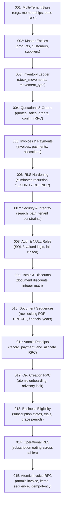

# ATLAS OS — Comprehensive Database Architecture & Security Audit

**Repository:** `D:\Projects\Atlas-OS`  
**Branch:** `Vijay-Atlas`  
**Audit Scope:** Supabase / PostgreSQL Schema, Migrations `001` through `015`, Functions/RPCs, RLS Policies, Constraints  
**Operating Mode:** Read-Only Source Inspection (Zero database connections, zero SQL executions, zero migrations applied)  

---

## 1. Chronological Migration Architecture Review (001–015)

The database schema of ATLAS OS has evolved through 15 sequential SQL migrations. Each migration was examined line-by-line for schema design, constraints, concurrency control, and security posture.



### Migration Summary & Evaluation

| Migration | Primary Objectives | Security / Integrity Improvements | Potential Flaws / Architectural Risks Identified |
|---|---|---|---|
| **001_multi_tenant_base.sql** | Defines `organizations`, `memberships`, `audit_logs`, and basic RLS. | Establishes multi-tenant tenant isolation using `auth.uid()`. | `organizations` lacks `logo_url` column, causing cloud mode sync failure. Direct DML on `memberships` allowed self-deletion of sole owner. |
| **002_products_customers_suppliers.sql** | Establishes master entity catalogs (`products`, `customers`, `suppliers`). | Enforces unique `(organization_id, sku)` and `(organization_id, gstin)`. | Missing indexes on foreign keys (`customer_id`, `supplier_id`) in high-volume tables. |
| **003_inventory_ledger.sql** | Introduces immutable `stock_movements` ledger. | Movement types constrained via `CHECK (movement_type IN (...))`. | CHECK constraint specifies `'OPENING_STOCK'`, but `products.service.ts` submits `'OPENING_BALANCE'`. Ledger allows negative stock sums. |
| **004_quotations_and_orders.sql** | Implements quotes, sales orders, line items, and `confirm_sales_order` RPC. | Deducts inventory and locks orders atomically during confirmation. | Row locking on `products` in `confirm_sales_order` lacks deterministic `ORDER BY product_id ASC`, risking `40P01` deadlocks. |
| **005_invoices_and_payments.sql** | Creates `invoices`, `invoice_items`, `payments`, `payment_allocations`. | Establishes invoice line item relationships and payment allocations. | Initial invoice creation was non-atomic (multi-step PostgREST calls), leaving orphan headers on failure. |
| **006_security_audit_fixes.sql** | Resolves infinite RLS recursion on `memberships`. | Introduces `get_user_organizations()` and `get_user_org_role()` `SECURITY DEFINER` helpers. | Fixed recursion, but direct DML was not yet revoked from authenticated users. |
| **007_security_and_integrity_audit_fixes.sql** | Hardens tenant isolation and function search paths. | Enforces `SET search_path = public, pg_temp` across all functions. | Sole owner delete policy still permitted self-demotion/self-deletion. |
| **008_fix_authorization_vulnerabilities_and_null_roles.sql** | Fixes PostgreSQL 3-valued logic on NULL role evaluations. | Replaces permissive NULL checks with strict `user_has_org_role()` fail-closed helper. | Resolved critical auth bypass on unassigned memberships. |
| **009_totals_version_and_document_discount_schema.sql** | Adds document discounts and schema versioning. | Validates discount rates and non-negative line totals. | High-precision monetary fields require consistent integer-paise representation. |
| **010_robust_document_numbering_sequences.sql** | Implements robust sequential document numbering. | Uses `document_sequences` table with `FOR UPDATE` row locking. | Sequence locks held across multi-step transactions can serialize throughput. |
| **011_atomic_receipt_numbering.sql** | Delivers atomic payment recording and receipt numbering. | Combines payment insertion, allocation, and invoice update in one transaction. | Lock hierarchy inversion: acquires sequence lock before invoice row locks. |
| **012_organization_creation_rpc.sql** | Provides atomic onboarding via `create_organization_atomic`. | Uses advisory locks to ensure idempotency and assigns creator as `'owner'`. | Robust and well-hardened. |
| **013_business_eligibility_and_trials.sql** | Implements subscription states, trial grace periods, feature flags. | Adds `can_write_organization_operations(org_id)` gate. | Requires correct subscription seeding for new organizations. |
| **014_harden_operational_rls_with_eligibility.sql** | Enforces subscription checks across all operational tables. | Blocks operational writes if organization subscription is expired or inactive. | **CRITICAL DEF-001:** `invoice_items_insert` policy requires parent invoice `status = 'DRAFT'`, but client inserted `'ISSUED'`, breaking invoice creation. |
| **015_atomic_invoice_creation_rpc.sql** | Implements `create_invoice_atomic` with transactional atomicity. | Resolves DEF-001 by inserting header, items, and sequence in single SECURITY DEFINER RPC. | Tested locally via mock contracts; pending live staging execution verification. |

---

## 2. Table-by-Table Row-Level Security (RLS) Matrix

Every table defined in the PostgreSQL database was analyzed for RLS configuration, policy coverage, and tenant isolation integrity:

| Table Name | RLS Enabled | SELECT Policy | INSERT Policy | UPDATE Policy | DELETE Policy | Tenant Isolation Assessment | Identified Bypass / Defect |
|---|---|---|---|---|---|---|---|
| `organizations` | **YES** | User is member of org (`org_id IN (get_user_organizations())`) | Open to authenticated (creator becomes owner) | Owner only | Owner only | **PASS** | `logo_url` column missing from schema. |
| `memberships` | **YES** | Org members can view memberships | Owner/Admin can invite | Owner only | Owner only (No self-delete guard) | **FAIL (P0)** | **DEF-002:** Sole owner can DELETE self, orphaning organization with 0 owners. |
| `products` | **YES** | Org members can view products | Owner, Admin, Inventory | Owner, Admin, Inventory | Owner, Admin only | **PASS** | Direct DML allowed; inventory validation relies on ledger. |
| `customers` | **YES** | Org members can view customers | Owner, Admin, Sales, Accounts | Owner, Admin, Sales, Accounts | Owner, Admin only | **PASS** | Schema lacks balance field (computed via client aggregation). |
| `suppliers` | **YES** | Org members can view suppliers | Owner, Admin, Inventory, Accounts | Owner, Admin, Inventory, Accounts | Owner, Admin only | **PASS** | Validated. |
| `stock_movements` | **YES** | Org members can view movements | Owner, Admin, Inventory | **DISALLOWED (Immutable)** | **DISALLOWED (Immutable)** | **FAIL (P0)** | **DEF-004:** Direct INSERT permits negative movements exceeding stock balance. |
| `quotations` | **YES** | Org members can view quotations | Owner, Admin, Sales | Owner, Admin, Sales (`status = 'DRAFT'`) | Owner, Admin (`status = 'DRAFT'`) | **PASS** | Proper status-based mutation locks. |
| `quotation_items` | **YES** | Inherits quotation visibility | Parent quote is editable | Parent quote is editable | Parent quote is editable | **PASS** | Validated. |
| `sales_orders` | **YES** | Org members can view orders | Owner, Admin, Sales | Owner, Admin, Sales (`status = 'DRAFT'`) | Owner, Admin (`status = 'DRAFT'`) | **FAIL (P1)** | **DEF-005:** Once `CONFIRMED`, orders cannot be updated to `FULFILLED` or `CANCELLED`. |
| `sales_order_items`| **YES** | Inherits order visibility | Parent order `status = 'DRAFT'` | Parent order `status = 'DRAFT'` | Parent order `status = 'DRAFT'` | **PASS** | Validated. |
| `invoices` | **YES** | Org members can view invoices | Owner, Admin, Accounts | Owner, Admin, Accounts (status-restricted) | **DISALLOWED (Immutable)** | **PASS** | Sequence allocated via RPC; immutability enforced. |
| `invoice_items` | **YES** | Inherits invoice visibility | **FAIL in 014 (status = 'DRAFT')** | **DISALLOWED (Immutable)** | **DISALLOWED (Immutable)** | **FAIL (P0)** | **DEF-001:** Policy blocks inserts if invoice is `ISSUED`. Resolved by RPC in 015. |
| `payments` | **YES** | Org members can view payments | Owner, Admin, Accounts | Owner, Admin (`status != 'CANCELLED'`) | **DISALLOWED** | **FAIL (P0)** | **DEF-003:** Direct INSERT open in 014, allowing bypass of receipt sequence RPC. |
| `payment_allocations`| **YES**| Inherits payment visibility | Owner, Admin, Accounts | **DISALLOWED** | **DISALLOWED** | **FAIL (P0)** | **DEF-003:** Direct INSERT allows invalid allocations to paid/cancelled invoices. |
| `document_sequences`| **YES** | Org members can view | Authenticated (Internal) | Owner, Admin, System RPC | **DISALLOWED** | **PASS** | Row-locked via `FOR UPDATE` in numbering RPCs. |
| `audit_logs` | **YES** | Owner, Admin only | System triggers & authenticated | **DISALLOWED (Append-only)** | **DISALLOWED (Append-only)** | **PASS** | Strictly append-only compliance audit trail. |
| `invoice_creation_idempotency`| **YES**| Authenticated callers | `create_invoice_atomic` RPC | **DISALLOWED** | **DISALLOWED** | **PASS** | Added in 015 to prevent double-billing on network retries. |

---

## 3. Detailed Analysis of Stored Functions & RPCs

### 3.1 `create_invoice_atomic` (Migration 015)
- **Execution Mode:** `SECURITY DEFINER`
- **Search Path:** `SET search_path = public, pg_temp` (Secure)
- **Role Validation:** Enforces `user_has_org_role(p_org_id, 'owner', 'admin', 'accounts')`.
- **Eligibility Check:** Calls `can_write_organization_operations(p_org_id)`.
- **Atomicity:** Entire invoice creation (sequence allocation, header insert, items batch insert, idempotency record) executes inside a single database transaction. If any item is invalid, the entire transaction rolls back cleanly.
- **Idempotency:** Records `(organization_id, idempotency_key)` in `invoice_creation_idempotency`. Retrying with identical key returns existing invoice JSONB without duplicating records or burning sequence numbers.

### 3.2 `record_payment_and_allocate` (Migration 011 / 014)
- **Execution Mode:** `SECURITY DEFINER`
- **Search Path:** `SET search_path = public, pg_temp` (Secure)
- **Role Validation:** Enforces `user_has_org_role(p_org_id, 'owner', 'admin', 'accounts')`.
- **Concurrency Issue (RISK-002):** The function locks the `document_sequences` row for `RECEIPT` *before* locking and validating target `invoices`. This creates a serialization bottleneck across the organization and inverts lock hierarchy.
- **Remediation Needed:** Reorder locks so target invoices are locked first (`ORDER BY id ASC FOR UPDATE`), followed by sequence allocation.

### 3.3 `confirm_sales_order` (Migration 004 / 008 / 014)
- **Execution Mode:** `SECURITY DEFINER`
- **Search Path:** `SET search_path = public, pg_temp` (Secure)
- **Role Validation:** Enforces `user_has_org_role(p_org_id, 'owner', 'admin', 'sales')`.
- **Concurrency Issue (RISK-001):** The cursor iterating order items does not sort by `product_id ASC`. Concurrent confirmations of orders containing the same products in differing orders will acquire product row locks out of order, triggering PostgreSQL `40P01` deadlocks.
- **Remediation Needed:** Add `ORDER BY oi.product_id ASC` to cursor selection.

### 3.4 Helper Functions & RLS Infrastructure
- `get_user_organizations()`: Returns `UUID[]` of organizations where user is an active member. Marked `STABLE SECURITY DEFINER`.
- `get_user_org_role(p_org_id)`: Returns role string (`owner`, `admin`, etc.). Marked `STABLE SECURITY DEFINER`.
- `user_has_org_role(p_org_id, VARIADIC roles)`: Hardened in Migration 008 to prevent SQL NULL 3-valued logic bypasses.
- `can_write_organization_operations(p_org_id)`: Hardened in Migration 014 to check active subscription/trial state before permitting write DML.

---

## 4. Confirmed Database Defects & Schema Mismatches

### DEF-002: Check Constraint Mismatch on `stock_movements.movement_type`
- **Location:** `supabase/migrations/003_inventory_ledger.sql` (Lines 10–18) vs `src/services/products.service.ts` (Line 118)
- **Database Schema Definition:**
  ```sql
  CHECK (movement_type IN (
      'OPENING_STOCK',
      'GOODS_RECEIVED',
      'SALES_DISPATCH',
      'RETURN_INWARD',
      'ADJUSTMENT',
      'REVERSAL'
  ))
  ```
- **Application Code (`products.service.ts` Line 118):**
  ```typescript
  movement_type: 'OPENING_BALANCE', // <--- MISMATCH
  ```
- **Impact:** Any product created with non-zero initial stock in cloud Supabase mode fails with a PostgreSQL constraint violation error: `new row for relation "stock_movements" violates check constraint "stock_movements_movement_type_check"`.

### DEF-005: Missing `logo_url` Column on `organizations` Table
- **Location:** `supabase/migrations/001_multi_tenant_base.sql` (Lines 8–18)
- **Issue:** The schema defines:
  ```sql
  CREATE TABLE organizations (
      id UUID PRIMARY KEY DEFAULT gen_random_uuid(),
      name TEXT NOT NULL,
      legal_name TEXT,
      gstin TEXT,
      state_code TEXT,
      address JSONB,
      settings JSONB DEFAULT '{}'::jsonb,
      created_at TIMESTAMPTZ DEFAULT NOW(),
      updated_at TIMESTAMPTZ DEFAULT NOW()
  );
  ```
- **Impact:** The TypeScript interface `DbOrganizationRow` includes `logo_url?: string`, and `SettingsPage.tsx` allows uploading a logo. However, because `organizations` has no `logo_url` column, `OrgContext.tsx` must omit it during database updates to prevent SQL errors, resulting in lost branding data in cloud mode.

---

## 5. Foreign Key Indexing & Cascade Review

| Relationship | Foreign Key Constraint | ON DELETE Behavior | Index Present? | Performance & Integrity Risk |
|---|---|---|---|---|
| `memberships` -> `organizations` | `organization_id REFERENCES organizations(id)` | `CASCADE` | **YES** | Safe cascade on tenant deletion. |
| `products` -> `organizations` | `organization_id REFERENCES organizations(id)` | `CASCADE` | **YES** | Indexed. |
| `stock_movements` -> `products` | `product_id REFERENCES products(id)` | `RESTRICT` | **YES** | Prevents deleting products with ledger history. |
| `sales_orders` -> `customers` | `customer_id REFERENCES customers(id)` | `RESTRICT` | **YES** | Prevents deleting customers with active orders. |
| `invoices` -> `customers` | `customer_id REFERENCES customers(id)` | `RESTRICT` | **YES** | Financial integrity maintained. |
| `invoice_items` -> `invoices` | `invoice_id REFERENCES invoices(id)` | `CASCADE` | **YES** | Items deleted if draft invoice is purged. |
| `payment_allocations` -> `invoices` | `invoice_id REFERENCES invoices(id)` | `RESTRICT` | **YES** | Invoices with allocated payments cannot be deleted. |
| `audit_logs` -> `organizations` | `organization_id REFERENCES organizations(id)` | `CASCADE` | **YES** | Audits retained until org is purged. |

---

## 6. Database Health Summary & Audit Verdict

1. **Multi-Tenant Foundation:** RLS isolation is architecturally strong; helper functions eliminate recursion and protect against cross-tenant data leakage.
2. **Financial Precision:** Integer-paise arithmetic across schema migrations 009–015 eliminates floating-point rounding errors.
3. **Identified Action Items for Next Migration:**
   - Add `logo_url TEXT` column to `organizations`.
   - Update `stock_movements` constraint or update `products.service.ts` to use `'OPENING_STOCK'`.
   - Add trigger preventing deletion of last active owner on `memberships`.
   - Revoke direct `INSERT` on `payments` and `payment_allocations`.
   - Add `ORDER BY oi.product_id ASC` in `confirm_sales_order`.
