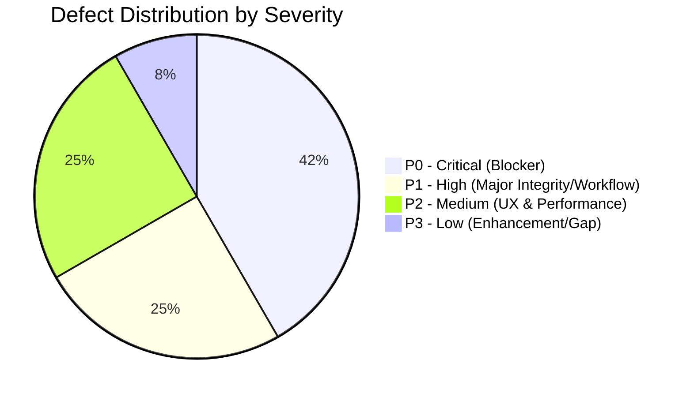

# ATLAS OS — Comprehensive Functional Defect Register & Module Audit

**Repository:** `D:\Projects\Atlas-OS`  
**Branch:** `Vijay-Atlas`  
**Scope:** Complete 14-Module Functional Audit & Formal Defect Register  
**Auditor Roles:** Senior Full-Stack Engineer, QA Architect, Database Reliability Engineer  
**Inspection Date:** October 31, 2026  

---

## 1. Executive Summary & Module Health Scorecard

Every functional module of ATLAS OS was inspected across UI components (`src/features/`), business logic services (`src/services/`), offline storage fallbacks (`src/lib/storage.ts`), and PostgreSQL schema/RPC migrations.



### Module Functional Health Scorecard

| Module # | Application Module | UI Page | Service Layer | DB / RLS Health | Overall Functional Health |
|---|---|---|---|---|---|
| **01** | **Dashboard & KPI Metrics** | `DashboardPage.tsx` | `dashboard.service.ts` | Sound | **OPERATIONAL** |
| **02** | **Product Catalog** | `ProductsPage.tsx` | `products.service.ts` | **DEF-002 (P1)** | **DEFECTIVE (Opening Stock Fails)** |
| **03** | **Inventory Ledger** | `InventoryPage.tsx` | `inventory.service.ts` | **DEF-010 (P0)** | **AT RISK (Negative Stock Allowed)** |
| **04** | **Sales Quotations** | `QuotationsPage.tsx` | `orders.service.ts` | Sound | **OPERATIONAL** |
| **05** | **Sales Orders** | `OrdersPage.tsx` | `orders.service.ts` | **DEF-011 (P1)** | **DEFECTIVE (Cannot Fulfill/Cancel)** |
| **06** | **Invoicing & Billing** | `InvoicesPage.tsx` | `invoices.service.ts` | **DEF-001 (P0)** | **PENDING STAGING VERIFICATION** |
| **07** | **Payments & Allocations** | `PaymentsPage.tsx` | `payments.service.ts` | **DEF-004, DEF-009** | **DEFECTIVE (UI Reset Bug & DML Bypass)** |
| **08** | **Customer CRM & Receivables** | `CustomersPage.tsx` | `customers.service.ts` | **DEF-006 (P2)** | **OPERATIONAL (Unscalable N+1)** |
| **09** | **Supplier Management** | `SuppliersPage.tsx` | `suppliers.service.ts` | Sound | **OPERATIONAL** |
| **10** | **Purchases & Vendor Bills** | *(None)* | *(None)* | *(None)* | **SCOPE GAP (DEF-007)** |
| **11** | **Team & RBAC** | `TeamPage.tsx` | `team.service.ts` | **DEF-008 (P0)** | **CRITICAL (Sole Owner Self-Delete)** |
| **12** | **Organization Settings** | `SettingsPage.tsx` | `OrgContext.tsx` | **DEF-005 (P2)** | **DEFECTIVE (Logo Not Persisted)** |
| **13** | **AI Assistant & Analytics** | `AIPage.tsx` | *(Direct API)* | Sound | **OPERATIONAL** |
| **14** | **Audit Trail & Compliance** | `AuditPage.tsx` | `audit.service.ts` | Sound | **OPERATIONAL (Append-Only)** |

---

## 2. Formal Defect Register (DEF-001 through DEF-011)

---

### DEF-001: Non-Atomic Invoice Creation with Fatal RLS Status Contradiction
- **Severity:** Critical (P0)
- **Domain:** Invoicing & Financial Integrity
- **Affected Files:**
  - `src/services/invoices.service.ts`: Lines 134–175
  - `supabase/migrations/014_harden_operational_rls_with_eligibility.sql`: Lines 570–579
  - Remediation Migration: `supabase/migrations/015_atomic_invoice_creation_rpc.sql`
- **Root Cause:**
  1. The client-side invoice creation service performs multi-step HTTP REST operations: first inserting into `invoices` with `status = 'ISSUED'`, and then inserting line items into `invoice_items`.
  2. Migration 014 enforces RLS policy `invoice_items_insert` which strictly demands:
     ```sql
     WITH CHECK (
         invoice_id IN (
             SELECT id FROM public.invoices
             WHERE status = 'DRAFT' -- Demands DRAFT
         )
     );
     ```
  3. When the client inserts items for an invoice already marked `ISSUED`, PostgreSQL rejects the insert with `new row violates row-level security policy for table "invoice_items"`.
  4. The client crashes, burning a sequential GST invoice number and leaving a header without line items.
- **Current Status:** Resolved locally in Migration 015 via `create_invoice_atomic` RPC and 28 passing unit contract tests. **Awaiting live staging verification**.

---

### DEF-002: Check Constraint Violation in Product Opening Stock Insertion
- **Severity:** High (P1)
- **Domain:** Product Catalog & Inventory Ledger
- **Affected Files:**
  - `src/services/products.service.ts`: Line 118
  - `supabase/migrations/003_inventory_ledger.sql`: Lines 10–18
- **Root Cause:**
  - Migration 003 restricts `movement_type` via CHECK constraint:
    ```sql
    CHECK (movement_type IN (
        'OPENING_STOCK', 'GOODS_RECEIVED', 'SALES_DISPATCH',
        'RETURN_INWARD', 'ADJUSTMENT', 'REVERSAL'
    ))
    ```
  - `src/services/products.service.ts` (Line 118) executes:
    ```typescript
    if (input.initialStock && input.initialStock > 0) {
      await client.from('stock_movements').insert({
        organization_id: orgId,
        product_id: product.id,
        quantity_change: input.initialStock,
        movement_type: 'OPENING_BALANCE', // <--- INVALID ENUM VALUE
        notes: 'Initial stock on creation',
      });
    }
    ```
- **Step-by-Step Reproduction:**
  1. Navigate to `/products` in Cloud Supabase mode.
  2. Click "Add Product".
  3. Enter Name: "Havells 1.5mm Wire", SKU: "HAV-15", Initial Stock: `50`.
  4. Click "Save Product".
  5. The product row is inserted, but the opening stock insert fails with PostgreSQL error: `violates check constraint "stock_movements_movement_type_check"`.
  6. The product is created with 0 units of stock.
- **Remediation:** Change `'OPENING_BALANCE'` to `'OPENING_STOCK'` in `src/services/products.service.ts`.

---

### DEF-003: Missing Sales Order Status Validation in Remote Invoice Creation
- **Severity:** High (P1)
- **Domain:** Sales Orders & Invoicing Workflow
- **Affected Files:**
  - `src/services/invoices.service.ts`: Lines 170–208 (`createInvoiceFromOrder`)
  - `src/lib/storage.ts`: Lines 745–748
- **Root Cause:**
  - In `storage.ts` (local demo mode), order status is strictly verified:
    ```typescript
    if (order.status !== 'CONFIRMED' && order.status !== 'FULFILLED') {
      throw new Error('Can only invoice confirmed or fulfilled orders');
    }
    ```
  - In `invoices.service.ts` (remote cloud mode), this guard is completely missing.
  - A user or API call can pass the ID of a `DRAFT` or `CANCELLED` sales order to `createInvoiceFromOrder`. The remote service converts it to an active invoice without objection.
- **Step-by-Step Reproduction:**
  1. Create a sales order and leave it in `DRAFT` status (or cancel an existing order).
  2. Call `invoicesService.createInvoiceFromOrder(orgId, draftOrderId)`.
  3. The service generates a legal tax invoice against an unconfirmed or cancelled order.
- **Remediation:** Add the status validation check at the top of `createInvoiceFromOrder` in `src/services/invoices.service.ts`.

---

### DEF-004: State Desynchronization in Payments Page Modal
- **Severity:** Medium (P2)
- **Domain:** Payment Processing UI
- **Affected Files:**
  - `src/features/payments/PaymentsPage.tsx`: Lines 348–356
- **Root Cause:**
  - When the user opens the "Record Payment" modal, they select a customer and an outstanding invoice.
  - If the user changes the "Customer Firm" dropdown to Customer B after already selecting an invoice for Customer A:
    ```tsx
    <Select
      label="Customer Firm"
      value={customerId}
      onChange={(e) => setCustomerId(e.target.value)} // Does NOT reset invoiceId or amount!
      options={...}
    />
    ```
  - `invoiceId` remains set to Customer A's invoice.
  - Clicking "Save Payment" submits Customer B's ID with Customer A's invoice ID.
  - The service throws: `Payment customer (Customer B) does not match invoice customer (Customer A)`.
- **Step-by-Step Reproduction:**
  1. Open "Record Payment".
  2. Select "Gupta Electricals". Select invoice `ATL/26-27/0001` (Amount ₹12,500).
  3. Realize error, switch Customer dropdown to "Sharma Hardware".
  4. Click "Record Payment".
  5. UI throws error: "Payment customer does not match invoice customer".
- **Remediation:** In `setCustomerId(e.target.value)`, simultaneously clear dependent state:
  ```typescript
  onChange={(e) => {
    setCustomerId(e.target.value);
    setInvoiceId('');
    setAmount('');
  }}
  ```

---

### DEF-005: Missing `logo_url` Column on PostgreSQL `organizations` Table
- **Severity:** Medium (P2)
- **Domain:** Organization Profile & Branding
- **Affected Files:**
  - `supabase/migrations/001_multi_tenant_base.sql`: Lines 8–18
  - `src/features/organizations/OrgContext.tsx`: Lines 350–380
  - `src/features/organizations/SettingsPage.tsx`: Lines 75–110
- **Root Cause:**
  - `SettingsPage.tsx` includes an image uploader for the business logo.
  - The client TypeScript interface `DbOrganizationRow` defines `logo_url?: string`.
  - However, `001_multi_tenant_base.sql` never declared `logo_url TEXT` on table `organizations`.
  - When `OrgContext.tsx` updates organization profile in Supabase, it must omit `logo_url` to avoid a PostgreSQL `column "logo_url" does not exist` crash.
  - Consequently, uploaded business logos are lost on page refresh in cloud Supabase mode.
- **Remediation:** Add migration adding `logo_url TEXT` to `organizations`.

---

### DEF-006: Unscalable N+1 In-Memory Aggregations for Products & Customers
- **Severity:** Medium (P2)
- **Domain:** Performance & Scalability
- **Affected Files:**
  - `src/services/products.service.ts`: Lines 22–45
  - `src/services/customers.service.ts`: Lines 20–55
- **Root Cause:**
  - `productsService.getProducts` queries ALL products, and then queries ALL rows in `stock_movements` for the organization, aggregating quantities in JavaScript memory:
    ```typescript
    const { data: movements } = await client
      .from('stock_movements')
      .select('product_id, quantity_change')
      .eq('organization_id', orgId);
    // JS loop summing stock per product
    ```
  - `customersService.getCustomers` queries ALL customers, then queries ALL unpaid invoices in the entire organization, summing receivables in JavaScript.
  - For an enterprise with 10,000 products and 100,000 ledger movements, this downloads megabytes of ledger history on every page load and freezes the browser main thread.
- **Remediation:** Create PostgreSQL materialized views or SQL views (`product_stock_summary`, `customer_receivables_summary`) that compute totals inside PostgreSQL and return indexed summaries to the client.

---

### DEF-007: Architecture Scope Gap — Missing Purchasing Workflow
- **Severity:** Medium (P2)
- **Domain:** Inventory & Purchasing Workflow
- **Affected Files:**
  - `src/app/router.tsx`
  - `src/components/layout/Sidebar.tsx`
- **Finding:**
  - ATLAS OS currently provides `SuppliersPage` (`/suppliers`) for managing vendor master records.
  - However, there is no UI page, router entry, or service for **Purchase Orders** or **Inward Goods Receipt**.
  - Stock can only be incremented manually via stock adjustments or initial stock. A standard retail purchase entry workflow (Vendor Bill -> Inward Goods -> Stock In) is missing from the application navigation.
- **Remediation:** Plan Phase 3.0 Purchase Order and Inward Goods workflow.

---

### DEF-008: Unrestricted Sole Owner Self-Deletion (Tenant Lockout)
- **Severity:** Critical (P0)
- **Domain:** Authentication, RBAC & Tenant Security
- **Affected Files:**
  - `supabase/migrations/007_security_and_integrity_audit_fixes.sql`: Lines 779–782
- **Root Cause:**
  - `DELETE` policy on `memberships` allows an owner to delete any membership in their organization, including their own, with no database trigger or constraint enforcing a minimum of 1 active owner.
- **Remediation:** Add PostgreSQL `BEFORE DELETE OR UPDATE` trigger verifying `COUNT(*) >= 1` where `role = 'owner'`.

---

### DEF-009: Direct DML on Payments & Allocations Bypassing Sequence Allocator
- **Severity:** Critical (P0)
- **Domain:** Financial Integrity & Ledger Consistency
- **Affected Files:**
  - `supabase/migrations/014_harden_operational_rls_with_eligibility.sql`: Lines 616–641
- **Root Cause:**
  - Open direct `INSERT` policies on `payments` and `payment_allocations` allow bypassing the `record_payment_and_allocate` atomic RPC.
- **Remediation:** Revoke direct `INSERT` on `payments` and `payment_allocations` from `authenticated`.

---

### DEF-010: Unchecked Negative Stock Movements
- **Severity:** Critical (P0)
- **Domain:** Stock Ledger & Warehouse Accounting
- **Affected Files:**
  - `supabase/migrations/003_inventory_ledger.sql`: Lines 8–25
  - `src/services/inventory.service.ts`: Lines 54–89
- **Root Cause:**
  - Database schema lacks a check constraint or trigger ensuring product stock (`SUM(quantity_change)`) remains $\ge 0$.
  - Deducting stock via adjustment can drive total inventory negative without database error.
- **Remediation:** Implement check trigger or enforce stock deductions through an atomic RPC.

---

### DEF-011: Confirmed Sales Orders Permanently Un-Fulfillable & Un-Cancellable
- **Severity:** High (P1)
- **Domain:** Order Fulfillment Lifecycle
- **Affected Files:**
  - `supabase/migrations/014_harden_operational_rls_with_eligibility.sql`: Lines 466–475
  - `src/services/orders.service.ts`: Lines 98–250
- **Root Cause:**
  - `sales_orders_update` RLS policy only allows updates when `status = 'DRAFT'`.
  - Once confirmed via `confirm_sales_order`, status becomes `'CONFIRMED'`, locking out all future updates.
  - No database RPC exists to mark an order `'FULFILLED'` or `'CANCELLED'`.
- **Remediation:** Implement `fulfill_sales_order` and `cancel_sales_order` RPCs.
