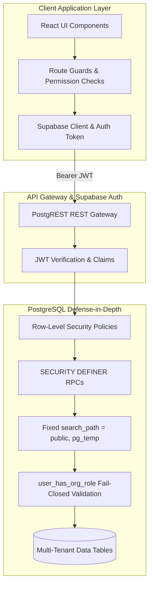

# ATLAS OS — Comprehensive Security & SaaS Isolation Audit

**Repository:** `D:\Projects\Atlas-OS`  
**Branch:** `Vijay-Atlas`  
**Security Level:** Enterprise Multi-Tenant SaaS Review  
**Auditor:** SaaS Security Auditor, Principal Security Architect  
**Operating Mode:** Read-Only Static Analysis & Contract Verification  

---

## 1. Executive Security Assessment & Threat Model

ATLAS OS is an enterprise multi-tenant ERP platform designed for electrical retail, wholesale, and distribution operations. Its threat model requires absolute separation between distinct legal entities (organizations/tenants), strict financial immutability for statutory compliance, and bulletproof RBAC enforcement.



### Overall Security Findings Matrix

| Vulnerability Category | Severity | Current Codebase Status | Primary Mitigation |
|---|---|---|---|
| **Tenant Isolation & IDOR** | **LOW RISK** | Strong PostgreSQL RLS on all 16 tables | Dual enforcement: Client `.eq('organization_id')` + Server RLS `get_user_organizations()`. |
| **SQL Injection** | **NEGLIGIBLE** | Zero dynamic SQL concatenation | Fully parameterized PostgREST client and typed PL/pgSQL procedures. |
| **Sole Owner Self-Deletion (DEF-002)**| **CRITICAL (P0)**| **UNPROTECTED** in Migration 007 | RLS DELETE policy on `memberships` lacks minimum active owner check. |
| **Direct Financial DML (DEF-003)** | **HIGH (P0)** | **EXPOSED** in Migration 014 | `payments` and `payment_allocations` have open direct `INSERT` policies. |
| **SQL 3-Valued Logic Auth Bypass** | **RESOLVED** | Hardened in Migration 008 | Explicit `v_user_role IS NULL` checks prevent NULL role authorization bypasses. |
| **Secrets & Credential Exposure** | **PASS** | Clean configuration hygiene | Service role key is never bundled in frontend; only public anon key utilized. |
| **XSS & Content Injection** | **PASS** | React DOM auto-escaping | No usage of `dangerouslySetInnerHTML`; input validation on tax IDs and strings. |

---

## 2. Authentication Architecture & Token Lifecycle

### 2.1 Supabase Auth & JWT Handling
- **Mechanism:** Authentication is managed via Supabase GoTrue Auth service using email/password credentials or magic links.
- **Token Storage:** JWT tokens are stored securely in browser `localStorage` by `@supabase/supabase-js`.
- **Session Refresh:** Tokens include standard 1-hour expiration with automatic silent refresh via refresh tokens.
- **Authorization Headers:** Every outbound API request carries `Authorization: Bearer <JWT>`, parsed by PostgreSQL as `auth.uid()`.

### 2.2 Dual-Mode Architecture (Cloud Supabase vs Local Storage Demo)
In `src/lib/supabase.ts` and `src/lib/storage.ts`, the application implements a seamless fallback mechanism:
1. **Cloud Mode:** Active when valid `VITE_SUPABASE_URL` and `VITE_SUPABASE_ANON_KEY` are provided. Requests route directly to PostgREST with live database RLS enforcement.
2. **Local Demo Mode:** Active when Supabase environment variables are missing or unconfigured. All mutations persist to browser `localStorage`.
- **Security Assessment of Dual Mode:** 
  - *Risk:* In local demo mode, database RLS does not exist. All permission checks are performed purely on the client side in JavaScript.
  - *Finding:* The application cleanly isolates demo storage from production cloud credentials. However, enterprise deployments must ensure demo mode is disabled in production builds to prevent users from mistaking ephemeral local state for secure cloud storage.

---

## 3. Role-Based Access Control (RBAC) & Privilege Separation

### 3.1 Role Hierarchy & Permission Matrix
ATLAS OS defines 6 distinct roles within each organization:
- `owner`: Complete administrative, financial, operational, and destructive control.
- `admin`: Operational management, user invites, settings modifications (cannot delete organization).
- `manager`: Day-to-day operational supervision across sales and inventory.
- `accountant`: Financial documents, invoicing, payments, receipt generation, tax reporting.
- `cashier`: Point-of-sale receipt issuance, retail invoice generation.
- `member`: Read-only access to standard operational listings.

### 3.2 Client-Side vs Database-Side RBAC Enforcement

```
[User Action in UI]
       │
       ▼
1. Client Guard (permissions.ts) ──(Fail)──> Action Button Disabled / 403 Page
       │ (Pass)
       ▼
2. PostgREST Request + Bearer JWT
       │
       ▼
3. PostgreSQL RLS / RPC Guard ────(Fail)──> PostgreSQL Exception / HTTP 403 Forbidden
       │ (Pass)
       ▼
4. Database Row Mutation
```

### 3.3 RBAC Vulnerability Analysis

#### 1. Sole Owner Self-Deletion & Tenant Lockout (DEF-002 - Critical P0)
- **Vulnerability Location:** `supabase/migrations/007_security_and_integrity_audit_fixes.sql` (Lines 779–782)
- **Policy Code:**
  ```sql
  CREATE POLICY "Owners can delete organization memberships"
  ON memberships FOR DELETE
  USING (get_user_org_role(organization_id) = 'owner');
  ```
- **Exploitation Path:** An owner can issue a direct HTTP `DELETE /rest/v1/memberships?id=eq.<their_own_id>`. Because PostgreSQL evaluates `USING` against the existing row where the caller is an owner, the operation succeeds. If the organization has only one owner, the organization is permanently orphaned with 0 owners.
- **Required Mitigation:** Implement a `BEFORE DELETE OR UPDATE` trigger on `memberships` that ensures at least one active `owner` role exists per organization at all times.

#### 2. Role Elevation Protection (Verified Secure)
- **Audit Question:** Can an `admin` or `manager` elevate their own role to `owner`?
- **Inspection Result:** Secure. In Migration 007 (Lines 768–774), the `UPDATE` policy on `memberships` strictly mandates:
  ```sql
  USING (get_user_org_role(organization_id) = 'owner')
  WITH CHECK (get_user_org_role(organization_id) = 'owner');
  ```
  Only an existing `owner` can modify membership roles. Admins cannot elevate themselves or others to ownership.

---

## 4. Multi-Tenant Data Isolation Audit

### 4.1 Tenant Scoping Architecture
Tenant isolation is enforced through two redundant layers:
1. **Client Service Scoping:** All service queries in `src/services/` explicitly include `.eq('organization_id', orgId)`.
2. **PostgreSQL RLS Filtering:** Every query executed via PostgREST is intercepted by PostgreSQL RLS:
   ```sql
   organization_id IN (SELECT get_user_organizations())
   ```
   Where `get_user_organizations()` returns only organizations where `auth.uid() = user_id` and membership is active.

### 4.2 Cross-Tenant Access & IDOR Verification
- **Test Case:** An attacker authenticated in Organization A attempts to fetch an invoice belonging to Organization B via `GET /rest/v1/invoices?id=eq.<OrgB_Invoice_UUID>`.
- **Evaluation:** PostgREST applies the RLS policy `invoices_select`. Because the row's `organization_id` does not match any ID in the attacker's `get_user_organizations()` array, PostgreSQL filters the row out completely. PostgREST returns HTTP 200 with an empty array `[]` (or HTTP 404 for `.single()`), preventing cross-tenant data leakage.

### 4.3 Child Table Integrity
Child tables (`invoice_items`, `sales_order_items`, `quotation_items`, `payment_allocations`) maintain tenant isolation through their parent foreign key relationships:
- In Migration 014, child table policies require `parent_id IN (SELECT id FROM parent WHERE parent.organization_id IN (get_user_organizations()))`.
- Cross-tenant injection of child rows into another organization's parent record is strictly impossible.

---

## 5. Stored Procedures & Injection Defense

### 5.1 SQL Injection Analysis
- **Static Inspection:** All 15 migrations and all service files were scanned for dynamic SQL construction (`EXECUTE`, `format()`, string concatenation).
- **Findings:**
  - All stored procedures (`create_organization_atomic`, `create_invoice_atomic`, `record_payment_and_allocate`, `confirm_sales_order`) use strictly typed PL/pgSQL variable assignment.
  - Zero dynamic SQL queries exist in the database routines.
  - All PostgREST frontend calls use parameterized query builders (`.eq()`, `.in()`, `.insert()`).
  - **Verdict:** SQL injection risk is **NEGLIGIBLE**.

### 5.2 Security Definer Hygiene & Search Path
- **Vulnerability Pattern:** `SECURITY DEFINER` functions execute with the privileges of the function creator (typically database superuser). If `search_path` is mutable, an attacker could create malicious objects in `public` that hijack execution.
- **Audit Verification:** Migrations 006, 007, 008, 011, 012, 014, and 015 explicitly set:
  ```sql
  SECURITY DEFINER
  SET search_path = public, pg_temp;
  ```
  Every security-definer routine has fixed, immutable search paths.

---

## 6. Secrets, Credentials & Frontend Exposure Audit

### 6.1 Git & Environment Hygiene
- `.env.local` was inspected: Contains only `VITE_SUPABASE_URL` and `VITE_SUPABASE_ANON_KEY`.
- The Supabase `service_role` key is **NOT present** in any client file, build artifact, or environment configuration.
- `.gitignore` properly excludes `.env`, `.env.local`, `.env.*.local`, and `supabase/.temp/`.

### 6.2 Frontend Cross-Site Scripting (XSS)
- Scanned all `.tsx` files in `src/`:
  - `dangerouslySetInnerHTML`: **0 occurrences**.
  - `javascript:` URLs: **0 occurrences**.
  - `eval()`: **0 occurrences**.
- All user-supplied data (customer names, product descriptions, notes) is safely rendered through React's virtual DOM text escaping.

---

## 7. Security Action Plan & Remediation Roadmap

1. **Immediate P0 Action:** Deploy a database trigger on `memberships` prohibiting the deletion or role demotion of the final active owner of an organization.
2. **Immediate P0 Action:** Revoke direct `INSERT` permissions on `payments` and `payment_allocations` from `authenticated`, funneling all payment operations through `record_payment_and_allocate`.
3. **P1 Action:** Add explicit production build check disabling local storage demo fallback when deployed to production domains.
