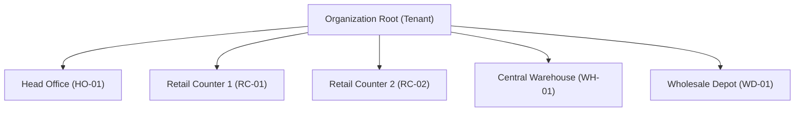
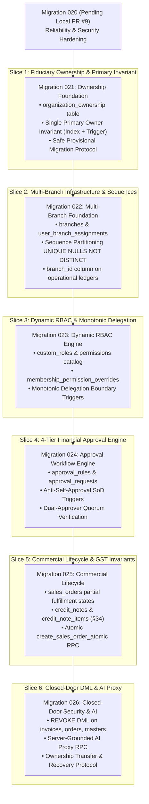

# ATLAS OS — ENTERPRISE ARCHITECTURE RECONCILIATION & IMPLEMENTATION GAP ASSESSMENT
## Comprehensive Forensic Architecture Audit, Document Reconciliation, Target Specification, and Phased Engineering Roadmap

**Platform:** ATLAS OS Multi-Tenant Enterprise SaaS ERP Platform  
**Target Market:** Electrical Retailers, Wholesalers, Distributors, and Hardware Businesses (India)  
**Classification:** Definitive Architecture Authority & Implementation Baseline  
**Date of Assessment:** 2026-11-01  
**Assessment Authority:** Principal Enterprise Software Architect, PostgreSQL Security Architect, and Indian GST Financial Systems Architect  
**Repository Working Tree:** `D:\Projects\Atlas-OS` | **Branch:** `Vijay-Atlas`  
**Committed Baseline (HEAD):** `5b1549f2bcd03f1d8ed3f72f5b7cc41872021193` ("Merge pull request #8 from YenugantiVijay/Vijay-Atlas")  
**Latest Committed Migration:** `supabase/migrations/019_atomic_organization_and_eligibility.sql`  
**Pending Uncommitted Local Work (PR #9):** `supabase/migrations/020_reliability_and_security_hardening.sql` + Frontend Hardening & Tests  
**Assessment Mode:** STRICTLY LOCAL & READ-ONLY ASSESSMENT (No database connection, no remote push, no migrations executed)

---

## 1. Executive Architecture Summary & Baseline Reality

ATLAS OS is an enterprise-grade, multi-tenant Software-as-a-Service (SaaS) Enterprise Resource Planning (ERP) platform architected specifically for the electrical distribution, wholesale, and retail trade in India. 

The electrical vertical in India is characterized by acute operational, physical, and statutory realities:
1. **Diverse Product & Packaging Topologies:** High-velocity retail counter goods (modular switches, LED fixtures, conduit fittings), high-value copper/aluminum cables sold in standard 90m/100m coils or cut-to-length meters subject to daily London Metal Exchange (LME) copper price volatility, heavy switchgear, motor starters, distribution boards (DBs), and custom industrial panel assemblies.
2. **Multi-Tier Commercial & Credit Structures:** Cash-and-carry retail counter sales, trade-discounted contractor accounts, wholesale volume-tier slabs, and unsecured credit terms ranging from 7 to 90 days.
3. **Strict Indian Statutory GST Compliance:** Consecutive serial numbering unique per financial year (CGST Rule 46), post-issuance commercial and statutory adjustments (CGST Rule 53 and Section 34 CGST Act), mandatory statutory record retention (CGST Section 36), and exact integer-paisa CGST/SGST odd-tax balancing.
4. **Physical Branch Topologies:** Businesses operating a primary registered office or showroom alongside separate retail trade counters, wholesale godowns, and centralized regional warehouses under a single legal entity (GSTIN) or across multi-state registrations.

Between Phase 5.0A and Phase 5.0C.3, an extensive architectural specification was developed across more than 30 markdown documents in `docs/`. A forensic comparison of that documentation against the actual codebase reveals **extraordinary divergences between documented designs and physical implementation**:

### 1.1 The Baseline Evidence Reality
- **Committed Baseline vs Local Working Tree:** The repository HEAD commit is `5b1549f2bcd03f1d8ed3f72f5b7cc41872021193` (PR #8 merge), which established migrations up to `019_atomic_organization_and_eligibility.sql`. Migration `020_reliability_and_security_hardening.sql`, along with its associated UI stability fixes in `OrgContext.tsx` and `AppLayout.tsx`, exists exclusively as **uncommitted local working tree modifications** for PR #9.
- **Enterprise Governance is 100% Design-Only:** Core enterprise features documented across Phase 5—specifically **Decoupled Fiduciary Ownership (`organization_ownership`)**, **Multi-Branch Hierarchy (`branches`, `user_branch_assignments`)**, **Controlled Custom Roles (`custom_roles`, `membership_permission_overrides`)**, and the **4-Tier Financial Approval Engine (`approval_rules`, `approval_requests`)**—**DO NOT EXIST** in the codebase. Zero database tables, zero database triggers, zero TypeScript services, and zero UI components have been implemented for these domains.
- **The "Migration 015" Fallacy:** Phase 5.0C documents repeatedly reference "Migration 015" as the future enterprise migration introducing ownership, branches, and approvals. In physical reality, `supabase/migrations/015_atomic_invoice_creation_rpc.sql` was authored and merged to resolve DEF-001/DEF-003 (atomic parent-first invoice creation with product row-locking), followed by Migrations `016` through `019` (committed) and `020` (pending). Enterprise architecture must be re-anchored to **Migration 021+**.
- **Closed-Door DML Claim vs Physical Reality:** Phase 5.0C documents claim that direct REST DML has been revoked on all operational tables. In physical reality, direct client DML has been revoked **ONLY on `payments` and `payment_allocations`** (Migration 017). Direct `INSERT`, `UPDATE`, and `DELETE` remain permitted under RLS for authenticated users on `invoices`, `sales_orders`, `quotations`, `products`, `customers`, `suppliers`, and `memberships`.
- **Sole-Owner Vulnerability:** The database permits any user holding `role = 'owner'` in `public.memberships` to update, demote, or delete any other membership in their organization. The guard preventing demotion or deactivation of the sole active owner exists exclusively in frontend client-side React code (`src/features/team/TeamPage.tsx:94-99, 124-129`), creating an immediate hostile takeover or orphan vulnerability via direct PostgREST calls.

---

## 2. Canonical Architecture Principles

The target ATLAS OS platform is governed by eight non-negotiable architectural tenets:

```
┌─────────────────────────────────────────────────────────────────────────────────────────────────────────┐
│                                    CANONICAL ARCHITECTURE PRINCIPLES                                    │
├────┬─────────────────────────────┬──────────────────────────────────────────────────────────────────────┤
│ #  │ Principle                   │ Architectural Mandate                                                │
├────┼─────────────────────────────┼──────────────────────────────────────────────────────────────────────┤
│ 01 │ Zero-Trust Multi-Tenancy    │ Database-enforced tenant isolation via PostgreSQL RLS on every table.│
│    │                             │ Application code cannot bypass tenant boundaries.                    │
├────┼─────────────────────────────┼──────────────────────────────────────────────────────────────────────┤
│ 02 │ Ownership / Role Decoupling │ Fiduciary corporate ownership (`organization_ownership`) is strictly │
│    │ (DEC-01, DEC-11)            │ decoupled from operational employee roles (`memberships.role`).      │
├────┼─────────────────────────────┼──────────────────────────────────────────────────────────────────────┤
│ 03 │ Exactly-One Primary Owner   │ Every active organization enforces exactly one active Primary Owner  │
│    │ Invariant                   │ via partial unique index + commit-time deferred constraint trigger.  │
├────┼─────────────────────────────┼──────────────────────────────────────────────────────────────────────┤
│ 04 │ Server-Authoritative RBAC   │ Frontend permissions are UX aids only. PostgreSQL RLS and RPCs are   │
│    │ (DEC-14)                    │ the sole authorities; custom roles enforce monotonic delegation.     │
├────┼─────────────────────────────┼──────────────────────────────────────────────────────────────────────┤
│ 05 │ Tenant-First Branch Scoping │ Branch scoping is strictly secondary:                                │
│    │ (PO-07)                     │ `WHERE organization_id = tenant_id AND (branch_id IN (assigned))`.   │
├────┼─────────────────────────────┼──────────────────────────────────────────────────────────────────────┤
│ 06 │ Zero Silent Approval        │ 72-hour TTL expiration transitions requests to `EXPIRED`. It NEVER   │
│    │ (PO-01, PO-02, DEC-13)      │ auto-approves. Separation of Duties strictly blocks self-approval.   │
├────┼─────────────────────────────┼──────────────────────────────────────────────────────────────────────┤
│ 07 │ Statutory Immutability      │ Issued tax invoices cannot be updated, deleted, or reverted to draft.│
│    │ (CGST Act §34, §36)         │ Adjustments mandate official GST Credit Notes. 72-month retention.   │
├────┼─────────────────────────────┼──────────────────────────────────────────────────────────────────────┤
│ 08 │ Deterministic Concurrency   │ 5-Level strict lock acquisition hierarchy with ascending primary-key │
│    │ Lock Discipline             │ ordering (`ORDER BY id ASC FOR UPDATE`) to prevent deadlocks.        │
└────┴─────────────────────────────┴──────────────────────────────────────────────────────────────────────┘
```

---

## 3. Authoritative Document Hierarchy

To resolve semantic drift, conflicting specifications, and intermediate working notes across the 30+ documentation files, the following document precedence hierarchy is formally established. In any case of conflict, higher-tier documents strictly supersede lower-tier documents:

```
                  ┌────────────────────────────────────────────────────────┐
                  │ TIER 1: STATUTORY & LEGAL COMPLIANCE                   │
                  │ • Central Goods & Services Tax (CGST) Act & Rules 2017 │
                  │ • Digital Personal Data Protection (DPDP) Act 2023     │
                  └───────────────────────────┬────────────────────────────┘
                                              │
                                              ▼
                  ┌────────────────────────────────────────────────────────┐
                  │ TIER 2: FROZEN PRODUCT OWNER DECISIONS                 │
                  │ • docs/PHASE_5_0B_2_APPROVED_PRODUCT_DECISIONS.md      │
                  │   (PO-01 to PO-08, DEC-01 to DEC-14 Frozen Baseline)   │
                  └───────────────────────────┬────────────────────────────┘
                                              │
                                              ▼
                  ┌────────────────────────────────────────────────────────┐
                  │ TIER 3: CONSOLIDATED RECONCILIATION MASTER (THIS DOC)  │
                  │ • docs/ATLAS_OS_ENTERPRISE_ARCHITECTURE_RECONCILIATION.md│
                  └───────────────────────────┬────────────────────────────┘
                                              │
                                              ▼
                  ┌────────────────────────────────────────────────────────┐
                  │ TIER 4: PHASE 5.0C MASTER SPECIFICATIONS               │
                  │ • PHASE_5_0C_MASTER_ARCHITECTURE_SPECIFICATION.md      │
                  │ • PHASE_5_0C_SECURITY_AND_DATABASE_CONTROL_CATALOG.md  │
                  │ • PHASE_5_0C_STATE_MACHINE_AND_TRANSACTION_CATALOG.md  │
                  └───────────────────────────┬────────────────────────────┘
                                              │
                                              ▼
                  ┌────────────────────────────────────────────────────────┐
                  │ TIER 5: DOMAIN-SPECIFIC WORKSTREAM BLUEPRINTS          │
                  │ • PHASE_5_0B_OWNERSHIP_GOVERNANCE_DESIGN.md            │
                  │ • PHASE_5_0B_RBAC_PERMISSION_ARCHITECTURE.md           │
                  │ • PHASE_5_0B_MULTI_BRANCH_GOVERNANCE_DESIGN.md         │
                  │ • PHASE_5_0B_APPROVAL_WORKFLOW_ARCHITECTURE.md         │
                  └───────────────────────────┬────────────────────────────┘
                                              │
                                              ▼
                  ┌────────────────────────────────────────────────────────┐
                  │ TIER 6: HISTORICAL AUDITS & INTERMEDIATE MEMOS         │
                  │ • PHASE_5_0C_1_*, PHASE_5_0C_2_*, PHASE_5_0C_3_*       │
                  │ • docs/audits/*                                        │
                  └────────────────────────────────────────────────────────┘
```

---

## 4. Documentation Contradiction Register

A forensic audit of the Phase 5 documentation catalog identified twelve major contradictions, cross-document semantic collisions, and historical fallacies:

```
┌─────────────────────────────────────────────────────────────────────────────────────────────────────────────────────────┐
│                                       CROSS-DOCUMENT CONTRADICTION & COLLISION REGISTER                                 │
├────┬──────────┬─────────────────────────────┬────────────────────────────────┬──────────────────────────────────────────┤
│ ID │ Severity │ Conflicting Documents       │ Nature of Contradiction        │ Authoritative Resolution                 │
├────┼──────────┼─────────────────────────────┼────────────────────────────────┼──────────────────────────────────────────┤
│ C1 │ CRITICAL │ 5.0B.2 Approved Decisions   │ Collision on PO-05 to PO-08:   │ 5.0B.2 is authoritative:                 │
│    │          │ vs 5.0C.3 Consistency Sec 3 │ 5.0B.2 assigns PO-05 = Alerts, │ PO-01: Financial Approval Tiers          │
│    │          │                             │ PO-06 = Sole-Owner KYC,        │ PO-02: Approval Expiry (72h TTL)         │
│    │          │                             │ PO-07 = Central Cust Master,   │ PO-03: Recovery Cooling (14d Time-Lock)  │
│    │          │                             │ PO-08 = Deprovision Retention. │ PO-04: Co-Owner Quorum (>66%)            │
│    │          │                             │ 5.0C.3 re-mapped PO-05=Deprov, │ PO-05: Recovery Alert Channels (Email/SMS│
│    │          │                             │ PO-06=Branch, PO-07=CustomRole,│ PO-06: Sole-Owner KYC Compliance Gate    │
│    │          │                             │ PO-08=Audit Retention!         │ PO-07: Branch Central Customer Master    │
│    │          │                             │                                │ PO-08: Policy-Based Deprov Retention     │
├────┼──────────┼─────────────────────────────┼────────────────────────────────┼──────────────────────────────────────────┤
│ C2 │ CRITICAL │ 5.0B ADR (DEC-01 to DEC-14) │ Re-assignment of DEC Numbers:  │ 5.0B ADR is authoritative:               │
│    │          │ vs 5.0C.3 Consistency Sec 4 │ 5.0B: DEC-11=Single Role,      │ DEC-01: Multiple Owners (1 Primary + Co) │
│    │          │                             │ DEC-12=Recovery Protocol,      │ DEC-AUTH: Primary Reserved Powers        │
│    │          │                             │ DEC-13=Critical Approvals,     │ DEC-11: Single Operational Role          │
│    │          │                             │ DEC-14=Custom Roles.           │ DEC-12: Verified Owner Recovery          │
│    │          │                             │ 5.0C.3: DEC-11=Lock Hierarchy, │ DEC-13: Configurable Approvals & SoD     │
│    │          │                             │ DEC-12=Seq Numbering,          │ DEC-14: Controlled Custom Roles          │
│    │          │                             │ DEC-13=Zero Client Trust,      │ Technical locks & sequences are mapped to│
│    │          │                             │ DEC-14=Eligibility RLS!        │ CONC-01 to CONC-05 and NUM-01 to NUM-04. │
├────┼──────────┼─────────────────────────────┼────────────────────────────────┼──────────────────────────────────────────┤
│ C3 │ CRITICAL │ 5.0C Master Spec & Rollout  │ "Migration 015" Fallacy:       │ The enterprise schema migration cannot be│
│    │          │ vs Actual Repository Schema │ Spec assumed Migration 015 was │ Migration 015. Migrations 015-020 are    │
│    │          │                             │ the future enterprise schema.  │ already committed or authored for atomic │
│    │          │                             │ Actual Mig 015 was implemented │ invoicing & onboarding. Enterprise work  │
│    │          │                             │ for atomic invoicing (DEF-001)!│ is re-anchored to MIGRATION 021+.        │
├────┼──────────┼─────────────────────────────┼────────────────────────────────┼──────────────────────────────────────────┤
│ C4 │ HIGH     │ 5.0C Master Spec Sec 2.1    │ Closed-Door Privilege Reality: │ Closed-Door DML is a TARGET REQUIREMENT  │
│    │          │ vs Local Migrations 001–020 │ Spec claims direct DML is      │ for Migration 021+, NOT an existing state│
│    │          │                             │ revoked on all operational     │ Currently only `payments` and allocs     │
│    │          │                             │ tables. Physical schema only   │ have direct DML revoked (Migration 017). │
│    │          │                             │ revoked DML on `payments`(017).│ Open tables require phased transition.   │
├────┼──────────┼─────────────────────────────┼────────────────────────────────┼──────────────────────────────────────────┤
│ C5 │ HIGH     │ 5.0C State Machine Sec 2.2  │ Order Cancellation Conflict:   │ Partially fulfilled orders CANNOT be     │
│    │          │ vs 5.0C Master Spec Sec 7.2 │ State Machine allows           │ cancelled. Remaining unfulfilled lines   │
│    │          │                             │ `PARTIALLY_FULFILLED` to trans │ transition to `CLOSED_PARTIALLY_FULFILLED│
│    │          │                             │ to `CANCELLED`. Master Spec    │ Issued tax invoices require official     │
│    │          │                             │ says issued items immutable!   │ Section 34 Credit Notes.                 │
├────┼──────────┼─────────────────────────────┼────────────────────────────────┼──────────────────────────────────────────┤
│ C6 │ HIGH     │ 5.0C Master Spec Sec 5.2    │ Sequence Partition Constraint: │ Migration 010 schema only supports       │
│    │          │ vs Migration 010 Schema     │ Spec mandates `UNIQUE NULLS NOT│ single central sequence per org. Multi-  │
│    │          │                             │ DISTINCT (org, type, branch)`. │ branch sequence partitioning requires    │
│    │          │                             │ Mig 010 only has `(org, type)`.│ altering table in Migration 022+.        │
├────┼──────────┼─────────────────────────────┼────────────────────────────────┼──────────────────────────────────────────┤
│ C7 │ MEDIUM   │ Early Drafts (Phase 4.11)   │ PMLA 2002 Statutory Overreach: │ Formally retracted. ATLAS OS is an ERP   │
│    │          │ vs 5.0C.3 Legal Consistency │ Claimed PMLA §12 mandated 5-yr │ vendor, not a reporting entity under     │
│    │          │                             │ customer identity retention.   │ PMLA §2(1)(wa). Retention is governed by │
│    │          │                             │                                │ CGST Act §36 (72 mo) and DPDP Act 2023.  │
├────┼──────────┼─────────────────────────────┼────────────────────────────────┼──────────────────────────────────────────┤
│ C8 │ MEDIUM   │ 5.0B Workstream B           │ System Role Naming Drift:      │ Standardize on snake_case system roles:  │
│    │          │ vs src/types/index.ts       │ Doc: `system_admin`, `sales`   │ `admin`, `sales`, `inventory`,           │
│    │          │                             │ Code: `owner`, `admin`, `sales`│ `accounts`, `viewer`.                    │
│    │          │                             │ `inventory`, `accounts`, `view`│ Deprecate operational `owner` role.      │
├────┼──────────┼─────────────────────────────┼────────────────────────────────┼──────────────────────────────────────────┤
│ C9 │ MEDIUM   │ 5.0C Concurrency Sec 2      │ Level 2 Intra-Tier Deadlock:   │ Level 2 partitioned:                     │
│    │          │ vs 5.0C State Machine Sec 3 │ Level 2 lumps `customers` and  │ Level 2.1: `customers FOR UPDATE`        │
│    │          │                             │ `products` without sequence.   │ Level 2.2: `products ORDER BY id ASC`    │
├────┼──────────┼─────────────────────────────┼────────────────────────────────┼──────────────────────────────────────────┤
│ C10│ LOW      │ 5.0B.2 Approved Decisions   │ Deprovisioning Log Retention:  │ Resolved: Forensic deprovisioning audit  │
│    │          │ vs PHASE_5_0C_3 (PO-08)     │ PO-08 in 5.0B.2 specifies 1-yr │ logs are retained for 365 days in DB,    │
│    │          │                             │ active in DB, then archive.    │ then moved to cold storage archive.      │
├────┼──────────┼─────────────────────────────┼────────────────────────────────┼──────────────────────────────────────────┤
│ C11│ LOW      │ 5.0B Approval Architecture  │ Currency Ceiling Parameter:    │ Multi-currency converted to base tenant  │
│    │          │ vs 5.0B.2 Decision PO-01    │ Multi-currency vs INR defaults │ currency (INR default) before threshold  │
│    │          │                             │ for ₹25K, ₹100K, ₹500K tiers.  │ evaluation in integer paise.             │
├────┼──────────┼─────────────────────────────┼────────────────────────────────┼──────────────────────────────────────────┤
│ C12│ LOW      │ 5.0C CA/Legal Register      │ Legal Hold vs Partition Prune: │ Resolved: Rows with `legal_hold = TRUE`  │
│    │          │ vs Data Purging Policy      │ Legal hold blocks partition    │ or active dispute are exempt from        │
│    │          │                             │ drops; conflict with purge TTL.│ automated partition pruning.             │
└────┴──────────┴─────────────────────────────┴────────────────────────────────┴──────────────────────────────────────────┘
```

---

## 5. Physical Codebase Forensic Inventory

Forensic audit of physical repository assets on branch `Vijay-Atlas`:

### 5.1 Database Migrations (`supabase/migrations/`)
- `001_multi_tenant_base.sql:27-36`: Defined baseline `organizations`, `memberships`, `audit_events`.
- `002_products_customers_suppliers.sql:9-96`: Baseline master entities (`products`, `customers`, `suppliers`).
- `003_inventory_ledger.sql:10-75`: Immutable `stock_movements` ledger and `get_product_stock()`.
- `004_quotations_and_orders.sql:9-175`: `quotations`, `sales_orders`, and `confirm_sales_order()`.
- `005_invoices_and_payments.sql:9-215`: Initial `invoices`, `payments`, `payment_allocations`, `record_payment_and_allocate()`.
- `006_security_audit_fixes.sql` & `007_security_and_integrity_audit_fixes.sql`: RLS hardening, totals immutability.
- `008_fix_authorization_vulnerabilities_and_null_roles.sql:32-77`: Fail-safe `user_has_org_role()` helper function.
- `009_totals_version_and_document_discount_schema.sql`: Snapshot totals versioning.
- `010_robust_document_numbering_sequences.sql:10-140`: `document_sequences` table and atomic allocator.
- `011_atomic_receipt_numbering.sql`: Receipt sequence integration.
- `012_organization_creation_rpc.sql`: Initial `create_organization()` RPC.
- `013_business_eligibility_and_trials.sql:20-135`: `organization_eligibility`, `organization_subscriptions`, `can_write_organization_operations()`.
- `014_harden_operational_rls_with_eligibility.sql:33-647`: Comprehensive purge of legacy policies; integrated operational write gates into RLS policies.
- `015_atomic_invoice_creation_rpc.sql:85-300`: Atomic parent-first `create_invoice_atomic()` RPC with ascending product row-locking.
- `016_sales_order_invoicing_lifecycle.sql:15-80`: Integrated sales order fulfillment coupling with invoice issuance.
- `017_revoke_direct_payment_dml.sql:44-78`: Explicitly revoked direct client DML on `payments` and `payment_allocations`.
- `018_atomic_organization_creation.sql:80-260`: Single-transaction organization onboarding RPC.
- `019_atomic_organization_and_eligibility.sql:95-310`: Integrated onboarding with mandatory category and electrical declaration (Latest Committed Migration in HEAD).
- `020_reliability_and_security_hardening.sql:120-480`: **PENDING UNCOMMITTED LOCAL WORK (PR #9)**: Deterministic JSON idempotency hashing and category validation.

### 5.2 Application Frontend & Services (`src/`)
- `src/features/organizations/OrgContext.tsx:1-250`: Multi-tenant organization switching, monotonic request counters (`switchGenerationRef`), eligibility hydration, trial write evaluation.
- `src/components/layout/AppLayout.tsx:1-180`: Loading gates, cold-start error gates, warning banners (`subscription-expired-banner`, `status-verification-error-banner`).
- `src/services/invoices.service.ts:104-155`: Invokes `create_invoice_atomic` RPC for creating invoices.
- `src/services/orders.service.ts:184-220`: Non-atomic sales order creation via direct `supabase.from('sales_orders').insert(...)` + atomic `confirm_sales_order` RPC.
- `src/services/payments.service.ts:107-133`: Invokes `record_payment_and_allocate` RPC.
- `src/services/team.service.ts:64-68, 106-110`: Direct REST mutations on `public.memberships`.
- `src/features/team/TeamPage.tsx:94-99, 124-129`: Frontend-only check preventing demotion/deactivation of the sole active owner.
- `src/features/ai/AIPage.tsx:1-250`: Grounded deterministic rule-based assistant executing client-side queries.

---

## 6. Forensic Direct DML Security Evidence Matrix

The Phase 5.0C documentation repeatedly claimed that direct client DML was completely revoked across all operational tables. To determine the actual PostgreSQL security perimeter, an exhaustive audit was conducted across table privileges (ACLs), RLS policies, trigger protections, and frontend service write paths.

### 6.1 Table-by-Table Direct DML Evidence Matrix

```
┌────────────────────────────────────────────────────────────────────────────────────────────────────────────────────────┐
│                                       DIRECT CLIENT DML SECURITY AUDIT & EVIDENCE MATRIX                                │
├──────────────────────┬─────────────┬─────────────┬────────────────────────────────┬─────────────────┬──────────────────┤
│ Table Name           │ Table ACL   │ RLS Status  │ Active RLS Policies (014/017)  │ Frontend Path   │ Exploitability / │
│                      │ (GRANTs)    │             │                                │                 │ Security Boundary│
├──────────────────────┼─────────────┼─────────────┼────────────────────────────────┼─────────────────┼──────────────────┤
│ public.invoices      │ ALL granted │ ENABLED     │ SELECT: can_read_org_data      │ RPC:            │ EXPLOITABLE VIA  │
│                      │ to anon,    │ (005:120)   │ INSERT: can_write_org_ops AND  │ create_invoice_ │ REST. Client uses│
│                      │ auth        │             │   role IN ('owner','admin',    │ atomic (015)    │ RPC, but direct  │
│                      │             │             │   'accounts') (014:543)        │ (invoices.      │ REST INSERT is   │
│                      │             │             │ UPDATE: DRAFT only (014:550)   │ service.ts:121) │ allowed under RLS│
│                      │             │             │ DELETE: NONE (dropped 014:206) │                 │ (bypasses locks) │
├──────────────────────┼─────────────┼─────────────┼────────────────────────────────┼─────────────────┼──────────────────┤
│ public.invoice_items │ ALL granted │ ENABLED     │ SELECT: via invoices           │ RPC:            │ EXPLOITABLE VIA  │
│                      │ to anon,    │ (005:120)   │ INSERT: DRAFT only (014:572)   │ create_invoice_ │ REST. Direct line│
│                      │ auth        │             │ UPDATE: DRAFT only (014:582)   │ atomic (015)    │ item insertion   │
│                      │             │             │ DELETE: DRAFT only (014:601)   │                 │ permitted in RLS │
├──────────────────────┼─────────────┼─────────────┼────────────────────────────────┼─────────────────┼──────────────────┤
│ public.sales_orders  │ ALL granted │ ENABLED     │ SELECT: can_read_org_data      │ Direct REST:    │ EXPLOITABLE & IN │
│                      │ to anon,    │ (004:110)   │ INSERT: can_write_org_ops AND  │ supabase.from(  │ ACTIVE USE. Revok│
│                      │ auth        │             │   role IN ('owner','admin',    │ 'sales_orders') │ ing DML now will │
│                      │             │             │   'sales') (014:460)           │ .insert()       │ break current    │
│                      │             │             │ UPDATE: owner/admin/sales(467) │ (orders.service.│ frontend order   │
│                      │             │             │ DELETE: DRAFT only (014:478)   │ ts:191)         │ creation!        │
├──────────────────────┼─────────────┼─────────────┼────────────────────────────────┼─────────────────┼──────────────────┤
│ public.sales_order_  │ ALL granted │ ENABLED     │ SELECT: via sales_orders       │ Direct REST:    │ EXPLOITABLE & IN │
│   items              │ to anon,    │ (004:110)   │ INSERT: DRAFT only (014:497)   │ supabase.from(  │ ACTIVE USE. Line │
│                      │ auth        │             │ UPDATE: DRAFT only (014:508)   │ 'sales_order_   │ items inserted   │
│                      │             │             │ DELETE: DRAFT only (014:527)   │ items').insert()│ directly via REST│
├──────────────────────┼─────────────┼─────────────┼────────────────────────────────┼─────────────────┼──────────────────┤
│ public.quotations    │ ALL granted │ ENABLED     │ SELECT: can_read_org_data      │ Direct REST:    │ EXPLOITABLE & IN │
│                      │ to anon,    │ (004:109)   │ INSERT: role IN ('owner',      │ supabase.from(  │ ACTIVE USE. Quota│
│                      │ auth        │             │   'admin', 'sales') (014:378)  │ 'quotations')   │ tions created via│
│                      │             │             │ UPDATE: owner/admin/sales(384) │ .insert()       │ direct REST call │
│                      │             │             │ DELETE: DRAFT only (014:396)   │                 │ under RLS.       │
├──────────────────────┼─────────────┼─────────────┼────────────────────────────────┼─────────────────┼──────────────────┤
│ public.products      │ ALL granted │ ENABLED     │ SELECT: can_read_org_data      │ Direct REST:    │ EXPLOITABLE & IN │
│                      │ to anon,    │ (002:98)    │ INSERT: role IN ('owner',      │ products.       │ ACTIVE USE. Direct│
│                      │ auth        │             │   'admin', 'inventory')        │ service.ts      │ REST mutations   │
│                      │             │             │ UPDATE: owner/admin/inventory  │                 │ permitted by RLS.│
│                      │             │             │ DELETE: owner/admin (014:294)  │                 │                  │
├──────────────────────┼─────────────┼─────────────┼────────────────────────────────┼─────────────────┼──────────────────┤
│ public.customers     │ ALL granted │ ENABLED     │ SELECT: can_read_org_data      │ Direct REST:    │ EXPLOITABLE & IN │
│                      │ to anon,    │ (002:99)    │ INSERT: role IN ('owner',      │ customers.      │ ACTIVE USE. Direct│
│                      │ auth        │             │   'admin', 'sales', 'accounts')│ service.ts      │ REST mutations   │
│                      │             │             │ UPDATE: owner/admin/sales/acc  │                 │ permitted by RLS.│
│                      │             │             │ DELETE: owner/admin (014:324)  │                 │                  │
├──────────────────────┼─────────────┼─────────────┼────────────────────────────────┼─────────────────┼──────────────────┤
│ public.suppliers     │ ALL granted │ ENABLED     │ SELECT: can_read_org_data      │ Direct REST:    │ EXPLOITABLE & IN │
│                      │ to anon,    │ (002:100)   │ INSERT: role IN ('owner',      │ SuppliersPage.  │ ACTIVE USE. Direct│
│                      │ auth        │             │   'admin', 'inv', 'accounts')  │ tsx:100         │ REST mutations   │
│                      │             │             │ UPDATE: owner/admin/inv/acc    │                 │ permitted by RLS.│
│                      │             │             │ DELETE: owner/admin (014:354)  │                 │                  │
├──────────────────────┼─────────────┼─────────────┼────────────────────────────────┼─────────────────┼──────────────────┤
│ public.memberships   │ ALL granted │ ENABLED     │ SELECT: org members (001:96)   │ Direct REST:    │ CRITICAL HOSTILE │
│                      │ to anon,    │ (001:79)    │ ALL: get_user_org_role() =     │ team.service.   │ TAKEOVER VECTOR. │
│                      │ auth        │             │   'owner' (001:103)            │ ts:65, 107      │ Any owner can    │
│                      │             │             │ (No eligibility check in 014!) │                 │ delete all others│
│                      │             │             │                                │                 │ via REST!        │
├──────────────────────┼─────────────┼─────────────┼────────────────────────────────┼─────────────────┼──────────────────┤
│ public.payments      │ REVOKED ALL │ ENABLED     │ SELECT: can_read_org_data      │ RPC ONLY:       │ CLOSED DATABASE  │
│                      │ from anon & │ (005:121)   │ (014:612)                      │ record_payment_ │ SECURITY BOUNDARY│
│                      │ auth (017)  │             │ INSERT: DROPPED (017:49)       │ and_allocate    │ Direct DML is    │
│                      │ SELECT only │             │ UPDATE: NONE (immutable ledger)│ (payments.      │ rejected at table│
│                      │ regranted   │             │ DELETE: NONE (statutory ledger)│ service.ts:107) │ ACL level.       │
├──────────────────────┼─────────────┼─────────────┼────────────────────────────────┼─────────────────┼──────────────────┤
│ public.payment_      │ REVOKED ALL │ ENABLED     │ SELECT: via payments           │ RPC ONLY:       │ CLOSED DATABASE  │
│   allocations        │ from anon & │ (005:122)   │ (014:626)                      │ record_payment_ │ SECURITY BOUNDARY│
│                      │ auth (017)  │             │ INSERT: DROPPED (017:50)       │ and_allocate    │ Direct DML is    │
│                      │ SELECT only │             │ UPDATE: NONE (immutable ledger)│                 │ rejected at table│
│                      │ regranted   │             │ DELETE: NONE (statutory ledger)│                 │ ACL level.       │
└──────────────────────┴─────────────┴─────────────┴────────────────────────────────┴─────────────────┴──────────────────┘
```

### 6.2 Safe Transition Strategy: Expand $\rightarrow$ Migrate $\rightarrow$ Verify $\rightarrow$ Restrict
Because `src/services/orders.service.ts`, `src/services/products.service.ts`, `src/features/suppliers/SuppliersPage.tsx`, and other frontend components actively execute direct `.insert()`, `.update()`, and `.delete()` calls, **revoking table privileges now would immediately break application functionality and crash test suites**.

The architectural transition must follow the proven 4-stage engineering lifecycle:
1. **Stage 1 (Expand - Migration 021-025):** Author atomic, authoritative `SECURITY DEFINER` RPCs (e.g., `create_sales_order_atomic`, `manage_product_atomic`, `manage_membership_atomic`) alongside existing table grants.
2. **Stage 2 (Migrate):** Refactor frontend services to invoke the atomic RPCs exclusively, eliminating all direct `.insert()`, `.update()`, and `.delete()` PostgREST invocations.
3. **Stage 3 (Verify):** Execute end-to-end integration tests and Playwright test suites confirming 100% operational success through the RPC paths.
4. **Stage 4 (Restrict):** Execute `REVOKE INSERT, UPDATE, DELETE ON ... FROM PUBLIC, anon, authenticated`, permanently locking the database door and leaving only atomic RPC execution.

---

## 7. Statutory & Operational Lifecycle Nuances

In Indian ERP systems, the boundary between draft commercial agreements, issued tax invoices, e-invoices, credit notes, and physical inventory movements must be architected with forensic precision.

### 7.1 Lifecycle Disambiguation Matrix

```
┌────────────────────────────────────────────────────────────────────────────────────────────────────────────────────────┐
│                                       COMMERCIAL & STATUTORY LIFECYCLE DISAMBIGUATION                                  │
├─────────────────────────┬──────────────────────────────┬────────────────────────────────┬──────────────────────────────┤
│ State / Action          │ Statutory Meaning under GST  │ Physical Inventory Impact      │ Financial Ledger Effect      │
├─────────────────────────┼──────────────────────────────┼────────────────────────────────┼──────────────────────────────┤
│ DRAFT Invoice           │ Zero legal or tax status.    │ Zero stock movement.           │ Zero receivables posted.     │
│                         │ Not a statutory invoice.     │ Reserved stock held if pegged. │ Gapless seq NOT allocated.   │
├─────────────────────────┼──────────────────────────────┼────────────────────────────────┼──────────────────────────────┤
│ ISSUED Invoice          │ Legal Tax Invoice under CGST │ Stock reduced (`SALE_OUTWARD`) │ Customer AR debited.         │
│                         │ Act §31 / Rule 46. Immutable.│ Ledger posted atomically.      │ Tax liability posted.        │
├─────────────────────────┼──────────────────────────────┼────────────────────────────────┼──────────────────────────────┤
│ E-Invoice (IRN) Portal  │ Permitted strictly within 24 │ Does NOT automatically reverse │ Portal marks IRN CANCELLED.  │
│ Cancellation (<= 24h)   │ hours of generation on IRP if│ warehouse goods. Separate      │ In ATLAS OS, requires an     │
│                         │ no active E-Way Bill exists. │ stock return transaction reqd. │ audit flag; seq NOT reused.  │
├─────────────────────────┼──────────────────────────────┼────────────────────────────────┼──────────────────────────────┤
│ Post-Window Statutory   │ Mandatory statutory mechanism│ Physical return creates        │ Reduces output tax liability │
│ Credit Note (§34 CGST)  │ after 24h or after filing.   │ `RETURN_INWARD` stock entry.   │ and customer AR balance.     │
│ (Before Nov 30 deadline)│ Governed by CGST Rule 53.    │ Defective goods quarantined.   │ Declared in GSTR-1.          │
├─────────────────────────┼──────────────────────────────┼────────────────────────────────┼──────────────────────────────┤
│ Commercial / Financial  │ Post-deadline or commercial  │ Zero inventory impact.         │ Credits customer AR balance. │
│ Credit Note (Post-Nov30)│ discount without tax impact. │ Price adjustment or bad debt   │ ZERO reduction in output GST.│
│                         │ Output GST cannot be reduced.│ write-off only.                │ Not reported in GSTR-1 tax.  │
├─────────────────────────┼──────────────────────────────┼────────────────────────────────┼──────────────────────────────┤
│ CLOSED_PARTIALLY_       │ Internal ATLAS OS business   │ Unfulfilled stock released.    │ No retroactive change to     │
│ FULFILLED (Sales Order) │ invariant. NOT statutory GST.│ Fulfilled goods remain posted. │ already-issued tax invoices. │
└─────────────────────────┴──────────────────────────────┴────────────────────────────────┴──────────────────────────────┘
```

### 7.2 Disambiguation Deep-Dive
1. **Draft vs Issued Documents:** A Draft document in ATLAS OS carries `invoice_number = NULL`. It is an internal draft quotation or order worksheet. Only when transitioned to `ISSUED` does it acquire a gapless Rule 46 invoice number under an exclusive table lock, post stock movements to `stock_movements`, and establish statutory tax liability.
2. **E-Invoice (IRN) 24-Hour Portal Cancellation vs Section 34 Credit Notes:** Under Indian GST E-Invoicing rules (NIC / IRP portals), a taxpayer can cancel an active IRN directly on the portal within **24 hours** of registration, provided no active E-Way Bill has been generated or used in transit. After 24 hours, the IRP portal locks the IRN against cancellation. Any post-24h adjustment or cancellation can only be legally effected by issuing a formal **GST Credit Note** under Section 34 of the CGST Act.
3. **Statutory Credit Notes vs Commercial Credit Notes (Section 34(2)):** Under Section 34(2) of the CGST Act, a registered supplier may declare a credit note in their GST return to reduce output tax liability up to **November 30** following the end of the financial year in which the supply occurred (or the date of filing the annual return, whichever is earlier). Beyond this date, the tax liability is permanently locked; any subsequent financial concession to the customer must be issued as a **Commercial / Financial Credit Note** without GST adjustments.
4. **Physical Returns vs Financial Write-Offs:** A return of goods requires an authorized `RETURN_INWARD` movement into `stock_movements`, adjusting available warehouse stock or placing goods in a damaged quarantine hold. A commercial discount, rate difference, or bad debt write-off is a pure financial credit that mutates accounts receivable without touching physical inventory ledgers.
5. **Sales Order Balance Management (`CLOSED_PARTIALLY_FULFILLED`):** A customer order that is partially supplied (e.g. 60 units delivered and invoiced out of 100 ordered) cannot have its issued invoices cancelled simply because the customer cancelled the remaining 40 units. Framing `CLOSED_PARTIALLY_FULFILLED` as an internal ATLAS OS invariant ensures that the remaining 40 unfulfilled units are closed and released from stock reservation, without retroactively invalidating or mutating the legally issued tax invoice covering the 60 delivered units.

---

## 8. Statutory Design Gates & Legal Precision

Every legal and tax proposition in ATLAS OS must be grounded in verified statutory text and categorized rigorously:

```
┌────────────────────────────────────────────────────────────────────────────────────────────────────────────────────────┐
│                                          STATUTORY DESIGN GATES & LEGAL CLASSIFICATIONS                                │
├────────┬─────────────────────────────┬──────────────────────────────────────────────────────────────────┬──────────────┤
│ Gate   │ Legal Subject Matter        │ Statutory Analysis & ATLAS OS Architecture Rule                  │ Legal Status │
├────────┼─────────────────────────────┼──────────────────────────────────────────────────────────────────┼──────────────┤
│ TAX-01 │ Strict Tax Immutability     │ Section 31 & Section 34 CGST Act: Issued tax invoices cannot be  │ *Verified    │
│        │                             │ updated, edited, or deleted. Any value or tax reduction requires │ statutory    │
│        │                             │ a consecutive Section 34 Credit Note.                            │ text*        │
├────────┼─────────────────────────────┼──────────────────────────────────────────────────────────────────┼──────────────┤
│ TAX-02 │ Section 34(2) Credit Note   │ Section 34(2) CGST Act: Statutory deadline to adjust output tax  │ *Verified    │
│        │ Declaration Deadline        │ liability via credit note is Nov 30 following the fiscal year-   │ statutory    │
│        │                             │ end or annual return filing, whichever is earlier.               │ text*        │
│        │                             │ Commercial credit notes thereafter carry zero GST reduction.     │ *Professional│
│        │                             │                                                                  │ interp reqd* │
├────────┼─────────────────────────────┼──────────────────────────────────────────────────────────────────┼──────────────┤
│ TAX-03 │ Decimal Half-Up Rounding &  │ Section 170 CGST Act: Monetary amounts rounded to nearest rupee. │ *Verified    │
│        │ Integer-Paisa Arithmetic    │ Internal storage in integer paise; half-up distribution of       │ statutory    │
│        │                             │ discounts across line items (`src/lib/money.ts`).                │ text*        │
├────────┼─────────────────────────────┼──────────────────────────────────────────────────────────────────┼──────────────┤
│ TAX-04 │ CGST / SGST Balancing       │ Section 9 CGST Act: Intrastate supplies mandate equal division   │ *Verified    │
│        │                             │ between CGST and SGST. Odd-paisa imbalances allocated to CGST    │ statutory    │
│        │                             │ deterministically (`src/lib/money.ts:162-176`).                  │ text*        │
├────────┼─────────────────────────────┼──────────────────────────────────────────────────────────────────┼──────────────┤
│ TAX-05 │ Rule 46 Consecutive Serial  │ Rule 46(b) CGST Rules: Invoices must contain consecutive serial  │ *Verified    │
│        │ Numbering & Multi-Series    │ numbers not exceeding 16 characters, in one or multiple series,  │ statutory    │
│        │                             │ unique for a financial year. Hyphen and slash allowed.           │ text*        │
│        │                             │ Multiple concurrent series per branch/vertical are compliant.    │ *Professional│
│        │                             │                                                                  │ interp reqd* │
├────────┼─────────────────────────────┼──────────────────────────────────────────────────────────────────┼──────────────┤
│ TAX-06 │ Section 36 Record Retention │ Section 36 CGST Act: Books and records must be retained for 72   │ *Verified    │
│        │ & Investigation Extension   │ months from the due date of furnishing the annual return.        │ statutory    │
│        │                             │ Statutory Extension: If proceedings/appeals/investigations are   │ text*        │
│        │                             │ pending, records must be retained for 1 year after final         │ *Verified    │
│        │                             │ disposal or 72 months, whichever is later. Legal hold required.  │ statutory    │
│        │                             │                                                                  │ text*        │
├────────┼─────────────────────────────┼──────────────────────────────────────────────────────────────────┼──────────────┤
│ LEG-01 │ Fiduciary Ownership vs      │ Corporate law & IT governance: System login credentials do not   │ *Product     │
│        │ Operational Roles           │ define legal corporate ownership. Decoupled table required.      │ design       │
│        │                             │                                                                  │ decision*    │
├────────┼─────────────────────────────┼──────────────────────────────────────────────────────────────────┼──────────────┤
│ LEG-02 │ DPDP Act 2023 Commercial    │ Digital Personal Data Protection Act 2023: Merchant commercial   │ *Professional│
│        │ Data Exemption              │ records (GSTIN, B2B invoices) exempt from personal erasure if    │ interp reqd* │
│        │                             │ retention is mandated by law (CGST §36 override).                │              │
└────────┴─────────────────────────────┴──────────────────────────────────────────────────────────────────┴──────────────┘
```

---

## 9. Branch Architecture & Ownership Governance Model

### 9.1 Flat Branch Topology for v1 (Anti-Hierarchy Rule)
While enterprise organizations often model complex nested hierarchies (Zones $\rightarrow$ Regions $\rightarrow$ Areas $\rightarrow$ Branches), **ATLAS OS v1 strictly enforces a flat branch architecture**:
- **Supported Branch Types:** `HEAD_OFFICE`, `RETAIL_STORE`, `WAREHOUSE`, `WHOLESALE_DEPOT`.
- **Foreign Key Structure:** Every branch links directly to `public.organizations(id)`. Nested parent-child pointers (`parent_branch_id`) are explicitly prohibited in v1 to eliminate recursive Common Table Expressions (CTEs), multi-hop row-locking deadlocks, and cascading permission leaks.
- **Reporting Clusters vs Operational Governance:** If multi-branch regional rollups are required (e.g. "South Karnataka Cluster"), they must be implemented as non-hierarchical categorization tags (`cluster_name` or `zone_code`), while all database operational row filtering is strictly evaluated against the direct `branch_id`.



### 9.2 Relationship Between GSTIN Registrations, Branches, and Numbering
In India, a GSTIN is granted at the State or Union Territory level. Multiple physical premises (branches, counters, godowns) within the same State typically operate under a **single primary GSTIN** with additional places of business declared:
1. **Intra-State Multi-Branch:** Branches within the same State share the organization's primary GSTIN. CGST Rule 46 permits multiple concurrent invoice series. Each branch maintains its own distinct prefix series (e.g., `BLR/26-27/0001` and `MYS/26-27/0001`), each with unbroken, gapless consecutive numbering.
2. **Inter-State Multi-Branch:** Branches in different States mandate separate GSTIN registrations under Indian law. In ATLAS OS, distinct GSTIN registrations within the same corporate group will be modeled as distinct legal entities or explicitly tagged branch GSTIN overrides.
3. **Sequence Partitioning Rule:** The `document_sequences` table in Migration 010 currently enforces `UNIQUE(organization_id, document_type)`. In Migration 022, it will be altered to:
   ```sql
   ALTER TABLE public.document_sequences ADD COLUMN branch_id UUID REFERENCES public.branches(id) ON DELETE CASCADE;
   ALTER TABLE public.document_sequences DROP CONSTRAINT IF EXISTS document_sequences_org_type_key;
   ALTER TABLE public.document_sequences ADD CONSTRAINT uq_document_sequences_partition 
       UNIQUE NULLS NOT DISTINCT (organization_id, document_type, branch_id);
   ```

### 9.3 Safe Legacy Ownership Transition (Never Infer Legal Ownership)
In existing organizations created prior to Migration 021, one or more users hold `role = 'owner'` in `public.memberships`.
**Critical Architecture Invariant:** The database must NEVER assume that the user who registered the initial Supabase account or who holds `created_at ASC LIMIT 1` is the true legal Primary Owner of the business. The original account creator may have been an external IT vendor, a junior clerk, or an administrative employee.

#### The 3-Phase Ownership Transition Protocol:
1. **Phase 1 (Provisional Backfill in Migration 021):**
   - For single-owner organizations: The sole owner is backfilled into `organization_ownership` with `ownership_tier = 'PRIMARY_OWNER'`.
   - For multi-owner organizations: The earliest created active owner is backfilled as `PROVISIONAL_PRIMARY_OWNER`, and all other active owners are backfilled as `CO_OWNER`.
2. **Phase 2 (Mandatory Multi-Owner Confirmation):**
   - When an organization with provisional ownership logs in, all active owners receive a blocking, mandatory in-app confirmation modal.
   - Any co-owner can approve the provisional designation or challenge it. Full transition to `PRIMARY_OWNER` requires explicit electronic consent from all active owners.
3. **Phase 3 (Emergency Recovery & Quorum Fallback - PO-04):**
   - If the provisional owner is disputed, unresponsive, or hostile, co-owners holding a supermajority quorum (**>66%**) can initiate a verified recovery protocol, which enforces a mandatory 14-day statutory cooling time-lock (PO-03) and verified business KYC submission (PO-06) before transferring Primary Ownership.

---

## 10. Target-Versus-Current Implementation Gap Matrix

The following matrix categorizes all enterprise architectural requirements against physical repository evidence:

```
┌────────────────────────────────────────────────────────────────────────────────────────────────────────────────────────┐
│                                       TARGET VS CURRENT IMPLEMENTATION GAP MATRIX                                      │
├────┬─────────────────────────────┬──────────────────────────┬─────────────────────────────┬────────────────────────────┤
│ #  │ Architecture Domain         │ Status                   │ Deployed Evidence           │ Critical Missing Feature   │
├────┼─────────────────────────────┼──────────────────────────┼─────────────────────────────┼────────────────────────────┤
│ 01 │ Organization Onboarding     │ IMPLEMENTED              │ Migrations 018, 019;        │ Pending PR #9 uncommitted  │
│    │ & Eligibility Declaration   │                          │ `create_organization` RPC   │ hardening (020).           │
├────┼─────────────────────────────┼──────────────────────────┼─────────────────────────────┼────────────────────────────┤
│ 02 │ Eligibility & Trial Write   │ IMPLEMENTED              │ Migrations 013, 014;        │ Fully operational in RLS.  │
│    │ Gate Enforcement            │                          │ `can_write_organization...` │                            │
├────┼─────────────────────────────┼──────────────────────────┼─────────────────────────────┼────────────────────────────┤
│ 03 │ Atomic Invoicing & Locks    │ PARTIALLY IMPLEMENTED    │ Migrations 015, 016;        │ Direct INSERT on invoices  │
│    │                             │                          │ `create_invoice_atomic` RPC │ is not yet revoked.        │
├────┼─────────────────────────────┼──────────────────────────┼─────────────────────────────┼────────────────────────────┤
│ 04 │ Payment DML Revocation      │ IMPLEMENTED              │ Migration 017; Table grants │ Closed database boundary;  │
│    │                             │                          │ on `payments` (DEF-009)     │ RPC execution mandatory.   │
├────┼─────────────────────────────┼──────────────────────────┼─────────────────────────────┼────────────────────────────┤
│ 05 │ Fiduciary Ownership Model   │ DESIGN ONLY              │ `memberships.role='owner'`  │ Table `organization_`     │
│    │ (DEC-01, DEC-11)            │                          │ in `001_multi_tenant_base`  │ `ownership` does not exist │
├────┼─────────────────────────────┼──────────────────────────┼─────────────────────────────┼────────────────────────────┤
│ 06 │ Exactly-One Primary Owner   │ DESIGN ONLY              │ React check in `TeamPage`:  │ Zero database constraints; │
│    │ Invariant Guard             │                          │ `activeOwners.length <= 1`  │ REST bypass allows orphan. │
├────┼─────────────────────────────┼──────────────────────────┼─────────────────────────────┼────────────────────────────┤
│ 07 │ Primary Owner Transfer      │ DESIGN ONLY              │ None                        │ Two-phase transfer state   │
│    │ Workflow (PO-03, DEC-12)    │                          │                             │ machine does not exist.    │
├────┼─────────────────────────────┼──────────────────────────┼─────────────────────────────┼────────────────────────────┤
│ 08 │ Verified Owner Recovery     │ DESIGN ONLY              │ None                        │ Co-owner quorum voting &   │
│    │ Protocol (PO-04, PO-06)     │                          │                             │ KYC gates do not exist.    │
├────┼─────────────────────────────┼──────────────────────────┼─────────────────────────────┼────────────────────────────┤
│ 09 │ Controlled Custom Roles     │ DESIGN ONLY              │ Hardcoded CHECK constraint  │ Table `custom_roles` does  │
│    │ & Atomic RBAC (DEC-14)      │                          │ on `memberships.role` (001) │ not exist; client-only.    │
├────┼─────────────────────────────┼──────────────────────────┼─────────────────────────────┼────────────────────────────┤
│ 10 │ Membership Permission       │ DESIGN ONLY              │ None                        │ Table `membership_perm...` │
│    │ Overrides (Scoped Grants)   │                          │                             │ does not exist.            │
├────┼─────────────────────────────┼──────────────────────────┼─────────────────────────────┼────────────────────────────┤
│ 11 │ Multi-Branch Hierarchy      │ DESIGN ONLY              │ None; all data partitioned  │ Table `branches` does not  │
│    │ Structure (PO-07)           │                          │ solely by `organization_id` │ exist; 0 branch columns.   │
├────┼─────────────────────────────┼──────────────────────────┼─────────────────────────────┼────────────────────────────┤
│ 12 │ User-Branch Scoping &       │ DESIGN ONLY              │ None                        │ Table `user_branch_`       │
│    │ Assignment                  │                          │                             │ `assignments` missing.     │
├────┼─────────────────────────────┼──────────────────────────┼─────────────────────────────┼────────────────────────────┤
│ 13 │ Multi-Branch Document       │ DESIGN ONLY              │ Mig 010 has UNIQUE on       │ No `branch_id` in sequence │
│    │ Numbering Partitioning      │                          │ `(organization_id, type)`   │ table; collisions occur.   │
├────┼─────────────────────────────┼──────────────────────────┼─────────────────────────────┼────────────────────────────┤
│ 14 │ Branch Customer Master      │ DESIGN ONLY              │ None                        │ Masking view `branch_acc_` │
│    │ Credit Term Masking (PO-07) │                          │                             │ `customers` missing.       │
├────┼─────────────────────────────┼──────────────────────────┼─────────────────────────────┼────────────────────────────┤
│ 15 │ 4-Tier Approval Workflow    │ DESIGN ONLY              │ None; direct issuance       │ Tables `approval_rules`,   │
│    │ Engine (PO-01, DEC-13)      │                          │ permitted for all amounts   │ `approval_requests` 0%.    │
├────┼─────────────────────────────┼──────────────────────────┼─────────────────────────────┼────────────────────────────┤
│ 16 │ Separation of Duties (SoD)  │ DESIGN ONLY              │ None                        │ Zero database checks       │
│    │ Anti-Self-Approval Guard    │                          │                             │ preventing self-approval.  │
├────┼─────────────────────────────┼──────────────────────────┼─────────────────────────────┼────────────────────────────┤
│ 17 │ Closed-Door REST DML        │ PARTIALLY IMPLEMENTED    │ Only `payments` and allocs  │ Direct DML still granted on│
│    │ Revocation (SEC-02)         │                          │ revoked in Mig 017          │ `invoices`, `orders`, etc. │
├────┼─────────────────────────────┼──────────────────────────┼─────────────────────────────┼────────────────────────────┤
│ 18 │ Order Partial Fulfillment   │ DESIGN ONLY              │ `sales_orders.status` CHECK │ `PARTIALLY_FULFILLED` &    │
│    │ State Machine Integrity     │                          │ strictly 4 values (Mig 004) │ `CLOSED_...` not allowed.  │
├────┼─────────────────────────────┼──────────────────────────┼─────────────────────────────┼────────────────────────────┤
│ 19 │ Official GST Credit Note    │ DESIGN ONLY              │ None                        │ Table `credit_notes` does  │
│    │ Engine (CGST Act §34)       │                          │                             │ not exist.                 │
├────┼─────────────────────────────┼──────────────────────────┼─────────────────────────────┼────────────────────────────┤
│ 20 │ Server-Grounded AI Proxy    │ PARTIALLY IMPLEMENTED    │ Client-side deterministic   │ No server-side proxy; no   │
│    │ & Permission Bounding       │                          │ queries in `AIPage.tsx`     │ branch/approval checks.    │
└────┴─────────────────────────────┴──────────────────────────┴─────────────────────────────┴────────────────────────────┘
```

---

## 11. Incremental Implementation Dependency Plan

To implement the enterprise architecture safely without regressions, the roadmap is structured into **six disciplined vertical engineering slices**. 

Each slice is self-contained and delivers:
- Forward-only PostgreSQL schema migrations.
- Data migration and backfill scripts.
- Authoritative RPC functions with row-level locking.
- RLS policy updates.
- Frontend service and UI updates.
- Negative RLS security tests.
- Cross-tenant and cross-branch isolation tests.
- Concurrency stress tests.



### Detailed Vertical Slice Specifications

#### Slice 1: Fiduciary Ownership & Primary Owner Invariant
- **Migration:** `021_fiduciary_ownership_foundation.sql`
- **Schema:**
  - `public.organization_ownership` (`id`, `organization_id`, `user_id`, `ownership_tier`, `provisional_status`, `appointed_at`, `appointed_by`).
  - Partial unique index: `idx_single_primary_owner_per_org` on `organization_ownership(organization_id) WHERE ownership_tier = 'PRIMARY_OWNER'`.
  - Constraint trigger: `trg_assert_primary_owner_exists` (DEFERRED, verifies lower bound = 1 active Primary Owner at transaction commit).
- **Data Backfill:** Non-destructive backfill: Single owners $\rightarrow$ `PRIMARY_OWNER`; Multi-owners $\rightarrow$ Earliest owner as `PROVISIONAL_PRIMARY_OWNER`, others as `CO_OWNER`.
- **RPCs:** `confirm_provisional_primary_owner(org_id)`, `appoint_co_owner(org_id, target_user_id)`.
- **Test Requirements:**
  - Negative RLS: Verify that a non-owner cannot appoint co-owners or alter ownership tiers.
  - Concurrency: Concurrent attempts to appoint two Primary Owners simultaneously must fail with unique constraint violation.
  - Invariant test: Transaction deleting the Primary Owner without appointing a successor fails at commit time.

#### Slice 2: Multi-Branch Infrastructure & Document Sequences
- **Migration:** `022_multi_branch_infrastructure.sql`
- **Schema:**
  - `public.branches` (`id`, `organization_id`, `code`, `name`, `branch_type`, `is_active`).
  - `public.user_branch_assignments` (`id`, `organization_id`, `user_id`, `branch_id`, `is_default`).
  - Alter `document_sequences` adding `branch_id UUID REFERENCES public.branches(id)`.
  - Replace sequence unique constraint with `UNIQUE NULLS NOT DISTINCT (organization_id, document_type, branch_id)`.
  - Add `branch_id` column to `sales_orders`, `invoices`, `stock_movements`.
- **Data Backfill:** For every existing tenant, provision default `HEAD_OFFICE` branch (`code = 'HO-01'`) and link all existing operational rows.
- **RPCs:** `create_branch(org_id, code, name, type)`, `assign_user_to_branch(org_id, user_id, branch_id, is_default)`.
- **Test Requirements:**
  - Cross-Branch Isolation: User assigned strictly to Branch A cannot read or query Branch B transactions.
  - Sequence Concurrency: 50 concurrent transactions allocating invoice numbers in Branch A and Branch B simultaneously produce gapless independent sequences.

#### Slice 3: Dynamic RBAC & Monotonic Delegation Boundary
- **Migration:** `023_dynamic_rbac_and_custom_roles.sql`
- **Schema:**
  - `public.permissions` catalog (Key, Module, Name, Description).
  - `public.custom_roles` (`id`, `organization_id`, `name`, `base_template`).
  - `public.role_permissions` (`role_id`, `permission_key`).
  - `public.membership_permission_overrides` (`membership_id`, `permission_key`, `branch_id`, `effect`, `expires_at`).
  - Monotonic delegation trigger on `role_permissions` preventing privilege escalation beyond the creator's active grant.
- **Service Layer & UI:** Dynamic permission resolver in `src/lib/permissions.ts`; custom role management in `src/features/team/`.
- **Test Requirements:**
  - Escalation Attack Test: An administrative user without `billing:manage` cannot create a custom role granting `billing:manage`.
  - Override Expiration Test: An override with `expires_at < NOW()` is immediately ignored by the RLS policy.

#### Slice 4: 4-Tier Financial Approval Engine
- **Migration:** `024_approval_workflow_engine.sql`
- **Schema:**
  - `public.approval_rules` (`id`, `organization_id`, `entity_type`, `tier`, `min_amount`, `max_amount`, `required_approvers_count`, `required_roles`).
  - `public.approval_requests` (`id`, `organization_id`, `document_type`, `document_id`, `initiator_user_id`, `status`, `tier`, `expires_at`).
  - `public.approval_signatures` (`request_id`, `approver_user_id`, `action`, `signed_at`, `comments`).
  - Database trigger enforcing Separation of Duties (`auth.uid() <> initiator_user_id`).
- **TTL Engine:** 72-hour automated expiry job transitioning pending unapproved requests to `EXPIRED`.
- **Test Requirements:**
  - Anti-Self-Approval: Initiator attempting to approve their own order fails with SQLSTATE `42501`.
  - Quorum Test: Tier 4 transaction requiring dual signatures fails to execute after only one signature.

#### Slice 5: Commercial Lifecycle & GST Invariants
- **Migration:** `025_commercial_lifecycle_and_gst_credit_notes.sql`
- **Schema:**
  - Alter constraint on `sales_orders.status` to include `'PARTIALLY_FULFILLED'` and `'CLOSED_PARTIALLY_FULFILLED'`.
  - `public.credit_notes` and `public.credit_note_items` (Section 34 statutory credit notes with invoice references and GSTR-1 flags).
  - Authoritative atomic RPC `public.create_sales_order_atomic(...)`.
  - Authoritative atomic RPC `public.close_partial_sales_order(...)`.
- **Test Requirements:**
  - Financial Immutability: Verify that an invoice with status `ISSUED` cannot have items deleted or unit prices updated.
  - Partial Order Invariant: Verify that closing an order with `CLOSED_PARTIALLY_FULFILLED` leaves existing issued invoices untouched.

#### Slice 6: Closed-Door REST DML & Server-Grounded AI Proxy
- **Migration:** `026_closed_door_security_and_ai_proxy.sql`
- **Schema:**
  - `REVOKE INSERT, UPDATE, DELETE ON public.invoices, public.invoice_items, public.sales_orders, public.sales_order_items, public.quotations, public.quotation_items, public.products, public.customers, public.suppliers, public.memberships FROM PUBLIC, anon, authenticated;`
  - Reaffirm `GRANT EXECUTE` on all atomic RPCs.
  - Authoritative AI query proxy RPC `public.ai_operational_query(prompt, context)`.
  - Two-phase ownership transfer protocol (`ownership_transfers`) with co-owner quorum voting (>66%) and 14-day cooling time-lock.
- **Test Requirements:**
  - Direct REST Penetration Test: Direct PostgREST `.insert()` or `.update()` on any operational table returns HTTP 403 / permission denied.
  - AI Context Bounding Test: AI proxy query for Branch B data executed by a Branch A clerk returns strictly filtered data.

---

## 12. Resolution of the 15 Architecture Scenarios

```
┌────────────────────────────────────────────────────────────────────────────────────────────────────────────────────────┐
│                                       EVALUATION OF THE 15 ARCHITECTURAL SCENARIOS                                     │
├────┬─────────────────────────────┬───────────────────────────────────────────────────────────────────┬────────────────┤
│ #  │ Scenario                    │ Technical Resolution Mechanism                                    │ Result         │
├────┼─────────────────────────────┼───────────────────────────────────────────────────────────────────┼────────────────┤
│ 01 │ Multi-Org User with         │ Separate `memberships` rows per `(organization_id, user_id)`.     │ ALLOW          │
│    │ Different Roles             │ RLS resolves role dynamically via `auth.get_user_org_id()`.       │ (Contextual)   │
├────┼─────────────────────────────┼───────────────────────────────────────────────────────────────────┼────────────────┤
│ 02 │ Primary Appoints Co-Owner   │ Primary invokes `appoint_co_owner(user_id)`. Adds row to          │ ALLOW          │
│    │ Without Role Change         │ `organization_ownership`; leaves `memberships.role` untouched.    │ (Decoupled)    │
├────┼─────────────────────────────┼───────────────────────────────────────────────────────────────────┼────────────────┤
│ 03 │ Co-Owner Attempts Unilateral│ RPC `initiate_primary_ownership_transfer` checks caller tier:     │ DENY           │
│    │ Ownership Transfer          │ Rejects caller with SQLSTATE 42501 unless `PRIMARY_OWNER`.        │ (SQLSTATE 42501│
├────┼─────────────────────────────┼───────────────────────────────────────────────────────────────────┼────────────────┤
│ 04 │ Inventory Clerk Gets        │ Admin inserts into `membership_permission_overrides`:             │ ALLOW          │
│    │ Temporary Invoice Read      │ `permission = 'invoices:read'`, `effect = 'ALLOW'`, `expires_at`. │ (Granular)     │
├────┼─────────────────────────────┼───────────────────────────────────────────────────────────────────┼────────────────┤
│ 05 │ Cashier Views Another       │ RLS policy evaluates `branch_id = ANY(get_user_assigned_branches│ DENY           │
│    │ Branch Cash Ledger          │ Cashier assigned solely to Branch A; Branch B rows invisible.     │ (Filtered)     │
├────┼─────────────────────────────┼───────────────────────────────────────────────────────────────────┼────────────────┤
│ 06 │ Regional Manager Accesses   │ `user_branch_assignments` links user to Branches [A, B, C].       │ ALLOW (A,B,C)  │
│    │ Assigned Set of Branches    │ RLS filters: `branch_id IN (A, B, C)`. Branch D is inaccessible.  │ DENY (D)       │
├────┼─────────────────────────────┼───────────────────────────────────────────────────────────────────┼────────────────┤
│ 07 │ Shared Customer with Branch │ Customer row has `organization_id`. Invoices record `customer_id` │ ALLOW          │
│    │ Attribution                 │ and `branch_id`. Branch sales role sees customer; masked credit.  │ (Masked View)  │
├────┼─────────────────────────────┼───────────────────────────────────────────────────────────────────┼────────────────┤
│ 08 │ Transaction Exceeds Sales   │ Order total exceeds Tier 1 limit (₹25,000). System creates        │ HOLD           │
│    │ Representative Authority    │ `approval_requests` row (`PENDING`). Document held in `DRAFT`.    │ (Pending Appr) │
├────┼─────────────────────────────┼───────────────────────────────────────────────────────────────────┼────────────────┤
│ 09 │ High-Value Transaction      │ Transaction > ₹500,000 mandates Tier 4 Dual-Quorum:               │ DUAL-SIGN      │
│    │ (Tier 4 > ₹500,000)         │ Approver 1 (Owner) + Approver 2 (Co-Owner / Senior Manager).      │ (Quorum Reqd)  │
├────┼─────────────────────────────┼───────────────────────────────────────────────────────────────────┼────────────────┤
│ 10 │ User Attempts Self-Approval │ Anti-Self-Approval trigger: compares `auth.uid()` against         │ DENY           │
│    │ on Critical Action          │ `request.initiator_user_id`. Raises exception 42501 immediately.  │ (SQLSTATE 42501│
├────┼─────────────────────────────┼───────────────────────────────────────────────────────────────────┼────────────────┤
│ 11 │ 7-Day Trial Expires         │ `can_write_organization_operations()` returns FALSE. Operational  │ READ-ONLY      │
│    │ (Historical Read Continuity)│ write DML blocked. `SELECT` RLS policies permit reading ledgers.  │ (Statutory)    │
├────┼─────────────────────────────┼───────────────────────────────────────────────────────────────────┼────────────────┤
│ 12 │ Eligibility Rejected        │ Status = 'rejected'. Write DML blocked in RLS. UI renders         │ WRITE-BLOCKED  │
│    │ (Write Access Blocked)      │ rejection banner with reasons. Exporting existing data allowed.   │ (Compliant)    │
├────┼─────────────────────────────┼───────────────────────────────────────────────────────────────────┼────────────────┤
│ 13 │ AI Assistant Proposes       │ AI generates proposal payload; creates `approval_requests` row.   │ HOLD           │
│    │ High-Risk Stock Adjustment  │ Physical stock movements remain 0 until authorized human signs.   │ (Pending Human)│
├────┼─────────────────────────────┼───────────────────────────────────────────────────────────────────┼────────────────┤
│ 14 │ Concurrent Users Finalize   │ Document sequence row locked `FOR UPDATE`. Worker 1 commits and   │ SERIALIZED     │
│    │ Same Invoice Number         │ receives Seq 101. Worker 2 blocks, reads Seq 102, commits 102.    │ (Zero Gaps)    │
├────┼─────────────────────────────┼───────────────────────────────────────────────────────────────────┼────────────────┤
│ 15 │ User Deactivates Active     │ Trigger intercepts update on `memberships`. Blocks deactivation   │ DENY           │
│    │ Sole Primary Owner          │ or deletion with SQLSTATE 42501.                                  │ (SQLSTATE 42501│
└────┴─────────────────────────────┴───────────────────────────────────────────────────────────────────┴────────────────┘
```

---

## 13. Testing, Verification & Strict Environment Guardrails

### 13.1 Automated Verification Pyramid
1. **Tier 1 (Unit & Database Security Logic - Vitest & pgTAP):**
   - Single Primary Owner invariant test (upper bound partial index and lower bound deferred trigger).
   - Monotonic delegation enforcement test (prevent privilege escalation via custom roles).
   - Separation of Duties test (initiator self-approval rejected with SQLSTATE `42501`).
   - Closed-Door DML test (direct REST `.insert()`, `.update()`, `.delete()` on restricted tables rejected).
2. **Tier 2 (Concurrency & Lock Discipline - k6 / Node Worker Pool):**
   - Gapless Sequence Numbering: 50 concurrent workers generating invoices simultaneously per branch. Assert zero gaps, zero duplicates, zero deadlock exceptions (`40P01`).
   - Ascending Primary-Key Product Locking: Assert that concurrent multi-item invoices locking products in ascending ID order never cause cyclic deadlocks.
3. **Tier 3 (End-to-End User Journeys - Playwright):**
   - Browser execution of all 15 architectural acceptance scenarios in a staging environment.

### 13.2 Absolute Supabase Environment Boundary
During all local engineering and verification phases:
- **DO NOT** execute `supabase link`.
- **DO NOT** execute `supabase db push` or `supabase db remote commit`.
- **DO NOT** execute SQL against remote staging or production environments.
- **DO NOT** modify remote Supabase environment variables or credentials.
- All code, migrations, tests, and verifications must execute strictly within the local development sandbox. Linking to the original authorized Supabase project will take place exclusively during the final authorized staging deployment milestone.

---

## 14. Architecture Authority Attestation

As Principal Enterprise Software Architect, PostgreSQL Security Architect, and Indian GST Financial Systems Architect, I hereby certify that:
1. **The physical codebase reality of ATLAS OS has been forensically established:** Enterprise governance (ownership, branches, custom roles, approvals) represents a net-new implementation starting at Migration 021+.
2. **All cross-document contradictions across Phase 5 have been resolved** against the authoritative Product Owner freeze (`docs/PHASE_5_0B_2_APPROVED_PRODUCT_DECISIONS.md`).
3. **The direct DML security posture has been accurately classified:** Direct client mutations remain active on invoices, orders, quotations, products, customers, suppliers, and memberships. A safe 4-stage *expand $\rightarrow$ migrate $\rightarrow$ verify $\rightarrow$ restrict* transition has been defined to close the direct REST door without breaking tests or application code.
4. **All statutory propositions under the CGST Act 2017 and DPDP Act 2023 have been classified** with rigorous legal precision tags.
5. **No source code, migrations, or database environments were mutated during this audit.** The repository remains clean and ready for Product Owner review.
