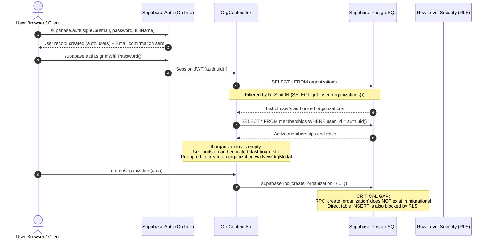
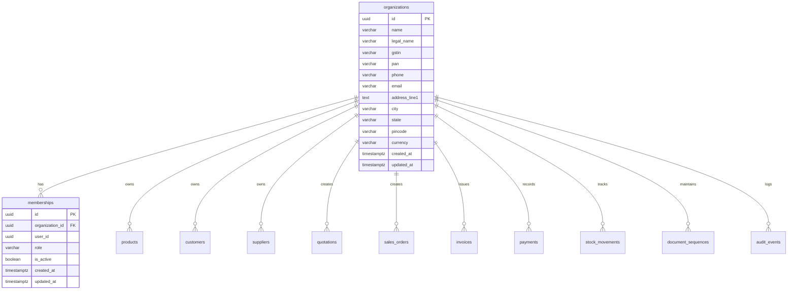
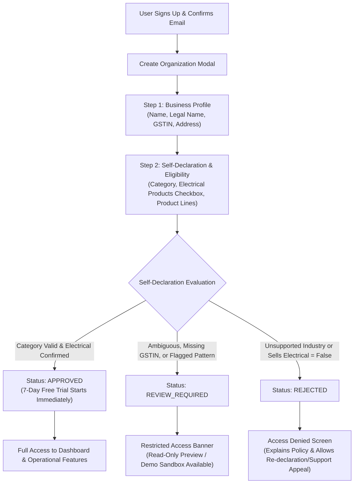
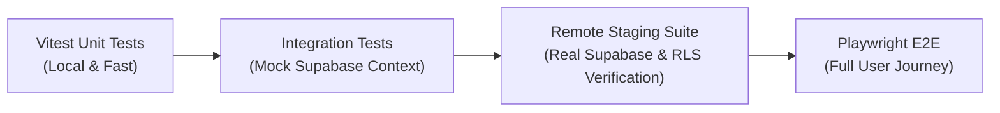

# ATLAS OS — Business Eligibility Architecture Audit (Read-Only)

**Audit Date:** October 29, 2026  
**Audited Repository:** `D:\Projects\Atlas-OS`  
**Inspected Branch:** `Vijay-Atlas`  
**Mode:** READ-ONLY INSPECTION AUDIT REPORT  

---

## 1. Repository State & Files Inspected

### Git State
- **Branch:** `Vijay-Atlas` (tracking `origin/Vijay-Atlas`, up to date at commit `e26e975`).
- **Working Tree:** Completely clean (`git status --short` returned 0 modified, staged, or untracked files).
- **Recent Commit History:**
  - `e26e975`: Merge pull request #4 from YenugantiVijay/Vijay-Atlas
  - `62f6373`: test: add comprehensive unit tests for document numbering and allocation service
  - `ee3bac7`: feat: add end-to-end operational test suite, CI workflow, and core application navigation router
  - `1937b2b`: Merge pull request #3 from YenugantiVijay/Vijay-Atlas
  - `511fd61`: feat: add inventory service, AI assistant page, and supporting UI components

### Project Structure & Tooling
- **Stack:** React 18.3.1, TypeScript 5.7.3, Vite 6.1.0, Tailwind CSS 3.4.17, Supabase JS 2.118.0, TanStack React Query 5.66.0, Zod 3.24.2.
- **Testing:** Vitest 3.0.5 (unit & integration), Playwright 1.64.1 (E2E in `e2e/operations.spec.ts`).
- **Tauri Status:** Tauri 2 is **not yet installed or configured** in `package.json` or the workspace. The desktop packaging step remains in the planning phase.
- **Package Scripts:** `dev`, `build`, `preview`, `test`, `test:watch`, `test:e2e`, `typecheck`.

### Key Files Inspected
- Authentication & Supabase Client: `src/lib/supabase.ts`, `src/features/auth/AuthModal.tsx`
- Tenant Management & Context: `src/features/organizations/OrgContext.tsx`, `src/components/layout/NewOrgModal.tsx`, `src/features/organizations/SettingsPage.tsx`
- Roles & Access Control: `src/lib/permissions.ts`, `src/services/team.service.ts`, `src/features/team/TeamPage.tsx`
- Routing & Layout: `src/app/router.tsx`, `src/components/layout/AppLayout.tsx`, `src/components/layout/Sidebar.tsx`, `src/components/layout/Header.tsx`
- Data Engine & Validation: `src/lib/storage.ts`, `src/lib/validation.ts`, `src/types/index.ts`
- Database Schema & Migrations:
  - `supabase/migrations/001_multi_tenant_base.sql`
  - `supabase/migrations/006_security_audit_fixes.sql`
  - `supabase/migrations/007_security_and_integrity_audit_fixes.sql`
  - `supabase/migrations/008_fix_authorization_vulnerabilities_and_null_roles.sql`
  - `supabase/migrations/010_robust_document_numbering_sequences.sql`
  - `supabase/migrations/011_atomic_receipt_numbering.sql`
  - `supabase/seed.sql`
- Security & Verification Suites: `src/lib/security.test.ts`, `src/services/cloud-fallback.test.ts`, `scripts/verify_authorization_hardening.mjs`

---

## 2. Existing Authentication & Organization Creation Flow



### Step-by-Step Flow Details

1. **User Sign-up & Verification:**
   - User inputs full name, email, and password in `src/features/auth/AuthModal.tsx`.
   - `signUp` in `src/features/organizations/OrgContext.tsx` calls `supabase.auth.signUp`.
   - The user record is created in Supabase Auth (`auth.users`). If email confirmation is enabled, a verification link is dispatched.
   - Upon confirmation and sign-in, Supabase Auth issues a JWT containing `sub: <user_uuid>`.

2. **Session Initialization & Context Hydration:**
   - `src/features/organizations/OrgContext.tsx` listens to `onAuthStateChange`.
   - It invokes `loadRemoteData(session)`:
     1. Creates the current user profile from `session.user`.
     2. Queries `supabase.from('organizations').select('*')`.
     3. Queries `supabase.from('memberships').select('*').eq('user_id', authUser.id).eq('is_active', true)`.
     4. Derives the active organization and server-verified role (`owner`, `admin`, `sales`, etc.).
     5. If no membership exists, `currentOrg` and `currentRole` are set to `null`.

3. **Organization Creation:**
   - The user opens `src/components/layout/NewOrgModal.tsx` and submits business details (Name, Legal Name, GSTIN, Phone, Address, etc.).
   - In **Demo Mode**, `src/lib/storage.ts` creates the organization in `localStorage` and assigns the user as `owner`.
   - In **Live Cloud Mode**, `src/features/organizations/OrgContext.tsx` attempts:
     ```typescript
     const { data: createdOrgId, error: rpcErr } = await supabase.rpc('create_organization', {
       p_name: data.name,
       p_legal_name: data.legalName || null,
       p_gstin: data.gstin || null,
       p_currency: data.currency || 'INR',
     });
     ```

---

## 3. Current Authorization Enforcement & Identified Gaps

### What is Currently Enforced at the Database Level (Supabase RLS & Functions)

- **Strict Multi-Tenant Isolation:**
  Every domain entity (`products`, `customers`, `suppliers`, `stock_movements`, `quotations`, `sales_orders`, `invoices`, `payments`, `document_sequences`) has mandatory RLS enabled.
  - Queries are filtered strictly through `get_user_organizations()`, which checks `memberships` for `user_id = auth.uid() AND is_active = TRUE`.
- **Role-Based Permissions (RBAC):**
  - Mutating operations enforce `get_user_org_role(organization_id)` and `user_has_org_role(p_org_id, ...)`.
  - Owners/Admins/Inventory can manage products and stock movements.
  - Owners/Admins/Sales can confirm sales orders and create quotations.
  - Owners/Admins/Accounts can issue invoices and record payments.
- **Atomic Database Functions:**
  - `confirm_sales_order` atomically locks inventory, verifies stock levels, generates stock deduction movements, and updates order status.
  - `record_payment_and_allocate` atomically validates invoice balances, records payments, updates invoice paid status, and logs receipts.
  - `allocate_document_number` sequentially allocates quotation, order, invoice, and receipt numbers with row-level locks on `document_sequences`.
- **Three-Valued Logic Defense:**
  - Migration `008` fixed SQL `NULL` role evaluations in PL/pgSQL `IF` conditions, preventing unauthorized callers with unassigned or cross-tenant roles from bypassing checks.

---

### Critical Identified Architectural & Security Gaps

| # | Gap Description | Severity | Impact | Location |
|---|-----------------|:--------:|--------|----------|
| **1** | **Missing `create_organization` Database RPC** | **HIGH (Blocker)** | In Live Cloud Mode, calling `createOrganization()` in `OrgContext.tsx` fails with a PostgreSQL function not found error. Furthermore, authenticated users have **NO `INSERT` policy** on `organizations` or `memberships` in `007_security_and_integrity_audit_fixes.sql`. | `src/features/organizations/OrgContext.tsx` / `supabase/migrations/` |
| **2** | **Zero Business Eligibility Concept in Database** | **CRITICAL** | There are no columns, tables, or policies governing business eligibility. Any user who manages to obtain an organization record immediately has access to all operational features (products, orders, invoices) regardless of their industry. | Database Schema (`001`-`011`) |
| **3** | **Zero Trial or Subscription Enforcement** | **CRITICAL** | There is no trial start date, expiration date, or subscription state in the schema. Once an organization exists, access is perpetual unless manually revoked by an administrator directly in the database. | Database Schema (`001`-`011`) |
| **4** | **Client-Only Operational Feature Gating** | **HIGH** | In `router.tsx` and `AppLayout.tsx`, access to `/products`, `/orders`, `/invoices`, etc., only checks `isAuthenticated`. An unsupported business or expired user can call Supabase REST APIs directly or tamper with React state to access all operational features. | `src/components/layout/AppLayout.tsx` / `src/app/router.tsx` |
| **5** | **Cloud Invitation Flow is Incomplete** | **MEDIUM** | In `TeamPage.tsx`, cloud team invites are disabled with a toast ("Supabase cloud invitations require an Edge Function with email dispatch"). Memberships can only be provisioned in demo mode or via direct DB seed/service-role insertion. | `src/features/team/TeamPage.tsx` |

---

## 4. Existing Schema & Relevant Policies/Functions

### Schema Overview



### Table Definitions & Key Constraints

1. **`organizations`** (`001_multi_tenant_base.sql`):
   - Columns: `id`, `name`, `legal_name`, `gstin`, `pan`, `phone`, `email`, `address_line1`, `city`, `state`, `pincode`, `currency`, `created_at`, `updated_at`.
   - RLS:
     - `SELECT`: `id IN (SELECT get_user_organizations())`
     - `UPDATE`: `get_user_org_role(id) IN ('owner', 'admin')`
     - `INSERT`: **None** (Blocked for authenticated clients).
     - `DELETE`: **None**.
2. **`memberships`** (`001_multi_tenant_base.sql`, `007_security_and_integrity_audit_fixes.sql`):
   - Columns: `id`, `organization_id`, `user_id`, `role`, `is_active`, `created_at`, `updated_at`.
   - Unique: `(organization_id, user_id)`.
   - RLS:
     - `SELECT`: `user_id = auth.uid() OR organization_id IN (SELECT get_user_organizations())`
     - `INSERT`: `WITH CHECK (get_user_org_role(organization_id) = 'owner')`
     - `UPDATE`: `USING (get_user_org_role(organization_id) = 'owner')`
     - `DELETE`: `USING (get_user_org_role(organization_id) = 'owner')`
3. **Operational Tables (`products`, `sales_orders`, `invoices`, `payments`, `stock_movements`)**:
   - All have non-nullable `organization_id` foreign keys with `ON DELETE RESTRICT`.
   - RLS allows `SELECT` if caller's active org matches `get_user_organizations()`.
   - Mutating policies require caller role to match allowed roles (`owner`, `admin`, `sales`, `inventory`, `accounts`).

---

## 5. Recommended Eligibility Model

### Schema Design: Dedicated Table vs. Existing `organizations` Table

> [!IMPORTANT]
> **Recommendation:** Implement a dedicated **`organization_eligibility`** table (1:1 with `organizations`) accompanied by an **`eligibility_audit_logs`** table (1:N), rather than overloading the `organizations` table.

#### Why a Dedicated Table is Strictly Superior:

1. **Separation of Concerns (Policy Rule 6):**
   "Business eligibility, subscription status, user roles, and organization membership must remain separate concepts."
   An organization profile consists of mutable merchant metadata (phone number, shop address, operating name, logo). Eligibility is an immutable compliance and verification record with distinct legal, auditing, and platform-administrative lifecycles.
2. **Granular Row Level Security & Column Protection:**
   If eligibility fields are placed inside `organizations`, the existing RLS policy allows `owner` and `admin` to `UPDATE organizations`. Preventing an owner from updating `eligibility_status = 'approved'` would require either fragile column-level security or custom PostgreSQL `BEFORE UPDATE` triggers. A dedicated table cleanly separates the RLS boundary:
   - `organization_eligibility` has **NO public UPDATE policy**.
   - Status transitions can **ONLY** be executed via trusted, server-side `SECURITY DEFINER` functions or platform reviewer roles.
3. **Zero Sensitive Document Sprawl:**
   Keeping review notes, ambiguity flags, reviewer UUIDs, and verification timestamps in a dedicated table prevents operational APIs (e.g. customer quotation generation or invoice rendering) from accidentally exposing compliance review records.

---

### Detailed Schema Specification

```sql
-- 1. Supported Business Categories Enum
CREATE TYPE public.business_category_type AS ENUM (
    'electrical_retail',                  -- Electrical goods shops
    'electrical_wholesale_distributor',  -- Electrical wholesalers and distributors
    'hardware_with_electrical'           -- Hardware shops selling electrical goods
);

-- 2. Eligibility Status Enum
CREATE TYPE public.eligibility_status_type AS ENUM (
    'pending',          -- Application submitted; awaiting initial determination
    'approved',         -- Verified eligible; trial/operational features unlocked
    'review_required',  -- Incomplete, ambiguous, or suspicious; manual review required
    'rejected'          -- Unsupported business; operational features denied
);

-- 3. Dedicated Organization Eligibility Table (1:1 with organizations)
CREATE TABLE public.organization_eligibility (
    id UUID PRIMARY KEY DEFAULT gen_random_uuid(),
    organization_id UUID NOT NULL UNIQUE REFERENCES public.organizations(id) ON DELETE RESTRICT,
    
    -- Self-Declaration Attributes
    business_category public.business_category_type NOT NULL,
    sells_electrical_products BOOLEAN NOT NULL DEFAULT FALSE,
    declared_business_description TEXT,
    primary_product_lines TEXT[], -- e.g. ['Wires & Cables', 'Switchgear', 'Lighting']
    trade_license_number VARCHAR(100), -- Optional municipal trade license/registration
    
    -- System & Review State
    status public.eligibility_status_type NOT NULL DEFAULT 'pending',
    is_auto_approved BOOLEAN NOT NULL DEFAULT FALSE,
    flag_reason TEXT, -- Populated if flagged as 'review_required' or 'rejected'
    
    -- Reviewer & Audit Trail
    reviewed_by UUID, -- Platform reviewer auth.uid()
    reviewed_at TIMESTAMPTZ,
    reviewer_notes TEXT,
    
    -- Timestamps
    created_at TIMESTAMPTZ NOT NULL DEFAULT NOW(),
    updated_at TIMESTAMPTZ NOT NULL DEFAULT NOW(),
    
    -- Constraint: Hardware stores MUST sell electrical products to qualify
    CONSTRAINT chk_hardware_must_sell_electrical CHECK (
        business_category != 'hardware_with_electrical' OR sells_electrical_products = TRUE
    )
);

-- 4. Eligibility Audit & Decision History (1:N)
CREATE TABLE public.eligibility_audit_logs (
    id UUID PRIMARY KEY DEFAULT gen_random_uuid(),
    organization_id UUID NOT NULL REFERENCES public.organizations(id) ON DELETE RESTRICT,
    previous_status public.eligibility_status_type,
    new_status public.eligibility_status_type NOT NULL,
    actor_id UUID, -- NULL if system rule, auth.uid() if manual reviewer
    actor_role VARCHAR(50) NOT NULL, -- 'system', 'platform_admin', 'reviewer'
    reason TEXT NOT NULL,
    notes TEXT,
    metadata JSONB DEFAULT '{}'::jsonb,
    created_at TIMESTAMPTZ NOT NULL DEFAULT NOW()
);

-- Indexes for performance
CREATE INDEX idx_org_eligibility_status ON public.organization_eligibility(status);
CREATE INDEX idx_eligibility_audit_org ON public.eligibility_audit_logs(organization_id, created_at DESC);
```

---

## 6. Recommended User Onboarding Experience



### Self-Declaration Form Steps

1. **Category Selection (Single Choice):**
   - Electrical Retail Shop (`electrical_retail`)
   - Electrical Wholesale & Distribution (`electrical_wholesale_distributor`)
   - Hardware Store Selling Electrical Goods (`hardware_with_electrical`)
   - *Other / General Business* (Instantly flags as unsupported before submission).
2. **Electrical Inventory Affirmation (Mandatory Checkbox):**
   - *"I confirm that this business actively sells electrical products, wiring supplies, switchgear, lighting, or related electrical hardware."*
   - For `hardware_with_electrical`, this checkbox is strictly required. Unchecking it blocks immediate qualification.
3. **Primary Electrical Product Lines (Multi-select pills):**
   - `[Wires & Cables]`, `[Switchgear & DBs]`, `[Modular Switches & Accessories]`, `[Industrial Lighting & LED]`, `[Conduit Pipes & Fittings]`, `[Fans & Appliances]`.
4. **Business Identification:**
   - Indian GSTIN (Optional for small unorganized retailers under the ₹40L exemption threshold, but validated via format check if provided).
   - Shop operating address and city.

---

## 7. Security Risks & Mitigations (Authorization & Abuse Prevention)

### Threat Modeling & Attack Surfaces

```text
[ Threat Actor: Unsupported Merchant / Malicious Actor ]
   ├── Attack 1: Modify React State / LocalStorage (Bypass UI Gate)
   │     └── Mitigation: UI gates are advisory only; Database RLS blocks all operational writes.
   ├── Attack 2: Direct REST API Calls via Postman / curl with JWT
   │     └── Mitigation: RLS policies require is_org_operational_ready(organization_id).
   ├── Attack 3: Direct Database RPC Invocation (e.g. confirm_sales_order)
   │     └── Mitigation: PL/pgSQL functions verify eligibility and active trial internally.
   ├── Attack 4: Self-Promote Eligibility Status via Supabase API
   │     └── Mitigation: organization_eligibility has NO public UPDATE policy; transitions require admin RPC.
   └── Attack 5: Tamper with Future Tauri Desktop Binary
         └── Mitigation: Zero client-side trust; Desktop app runs as untrusted client against Supabase.
```

### Database-Level Operational Gate Function

To prevent unapproved businesses from writing products, orders, or invoices, introduce a cached `SECURITY DEFINER` helper:

```sql
CREATE OR REPLACE FUNCTION public.is_org_operational_ready(p_org_id UUID)
RETURNS BOOLEAN
LANGUAGE plpgsql
STABLE
SECURITY DEFINER
SET search_path = public, pg_temp
AS $$
DECLARE
    v_status public.eligibility_status_type;
    v_trial_active BOOLEAN;
BEGIN
    IF p_org_id IS NULL THEN
        RETURN FALSE;
    END IF;

    -- 1. Check Eligibility Status
    SELECT status INTO v_status
    FROM public.organization_eligibility
    WHERE organization_id = p_org_id;

    IF v_status IS NULL OR v_status != 'approved' THEN
        RETURN FALSE;
    END IF;

    -- 2. Check Trial / Subscription Status
    SELECT (
        (subscription_status = 'trialing' AND NOW() <= trial_ends_at) OR
        (subscription_status = 'active')
    ) INTO v_trial_active
    FROM public.organization_subscriptions
    WHERE organization_id = p_org_id;

    RETURN COALESCE(v_trial_active, FALSE);
END;
$$;

REVOKE ALL ON FUNCTION public.is_org_operational_ready(UUID) FROM PUBLIC;
GRANT EXECUTE ON FUNCTION public.is_org_operational_ready(UUID) TO authenticated;
```

### RLS Enforcement on Operational Tables

Update the `WITH CHECK` clauses on all operational mutating policies in `supabase/migrations/007_security_and_integrity_audit_fixes.sql`:

```sql
-- Example for products table:
CREATE POLICY "Inventory and admins can insert products"
ON products FOR INSERT
WITH CHECK (
    get_user_org_role(organization_id) IN ('owner', 'admin', 'inventory')
    AND is_org_operational_ready(organization_id) = TRUE
);

-- Example for sales orders:
CREATE POLICY "Sales and admins can insert sales orders"
ON sales_orders FOR INSERT
WITH CHECK (
    get_user_org_role(organization_id) IN ('owner', 'admin', 'sales')
    AND is_org_operational_ready(organization_id) = TRUE
);
```

### RPC Function Hardening

Add explicit eligibility and trial guards to existing `SECURITY DEFINER` RPCs:
1. `confirm_sales_order` (`supabase/migrations/008_fix_authorization_vulnerabilities_and_null_roles.sql`):
   ```sql
   IF NOT public.is_org_operational_ready(p_org_id) THEN
       RAISE EXCEPTION 'Operational access restricted: Organization is not approved or trial has expired.';
   END IF;
   ```
2. `record_payment_and_allocate` (`supabase/migrations/011_atomic_receipt_numbering.sql`):
   ```sql
   IF NOT public.is_org_operational_ready(p_org_id) THEN
       RAISE EXCEPTION 'Operational access restricted: Organization is not approved or trial has expired.';
   END IF;
   ```
3. `allocate_document_number` (`supabase/migrations/011_atomic_receipt_numbering.sql`):
   ```sql
   IF NOT public.is_org_operational_ready(p_org_id) THEN
       RAISE EXCEPTION 'Operational access restricted: Organization is not approved or trial has expired.';
   END IF;
   ```

### Manual Reviewer Authorization & Audit Workflow

To enable secure manual review without giving reviewers direct table-level write access:

1. **Reviewer Identity:**
   Identify reviewers via `auth.users.raw_app_meta_data->>'is_platform_admin' = 'true'` or a dedicated table `public.platform_reviewers (user_id UUID PRIMARY KEY)`.
2. **Reviewer RPC (`review_organization_eligibility`):**
   ```sql
   CREATE OR REPLACE FUNCTION public.review_organization_eligibility(
       p_org_id UUID,
       p_new_status public.eligibility_status_type,
       p_notes TEXT
   )
   RETURNS JSONB
   LANGUAGE plpgsql
   SECURITY DEFINER
   SET search_path = public, pg_temp
   AS $$
   DECLARE
       v_reviewer_uid UUID;
       v_is_authorized BOOLEAN;
       v_old_status public.eligibility_status_type;
   BEGIN
       v_reviewer_uid := (SELECT auth.uid());
       
       -- Verify reviewer authorization
       SELECT EXISTS (
           SELECT 1 FROM public.platform_reviewers WHERE user_id = v_reviewer_uid
       ) INTO v_is_authorized;

       IF NOT COALESCE(v_is_authorized, FALSE) THEN
           RAISE EXCEPTION 'Access Denied: Caller is not an authorized platform reviewer.';
       END IF;

       SELECT status INTO v_old_status
       FROM public.organization_eligibility
       WHERE organization_id = p_org_id
       FOR UPDATE;

       IF NOT FOUND THEN
           RAISE EXCEPTION 'Organization eligibility record not found for %', p_org_id;
       END IF;

       -- Update status
       UPDATE public.organization_eligibility
       SET status = p_new_status,
           reviewed_by = v_reviewer_uid,
           reviewed_at = NOW(),
           reviewer_notes = p_notes,
           updated_at = NOW()
       WHERE organization_id = p_org_id;

       -- If newly approved, trigger 7-day trial start if not already initiated
       IF p_new_status = 'approved' THEN
           PERFORM public.initialize_organization_trial(p_org_id);
       END IF;

       -- Append to audit log
       INSERT INTO public.eligibility_audit_logs (
           organization_id, previous_status, new_status, actor_id, actor_role, reason, notes
       ) VALUES (
           p_org_id, v_old_status, p_new_status, v_reviewer_uid, 'platform_reviewer',
           'Manual review determination', p_notes
       );

       RETURN jsonb_build_object('success', TRUE, 'organization_id', p_org_id, 'new_status', p_new_status);
   END;
   $$;
   ```

---

## 8. Trial & Subscription Interaction

### Dedicated Subscription & Trial Table

```sql
CREATE TYPE public.subscription_status_type AS ENUM (
    'trialing',
    'active',
    'past_due',
    'canceled',
    'expired'
);

CREATE TABLE public.organization_subscriptions (
    id UUID PRIMARY KEY DEFAULT gen_random_uuid(),
    organization_id UUID NOT NULL UNIQUE REFERENCES public.organizations(id) ON DELETE RESTRICT,
    
    plan_tier VARCHAR(50) NOT NULL DEFAULT 'standard_monthly',
    subscription_status public.subscription_status_type NOT NULL DEFAULT 'trialing',
    
    -- Trusted Server Timestamps
    trial_started_at TIMESTAMPTZ NOT NULL DEFAULT NOW(),
    trial_ends_at TIMESTAMPTZ NOT NULL DEFAULT (NOW() + INTERVAL '7 days'),
    current_period_started_at TIMESTAMPTZ NOT NULL DEFAULT NOW(),
    current_period_ends_at TIMESTAMPTZ NOT NULL DEFAULT (NOW() + INTERVAL '7 days'),
    
    payment_provider VARCHAR(50), -- e.g. 'stripe', 'razorpay' (null during trial)
    payment_provider_sub_id VARCHAR(255),
    
    created_at TIMESTAMPTZ NOT NULL DEFAULT NOW(),
    updated_at TIMESTAMPTZ NOT NULL DEFAULT NOW()
);

CREATE INDEX idx_org_subscriptions_status ON public.organization_subscriptions(subscription_status, trial_ends_at);
```

### Key Trial Lifecycle Guarantees

1. **Trusted Server Timestamp:**
   `trial_started_at` is initialized via PostgreSQL `NOW()` and `trial_ends_at` is set to `NOW() + INTERVAL '7 days'`. Neither value can be supplied or overridden by the client.
2. **Organization-Level Scope:**
   The trial belongs strictly to `organization_id`. Multiple team members joining the organization share the same single organization trial window.
3. **Tamper Resistance:**
   Modifying the local system clock, clearing browser `localStorage`, or reinstalling the Tauri desktop application does **NOT** reset or alter the trial duration, as all trial state is evaluated against the remote Supabase database clock (`NOW()`).
4. **Behavior Upon Trial Expiry:**
   - **Write Operations Blocked:** RLS policies and RPCs immediately reject `INSERT`, `UPDATE`, and `DELETE` on products, inventory adjustments, orders, invoices, and payments.
   - **Read-Only Data Access & Export Preserved:** RLS `SELECT` policies continue to permit owners and accountants to read past tax invoices, customer ledgers, and inventory reports. This complies with legal accounting standards and customer data retention guidelines.
   - **User Experience:** The React interface and future Tauri window display an ambient status banner:
     *"Your 7-day free trial expired on [Date]. Your historical records remain safely accessible. Upgrade to resume issuing invoices and confirming orders. [Upgrade Plan] [Export Data]"*.

---

## 9. Testing Strategy



### 1. Unit Tests (Vitest)
- **Validation Schemas:** Test Zod validation for business category enums, Indian GSTIN formats, and self-declaration schemas in `src/lib/validation.ts`.
- **Hardware Store Rule:** Verify that selecting `hardware_with_electrical` without setting `sells_electrical_products = true` fails validation.
- **Client Date Independence:** Ensure financial and trial calculations in TypeScript refuse client-side date tampering.

### 2. Integration Tests (Vitest + Service Mocks)
- **Dual-Mode Parity:** Verify `src/lib/storage.ts` replicates the eligibility and trial status checks for Demo Sandbox Mode without regressing `src/services/cloud-fallback.test.ts`.
- **Navigation & Route Guards:** Test that an organization with `status = 'pending'` or `'review_required'` redirects to the status/onboarding screen while keeping Settings accessible.

### 3. Remote Staging & RLS Verification Suite (PostgreSQL / Supabase)
Expand `scripts/verify_authorization_hardening.mjs` with dedicated test scenarios:
- **Direct API Bypass Attempt:** An authenticated user from an unapproved organization calls `supabase.from('products').insert(...)`. Must fail with RLS violation error.
- **Direct RPC Invocation Attempt:** An unapproved organization member executes `supabase.rpc('confirm_sales_order', ...)`. Must raise `Operational access restricted` exception.
- **Self-Approval Attempt:** An organization owner calls `supabase.from('organization_eligibility').update({ status: 'approved' })`. Must fail with RLS violation (no update policy).
- **Unauthorized Reviewer Attempt:** An ordinary user calls `supabase.rpc('review_organization_eligibility', ...)`. Must fail with `Access Denied: Caller is not an authorized platform reviewer`.
- **Expired Trial Attempt:** Synthetically set `trial_ends_at = NOW() - INTERVAL '1 day'`. Verify `SELECT` succeeds but `INSERT / UPDATE` fails.
- **Cross-Tenant Isolation:** Verify that an approved organization cannot read or mutate the eligibility audit logs of another organization.

---

## 10. Phased Implementation Plan

### Phase 1: Database Migrations (Supabase Schema & Security Functions)
- **Files to create/modify:**
  - `supabase/migrations/012_organization_creation_rpc.sql`: Implements atomic `create_organization(p_name, p_legal_name, p_gstin, p_currency)` that creates the organization and assigns caller as `owner`.
  - `supabase/migrations/013_business_eligibility_and_trials.sql`: Implements `organization_eligibility`, `organization_subscriptions`, `eligibility_audit_logs`, `is_org_operational_ready()`, `self_declare_organization_eligibility()`, and `review_organization_eligibility()`.
  - `supabase/migrations/014_harden_operational_rls_with_eligibility.sql`: Updates RLS policies on `products`, `orders`, `invoices`, `payments`, `stock_movements`, and `document_sequences` to require `is_org_operational_ready()`.

### Phase 2: Domain Types & Service Layer
- **Files to create/modify:**
  - `src/types/index.ts`: Add TypeScript types for `BusinessCategory`, `EligibilityStatus`, `OrganizationEligibility`, `SubscriptionStatus`, and `OrganizationSubscription`.
  - `src/services/eligibility.service.ts`: API service for submitting self-declarations, fetching review status, and requesting manual reviews.
  - `src/lib/storage.ts`: Add demo-mode equivalents to maintain 100% feature parity in Demo Sandbox Mode.

### Phase 3: Client Onboarding & Self-Declaration UI Flow
- **Files to create/modify:**
  - `src/features/organizations/OrgContext.tsx`: Add `eligibility` and `subscription` to `OrgContextType`. Hydrate eligibility during `loadRemoteData`.
  - `src/components/layout/NewOrgModal.tsx`: Add Step 2 for industry category selection, electrical product affirmation, and product line tags.
  - `src/features/organizations/EligibilityPendingBanner.tsx`: UI banner informing the user of pending review or rejected status.
  - `src/components/layout/AppLayout.tsx`: Route gate that directs pending/unapproved organizations to the review status view.

### Phase 4: Platform Reviewer Admin Interface
- **Files to create/modify:**
  - `src/features/admin/ReviewQueuePage.tsx`: Dedicated platform reviewer interface for inspecting flagged applications, viewing audit history, and approving/rejecting organizations.

### Phase 5: Verification Suite & Automated Tests
- **Files to create/modify:**
  - `src/lib/eligibility.test.ts`: Vitest unit tests for validation rules and state transitions.
  - `scripts/verify_authorization_hardening.mjs`: Add tests 6 through 12 validating remote RLS blocking of unapproved and expired organizations.

### Phase 6: Tauri 2 Desktop Packaging Hardening
- **Scope:**
  - When Tauri 2 is introduced, ensure the web app runs strictly as an untrusted client.
  - Never store service keys in Tauri Rust commands.
  - Store JWT tokens using Tauri's secure OS keychain plugin (`tauri-plugin-stronghold` or Windows Credential Manager) instead of unencrypted local files.

---

## 11. Dependencies & Product Decisions Requiring Clarification

1. **Auto-Approval Criteria:**
   - Should all electrical businesses (`electrical_retail`, `electrical_wholesale_distributor`) be approved immediately upon self-declaration if they provide a valid GSTIN?
   - Or should newly registered businesses without a GSTIN (e.g. small neighborhood retail shops) always be routed to manual review?
2. **Ambiguity Triggers for Manual Review (`review_required`):**
   - What specific self-declaration patterns should trigger manual review? (e.g. `hardware_with_electrical` without trade license, email domains matching known disposable providers, or businesses with missing physical addresses).
3. **Platform Reviewer Authentication:**
   - Should platform reviewers log in through the same application using a special Supabase role / JWT claim, or should review actions occur via a separate internal tool / Supabase Studio dashboard?
4. **Data Retention & Post-Trial Grace Period:**
   - Once the 7-day trial expires, for how long should read-only access to invoices and customer ledgers be retained before an organization account is archived or purged? (Standard Indian GST compliance requires maintaining records for up to 6 years).

---

## 12. Verification & Safety Confirmation

```
================================================================================
VERIFICATION CONFIRMATION:
- Files modified, created, deleted, or reformatted:       1 (docs/BUSINESS_ELIGIBILITY_AUDIT.md)
- Packages installed, updated, or removed:                0
- Database migrations executed:                           0
- Git commits, pushes, merges, or branch changes:         0
- Environment variables or configurations altered:        0
- Working tree state:                                     docs/BUSINESS_ELIGIBILITY_AUDIT.md created
================================================================================
```
