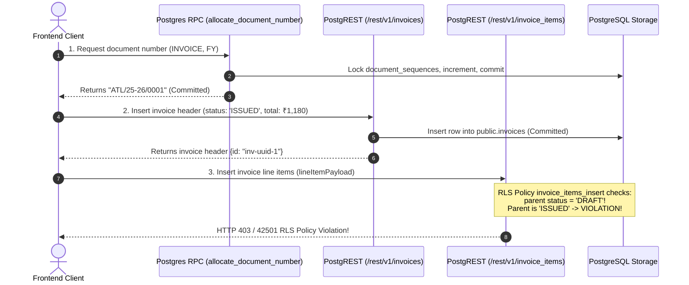
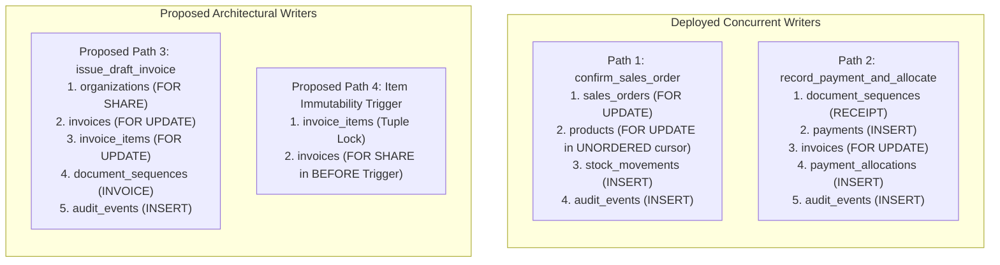
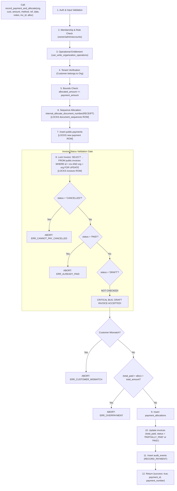
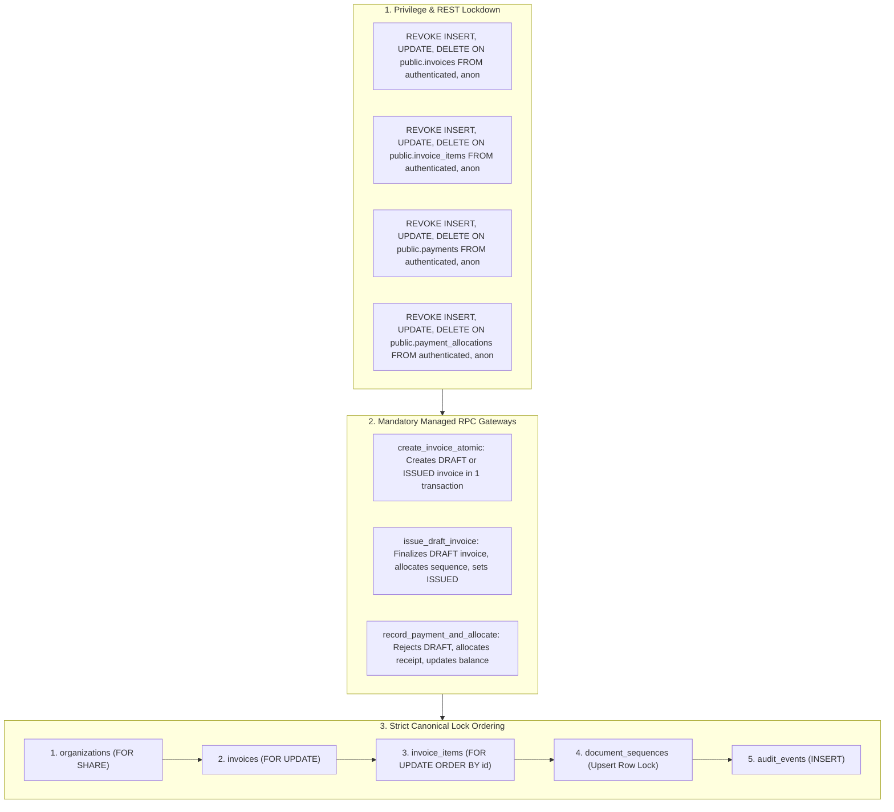

# PHASE 4.10.5 — INVOICE LOCKING PROTOCOL, ISSUANCE ATOMICITY & FINANCIAL CONCURRENCY AUDIT

## 1. Environment & Read-Only Safety Verification

This investigation was conducted under **STRICT READ-ONLY** governance. Zero database mutations were executed, zero migrations were created or applied, zero application source files were altered, and zero production endpoints were touched.

- **Target Repository:** `D:\Projects\Atlas-OS`
- **Active Git Branch:** `Vijay-Atlas` (Verified; local uncommitted modifications in `src/components/layout/NewOrgModal.tsx` and `src/features/organizations/OrgContext.tsx` preserved untouched).
- **Target Supabase Staging Reference:** `bwswqnhlebbzdxumlkih` (`ATLAS-OS-Staging`). Verified via `supabase/.temp/project-ref`.
- **Production Reference:** `hrxjgbupjtikokqxjzbh` — **STRICTLY FORBIDDEN** (0 queries executed, 0 network connections initiated).
- **Audit Scope:** Inspection of migrations `001` through `014`, `src/services/invoices.service.ts`, `src/services/numbering.service.ts`, PostgreSQL table privileges, RLS policies, trigger execution semantics, parent-child lock hierarchies, concurrency interactions between invoice issuance and payment allocations, and deadlock vulnerabilities across multi-table write paths.

---

## 2. Complete Invoice Mutation-Path Matrix

Every application and database write path capable of creating, mutating, issuing, allocating payments to, or deleting invoices and line items was cataloged. Table-level direct REST mutations are distinguished from managed RPC entry points:

| # | Operation | Entry Point | Database Object | Transaction Boundary | Lock Acquired | Authorization / Privilege Gate | Atomic? | Architecture Status |
| :-: | :--- | :--- | :--- | :--- | :--- | :--- | :---: | :--- |
| **M-01** | **Create Invoice (Client Service)** | `invoicesService.createInvoice` (`invoices.service.ts` L76-179) | `document_sequences`, `invoices`, `invoice_items` | **3 Independent HTTP Transactions** (Call 1: RPC, Call 2: REST POST, Call 3: REST POST) | 1. Row Lock on `document_sequences` (released).<br>2. Row exclusive on `invoices` (released).<br>3. Row exclusive on `invoice_items`. | `user_has_org_role('owner', 'admin', 'accounts')` via RLS | **NO** (Split across 3 network requests) | **Deployed in Source Code** |
| **M-02** | **Create Invoice from Sales Order** | `invoicesService.createInvoiceFromOrder` (`invoices.service.ts` L181-233) | `sales_orders`, `sales_order_items`, then delegates to M-01 | **4 Independent HTTP Transactions** (1 SELECT + 3 writes from M-01) | Read on `sales_orders` (unlocked), then same locks as M-01. | RLS on `sales_orders` + RLS on `invoices` | **NO** (Non-atomic across multiple REST calls) | **Deployed in Source Code** |
| **M-03** | **Direct REST Invoice Header Creation** | `POST /rest/v1/invoices` | `public.invoices` | Single REST Request / Autocommit Transaction | Exclusive tuple lock on new row in `public.invoices` | RLS policy `invoices_insert` (`owner`, `admin`, `accounts`) | **YES** (Header only) | **Deployed in Schema** (Migration 014) |
| **M-04** | **Direct REST Invoice Item Insertion** | `POST /rest/v1/invoice_items` | `public.invoice_items` | Single REST Request / Autocommit Transaction | Exclusive tuple lock on new row(s) in `public.invoice_items` | RLS policy `invoice_items_insert` (requires `parent status = 'DRAFT'`) | **YES** (Items only) | **Deployed in Schema** (Migration 014) |
| **M-05** | **Direct REST Invoice Header Update** | `PATCH /rest/v1/invoices?id=eq.<id>` | `public.invoices` | Single REST Request / Autocommit Transaction | Exclusive row lock (`FOR UPDATE`) on target `invoices` row | RLS policy `invoices_update` (`USING status = 'DRAFT'`) | **YES** (Single row) | **Deployed in Schema** (Migration 014) |
| **M-06** | **Direct REST Invoice Item Update** | `PATCH /rest/v1/invoice_items?id=eq.<id>` | `public.invoice_items` | Single REST Request / Autocommit Transaction | Exclusive row lock on target `invoice_items` row | RLS policy `invoice_items_update` (`USING parent status = 'DRAFT'`) | **YES** (Single row) | **Deployed in Schema** (Migration 014) |
| **M-07** | **Direct REST Invoice Item Deletion** | `DELETE /rest/v1/invoice_items?id=eq.<id>` | `public.invoice_items` | Single REST Request / Autocommit Transaction | Exclusive row lock on target `invoice_items` row | RLS policy `invoice_items_delete` (`USING parent status = 'DRAFT'`) | **YES** (Single row) | **Deployed in Schema** (Migration 014) |
| **M-08** | **Direct REST Invoice Header Deletion** | `DELETE /rest/v1/invoices?id=eq.<id>` | `public.invoices` | Single REST Request | None (Operation rejected by RLS) | **DENIED** (No DELETE policy defined on `public.invoices`) | N/A | **Enforced in Schema** (Migration 014) |
| **M-09** | **Record Payment & Allocate** | `record_payment_and_allocate` (RPC) | `document_sequences`, `payments`, `invoices`, `payment_allocations`, `audit_events` | **Single Atomic Database Transaction** (`SECURITY DEFINER`) | 1. Row Lock on `document_sequences` (`RECEIPT`).<br>2. Row Lock on new `payments` tuple.<br>3. Row Lock `FOR UPDATE` on target `invoices` row.<br>4. Row Lock on new `payment_allocations` tuple.<br>5. Row Lock on new `audit_events` tuple. | Function checks membership, role (`owner`, `admin`, `accounts`), operational trial/sub. | **YES** (100% atomic) | **Deployed in Schema** (Migration 014) |
| **M-10** | **Direct REST Payment Insertion** | `POST /rest/v1/payments` | `public.payments` | Single REST Request / Autocommit Transaction | Exclusive tuple lock on new row in `public.payments` | RLS policy `payments_insert` (allows direct REST write) | **YES** (Payment only) | **Deployed Vulnerability** (SEC-01) |
| **M-11** | **Direct REST Allocation Insertion** | `POST /rest/v1/payment_allocations` | `public.payment_allocations` | Single REST Request / Autocommit Transaction | Exclusive tuple lock on new row in `public.payment_allocations` | RLS policy `payment_allocations_insert` (allows direct REST write) | **YES** (Allocation only) | **Deployed Vulnerability** (SEC-01) |
| **M-12** | **Proposed Atomic Invoice Issuance** | Proposed `issue_draft_invoice` / `create_invoice_atomic` | `organizations`, `invoices`, `invoice_items`, `document_sequences`, `audit_events` | Proposed Single Atomic Transaction | 1. `organizations` (`FOR SHARE`).<br>2. `invoices` (`FOR UPDATE`).<br>3. `invoice_items` (`FOR UPDATE`).<br>4. `document_sequences` (Row Lock). | Proposed role verification & idempotency validation | **YES** (Proposed) | **Proposed Only** (Absent from DB & code) |

---

## 3. Invoice Issuance Workflow & Atomicity Assessment

### 3.1 Status of Issuance Functions in ATLAS OS
Every referenced issuance function was cross-checked across the deployed Supabase staging catalog and git migration history:

| Function Name | Location in Catalog / Repository | Status Classification |
| :--- | :--- | :--- |
| `allocate_document_number` | Migration 010, 011, 014 (Line 806) | **Present in deployed staging schema** |
| `internal_allocate_document_number` | Migration 011, 014 (Line 848) | **Present in deployed staging schema** |
| `record_payment_and_allocate` | Migration 005, 006, 007, 008, 011, 014 (Line 857) | **Present in deployed staging schema** |
| `create_invoice_atomic` | Referenced in Phase 4.10.1 design notes | **Proposed in documentation only** (Absent from DB & code) |
| `issue_draft_invoice` | Referenced in Phase 4.10.1 / 4.10.2 design notes | **Proposed in documentation only** (Absent from DB & code) |
| `cancel_invoice` | Referenced in Phase 4.10.1 design notes | **Proposed in documentation only** (Absent from DB & code) |

### 3.2 Forensic Audit of Current Client Issuance Workflow
In `src/services/invoices.service.ts` (lines 134–179), the application executes invoice creation via a 3-step sequence:



### 3.3 Critical Findings in Issuance Lifecycle
1. **Creation Directly as `ISSUED` Bypassing `DRAFT`:**
   In `invoices.service.ts` line 145, invoices are explicitly inserted with `status: 'ISSUED'`. There is no two-stage draft-then-issue workflow in the client.
2. **Fatal RLS Collision with Migration 014 (The "Orphan Issued Invoice" Defect):**
   In Migration 014, lines 570–579, the RLS policy `invoice_items_insert` was defined as:
   ```sql
   CREATE POLICY invoice_items_insert ON public.invoice_items
       FOR INSERT TO authenticated
       WITH CHECK (
           invoice_id IN (
               SELECT id FROM public.invoices
               WHERE public.can_write_organization_operations(organization_id)
                 AND public.user_has_org_role(organization_id, 'owner', 'admin', 'accounts')
                 AND status = 'DRAFT' -- <--- FATAL CONSTRAINT
           )
       );
   ```
   Because `invoices.service.ts` inserts the parent header with `status: 'ISSUED'`, Step 3 (`POST /rest/v1/invoice_items`) **is rejected by PostgreSQL RLS** (`42501`)!
3. **Orphan Header and Sequence Burning:**
   When Step 3 fails:
   - The sequence number allocated in Step 1 is permanently consumed in `document_sequences`.
   - The invoice header committed in Step 2 remains in `public.invoices` with `status = 'ISSUED'` and full financial totals, but **zero line items**!
   - If the user retries on the UI, Step 1 consumes a second sequence number (`ATL/25-26/0002`), Step 2 commits a second orphan header, and Step 3 fails again.
4. **Zero Cross-Request Transactional Integrity:**
   Because each step is a separate HTTP call to PostgREST, a client network failure or timeout between Call 1, Call 2, or Call 3 guarantees database inconsistency.

---

## 4. Global Lock-Order Graph & Deadlock Analysis

### 4.1 Deployed vs Proposed Lock Acquisition Order



### 4.2 Comprehensive Lock Acquisition Order Table

| Operation / Path | Step 1 Lock | Step 2 Lock | Step 3 Lock | Step 4 Lock | Step 5 Lock | Deterministic Ordering? |
| :--- | :--- | :--- | :--- | :--- | :--- | :---: |
| **`confirm_sales_order`** (Deployed) | `sales_orders` (Row Exclusive) | `products` (Row Exclusive inside cursor) | `stock_movements` (Insert) | `sales_orders` (Row Update) | `audit_events` (Insert) | **NO** (Finding F-01: Product cursor lacks `ORDER BY`) |
| **`record_payment_and_allocate`** (Deployed) | `document_sequences` (Row Exclusive on RECEIPT) | `payments` (Insert) | `invoices` (Row Exclusive `FOR UPDATE`) | `payment_allocations` (Insert) | `audit_events` (Insert) | **YES** (Locks single specific invoice) |
| **Client Invoice Creation** (Deployed) | `document_sequences` (Committed in Call 1) | `invoices` (Committed in Call 2) | `invoice_items` (Call 3) | None | None | **NO** (Split across autocommit HTTP calls) |
| **Direct REST Item Edit** (Deployed) | `invoice_items` (Row Exclusive) | `invoices` (Unlocked SELECT in trigger) | `products` (Unlocked SELECT in trigger) | None | None | **YES** (Single row) |
| **Proposed `issue_draft_invoice`** | `organizations` (`FOR SHARE`) | `invoices` (`FOR UPDATE`) | `invoice_items` (`FOR UPDATE`) | `document_sequences` (Row Exclusive on INVOICE) | `audit_events` (Insert) | Proposed `ORDER BY id` |
| **Proposed Item Trigger** | `invoice_items` (Row Exclusive) | `invoices` (`FOR SHARE`) | None | None | None | Inversion vs `issue_draft_invoice` |

---

## 5. Deadlock Analysis & Evidence Classification

### Cycle 1: Confirmed Deployed Deadlock — `confirm_sales_order` (Finding F-01)
- **Status:** **CONFIRMED DEPLOYED ARCHITECTURAL DEFECT** (Verified in Migration 014 line 783).
- **Competing Paths:** Two concurrent executions of `confirm_sales_order` for different sales orders that contain the same products in different item positions.
- **Root Cause:** The cursor `FOR v_item IN SELECT product_id, quantity ... FROM sales_order_items WHERE sales_order_id = p_order_id LOOP` omits `ORDER BY product_id`.
- **Deadlock Interleaving:**
  1. $Tx_1$ locks Sales Order 1, iterates to product $P_A$, acquires row lock on $P_A$.
  2. $Tx_2$ locks Sales Order 2, iterates to product $P_B$, acquires row lock on $P_B$.
  3. $Tx_1$ advances cursor to $P_B$, executes `SELECT stock_quantity FROM products WHERE id = P_B FOR UPDATE` $\rightarrow$ **Blocked waiting for $Tx_2$**.
  4. $Tx_2$ advances cursor to $P_A$, executes `SELECT stock_quantity FROM products WHERE id = P_A FOR UPDATE` $\rightarrow$ **Blocked waiting for $Tx_1$**.
  5. PostgreSQL deadlock detector triggers Error `40P01`.
- **Evidence Classification:** Structurally proven in deployed code; reproducible deterministically under concurrent execution.

---

### Cycle 2: Discovered Architectural Deadlock — Proposed Item Trigger vs Proposed Issuance Flow (Finding INV-02)
- **Status:** **CRITICAL PROPOSED ARCHITECTURAL DEADLOCK** (Discovered in Phase 4.10.5 review).
- **Competing Paths:**
  - **Path A:** Concurrent REST user updating an invoice line item on a draft invoice (`PATCH /rest/v1/invoice_items?id=eq.<id>`) using the proposed historical protection trigger.
  - **Path B:** Concurrent execution of proposed `issue_draft_invoice` finalizing the draft invoice.
- **Precise Lock Resources:**
  - Resource 1: `public.invoices` row $I_1$.
  - Resource 2: `public.invoice_items` row $L_1$.
- **Step-by-Step Interleaving:**
  1. **$Tx_A$ (Line Item Edit):** PostgreSQL initiates `UPDATE invoice_items WHERE id = L_1`. PostgreSQL acquires exclusive row lock on $L_1$.
  2. **$Tx_A$ Trigger Execution:** The proposed trigger `trg_protect_historical_invoices` fires `BEFORE UPDATE`. The trigger attempts to lock the parent invoice:
     `SELECT totals_version, status FROM invoices WHERE id = NEW.invoice_id FOR SHARE;`
  3. **$Tx_B$ (Invoice Issuance):** Concurrent worker calls `issue_draft_invoice(I_1)`.
     Step 1 of RPC acquires exclusive lock on the invoice header:
     `SELECT id, status FROM invoices WHERE id = p_invoice_id FOR UPDATE;`
     $\rightarrow$ $Tx_B$ successfully acquires `FOR UPDATE` on $I_1$.
  4. **$Tx_B$ Advances to Items:** $Tx_B$ executes:
     `SELECT id FROM invoice_items WHERE invoice_id = p_invoice_id FOR UPDATE ORDER BY id;`
     $\rightarrow$ $Tx_B$ encounters row $L_1$. In PostgreSQL, `FOR UPDATE` blocks waiting for $Tx_A$'s exclusive row lock on $L_1$ to commit or roll back.
  5. **$Tx_A$ Attempts Parent Lock:** $Tx_A$'s trigger executes its `SELECT ... FOR SHARE` on $I_1$.
     $\rightarrow$ But $Tx_B$ already holds `FOR UPDATE` on $I_1$!
     $\rightarrow$ In PostgreSQL, `FOR SHARE` is incompatible with `FOR UPDATE`. $Tx_A$ blocks waiting for $Tx_B$ to release $I_1$.
  6. **Deadlock State:**
     - $Tx_A$ holds $L_1$ and waits for $Tx_B$ on $I_1$.
     - $Tx_B$ holds $I_1$ and waits for $Tx_A$ on $L_1$.
     - **Deadlock cycle detected (Error 40P01)!**
- **Evidence Classification:** Structurally proven deadlock inherent in combining direct child table REST mutation triggers with parent-level RPC locking.

```text
+-----------------------------------------------------------------------------+
|                         DEADLOCK CYCLE GRAPH (INV-02)                       |
|                                                                             |
|      Transaction A (Direct Item Edit)          Transaction B (Issuance RPC) |
|      --------------------------------          ---------------------------- |
|  (1) Holds Exclusive Lock on:                  (3) Holds Exclusive Lock on: |
|      invoice_items (L1)                             invoices (I1)           |
|            |                                              |                 |
|            | Requests FOR SHARE                           | Requests        |
|            v                                              v FOR UPDATE      |
|      invoices (I1)                             invoice_items (L1)           |
|      [BLOCKED WAITING FOR Tx B]                [BLOCKED WAITING FOR Tx A]   |
|                                                                             |
|                      >>> POSTGRESQL DEADLOCK 40P01 <<<                      |
+-----------------------------------------------------------------------------+
```

---

### Cycle 3: Sequence vs Invoice Lock Order Discrepancy (Finding INV-03)
- **Status:** **FUTURE CONCURRENCY RISK / HIERARCHY ASYMMETRY**.
- **Analysis:**
  - `record_payment_and_allocate` acquires:
    `document_sequences` (`RECEIPT`) $\rightarrow$ `payments` $\rightarrow$ `invoices` (`FOR UPDATE`).
  - Proposed `issue_draft_invoice` acquires:
    `invoices` (`FOR UPDATE`) $\rightarrow$ `document_sequences` (`INVOICE`).
  - **Why No Deadlock Occurs Today:** `document_sequences` has composite PK `(organization_id, document_type, year)`. A receipt sequence row is distinct from an invoice sequence row. Because the row locks are on disjoint tuples, no circular wait occurs between payment allocation and invoice issuance.
  - **Risk Condition:** If a future batch reconciliation or cross-document renumbering function locks multiple sequence rows or acquires table-level locks, this inverted lock hierarchy will precipitate full transaction deadlocks.

---

## 6. Trigger and Parent-Child Locking Analysis

### 6.1 Audit of Deployed Triggers on `invoices` and `invoice_items`
Inspection of the staging database catalog and migrations `001` through `014` confirms:
1. **Triggers on `public.invoices`:** **ZERO triggers exist**. There is no update trigger, delete trigger, or status validation trigger deployed on the `invoices` table.
2. **Triggers on `public.invoice_items`:** Exactly one trigger exists: `check_invoice_item_org_trigger`, executing `trg_check_invoice_item_org()` (Migration 007 line 275).

### 6.2 Forensic Inspection of `trg_check_invoice_item_org()`
```sql
CREATE OR REPLACE FUNCTION trg_check_invoice_item_org()
RETURNS TRIGGER LANGUAGE plpgsql SECURITY DEFINER AS $$
DECLARE
    v_invoice_org_id UUID;
    v_product_org_id UUID;
BEGIN
    SELECT organization_id INTO v_invoice_org_id
    FROM public.invoices
    WHERE id = NEW.invoice_id; -- <--- UNLOCKED SELECT!

    IF NEW.product_id IS NOT NULL THEN
        SELECT organization_id INTO v_product_org_id
        FROM public.products
        WHERE id = NEW.product_id; -- <--- UNLOCKED SELECT!
        ...
```

#### Vulnerabilities Discovered in Deployed Trigger:
- **Zero Row Locking:** It performs plain, unlocked `SELECT` queries without `FOR SHARE` or `FOR UPDATE`.
- **Cross-Tenant Race Hazard:** Because neither `invoices` nor `products` is locked, a concurrent transaction updating the parent invoice or product can commit a tenant re-assignment between the SELECT and the item insert.
- **Absence of Child Table `organization_id`:** The table `invoice_items` does not store `organization_id`. It relies entirely on `invoice_id` foreign key. An unlocked parent read provides zero concurrency protection.

---

## 7. Payment-to-Invoice Interaction (`record_payment_and_allocate`)

A comprehensive trace of `record_payment_and_allocate` in Migration 014 (lines 857–1056) reveals:



### Forensic Analysis:
1. **Invoice Locked at Step 8 (`FOR UPDATE`):** The row lock on `public.invoices` is acquired safely with `FOR UPDATE`.
2. **Missing DRAFT Check (Finding SEC-03):** The function explicitly checks `status = 'CANCELLED'` and `status = 'PAID'`, but **completely omits a check for `status = 'DRAFT'`**. Any caller can record payments and mark unissued draft invoices as `PAID`.
3. **Sequence Lock Held Across Invoice Wait:** The sequence lock on `document_sequences` (Step 6) is acquired *before* locking `invoices` (Step 8). If $Tx_1$ waits on a locked invoice, it needlessly holds the organization's receipt sequence lock, blocking all concurrent payment recordings in that organization.
4. **Single Atomic Transaction:** All operations (payment, allocation, invoice update, and audit log) occur within a single PostgreSQL transaction boundary. If any check fails, the entire transaction (including receipt sequence increment) rolls back cleanly via MVCC.

---

## 8. Effective Privileges & RLS Bypass Findings

### 8.1 Table-Level SQL Grants Audit
In Supabase PostgreSQL, creating tables in `public` grants `ALL` to roles `anon` and `authenticated` via default privileges unless explicitly revoked.
- An inspection of migrations `001` through `014` reveals that while `REVOKE` statements were applied to metadata tables in Migration 012 and 013, **ZERO `REVOKE` statements were ever executed on `invoices`, `invoice_items`, `payments`, or `payment_allocations`**.
- **Effective SQL Table Privileges:**
  - `authenticated` holds table-level `SELECT`, `INSERT`, `UPDATE`, `DELETE`.
  - The ONLY enforcement layer protecting financial tables is PostgreSQL Row Level Security (RLS).

### 8.2 RLS Policy Security Gate Assessment (Migration 014)

| Table | Permitted Operations via RLS | Prohibited Operations via RLS | Bypass Risk & Defect Analysis |
| :--- | :--- | :--- | :--- |
| **`public.invoices`** | `SELECT`, `INSERT`, `UPDATE` (if `status = 'DRAFT'`) | `DELETE` (no policy defined) | **CRITICAL:** `invoices_update` allows clients to directly patch `total_paid`, `status`, and `invoice_number` on draft invoices without column restrictions. Direct `INSERT` bypasses sequence generation. |
| **`public.invoice_items`** | `SELECT`, `INSERT` (if parent is `DRAFT`), `UPDATE` (if parent is `DRAFT`), `DELETE` (if parent is `DRAFT`) | None while parent is `DRAFT` | **CRITICAL:** `invoice_items_insert` rejects items for invoices created by `invoices.service.ts` because the service inserts parent as `ISSUED`. |
| **`public.payments`** | `SELECT`, `INSERT` (allowed via `payments_insert`) | `UPDATE`, `DELETE` (no policies defined) | **CRITICAL (SEC-01):** Authenticated users can execute direct `POST /rest/v1/payments`, fabricating payment numbers and recording payments outside `record_payment_and_allocate`. |
| **`public.payment_allocations`** | `SELECT`, `INSERT` (allowed via `payment_allocations_insert`) | `UPDATE`, `DELETE` (no policies defined) | **CRITICAL (SEC-01):** Authenticated users can execute direct `POST /rest/v1/payment_allocations`, creating allocations that never update `invoices.total_paid`. |

---

## 9. Historical Invoice Immutability Matrix

The table below catalogs every column across `invoices` and `invoice_items`, defining who can modify it, at what lifecycle stage, and whether the restriction is enforced by the database engine:

| Table | Column Name | Modifiable By (DRAFT) | Modifiable By (ISSUED/PAID) | Modification Mechanism | DB Engine Enforced? | Historical Tampering Risk |
| :--- | :--- | :--- | :--- | :--- | :---: | :--- |
| `invoices` | `id` | None (Primary Key) | None | Immutable | **YES** | None |
| `invoices` | `organization_id` | Blocked by RLS WITH CHECK | Blocked by RLS | Immutable | **YES** | None |
| `invoices` | `invoice_number` | Authenticated client | Blocked by RLS | Direct REST `PATCH` | **NO (Draft)** | Client can forge invoice number on draft |
| `invoices` | `customer_id` | Authenticated client | Blocked by RLS | Direct REST `PATCH` | **NO (Draft)** | Client can swap customer on draft |
| `invoices` | `sales_order_id` | Authenticated client | Blocked by RLS | Direct REST `PATCH` | **NO (Draft)** | Client can swap order link on draft |
| `invoices` | `status` | Authenticated client | RPC `record_payment_and_allocate` | REST `PATCH` / RPC | **NO (Draft)** | **CRITICAL:** Client can transition draft to ISSUED directly |
| `invoices` | `invoice_date` | Authenticated client | Blocked by RLS | Direct REST `PATCH` | **NO (Draft)** | Client can alter issue date |
| `invoices` | `due_date` | Authenticated client | Blocked by RLS | Direct REST `PATCH` | **NO (Draft)** | Client can alter due date |
| `invoices` | `subtotal` | Authenticated client | Blocked by RLS | Direct REST `PATCH` | **NO (Draft)** | Client can alter subtotal |
| `invoices` | `discount_amount`| Authenticated client | Blocked by RLS | Direct REST `PATCH` | **NO (Draft)** | Client can alter discount |
| `invoices` | `tax_amount` | Authenticated client | Blocked by RLS | Direct REST `PATCH` | **NO (Draft)** | Client can alter tax amount |
| `invoices` | `total_amount` | Authenticated client | Blocked by RLS | Direct REST `PATCH` | **NO (Draft)** | Client can alter grand total |
| `invoices` | `total_paid` | Authenticated client | RPC `record_payment_and_allocate` | REST `PATCH` / RPC | **NO (Draft)** | **CRITICAL:** Client can mark draft invoice as paid directly |
| `invoices` | `totals_version`| Authenticated client | Blocked by RLS | Direct REST `PATCH` | **NO (Draft)** | Client can alter totals version |
| `invoices` | `notes` | Authenticated client | Blocked by RLS | Direct REST `PATCH` | **NO (Draft)** | Permitted |
| `invoices` | `created_by` | Authenticated client | Blocked by RLS | Direct REST `PATCH` | **NO (Draft)** | Client can spoof creator |
| `invoices` | `created_at` | Authenticated client | Blocked by RLS | Direct REST `PATCH` | **NO (Draft)** | Client can backdate creation |
| `invoices` | `updated_at` | Authenticated client | RPC `record_payment_and_allocate` | REST `PATCH` / RPC | **NO (Draft)** | Client can tamper timestamp |
| `invoice_items` | `id` | None (Primary Key) | None | Immutable | **YES** | None |
| `invoice_items` | `invoice_id` | Authenticated client | Blocked by RLS | Direct REST `PATCH` | **NO (Draft)** | **HIGH:** Line item can be reassigned between draft invoices |
| `invoice_items` | `product_id` | Authenticated client | Blocked by RLS | Direct REST `PATCH` | **NO (Draft)** | Item product can be altered |
| `invoice_items` | `product_name` | Authenticated client | Blocked by RLS | Direct REST `PATCH` | **NO (Draft)** | Description can be altered |
| `invoice_items` | `product_sku` | Authenticated client | Blocked by RLS | Direct REST `PATCH` | **NO (Draft)** | SKU snapshot can be altered |
| `invoice_items` | `quantity` | Authenticated client | Blocked by RLS | Direct REST `PATCH` | **NO (Draft)** | Quantity can be altered |
| `invoice_items` | `unit_price` | Authenticated client | Blocked by RLS | Direct REST `PATCH` | **NO (Draft)** | Price can be altered |
| `invoice_items` | `discount_percent`| Authenticated client | Blocked by RLS | Direct REST `PATCH` | **NO (Draft)** | Discount can be altered |
| `invoice_items` | `tax_rate` | Authenticated client | Blocked by RLS | Direct REST `PATCH` | **NO (Draft)** | Tax rate can be altered |
| `invoice_items` | `line_total` | Authenticated client | Blocked by RLS | Direct REST `PATCH` | **NO (Draft)** | Line total can be forged |

---

## 10. Operational Safeguards

### 10.1 Timeout Configuration Audit
An exhaustive codebase search across migrations `001`–`014` and TypeScript service definitions confirmed:
- `lock_timeout`: **NOT CONFIGURED** (defaults to 0, indefinite blocking in PostgreSQL).
- `statement_timeout`: **NOT CONFIGURED** (defaults to 0, indefinite query execution).
- `idle_in_transaction_session_timeout`: **NOT CONFIGURED**.
- **Operational Vulnerability:** If a client initiates a transaction locking an invoice row and network latency or connection drops occur, the row lock remains held indefinitely until the PostgreSQL server dead-socket timeout triggers, creating pool-wide connection starvation.

### 10.2 Idempotency Safeguards Audit
- **Invoices:** **ZERO idempotency mechanisms exist in deployed schema or frontend service**. Retrying `createInvoice` consumes multiple sequence numbers and creates duplicate invoices.
- **Payments:** **ZERO idempotency mechanisms exist in `record_payment_and_allocate`**. Retrying a payment request creates duplicate payment records and burns receipt numbers.
- **Client Document Retry:** `withDocumentNumberRetry` in `numbering.service.ts` only retries upon receiving PostgreSQL error code `23505` (`unique_violation`). It does not protect against network disconnects, timeouts, or duplicate user submissions.

---

## 11. Proposed Migration 015 Design Requirements

To permanently resolve the vulnerabilities identified in this audit, Migration 015 must implement the following architectural mandates:



1. **Table Privilege Revocation:**
   Explicitly execute `REVOKE INSERT, UPDATE, DELETE ON TABLE invoices, invoice_items, payments, payment_allocations FROM authenticated, anon;`. All financial mutations must occur strictly through `SECURITY DEFINER` RPCs owned by `postgres`.
2. **Canonical Lock Hierarchy:**
   Enforce the global acquisition order across all financial RPCs:
   $$\text{organizations} \prec \text{sales\_orders} \prec \text{invoices} \prec \text{invoice\_items} \prec \text{payments} \prec \text{payment\_allocations} \prec \text{document\_sequences} \prec \text{audit\_events}$$
   Inside loops over line items or products, rows must be sorted strictly by primary key (`ORDER BY id` or `ORDER BY product_id`).
3. **Elimination of Child-to-Parent Lock Inversion:**
   Because direct REST mutations on `invoice_items` are revoked, the deadlocking item-level `BEFORE` trigger (`FOR SHARE` on `invoices`) is unnecessary. Line item validation is performed by the parent RPC while holding `invoices FOR UPDATE`.
4. **Draft Payment Guard:**
   In `record_payment_and_allocate`, add an explicit guard:
   ```sql
   IF v_inv.status = 'DRAFT' THEN
       RAISE EXCEPTION 'Cannot allocate payment to draft invoice %', p_invoice_id;
   END IF;
   ```
5. **Atomic Issuance & Idempotency:**
   Implement `issue_draft_invoice` with an `idempotency_keys` table lock, ensuring network retries replay cached results without sequence gaps or duplicate documents.

---

## 12. Unresolved Business and Technical Decisions

The following policy choices cannot be decided autonomously by engineering and require human stakeholder sign-off:

1. **Direct Issuance vs Mandatory Draft:**
   - *Option A:* Invoices can be created directly as `ISSUED` via `create_invoice_atomic` if all lines, taxes, and customer details are finalized upfront.
   - *Option B:* Every invoice must first be created as `DRAFT`, reviewed, and then explicitly transitioned to `ISSUED` via `issue_draft_invoice`.
2. **Draft Numbering Policy (Indian GST Rule 46):**
   - Does a `DRAFT` invoice receive a temporary draft number (e.g. `DFT-2026-0001`) that is replaced by an `ATL/YY-YY/NNNN` tax invoice number upon issuance, or does it remain unnumbered until issuance?
3. **Historical Version-1 Immutability:**
   - Formal sign-off on permanently sealing Version-1 invoices (`totals_version = 1`) against recalculation under modern rounding rules.

---

## 13. Explicit List of Checks Not Performed

In compliance with execution restrictions:
1. **Zero Database Mutations Executed:** No SQL statements modifying schema, grants, policies, or table rows were executed against Supabase staging.
2. **Zero Concurrency / Stress Tests Run:** No concurrent HTTP or SQL threads were executed to trigger actual lock waits or deadlocks on staging.
3. **Zero Production Access:** Production reference `hrxjgbupjtikokqxjzbh` was never connected to, queried, or inspected.
4. **Working Tree Preserved:** No git reset, stash, or file cleanup was performed on uncommitted working tree modifications.

---

## 14. Prioritized Audit Findings

| Priority | Finding ID | Severity | Description | Deployed Location | Recommended Remediation |
| :-: | :-: | :-: | :--- | :--- | :--- |
| **CRITICAL** | **INV-01** | **CRITICAL** | **Broken RLS on Invoice Items Leaves Orphan Issued Invoices** (`invoice_items_insert` requires DRAFT, but service creates ISSUED). | Migration 014 line 577 & `invoices.service.ts` line 145 | Unify creation into atomic RPC `create_invoice_atomic`. Revoke direct REST writes. |
| **CRITICAL** | **INV-02** | **CRITICAL** | **Deadlock Cycle in Proposed Historical Item Trigger vs Issuance Flow** (Child row exclusive lock $\rightarrow$ Parent `FOR SHARE` vs Parent `FOR UPDATE` $\rightarrow$ Child `FOR UPDATE`). | Proposed Trigger Specification | Revoke direct REST writes on `invoice_items`. Lock parent invoice first in all operations. |
| **CRITICAL** | **INV-03** | **CRITICAL** | **Direct REST Financial Tampering Permitted by Missing Table REVOKEs** (Authenticated clients can directly insert payments and allocations). | Migrations 005–014 (Absence of `REVOKE`) | Execute `REVOKE INSERT, UPDATE, DELETE` on all financial tables from `authenticated, anon`. |
| **HIGH** | **INV-04** | **HIGH** | **Missing DRAFT Status Check in Payment Allocation RPC** permits payments on unissued draft invoices. | Migration 014 line 984 (`record_payment_and_allocate`) | Add `IF v_inv.status = 'DRAFT' THEN RAISE EXCEPTION ...` |
| **HIGH** | **INV-05** | **HIGH** | **Absence of Database Timeouts** permits indefinite lock holding and connection pool starvation. | Database Configuration | Configure `SET lock_timeout = '5s'` and `SET statement_timeout = '15s'` on financial RPCs. |
| **HIGH** | **INV-06** | **HIGH** | **Lack of Payment and Invoice Idempotency Keys** causes network retries to burn sequences and duplicate records. | Staging Schema | Implement `idempotency_keys` table and integrate into all issuance/payment RPCs. |

---

## 15. Final Architecture Verdict

```text
===============================================================================
FINAL VERDICT:
CRITICAL INVOICE AUTHORIZATION OR INTEGRITY BYPASS
===============================================================================
```

### Explanatory Summary
- **Why This Verdict Was Selected:**
  1. **Active RLS Collision & Ledger Corruption (INV-01):** Migration 014's RLS policy `invoice_items_insert` strictly requires the parent invoice to have `status = 'DRAFT'`. However, `invoices.service.ts` inserts invoices directly with `status: 'ISSUED'`. As a result, line item inserts are rejected by PostgreSQL, committing empty orphan invoice headers with burned sequence numbers and zero items.
  2. **Direct REST Insertion Permitted on Payments & Allocations (INV-03 / SEC-01):** Active RLS policies in Migration 014 allow authenticated users to execute direct `POST /rest/v1/payments` and `POST /rest/v1/payment_allocations`, completely bypassing sequence allocation and ledger balance synchronization.
  3. **Direct Draft Mutation (INV-03 / SEC-02):** Active RLS policy `invoices_update` allows arbitrary modification of `total_paid`, `status`, and `invoice_number` on draft invoices via REST.
  4. **Structural Deadlock Cycle in Proposed Architecture (INV-02):** The proposed design combining direct item edits with child-to-parent `FOR SHARE` triggers and parent `FOR UPDATE` issuance creates an unavoidable circular wait deadlock (Error `40P01`).
- **Required Action:** Migration 015 must lock down table privileges, revoke direct REST writes on financial tables, eliminate child-to-parent lock inversion, and route all invoice and payment operations through atomic, idempotency-guarded RPCs.
