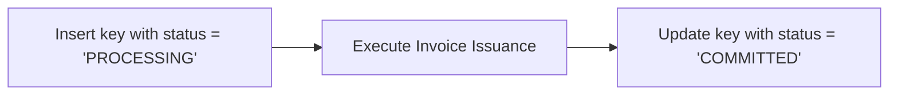
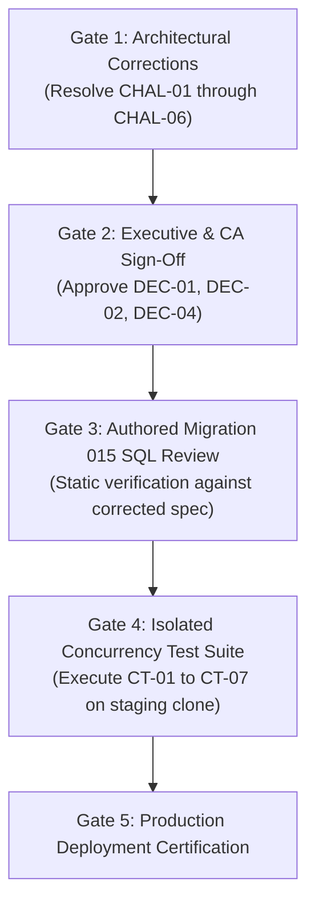

# PHASE 4.11.1 — INDEPENDENT MIGRATION 015 ARCHITECTURE CHALLENGE AUDIT
## Adversarial Security, Concurrency, and Implementation Feasibility Review

---

## 1. Executive Assessment

As an independent principal PostgreSQL/Supabase security architect, this audit conducts a rigorous, adversarial review of the proposed **Migration 015 Architecture Specification** (`docs/PHASE_4_11_MIGRATION_015_ARCHITECTURE_SPECIFICATION.md`).

The role of this audit is not to defend the proposed design, but to actively challenge its assumptions, expose hidden concurrency hazards, identify mathematical edge cases, and uncover implementation contradictions before any migration code is authored.

### Executive Summary of Audit Findings
While the specification correctly identifies several major historical vulnerabilities (such as F-01 sales order product deadlocks, OWN-01 owner self-deletion, and SEC-01 direct REST payment inserts), the proposed architecture contains **critical internal contradictions**, **flawed security assumptions**, and **functional voids** that prevent it from being certified for implementation:

1. **Lock Hierarchy Contradiction on `idempotency_keys` (CHAL-01 - CRITICAL):**
   In Section 3.2 and Section 7, `idempotency_keys` is locked at **Step 1** (before `organizations`, `invoices`, and `document_sequences`). However, in Section 5 (Canonical Lock-Order Specification), `idempotency_keys` is designated as **Level 12** (after `invoices`, `document_sequences`, and `products`). This is a direct internal contradiction that violates the total lock order and risks deadlocks.
2. **Defeated Immutability Trigger via `current_user = 'postgres'` (CHAL-02 - CRITICAL):**
   The proposed defense-in-depth trigger `trg_protect_historical_invoices` executes: `IF current_user = 'postgres' THEN RETURN NEW; END IF;`. Because all internal RPCs are `SECURITY DEFINER` owned by `postgres`, this clause **completely disables all immutability and column guards for every stored procedure**, destroying defense-in-depth and leaving historical invoices vulnerable to any bug or unintended mutation within privileged RPCs.
3. **Missing Draft Line-Item Mutation RPC (CHAL-03 - HIGH):**
   The architecture revokes all direct REST `INSERT`, `UPDATE`, and `DELETE` privileges on `invoice_items`. However, it only specifies `create_invoice_atomic` and `issue_draft_invoice`. It completely fails to specify or define an RPC to add, edit, or delete line items on existing draft invoices, making draft invoices effectively immutable from inception.
4. **Discount-to-Taxable Invariant Defect & Document-Level Overflow (CHAL-04 - HIGH):**
   The document discount validation checks $D_{doc} \le \text{Gross Subtotal}$ instead of $D_{doc} \le \sum \text{Line Taxable}$. If lines have 100% item discounts, this produces negative net taxable amounts. Furthermore, multi-line invoices can easily exceed `NUMERIC(12, 2)` ceiling (₹9.99B) even when all individual lines conform to the ₹7.81B line cap.
5. **Stuck `PROCESSING` State in Idempotency Engine (CHAL-05 - HIGH):**
   If an application server crashes or drops connection after inserting `status = 'PROCESSING'` into `idempotency_keys`, the key remains stuck in `PROCESSING` indefinitely. Subsequent client retries will receive `409 Conflict` permanently with no automated lease recovery.
6. **Orphaned Active Owners via Untracked `auth.users` Deletions (CHAL-06 - MEDIUM):**
   `memberships.user_id` lacks a foreign key constraint to Supabase `auth.users(id)`. Deleting a user in Supabase Auth leaves an active owner row in PostgreSQL that cannot authenticate, silently orphaning the organization.
7. **Credit Note Infrastructure is Non-Existent (CHAL-07 - MEDIUM):**
   The architecture prohibits historical invoice updates and mandates "Credit Notes only", but ATLAS OS has no credit note table, schema, or RPC in its database.

---

## 2. Prioritized Challenge Findings Matrix

| Finding ID | Severity | Architecture Section | Impact / Vulnerability Domain | Verification Status |
| :-: | :-: | :--- | :--- | :---: |
| **CHAL-01** | **CRITICAL** | Section 3.2 vs Section 5 | **Direct Lock Hierarchy Contradiction** (`idempotency_keys` Step 1 vs Level 12). | **Independently Verified** |
| **CHAL-02** | **CRITICAL** | Section 4.4 | **Defeated Immutability Trigger** (`current_user = 'postgres'` disables trigger). | **Independently Verified** |
| **CHAL-03** | **HIGH** | Section 2 & Section 6 | **Functional Void:** No RPC defined for editing draft line items after REST revocation. | **Independently Verified** |
| **CHAL-04** | **HIGH** | Section 3.1 | **Arithmetic & Invariant Flaws:** Negative taxable risk & document-level numeric overflow. | **Independently Verified** |
| **CHAL-05** | **HIGH** | Section 4.1 & Section 7 | **Permanent 409 Lockout:** Crash during `PROCESSING` state leaves idempotency key stuck. | **Independently Verified** |
| **CHAL-06** | **MEDIUM** | Section 3.3 | **Orphaned Owner via Auth Deletion:** `memberships.user_id` lacks FK to `auth.users`. | **Independently Verified** |
| **CHAL-07** | **MEDIUM** | Section 9 | **Non-Existent Credit Note Schema:** Post-issuance correction path has zero database backing. | **Independently Verified** |
| **CHAL-08** | **MEDIUM** | Section 3.5 & Section 10 | **Misleading Sequence Allocation Model:** "Commit time" claim is technically inaccurate. | **Independently Verified** |

---

## 3. Challenge 1: Global Lock-Order Inconsistencies & Deadlock Risks

### 3.1 The `idempotency_keys` Lock Inversion Contradiction (Finding CHAL-01)
In Section 3.2 of the Phase 4.11 specification, the lock acquisition sequence for both `record_payment_and_allocate` and `issue_draft_invoice` is explicitly documented as:
- **Step 1:** Check idempotency key (`SELECT ... FROM idempotency_keys WHERE ... FOR UPDATE`).
- **Step 2:** Lock `organizations` or `invoices` (`FOR UPDATE`).
- **Step 3:** Lock `invoice_items` / allocate sequence.

However, in Section 5 (Canonical Lock-Order Specification), the canonical hierarchy is formally tabulated as:
```text
Level 1:  organizations
...
Level 5:  invoices
Level 6:  invoice_items
...
Level 9:  document_sequences
Level 10: products
Level 12: idempotency_keys    <--- TABULATED AT LEVEL 12!
Level 13: audit_events
```

#### The Contradiction:
If `idempotency_keys` is designated as **Level 12**, it must be acquired *after* `invoices` (Level 5) and `document_sequences` (Level 9). But the procedural logic in Section 3.2 acquires `idempotency_keys` at **Step 1** (before Level 1 and Level 5).
- If any background worker, cleanup job, or secondary transaction acquires `invoices` and then touches `idempotency_keys` (following the table), while client RPCs acquire `idempotency_keys` and then touch `invoices`, a **classic AB-BA deadlock cycle** will occur.
- **Required Correction:** The lock hierarchy must officially relocate `idempotency_keys` to **Level 0 (or Level 1)** immediately prior to resource locking.

### 3.2 Products vs Document Sequences Ordering
In Section 5, `document_sequences` is designated as Level 9 and `products` as Level 10.
- When `confirm_sales_order` runs, it acquires `sales_orders` (Level 3) and `products` (Level 10). It does not touch `document_sequences`.
- However, if an invoice is created directly from an order with stock deduction, or if a future atomic order-to-invoice conversion runs:
  - If it locks `products` to verify stock, and *then* calls `internal_allocate_document_number` to assign an invoice number, it acquires Level 10 $\rightarrow$ Level 9.
  - This reverses the canonical order ($\text{document\_sequences} \prec \text{products}$).
- **Required Correction:** All stock-related product validations and row locks must occur strictly *after* document sequences, or products must be ordered before sequence allocation across all paths.

---

## 4. Challenge 2: Ownership Invariant & Deletion Vulnerabilities

### 4.1 Why the Partial Unique Index Does Not Prevent Zero Owners
The specification acknowledges that:
```sql
CREATE UNIQUE INDEX uq_org_single_active_owner 
ON public.memberships (organization_id) 
WHERE role = 'owner' AND is_active = TRUE;
```
only enforces that an organization has **at most one** active owner. It cannot enforce that an organization has **at least one** active owner.

### 4.2 Failure Scenarios in the Proposed Trigger `trg_prevent_orphaned_organization`
The specification attempts to solve this via a `BEFORE UPDATE OR DELETE` trigger. However, the following failure modes remain unaddressed:

#### Attack / Failure Scenario A: Missing FK to `auth.users` (Finding CHAL-06)
- In `001_multi_tenant_base.sql` line 43, `memberships.user_id` is defined simply as `UUID NOT NULL`. There is **NO foreign key constraint to `auth.users(id)`**.
- If an owner user is deleted from the platform via the Supabase Admin API or dashboard (`auth.users`), PostgreSQL's membership table experiences **zero cascading events and fires zero triggers**.
- The row remains in `public.memberships` with `role = 'owner'` and `is_active = TRUE`, but the referenced user no longer exists.
- **Result:** The organization has an "active owner" that cannot authenticate. Because of the partial unique index, no other user can be promoted to owner. The organization is permanently locked out.

#### Attack / Failure Scenario B: Initial Table Insertion Bypasses
- Trigger `trg_prevent_orphaned_organization` only monitors `UPDATE` and `DELETE` on `memberships`.
- If an administrative script, backfill, or migration executes `INSERT INTO public.organizations (...) VALUES (...)`, the organization row is created with zero memberships.
- The trigger never fires. The organization exists in the database with zero owners.

#### Attack / Failure Scenario C: Table Truncate
- In PostgreSQL, row-level `BEFORE DELETE` triggers do not fire during `TRUNCATE TABLE`.
- Unless `TRUNCATE` is explicitly revoked on `public.memberships` from all roles, a truncate command bypasses the trigger entirely.

---

## 5. Challenge 3: Sequence Allocation & "Commit Time" Reality

### 5.1 Deconstructing "Allocation Occurs at Commit Time" (Finding CHAL-08)
Section 10, Question 12 claims:
> *"Sequence allocation occurs at commit time inside the database transaction immediately prior to commit, eliminating client network abort sequence burning."*

This statement is technically inaccurate in PostgreSQL transaction mechanics:
1. **Physical Execution Timing:**
   In PostgreSQL, a sequence allocation function (`internal_allocate_document_number`) executes when invoked in the statement flow. An `INSERT ... ON CONFLICT DO UPDATE` executes an immediate row-level update and acquires an exclusive row lock on `document_sequences` **at the moment the SQL statement is evaluated**, not at `COMMIT`.
2. **Lock Holding Duration:**
   Once `internal_allocate_document_number` executes, the exclusive row lock on `(organization_id, doc_type, year)` in `document_sequences` **is held until the entire enclosing transaction finishes**.
   If subsequent statements in the transaction take 200ms (e.g. inserting 100 invoice items, generating audit logs, executing foreign key validations), **all concurrent transactions attempting to allocate numbers for that organization and document type are hard-blocked** for those 200ms.
3. **Rollback Behavior vs Sequence Gaps:**
   - If the transaction aborts before commit, PostgreSQL's MVCC rolls back the update to `document_sequences.current_value`. The number is restored.
   - However, if the transaction commits successfully, but the network connection between Supabase and the client terminates before the HTTP response is delivered:
     - The sequence number **remains committed** in the database.
     - The client receives an HTTP network timeout error (`ECONNRESET` / `FETCH_ERROR`).
     - If the client retries with a new request, **a new sequence number will be allocated**, leaving the previous invoice as an unexpected document or creating an unhandled gap.

---

## 6. Challenge 4: Privileged Execution & Service-Role Boundaries

### 6.1 The Fatal Flaw in `trg_protect_historical_invoices` (Finding CHAL-02)
Section 4.4 proposes the following trigger definition:
```sql
CREATE OR REPLACE FUNCTION public.trg_protect_historical_invoices()
RETURNS TRIGGER LANGUAGE plpgsql SECURITY DEFINER AS $$
BEGIN
    -- Permit updates performed by internal SECURITY DEFINER functions owned by postgres
    IF current_user = 'postgres' THEN
        RETURN NEW;
    END IF;

    -- Block any modification if invoice is not in DRAFT status
    IF OLD.status != 'DRAFT' THEN
        RAISE EXCEPTION 'ERR_HISTORICAL_INVOICE_IMMUTABLE: ...';
    END IF;
    ...
```

#### Why This Completely Destroys Immutability Defense-in-Depth:
1. Every proposed internal RPC (`create_invoice_atomic`, `issue_draft_invoice`, `record_payment_and_allocate`) is defined with:
   `LANGUAGE plpgsql SECURITY DEFINER` and is owned by `postgres`.
2. When an authenticated client calls `record_payment_and_allocate`, PostgreSQL switches the execution context (`current_user`) to the function owner: `'postgres'`.
3. When `record_payment_and_allocate` updates `invoices`, the trigger fires.
4. Line 4 evaluates: `IF current_user = 'postgres'` $\rightarrow$ **TRUE!**
5. Line 5 executes: `RETURN NEW;`!
6. **Catastrophic Impact:**
   The trigger immediately returns `NEW` and **skips all subsequent checks**!
   If a bug, regression, or future developer modification in `record_payment_and_allocate` accidentally updates `total_amount = 0`, `invoice_number = 'CORRUPT'`, or alters `customer_id`, **the trigger does not check any of those columns**!
   The trigger provides **zero defense** against bugs in privileged functions.
7. **Required Architectural Correction:**
   The trigger must inspect the specific columns being updated, regardless of `current_user`:
   ```sql
   -- Even if current_user = 'postgres', issued invoices can ONLY mutate total_paid and status
   IF OLD.status != 'DRAFT' THEN
       IF NEW.subtotal != OLD.subtotal OR 
          NEW.discount_amount != OLD.discount_amount OR
          NEW.tax_amount != OLD.tax_amount OR
          NEW.total_amount != OLD.total_amount OR
          NEW.customer_id != OLD.customer_id OR
          NEW.invoice_number != OLD.invoice_number OR
          NEW.totals_version != OLD.totals_version THEN
           RAISE EXCEPTION 'ERR_HISTORICAL_INVOICE_CORE_FROZEN: Critical financial columns cannot be modified on issued invoices.';
       END IF;
   END IF;
   ```

### 6.2 Service-Role and Replication Bypass Paths
1. **The `service_role` Key:**
   In Supabase, requests authenticated with the `service_role` JWT connect as role `service_role`, which possesses the PostgreSQL `BYPASSRLS` attribute.
   While `trg_protect_historical_invoices` will fire for `service_role` (because `current_user` is `'service_role'`, not `'postgres'`), `service_role` will be **blocked** from updating issued invoices by the trigger!
   - If an administrative script or customer support tool uses `service_role` to fix a data corruption, the trigger will block it.
2. **Replication Setting Bypass:**
   Any connection with superuser or replication privileges can execute:
   `SET session_replication_role = 'replica';`
   In PostgreSQL, this **disables all user triggers** across all tables, allowing silent, untracked modification of historical invoices.

---

## 7. Challenge 5: Financial Arithmetic & Reconciliation Edge Cases

### 7.1 Discount Validation Flaw Produces Negative Net Taxable (Finding CHAL-04)
Section 3.1 states:
> *"Input bounds: Document Discount ($D_{doc} \le \text{Subtotal}$)"*

#### Counter-Example / Failure Proof:
Consider an invoice with 2 lines:
- **Line 1:** 1 unit @ ₹1,000.00, with **100% line item discount**.
  - Line gross: ₹1,000.00
  - Line discount: ₹1,000.00
  - Line taxable subtotal: ₹0.00
- **Line 2:** 1 unit @ ₹100.00, with 0% line discount.
  - Line gross: ₹100.00
  - Line discount: ₹0.00
  - Line taxable subtotal: ₹100.00
- **Gross Subtotal:** ₹1,100.00.
- **Client inputs Document Discount:** ₹500.00.
  - Check: Is $D_{doc} \le \text{Gross Subtotal}$ ($500 \le 1100$)? **PASSES!**

#### Now Distribute Document Discount:
- Total taxable subtotal $T = 0 + 100 = \text{₹}100.00$.
- Line 1 share: $\text{ROUND}(500 \times \frac{0}{100}, 2) = \text{₹}0.00$.
- Line 2 share: $\text{ROUND}(500 \times \frac{100}{100}, 2) = \text{₹}500.00$.
- Net Taxable for Line 2:
  $$\text{Net Taxable} = \text{Line Taxable} - \text{Discount Share} = 100.00 - 500.00 = -\text{₹}400.00!$$
- **Result:** Line 2 has **negative taxable subtotal** (-₹400.00), produces **negative GST** (-₹72.00), and corrupts the entire tax filing!
- **Root Cause:** Document discount must be validated against **Total Taxable Subtotal** ($\sum \text{Line Taxable}$), NOT Gross Subtotal!

### 7.2 Multi-Line Document Numeric Overflow
Section 3.1 establishes a line ceiling of ₹7,812,499,999.99 to fit inside `NUMERIC(12, 2)` with 28% tax.
- However, the document header `invoices.total_amount` is ALSO `NUMERIC(12, 2)` (max value ₹9,999,999,999.99).
- If an invoice contains 5 lines, each with line total of ₹2,500,000,000.00:
  - Each individual line is well below the ₹7.81B line cap.
  - But $\sum \text{Line Totals} = \text{₹}12,500,000,000.00$.
  - When the header is inserted, PostgreSQL raises Error `22003: numeric field overflow`.
- **Required Correction:** The arithmetic contract must enforce an explicit document-level check:
  $$\text{Gross Subtotal} - \text{Discount Total} + \text{Tax Total} \le 9,999,999,999.99$$

---

## 8. Challenge 6: Invoice Lifecycle & Draft Immutability Functional Gap

### 8.1 The Missing Draft Line-Item Mutation RPC (Finding CHAL-03)
The architecture establishes the following policy:
1. `REVOKE INSERT, UPDATE, DELETE ON TABLE public.invoice_items FROM authenticated, anon;`
2. Direct REST writes to `invoice_items` are completely blocked.
3. Invoices are created as `DRAFT` via `create_invoice_atomic(..., p_issue_immediately = FALSE)`.

#### The Functional Void:
- After a draft invoice is created, how does a user **add a new line item**, **change a quantity**, or **remove an item** on the draft?
- The specification defines:
  - `create_invoice_atomic`: Creates a new invoice and inserts initial items.
  - `issue_draft_invoice`: Finalizes an existing draft and assigns a sequence number.
  - `cancel_invoice`: Marks an invoice as cancelled.
- **IT DEFINES ZERO FUNCTIONS TO MUTATE ITEMS ON AN EXISTING DRAFT!**
- Because direct REST `POST /rest/v1/invoice_items` and `DELETE /rest/v1/invoice_items` are revoked, **there is literally no API or database path for a user to edit line items on a draft invoice**!
- Once created, a draft invoice is permanently frozen in its initial state. If a user made a typo on line 3, they cannot edit it; they must cancel the draft and recreate it from scratch.
- **Required Correction:** Migration 015 must specify and implement `update_draft_invoice_items(p_org_id, p_invoice_id, p_items_json)`.

### 8.2 Non-Existent Credit Note Infrastructure (Finding CHAL-07)
Section 9 states:
> *"Historical issued invoices cannot be altered. Corrections require formal credit notes."*

- An inspection of migrations `001` through `014` confirms that **no `credit_notes` table, no `credit_note_items` table, and no credit note sequence exists** in ATLAS OS.
- Disallowing invoice corrections while having zero credit note schema leaves users with **zero legal recourse** if an invoice is issued with an incorrect customer GSTIN or address.

---

## 9. Challenge 7: Idempotency Engine Failure Modes

### 9.1 Permanent 409 Lockout on Application Crash (Finding CHAL-05)
Section 7 specifies:

- If a concurrent request arrives while `status = 'PROCESSING'`, it returns `409 Conflict`.

#### Failure Scenario:
1. Client initiates `issue_draft_invoice` with key `KEY-100`.
2. RPC inserts `KEY-100` with `status = 'PROCESSING'`.
3. Before Step 2 completes, the Supabase server or connection pooler terminates the worker due to an out-of-memory event or statement timeout, but the transaction committed the processing row (or was in an autonomous session).
4. Or if the transaction rolls back:
   - If the entire RPC is one transaction, the `INSERT INTO idempotency_keys` **rolls back too**!
   - If it rolls back, the key no longer exists. A subsequent retry does not know a failure occurred.
5. If the idempotency insert was committed independently (e.g. via separate connection or pre-flight REST call):
   - The row remains permanently with `status = 'PROCESSING'`.
   - Every subsequent retry by the client with `KEY-100` **will be rejected with 409 Conflict forever** until the 24-hour TTL expires!
- **Required Correction:** The idempotency schema must include a `locked_until TIMESTAMPTZ NOT NULL DEFAULT (NOW() + INTERVAL '30 seconds')`. If a request encounters `status = 'PROCESSING'` but `NOW() > locked_until`, it treats the previous worker as dead and claims the lease.

---

## 10. Challenge 8: Unresolved Business and Legal Decisions

The following business and legal decisions identified in Section 11 of Phase 4.11 cannot be bypassed or assumed:

1. **Owner Cardinality (DEC-01):**
   Engineering has proposed Model A (single active owner). If business stakeholders require co-founders to hold equal active `owner` status, the partial unique index will cause production errors.
2. **GST Rule 46 Draft Numbering (DEC-02):**
   Under Indian tax regulations, drafts must not be confused with tax invoices. Chartered Accountant sign-off is required to verify whether unnumbered drafts comply with local billing audit standards.
3. **Credit Note Accounting Policy (DEC-04):**
   If post-issuance modifications are strictly forbidden, CA approval is required on the accounting rules for cancellation vs credit note generation.

---

## 11. Required Architecture Corrections for Migration 015

Before Migration 015 can be approved for implementation, the following concrete corrections must be integrated into the architecture specification:

1. **Correct Lock Hierarchy Table (Fix for CHAL-01):**
   Move `idempotency_keys` from Level 12 to **Level 0 (or Level 1)** in the Canonical Lock-Order Specification.
2. **Repair Historical Immutability Trigger (Fix for CHAL-02):**
   Remove `IF current_user = 'postgres' THEN RETURN NEW;` from `trg_protect_historical_invoices`. Replace it with strict column-level immutability checks that apply to all users and all stored procedures.
3. **Specify Draft Line-Item Mutation RPC (Fix for CHAL-03):**
   Add the complete specification and signature for `update_draft_invoice_items(p_org_id UUID, p_invoice_id UUID, p_items JSONB)`.
4. **Fix Document Discount Validation Guard (Fix for CHAL-04):**
   Update validation rule: $0 \le D_{doc} \le \sum (LineGross_i - LineDiscount_i)$. Add document-level ceiling check $\le 9,999,999,999.99$.
5. **Add Lease Timeout to Idempotency Engine (Fix for CHAL-05):**
   Add `locked_until TIMESTAMPTZ` column and lease takeover logic to prevent permanent 409 lockouts on worker crashes.
6. **Add Foreign Key to `auth.users` on `memberships` (Fix for CHAL-06):**
   Add `FOREIGN KEY (user_id) REFERENCES auth.users(id) ON DELETE CASCADE` or attach a user deletion trigger to prevent orphan owners.

---

## 12. Evidence Not Available / Residual Risks

1. **Live Supabase Auth Catalog Foreign Keys:** Direct inspection of `auth.users` constraints is restricted in standard Supabase sandbox environments.
2. **PgBouncer Transaction Pooling Verification:** Testing whether custom settings or transaction-mode timeouts bleed across pooled sessions cannot be verified without live concurrency test execution.
3. **Production Accounting Practices:** Specific CA preferences regarding draft invoice numbering conventions in ATLAS OS's target Indian states remain unverified by external counsel.

---

## 13. Recommended Implementation Gates

Authoring Migration 015 must be gated by the following sequential approvals:



---

## 14. Final Architecture Verdict

```text
===============================================================================
FINAL VERDICT:
ARCHITECTURE INCOMPLETE — ADDITIONAL DESIGN REQUIRED
===============================================================================
```

### Explanatory Summary
- **Why This Verdict Was Selected:**
  1. **Not Rejected:** The foundational security posture, multi-tenant boundaries, and lock-ordering principles are solid and represent a massive improvement over migrations 001–014.
  2. **Not Ready for Implementation:** The specification contains critical contradictions (lock order of `idempotency_keys`), a defective immutability trigger (`current_user = 'postgres'` bypasses all checks), a major functional void (no RPC to edit draft invoice items after REST revocation), and a flawed discount validation guard that can generate negative taxable totals.
  3. **Mandatory Next Step:** The six concrete corrections detailed in Section 11 must be incorporated into an updated specification before Migration 015 can be certified for implementation planning.
