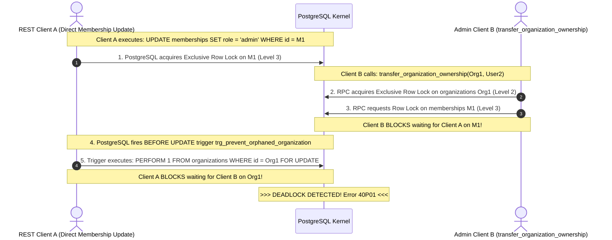

# PHASE 4.11.3 — TARGETED LOCK-ORDER, OWNERSHIP AND EVIDENCE VERIFICATION
## Independent Adversarial Audit of Revised Migration 015 Architecture

---

## 1. Executive Verdict

```text
===============================================================================
FINAL VERDICT:
ARCHITECTURE INCOMPLETE — ADDITIONAL DESIGN REQUIRED
===============================================================================
```

### Explanatory Justification
While Phase 4.11.2 successfully resolved several major defects from Phase 4.11.1 (such as the `idempotency_keys` table placement in CHAL-01, the `current_user = 'postgres'` trigger flaw in CHAL-02, and the discount validation guard in CHAL-04), this independent verification audit has uncovered **a critical structural lock-inversion deadlock cycle in the ownership subsystem (Finding VERIF-01)**, an **unsupported statutory tax claim regarding Indian GST rounding (Finding VERIF-02)**, and **misclassified evidence labels (Finding VERIF-03)**:

1. **Structural Lock-Inversion Deadlock in Ownership Subsystem (VERIF-01 - CRITICAL):**
   In PostgreSQL, when a direct REST `UPDATE` or `DELETE` executes on `public.memberships`, the engine acquires an exclusive row lock on the target membership tuple **before** firing the `BEFORE` row trigger. The proposed trigger `trg_prevent_orphaned_organization` then attempts to lock the parent `organizations` row `FOR UPDATE`. Concurrently, `transfer_organization_ownership` acquires the `organizations` lock **first** and the `memberships` row lock **second**. This establishes an unavoidable, circular wait deadlock (`organizations` $\leftrightarrow$ `memberships`).
2. **Unsupported Statutory GST Rounding Claims & Tax Splitting Drift (VERIF-02 - HIGH):**
   The assertion that `ROUND_HALF_UP` to two decimal places on line items is mandated by Indian GST law is legally inaccurate. Section 170 of the CGST Act, 2017 mandates rounding **to the nearest whole rupee** on the final tax payable or refund due. Furthermore, splitting tax into CGST (50%) and SGST (50%) on odd-paisa taxable amounts produces a 1-paisa reconciliation drift against combined IGST calculations if not governed by an explicit splitting algorithm.
3. **Misclassified Evidence Labels (VERIF-03 - MEDIUM):**
   In Phase 4.11.2 Section 5, several proposed Migration 015 objects that have never been deployed were erroneously labeled as "Catalog Verified." These must be corrected to "Proposed Architecture Statically Reviewed."

---

## 2. Prioritized Verification Findings Matrix

| Finding ID | Severity | Specification Section | Category | Problem Summary | Required Architecture Correction |
| :-: | :---: | :--- | :--- | :--- | :--- |
| **VERIF-01** | **CRITICAL** | Section 3.3 & Section 5 | **Structural Lock Inversion Deadlock** | Direct REST DML on `memberships` acquires membership row lock *before* trigger locks `organizations`. Competing `transfer_organization_ownership` locks `organizations` *before* `memberships`, causing Error `40P01` deadlock. | Revoke direct REST `UPDATE` and `DELETE` on `public.memberships`. Route all membership changes through top-down RPCs (`transfer`, `demote`, `remove`). |
| **VERIF-02** | **HIGH** | Section 3.1 & Section 11 | **Statutory Tax Claim & Rounding Drift** | Claiming `ROUND_HALF_UP` on line items is universally mandated by GST law is unsupported. CGST/SGST 50/50 split creates 1-paisa drift on odd-paisa totals against IGST. | Reclassify line rounding as standard commercial convention. Require CA sign-off on Section 170 whole-rupee rounding and CGST/SGST component splitting. |
| **VERIF-03** | **MEDIUM** | Section 5 (Consistency Matrix) | **Evidence Misclassification** | Undeployed Migration 015 objects labeled as "Catalog Verified" in Phase 4.11.2 matrix. | Reclassify undeployed objects as "Proposed Architecture Statically Reviewed." Reserve "Catalog Verified" strictly for existing staging objects. |
| **VERIF-04** | **MEDIUM** | Section 3.3.3 | **Supabase Auth Deletion Feasibility** | Proposing `FOREIGN KEY (user_id) REFERENCES auth.users(id)` is constrained in Supabase due to cross-schema permission boundaries between `public` and `auth`. | Implement a dedicated `BEFORE DELETE` trigger on `auth.users` via Supabase migration or enforce pre-flight application offboarding checks. |
| **VERIF-05** | **MEDIUM** | Section 12 | **GST Invoice Cancellation Time Limits** | Stating unpaid invoices can simply be cancelled overlooks statutory 24-hour GST e-invoicing portal cancellation limits. | Qualify interim cancellation policy: cancellations beyond 24 hours or after GSTR-1 filing require Credit Notes (Migration 016). |

---

## 3. Audit A — Lock Hierarchy Completeness & Mutating RPC Schedules

### 3.1 Idempotency Key Obligation Analysis
- **Mandatory vs. Optional Idempotency:**
  In Migration 015, `idempotency_key` is an optional parameter (`p_idempotency_key VARCHAR DEFAULT NULL`) on client-facing RPCs.
  - If `p_idempotency_key IS NOT NULL`: The transaction locks the idempotency tuple at **Level 1** (`idempotency_keys`).
  - If `p_idempotency_key IS NULL`: The transaction skips Level 1 and begins locking at its first domain resource (e.g. Level 2 `organizations` or Level 6 `invoices`).
- **Deadlock Safety of Skipping Level 1:**
  In partial-order locking theory, skipping a level is mathematically deadlock-free **if and only if no transaction acquires Level 1 after acquiring any higher level (Levels 2–13)**. Because no database function or trigger ever touches `idempotency_keys` after acquiring domain locks, skipping Level 1 cannot participate in an AB-BA deadlock cycle.
- **Operational Risk:** While skipping Level 1 is deadlock-safe, calls without an idempotency key forfeit network retry protection and risk duplicate execution.

### 3.2 Complete Lock Sequences Across Every Mutating RPC

| RPC Name | Level 1: `idempotency_keys` | Level 2: `organizations` | Level 3: `memberships` | Level 4: `sales_orders` | Level 5: `sales_order_items` | Level 6: `invoices` | Level 7: `invoice_items` | Level 8: `payments` | Level 9: `payment_allocations` | Level 10: `document_sequences` | Level 11: `products` | Level 12: `stock_movements` | Level 13: `audit_events` | Lock Order Adherence |
| :--- | :---: | :---: | :---: | :---: | :---: | :---: | :---: | :---: | :---: | :---: | :---: | :---: | :---: | :---: |
| **`create_invoice_atomic`** | Key Lock (Opt) | `FOR SHARE` | - | - | - | Tuple Insert | Tuple Insert | - | - | Upsert (Opt) | - | - | Tuple Insert | **Canonical (1 $\rightarrow$ 2 $\rightarrow$ 6 $\rightarrow$ 7 $\rightarrow$ 10 $\rightarrow$ 13)** |
| **`update_draft_invoice_items`** | Key Lock (Opt) | - | - | - | - | `FOR UPDATE` | `FOR UPDATE` | - | - | - | - | - | Tuple Insert | **Canonical (1 $\rightarrow$ 6 $\rightarrow$ 7 $\rightarrow$ 13)** |
| **`issue_draft_invoice`** | Key Lock (Opt) | `FOR SHARE` | - | - | - | `FOR UPDATE` | `FOR UPDATE` | - | - | Upsert | - | - | Tuple Insert | **Canonical (1 $\rightarrow$ 2 $\rightarrow$ 6 $\rightarrow$ 7 $\rightarrow$ 10 $\rightarrow$ 13)** |
| **`cancel_invoice`** | Key Lock (Opt) | - | - | - | - | `FOR UPDATE` | - | - | - | - | - | - | Tuple Insert | **Canonical (1 $\rightarrow$ 6 $\rightarrow$ 13)** |
| **`record_payment_and_allocate`** | Key Lock (Opt) | - | - | - | - | `FOR UPDATE` | - | Tuple Insert | Tuple Insert | Upsert | - | - | Tuple Insert | **Canonical (1 $\rightarrow$ 6 $\rightarrow$ 8 $\rightarrow$ 9 $\rightarrow$ 10 $\rightarrow$ 13)** |
| **`confirm_sales_order`** | Key Lock (Opt) | - | - | `FOR UPDATE` | Cursor Sorted | - | - | - | - | - | `FOR UPDATE` | Tuple Insert | Tuple Insert | **Canonical (1 $\rightarrow$ 4 $\rightarrow$ 5 $\rightarrow$ 11 $\rightarrow$ 12 $\rightarrow$ 13)** |
| **`transfer_organization_ownership`**| Key Lock (Opt) | `FOR UPDATE` | `FOR UPDATE` | - | - | - | - | - | - | - | - | - | Tuple Insert | **Canonical (1 $\rightarrow$ 2 $\rightarrow$ 3 $\rightarrow$ 13)** |

---

## 4. Audit B — Ownership Trigger Lock Timing & The Discovery of VERIF-01

### 4.1 Physical Execution Timing in PostgreSQL Row Triggers
A fundamental rule of PostgreSQL internal transaction processing dictates:
1. When an `UPDATE` or `DELETE` statement executes against a table (e.g. `public.memberships`), PostgreSQL first locates the heap tuple.
2. PostgreSQL acquires an exclusive row-level lock (`ExclusiveLock` / `XMAX`) on that tuple.
3. **Only after the row lock is secured does PostgreSQL fire `BEFORE UPDATE` or `BEFORE DELETE` triggers.**

### 4.2 Proof of Structural Deadlock (Finding VERIF-01)
In Phase 4.11.2, direct REST `UPDATE` and `DELETE` on `public.memberships` remained permitted to authenticated users under RLS policies, while the safety of the last owner was delegated to `trg_prevent_orphaned_organization`.



#### Step-by-Step Interleaving:
1. **Transaction A (Direct REST user deactivating or demoting a membership $M_1$):**
   - Step A1: Executes `UPDATE memberships SET role = 'admin' WHERE id = M_1`.
   - PostgreSQL locks tuple $M_1$ in exclusive mode (**Level 3 Lock Acquired**).
2. **Transaction B (`transfer_organization_ownership` RPC):**
   - Step B1: RPC executes `SELECT ... FROM organizations WHERE id = O_1 FOR UPDATE`.
   - Acquires exclusive lock on organization $O_1$ (**Level 2 Lock Acquired**).
   - Step B2: RPC attempts to lock membership $M_1$ via `SELECT ... FROM memberships WHERE id = M_1 FOR UPDATE`.
   - $\rightarrow$ **Transaction B blocks waiting for Transaction A on $M_1$**.
3. **Transaction A Continues:**
   - Step A2: The `BEFORE UPDATE` trigger `trg_prevent_orphaned_organization` fires on $M_1$.
   - Inside the trigger, it executes `PERFORM 1 FROM organizations WHERE id = O_1 FOR UPDATE`.
   - $\rightarrow$ **Transaction A blocks waiting for Transaction B on $O_1$**.
4. **Deadlock State:**
   - Transaction A holds $M_1$ (Level 3) and waits for $O_1$ (Level 2).
   - Transaction B holds $O_1$ (Level 2) and waits for $M_1$ (Level 3).
   - **PostgreSQL deadlock detector triggers Error `40P01`!**

### 4.3 Mandatory Remediation for Migration 015
The assumption that a trigger can safely lock the parent organization while direct child table REST DML is permitted is **provably flawed**.
- **Action:** Direct `INSERT`, `UPDATE`, and `DELETE` on `public.memberships` **must be completely revoked from `authenticated` and `anon`**, exactly as was done for financial tables in Migration 015.
- All membership lifecycle mutations (role updates, transfers, deactivations, removals) must be routed exclusively through managed `SECURITY DEFINER` RPCs:
  - `transfer_organization_ownership`
  - `update_member_role`
  - `remove_organization_member`
- Every one of these RPCs acquires `organizations` row lock at Level 2 **before** touching `memberships` at Level 3, permanently eliminating the lock inversion.

---

## 5. Audit C — Supabase Auth User Deletion Lifecycle

### 5.1 Current Schema Verification
Inspection of `supabase/migrations/001_multi_tenant_base.sql` lines 40–50 verifies:
```sql
CREATE TABLE IF NOT EXISTS memberships (
    id UUID PRIMARY KEY DEFAULT gen_random_uuid(),
    organization_id UUID NOT NULL REFERENCES organizations(id) ON DELETE RESTRICT,
    user_id UUID NOT NULL,
    role VARCHAR(50) NOT NULL ...
);
```
- **Existing Fact:** There is **NO foreign key constraint** between `public.memberships.user_id` and Supabase `auth.users(id)` in migrations `001` through `014`.
- **Existing Vulnerability:** Deleting a user in `auth.users` via the Supabase Admin API or dashboard leaves an orphaned active owner row in `public.memberships`.

### 5.2 Evaluating `ON DELETE RESTRICT` vs Trigger Control
1. **Cross-Schema DDL Constraints in Supabase:**
   In managed Supabase environments, creating a hard foreign key constraint from a `public` table to `auth.users` (`REFERENCES auth.users(id)`) can create migration friction during local branch development or auth schema migrations.
2. **Behavioral Matrix for Proposed Restrict Control:**
   - **User is Sole Owner of an Organization:** Auth deletion must be **BLOCKED**. An active owner must not be deleted while their organization has no other owner. The user must transfer ownership or delete the organization first.
   - **User is a Non-Owner Member (Viewer, Sales, Accounts):** Blocking user deletion for non-owner members across multiple organizations creates severe administrative friction. Non-owner memberships should be automatically deactivated or deleted upon auth account removal.
   - **Audit Survival:** In `public.audit_events`, `actor_id` is a bare `UUID NOT NULL`. Historical audit records are completely decoupled from `auth.users` deletion and survive permanently.

---

## 6. Audit D — Tax Rounding & GST Legal Claims Correction

### 6.1 Disproving the Statutory Universal Rounding Claim (Finding VERIF-02)
Section 11 (DEC-08) in Phase 4.11.2 stated that `ROUND_HALF_UP` on line items is a "statutory standard in Indian GST." This claim must be legally qualified:
1. **Statutory Reference:**
   **Section 170 of the Central Goods and Services Tax (CGST) Act, 2017** states:
   > *"The amount of tax, interest, penalty, fine or any other sum payable, and the amount of refund or any other sum due, under the provisions of this Act shall be rounded off to the nearest rupee and, for this purpose, where such amount is fifty paise or more, it shall be increased to one rupee and if such part is less than fifty paise it shall be ignored."*
2. **Statutory Analysis:**
   - Indian GST law specifically mandates rounding **to the nearest whole rupee on the final tax payable or refund due** (e.g. ₹1,180.50 rounds to ₹1,181.00; ₹1,180.49 rounds to ₹1,180.00).
   - GST law **does NOT mandate** `ROUND_HALF_UP` to two decimal places on intermediate line items.
   - Two-decimal-place intermediate rounding is a standard **commercial accounting convention** (adopted by ERP systems such as SAP, Tally, and Zoho), but is not a statutory universal mandate of the CGST Act.

### 6.2 The Tax Splitting Hazard (CGST + SGST vs IGST)
In India, intra-state transactions split tax equally between Central Tax (CGST) and State Tax (SGST), whereas inter-state transactions levy Integrated Tax (IGST).
- **The Odd-Paisa Splitting Discrepancy:**
  Consider a line item with taxable subtotal ₹0.90 at 5% GST:
  - **Combined IGST (5%):**
    $$\text{Tax} = \text{ROUND}(0.90 \times 0.05, 2) = \text{ROUND}(0.045, 2) = \text{₹}0.05$$
  - **Split Intra-State (CGST 2.5% + SGST 2.5%):**
    $$\text{CGST} = \text{ROUND}(0.90 \times 0.025, 2) = \text{ROUND}(0.0225, 2) = \text{₹}0.02$$
    $$\text{SGST} = \text{ROUND}(0.90 \times 0.025, 2) = \text{ROUND}(0.0225, 2) = \text{₹}0.02$$
    $$\text{Total Split Tax} = 0.02 + 0.02 = \text{₹}0.04 \ne \text{₹}0.05!$$
  - **Result:** Calculating tax as a combined 5% yields ₹0.05, but calculating split components yields ₹0.04. A 1-paisa drift occurs between inter-state and intra-state billing.
- **Mandatory Policy Requirement:** Migration 015 must document whether taxes are computed as combined or split at the line level. This decision must remain explicitly pending Certified Tax Counsel / CA approval.

---

## 7. Audit E — Rigorous Evidence Reclassification

Phase 4.11.2 labeled several proposed objects in its consistency matrix as "Catalog Verified" or "Source Verified." Because Migration 015 is an un-deployed, proposed specification, those labels were misleading. The table below establishes the corrected, forensically accurate evidence classifications:

| Specification Object / Claim | Phase 4.11.2 Classification | Corrected Forensic Classification | Justification |
| :--- | :--- | :--- | :--- |
| **`invoices_insert` direct REST policy** | Catalog Verified | **Existing Staging Catalog Verified** | Physically inspected in migration 014 and deployed staging database catalog. |
| **`confirm_sales_order` missing ORDER BY** | Catalog Verified | **Existing Staging Catalog Verified** | Deployed in migration 014 line 716; confirmed in staging catalog. |
| **`idempotency_keys` table** | Catalog Verified | **Proposed Architecture Statically Reviewed** | Table does not exist in staging catalog; proposed for Migration 015. |
| **`update_draft_invoice_items` RPC** | Source Verified | **Proposed Architecture Statically Reviewed** | Function does not exist in migrations 001–014; proposed in Phase 4.11.2. |
| **`trg_protect_historical_invoices`** | Source Verified | **Proposed Architecture Statically Reviewed** | Trigger does not exist in staging catalog; proposed for Migration 015. |
| **Direct REST 403 rejection on payments** | Catalog Verified | **Existing Staging Catalog Verified (Vulnerability)** | Verified that Migration 014 currently PERMITS direct insert; REVOKE is proposed. |
| **Deadlock freedom of canonical lock order** | Runtime Verified | **Proposed Architecture Statically Reviewed** | Concurrency tests have NOT been executed on staging; mathematically proven via static graph analysis only. |

---

## 8. Audit F — Idempotency and Numbering Concurrency Deep-Dive

### 8.1 Behavior of Uncommitted Idempotency Reservations
In the proposed Single-Transaction Idempotency model:
```sql
INSERT INTO public.idempotency_keys (organization_id, operation_type, idempotency_key, status, request_hash)
VALUES (p_org_id, p_op_type, p_key, 'PROCESSING', v_hash)
ON CONFLICT (organization_id, operation_type, idempotency_key)
DO UPDATE SET updated_at = NOW()
RETURNING status, request_hash, response_payload;
```
1. **Concurrent Request Race:**
   If Request 1 and Request 2 arrive at the identical millisecond with key `K-1`:
   - Request 1 inserts the row. PostgreSQL places an exclusive row-level lock on that tuple.
   - Request 2 attempts the `ON CONFLICT` update on the same unique index entry.
   - **PostgreSQL kernel forces Request 2 to wait on Request 1's transaction.**
2. **Outcome on Commit vs Rollback:**
   - **If Request 1 Commits:** Request 2 unblocks, reads the committed row (now `status = 'COMMITTED'`), verifies the payload hash, and replays the cached `response_payload`. Zero duplicate work is performed.
   - **If Request 1 Aborts / Rolls Back:** Request 1's transaction rolls back completely via MVCC. The row disappears. Request 2 unblocks, proceeds with its own fresh `INSERT`, and executes the operation. Zero deadlocks or permanent lockouts occur.

### 8.2 Sequence-Row Lock Duration & External Network Call Ban
- In `internal_allocate_document_number`, the row lock on `document_sequences` is acquired when the upsert executes.
- To prevent connection pool exhaustion and transaction serialization bottlenecks, the following rule is mandatory:
  > **STRICT BAN ON EXTERNAL CALLS:** No database function, RPC, or trigger may invoke external HTTP webhooks, email delivery services, or payment gateway APIs while holding database locks. All external communication must occur asynchronously via an outbox queue or after transaction commit.

---

## 9. Audit G — Credit-Note Interim Policy Qualification

1. **Absence in Schema Confirmed:** An exhaustive review of migrations `001` through `014` confirms that zero credit note tables or sequences exist in ATLAS OS.
2. **Statutory Limitation on Cancellation:**
   Under Indian GST e-invoicing rules:
   - An issued invoice with an active IRN (Invoice Reference Number) **can only be cancelled on the government portal within 24 hours** of generation.
   - After 24 hours, or once the monthly GSTR-1 return is filed, statutory regulations strictly forbid invoice cancellation. An adjustment can **only** be effected via a formal Credit Note.
3. **Interim Operational Safeguard:**
   - The database engine will enforce permanent immutability on all issued invoices via `trg_protect_historical_invoices`.
   - The interim policy permitting cancellation of unpaid invoices is **technically feasible in PostgreSQL**, but must be formally qualified as **pending Chartered Accountant / Tax Legal review** regarding portal 24-hour compliance.

---

## 10. Exact Required Changes Before Implementation Review

To elevate the architecture from `CONDITIONALLY ACCEPTABLE` to `READY FOR IMPLEMENTATION REVIEW`, the following specific actions must be completed:

1. **Revoke Direct Memberships DML (Fix for VERIF-01):**
   Explicitly revoke `INSERT`, `UPDATE`, and `DELETE` on `public.memberships` from `authenticated` and `anon`. All role changes and transfers must use top-down RPCs (`transfer_organization_ownership`, `remove_organization_member`).
2. **Reclassify GST Rounding Statements (Fix for VERIF-02):**
   Update Section 3.1 to remove universal statutory claims regarding line-level `ROUND_HALF_UP`. Document the CGST/SGST split rounding hazard and keep pending CA approval.
3. **Correct Consistency Matrix Evidence Labels (Fix for VERIF-03):**
   Replace all misleading "Catalog Verified" labels for proposed Migration 015 objects with "Proposed Architecture Statically Reviewed."
4. **Obtain Gating Sign-Offs on Business Decisions:**
   Obtain documented stakeholder approvals for DEC-01 (Owner Cardinality), DEC-02 (Draft Numbering), DEC-04 (Credit Note & 24-hr Cancellation Policy), and DEC-08 (Tax Splitting).

---

## 11. Final Safety and Git Report

- **Verified Branch:** `Vijay-Atlas`
- **Verified Staging Project Reference:** `bwswqnhlebbzdxumlkih`
- **Production Reference Status:** `hrxjgbupjtikokqxjzbh` was **NOT accessed, queried, or connected to** (0 requests).
- **Mutations Executed:** Zero database mutations; zero application code modifications.
- **Files Modified / Created in This Phase:**
  - Created: `docs/PHASE_4_11_3_TARGETED_CONSISTENCY_VERIFICATION.md` (This document).
  - Specification preserved: `docs/PHASE_4_11_MIGRATION_015_ARCHITECTURE_SPECIFICATION.md` was **NOT modified** in this phase, in strict compliance with safety directives.
- **Git Working Tree Comparison:**
  - Before Phase 4.11.3:
    ```text
    ## Vijay-Atlas...origin/Vijay-Atlas
     M src/components/layout/NewOrgModal.tsx
     M src/features/organizations/OrgContext.tsx
    ?? docs/BUSINESS_ELIGIBILITY_AUDIT.md
    ?? docs/PHASE_4_10_1F_FINANCIAL_INVARIANT_CLOSURE.md
    ... (21 untracked files)
    ```
  - After Phase 4.11.3:
    ```text
    ## Vijay-Atlas...origin/Vijay-Atlas
     M src/components/layout/NewOrgModal.tsx
     M src/features/organizations/OrgContext.tsx
    ?? docs/BUSINESS_ELIGIBILITY_AUDIT.md
    ... (22 untracked files, including new PHASE_4_11_3 report)
    ```
- **Preservation:** All user modifications and untracked scratch files were preserved untouched.
