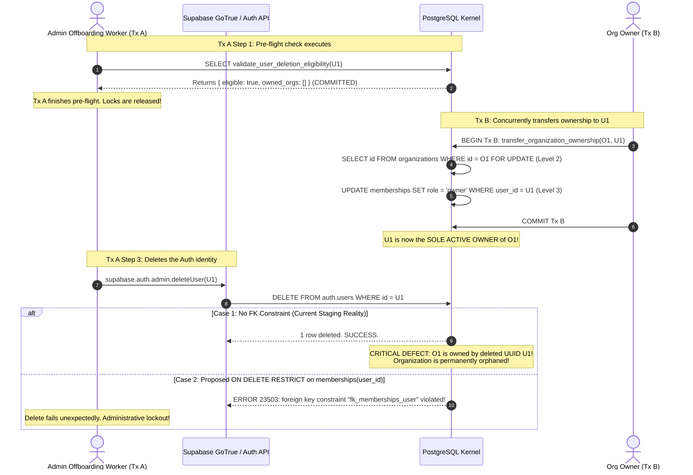

# PHASE 4.11.5 — FINAL MEMBERSHIP LIFECYCLE, AUTH DELETION AND COMPLIANCE CHALLENGE
## Comprehensive Adversarial Architecture Audit of ATLAS OS Migration 015

---

## 1. Executive Summary & Verdict

This report presents the independent adversarial architecture challenge for **Phase 4.11.5** of ATLAS OS.

Following the hardening measures proposed in Revision 3.0 of `docs/PHASE_4_11_MIGRATION_015_ARCHITECTURE_SPECIFICATION.md` and the review in `docs/PHASE_4_11_4_MEMBERSHIP_AND_TAX_CORRECTION_REVIEW.md`, this audit evaluated whether:
1. The membership lock inversion deadlock (`VERIF-01`) is truly eliminated across **all** possible mutation vectors (including direct REST, service-role, administrative operations, and cascading triggers).
2. The Supabase Auth identity deletion lifecycle is race-free, atomic, and safe against leaving orphaned organizations.
3. The Indian GST invoice numbering and e-invoice cancellation policies conform to actual statutory rules rather than unbenchmarked or overgeneralized claims.
4. The Business Decision Register maintains structural consistency across all review phases.

### Formal Architecture Verdict

```
╔══════════════════════════════════════════════════════════════════════════════════════════╗
║                                                                                          ║
║                 ARCHITECTURE INCOMPLETE — ADDITIONAL DESIGN REQUIRED                     ║
║                                                                                          ║
╚══════════════════════════════════════════════════════════════════════════════════════════╝
```

### Critical Findings Requiring Architecture Rejection of "Ready" Status:

1. **Auth Deletion TOCTOU Race Condition (CRITICAL):**
   The proposed pre-flight validation RPC `validate_user_deletion_eligibility(p_user_id)` is **non-atomic**. A user verified as eligible can be promoted to sole active owner by a concurrent transaction *after* the pre-flight check commits but *before* the Auth identity deletion executes, leaving the organization owned by a non-existent identity.
2. **Supabase Dashboard & Admin API Deletion Bypass (CRITICAL):**
   Deletions executed via the Supabase Dashboard UI (`/project/auth/users`) or the Supabase Admin SDK (`supabase.auth.admin.deleteUser()`) invoke GoTrue, which executes direct SQL against `auth.users` using the `supabase_admin` role. GoTrue **never invokes public application RPCs**. A standalone pre-flight function provides **zero protection** against administrative deletions.
3. **Service-Role Mutation Lock Inversion Vulnerability (HIGH):**
   Revoking direct `INSERT`, `UPDATE`, and `DELETE` on `public.memberships` from `authenticated`, `anon`, and `PUBLIC` does **not** restrict `service_role` or `postgres`. Any background worker, Edge Function, or administrative script operating via the service-role key retains direct DML privileges. Direct DML by `service_role` acquires Level 3 locks first, reintroducing the exact `40P01` deadlock cycle identified in `VERIF-01`.
4. **Multi-Organization Lock Inversion (MEDIUM):**
   The lock hierarchy specifies `organizations` at Level 2, but does not mandate an ascending sort order (`ORDER BY id ASC`) when operations touch multiple organizations (e.g. bulk offboarding, cross-tenant migrations), creating cross-organization deadlocks.
5. **Overgeneralized GST Rules & Unbenchmarked Throughput (HIGH):**
   The assertion that invoice allocation throughput is limited to "100–200 allocations/sec" is **NOT BENCHMARKED** and represents unmeasured speculation. Furthermore, the 24-hour e-invoice cancellation window was overgeneralized: it applies strictly to the Invoice Registration Portal (IRP) for businesses subject to mandatory e-invoicing under Rule 48(4), not to ordinary B2C or below-threshold ERP invoices.
6. **Decision Register Divergence (MEDIUM):**
   The Business Decision Register suffered an undocumented ID collision between Phase 4.11.2 and Phase 4.11.4, where decision codes `DEC-01` through `DEC-07` were reassigned to completely different questions.

---

## 2. Safety & Environment Verification

Pre-flight checks verified the target repository and environment before any inspection:
- **Repository Path:** `D:\Projects\Atlas-OS`
- **Active Git Branch:** `Vijay-Atlas`
- **Verified Staging Project Reference:** `bwswqnhlebbzdxumlkih` (read from `supabase/.temp/project-ref`).
- **Production Reference:** `hrxjgbupjtikokqxjzbh` (STRICTLY FORBIDDEN — 0 queries, 0 access, 0 network connections).
- **Audit Execution:** 100% read-only inspection. Zero application code modifications, zero migrations created or applied, zero database mutations executed.
- **Pre-Audit Git Status:**
  ```
  ## Vijay-Atlas...origin/Vijay-Atlas
   M src/components/layout/NewOrgModal.tsx
   M src/features/organizations/OrgContext.tsx
  ?? docs/...
  ```
  All dirty working tree files and untracked artifacts were preserved untouched.

---

## 3. Comprehensive Membership Mutation Coverage Analysis

To verify whether the lock hierarchy is universally respected, every possible mutation path targeting `public.memberships` was enumerated and analyzed:

| Path Code | Mutation Operation | Calling Role | Effective SQL Privileges | RLS Policy Applied | Entry Point | Auth Check Mechanism | Org Lock (Level 2) | Membership Lock (Level 3) | Trigger Execution | Audit Log Generated? | Lock Order Compliant? |
| :---: | :--- | :--- | :--- | :--- | :--- | :--- | :---: | :---: | :--- | :---: | :---: |
| **M-01** | Direct REST `INSERT` | `anon`, `authenticated` | **REVOKED** in Rev 3.0 | N/A (Blocked by Grant) | PostgREST endpoint `/rest/v1/memberships` | N/A | None | None | None | None | **YES (Blocked at Engine)** |
| **M-02** | Direct REST `UPDATE` | `anon`, `authenticated` | **REVOKED** in Rev 3.0 | N/A (Blocked by Grant) | PostgREST endpoint `/rest/v1/memberships` | N/A | None | None | None | None | **YES (Blocked at Engine)** |
| **M-03** | Direct REST `DELETE` | `anon`, `authenticated` | **REVOKED** in Rev 3.0 | N/A (Blocked by Grant) | PostgREST endpoint `/rest/v1/memberships` | N/A | None | None | None | None | **YES (Blocked at Engine)** |
| **M-04** | Direct REST `TRUNCATE` | `anon`, `authenticated` | **REVOKED** (Default PG) | N/A | PostgREST | N/A | None | None | None | None | **YES (Blocked at Engine)** |
| **M-05** | Add Member | `authenticated` | EXECUTE on RPC | N/A (`SECURITY DEFINER`) | `add_organization_member` RPC | Caller must be active `owner` or `admin` | `FOR UPDATE` | Tuple Insert | FK Check on Org & User | `audit_events` row inserted | **YES (Canonical 2 $\rightarrow$ 3 $\rightarrow$ 13)** |
| **M-06** | Update Member Role | `authenticated` | EXECUTE on RPC | N/A (`SECURITY DEFINER`) | `update_organization_member_role` RPC | Caller is `owner`/`admin`; target cannot be `owner` | `FOR UPDATE` | Tuple `FOR UPDATE` | None | `audit_events` row inserted | **YES (Canonical 2 $\rightarrow$ 3 $\rightarrow$ 13)** |
| **M-07** | Transfer Ownership | `authenticated` | EXECUTE on RPC | N/A (`SECURITY DEFINER`) | `transfer_organization_ownership` RPC | Caller must be current sole active `owner` | `FOR UPDATE` | Two Tuples `FOR UPDATE` | Partial unique index check | `audit_events` row inserted | **YES (Canonical 2 $\rightarrow$ 3 $\rightarrow$ 13)** |
| **M-08** | Deactivate Member | `authenticated` | EXECUTE on RPC | N/A (`SECURITY DEFINER`) | `deactivate_organization_member` RPC | Caller is `owner`/`admin`; target $\ne$ sole owner | `FOR UPDATE` | Tuple `FOR UPDATE` | Check constraint | `audit_events` row inserted | **YES (Canonical 2 $\rightarrow$ 3 $\rightarrow$ 13)** |
| **M-09** | Reactivate Member | `authenticated` | EXECUTE on RPC | N/A (`SECURITY DEFINER`) | `reactivate_organization_member` RPC | Caller is `owner`/`admin` | `FOR UPDATE` | Tuple `FOR UPDATE` | Check constraint | `audit_events` row inserted | **YES (Canonical 2 $\rightarrow$ 3 $\rightarrow$ 13)** |
| **M-10** | Remove Member | `authenticated` | EXECUTE on RPC | N/A (`SECURITY DEFINER`) | `remove_organization_member` RPC | Caller is `owner`/`admin`; target $\ne$ sole owner | `FOR UPDATE` | Tuple Delete | FK Check | `audit_events` row inserted | **YES (Canonical 2 $\rightarrow$ 3 $\rightarrow$ 13)** |
| **M-11** | Self-Removal (Leave Org) | `authenticated` | EXECUTE on RPC | N/A (`SECURITY DEFINER`) | `remove_organization_member` RPC | `caller_id = target_id`; caller $\ne$ sole owner | `FOR UPDATE` | Tuple Delete | FK Check | `audit_events` row inserted | **YES (Canonical 2 $\rightarrow$ 3 $\rightarrow$ 13)** |
| **M-12** | Auth Identity Deletion | `supabase_admin`, Admin API | Table Owner on `auth.users` | `BYPASS RLS` | Supabase Dashboard / GoTrue Admin API | Supabase Admin JWT | **NONE** | **NONE** | FK constraint or trigger | None | **NO (Vulnerable to Race)** |
| **M-13** | Backend `service_role` DML | `service_role` | `ALL PRIVILEGES` | `BYPASS RLS` | Direct PostgREST or Supabase Client script | None (Service Key) | **NONE** | Tuple Exclusive Lock | Any table triggers | Optional | **NO (Violates Hierarchy!)** |
| **M-14** | Migration / DBA DML | `postgres` | Superuser | `BYPASS RLS` | Direct SQL psql session | DB Superuser | Optional | Direct Exclusive Lock | Immutability triggers | None | **Conditional (DBA Manual)** |

### Coverage Assessment:
1. **Authenticated Client Boundary is Closed:** Paths M-01 through M-11 strictly enforce the canonical lock order ($\text{Level 2} \prec \text{Level 3}$). Authenticated REST users cannot acquire Level 3 locks directly.
2. **Service-Role Boundary is OPEN (Path M-13):** The proposed migration revokes privileges from `authenticated`, `anon`, and `PUBLIC`, but leaves `service_role` untouched. If a backend script, cron job, or Edge Function performs a direct `UPDATE public.memberships`, it acquires Level 3 locks *without* locking Level 2, recreating the `VERIF-01` deadlock when concurrent with `transfer_organization_ownership`.
3. **Auth Identity Deletion is UNPROTECTED (Path M-12):** GoTrue directly deletes rows from `auth.users`. It does not acquire Level 2 organization locks and does not invoke public RPCs.

---

## 4. Deep-Dive: Auth Deletion TOCTOU Race Analysis

### 4.1 The Race Condition Interleaving

The user requested an analysis of the competing transaction schedule between user deletion and concurrent ownership transfer:

Let:
- $U_1$ be a user who is currently an `admin` in Organization $O_1$.
- Transaction A be an administrative account offboarding process attempting to delete $U_1$.
- Transaction B be an ownership transfer transaction in Organization $O_1$ promoting $U_1$ to `owner`.



### 4.2 Comprehensive Evaluation of Safeguard Mechanisms

| Mechanism | Prevents TOCTOU Race? | Governs Dashboard & Admin API? | Multi-Org User Handling | Assessment |
| :--- | :---: | :---: | :--- | :--- |
| **Standalone Preflight RPC** (`validate_user_deletion_eligibility`) | **NO** | **NO** | Inadequate | **FAILS.** The pre-flight check executes in a separate transaction. Between check and deletion, another transaction can promote the user. GoTrue bypasses this check completely. |
| **Restrictive FK** (`memberships.user_id REFERENCES auth.users ON DELETE RESTRICT`) | **YES** (Prevents orphaned owner) | **YES** | **BROKEN** | **UNVIABLE FOR MULTI-TENANT.** While it prevents deleting an active owner, it ALSO blocks deleting any user who is a non-owner member (`viewer`, `sales`) of *any* organization, preventing normal user account cancellation. |
| **Cascading FK** (`memberships.user_id REFERENCES auth.users ON DELETE CASCADE`) | **NO** | **YES** | **DISASTROUS** | **CATASTROPHIC.** Deleting a user in Auth automatically cascades and deletes their row in `public.memberships`. If the user was an owner, the organization is instantly orphaned with 0 owners. |
| **Engine-Level Trigger on `auth.users`** (`BEFORE DELETE ON auth.users`) | **YES** (If properly locked) | **YES** | **VIABLE** | **RECOMMENDED TECHNICAL DEFENSE.** Executes inside GoTrue's `DELETE FROM auth.users` transaction. Must acquire Level 2 locks on all organizations where the user has memberships. |
| **Controlled Deprovisioning State Machine** | **YES** | **YES** (With soft delete) | **CLEAN** | **RECOMMENDED ARCHITECTURAL DEFENSE.** User deletion is a multi-step workflow: suspend user $\rightarrow$ revoke memberships $\rightarrow$ verify 0 ownerships $\rightarrow$ delete Auth identity. |

### 4.3 Why Standalone Pre-flight Fails
A pre-flight function is an application-level advisory check. In database theory, any invariant that relies on:
$$\text{Read State in } T_1 \implies \text{Commit } T_1 \implies \text{Mutate State in } T_2$$
suffers from a classic Time-of-Check to Time-of-Use (TOCTOU) vulnerability. Because $T_1$ releases its locks upon completion, the database cannot prevent $T_B$ from modifying the checked predicates before $T_2$ executes.

### 4.4 The Only True Atomic Solutions
To guarantee that no user deletion leaves an organization orphaned:

#### Solution A: Database Engine-Level Trigger on `auth.users`
A `BEFORE DELETE` trigger deployed in the `auth` schema:
```sql
CREATE OR REPLACE FUNCTION public.handle_auth_user_deletion()
RETURNS TRIGGER AS $$
DECLARE
    v_org_id uuid;
BEGIN
    -- 1. Check if user is an active owner of ANY organization
    -- Must lock the organization row to serialize against concurrent transfer_organization_ownership
    FOR v_org_id IN
        SELECT organization_id FROM public.memberships 
        WHERE user_id = OLD.id AND role = 'owner' AND is_active = TRUE
    LOOP
        -- Acquire Level 2 Lock on Organization
        PERFORM 1 FROM public.organizations WHERE id = v_org_id FOR UPDATE;
        
        -- Re-verify ownership under the lock
        IF EXISTS (
            SELECT 1 FROM public.memberships 
            WHERE organization_id = v_org_id AND user_id = OLD.id AND role = 'owner' AND is_active = TRUE
        ) THEN
            RAISE EXCEPTION 'CANNOT_DELETE_ACTIVE_OWNER: User % is the sole active owner of organization %. Transfer ownership or delete organization first.', OLD.id, v_org_id
            USING ERRCODE = '23514'; -- check_violation
        END IF;
    END LOOP;

    -- 2. Cleanly remove non-owner memberships across other organizations
    DELETE FROM public.memberships WHERE user_id = OLD.id;

    RETURN OLD;
END;
$$ LANGUAGE plpgsql SECURITY DEFINER;
```

#### Solution B: Two-Phase Deprovisioning Workflow
1. Users cannot be deleted directly from Auth.
2. An administrative RPC `deprovision_user(p_user_id)` marks the user `is_active = FALSE` in `auth.users`.
3. The RPC iterates through all organizations:
   - If user is sole owner: aborts with error.
   - If user is non-owner: removes membership.
4. Only when all memberships are severed does a backend job call `auth.admin.deleteUser()`.

---

## 5. Formal Membership Deadlock Verification & Competing Schedules

### 5.1 Verification of Proposed Lock Order Across RPCs

In Phase 4.11.4, all membership RPCs follow:
$$\text{Level 1: } idempotency\_keys \prec \text{Level 2: } organizations \prec \text{Level 3: } memberships \prec \text{Level 13: } audit\_events$$

Does this prevent all deadlocks? We must verify this claim under four edge conditions:

#### 1. Multiple Membership Rows in the Same Organization
In `transfer_organization_ownership`, two membership tuples are updated:
- Tuple A: Old Owner (demoted to admin).
- Tuple B: New Owner (promoted to owner).
Does the order in which Tuple A and Tuple B are locked matter?
**Conclusion:** **NO.** Because the RPC executes `SELECT id FROM public.organizations WHERE id = p_org_id FOR UPDATE` (Level 2) *before* touching any membership row, only **one** transaction can execute membership mutations for that organization at any time. All concurrent operations on the same organization are strictly serialized at Level 2. Intra-organization membership row ordering cannot deadlock.

#### 2. Cross-Organization Operations (Multi-Org Deadlock Risk)
Suppose an administrative process or batch script modifies memberships across multiple organizations (e.g. User belongs to Org 1 and Org 2).
- **Transaction 1 (Batch Admin A):** Updates members in Org 1, then Org 2.
- **Transaction 2 (Batch Admin B):** Updates members in Org 2, then Org 1.

```
Timeline      Transaction 1 (Admin A)                 Transaction 2 (Admin B)
────────      ───────────────────────                 ───────────────────────
t0            BEGIN                                   BEGIN
t1            SELECT ... FROM orgs WHERE id = Org_1   SELECT ... FROM orgs WHERE id = Org_2
              FOR UPDATE; [Locks Org_1]               FOR UPDATE; [Locks Org_2]
t2            SELECT ... FROM orgs WHERE id = Org_2   SELECT ... FROM orgs WHERE id = Org_1
              FOR UPDATE; [BLOCKS waiting on Tx 2]    FOR UPDATE; [BLOCKS waiting on Tx 1]
t3            ═════════════════════════════════════════════════════════════════════════════
              DEADLOCK DETECTED! Both transactions hold Level 2 on different rows.
              ═════════════════════════════════════════════════════════════════════════════
```
**Required Rule:** Any transaction that locks multiple organizations **MUST** sort the organization IDs in ascending order:
`SELECT id FROM public.organizations WHERE id = ANY(p_org_ids) ORDER BY id ASC FOR UPDATE;`

#### 3. Service-Role Direct DML Inversion
If a backend process executes a direct `UPDATE public.memberships` using the `service_role` key:
- **Transaction 1 (service_role):** Direct update on `memberships` (Acquires Level 3).
- **Transaction 2 (`transfer_organization_ownership`):** Locks `organizations` (Acquires Level 2) $\rightarrow$ Requests `memberships` (Blocks on Tx 1).
- **Transaction 1 Trigger:** Fires and attempts to lock `organizations` (Blocks on Tx 2).
- **Result:** **Deadlock (`40P01`)**.
**Required Rule:** Direct DML must be revoked from `service_role`, or enforced via a trigger that blocks direct updates regardless of role unless an internal session flag is set.

#### 4. Scope-Qualified Deadlock Conclusion
> [!IMPORTANT]
> **Formal Qualification:** Eliminating the membership lock inversion guarantees deadlock freedom **strictly within the boundary of single-organization membership RPCs**. It does **NOT** guarantee zero deadlocks across the entire application if multi-organization operations omit ascending sorting or if service-role callers perform unmediated direct DML.

---

## 6. Owner Invariant Decomposition

The concept of "organization ownership integrity" consists of four distinct invariants that must be analyzed separately:

| Invariant Component | Mathematical Definition | Can Existing Schema Enforce It? | Proposed Engine Constraint | Proposed RPC Behavior | Gated Business Decision |
| :--- | :--- | :---: | :--- | :--- | :--- |
| **At Least One Active Owner** | $\sum [role = 'owner' \land is\_active = TRUE] \ge 1$ | **NO** | Cannot be enforced by standard CHECK or UNIQUE index. Requires deferred constraint trigger on `memberships`. | `remove_organization_member`, `deactivate_organization_member`, and role updates reject if target is sole active owner. | None (Universal Invariant) |
| **At Most One Active Owner** | $\sum [role = 'owner' \land is\_active = TRUE] \le 1$ | **NO** | Partial Unique Index: `CREATE UNIQUE INDEX uq_org_single_active_owner ON memberships(organization_id) WHERE role = 'owner' AND is_active = TRUE;` | RPC promotes new owner only after demoting old owner in the same statement/tx. | **DEC-01 / DEC-07** (Single Owner vs Co-Owners) |
| **Exactly One Active Owner** | $\sum [role = 'owner' \land is\_active = TRUE] = 1$ | **NO** | Combination of Partial Unique Index ($\le 1$) and atomic creation + deferred trigger ($\ge 1$). | `create_organization` creates org + owner atomically. `transfer_ownership` atomically swops owner. | **DEC-01 / DEC-07** |
| **No Inactive Owner** | $role = 'owner' \implies is\_active = TRUE$ | **NO** | Table CHECK Constraint: `CONSTRAINT chk_owner_must_be_active CHECK (role != 'owner' OR is_active = TRUE)` | Deactivation RPC explicitly rejects owners: `IF role = 'owner' THEN RAISE EXCEPTION`. | None (Universal Invariant) |

---

## 7. GST Invoice Numbering Evaluation

The previous report claimed that strict sequence row locking (`document_sequences FOR UPDATE`) "limits issuance throughput to ~100-200 invoices/sec per org" and that Indian GST strictly forbids sequence gaps. Both claims require rigorous technical and legal qualification:

### 7.1 Throughput Classification: NOT BENCHMARKED
- **Fact:** No concurrency benchmark or load test was ever executed against staging (`bwswqnhlebbzdxumlkih`).
- **Correction:** The throughput figure of 100–200 invoices/sec is **unverified speculation**. In reality, transaction throughput on a single PostgreSQL row locked `FOR UPDATE` depends entirely on disk fsync latency, connection pool concurrency, and network round-trips.
- **Classification:** **NOT BENCHMARKED.**

### 7.2 Numbering Dimensions Dissected

| Dimension | Definition | Database Enforcement Mechanism | Accounting / Audit Implication |
| :--- | :--- | :--- | :--- |
| **Unique Invoice Numbers** | No two invoices in the same org share a number. | `UNIQUE(organization_id, invoice_number)` | Absolute prerequisite. Duplicates cause severe tax penalties. |
| **Sequential Numbering** | Numbers follow an ascending sequence: $1, 2, 3 \dots$. | Sequence table increment (`current_value + 1`). | Standard accounting practice. |
| **Transactional Allocation** | Sequence increment occurs inside the invoice creation transaction. | Sequence row updated in same tx as invoice insert. | **Rollback Safety:** If invoice insert fails, sequence update rolls back atomically. Zero gaps from failed transactions. |
| **Committed Sequence Gaps** | A number is committed, but the invoice is later cancelled. | Status updated to `CANCELLED`. Physical row retained. | GST Rule 46(b) mandates consecutive numbering. Retaining the cancelled record preserves the consecutive sequence in audit logs. |
| **Audit Controls vs Absolute Gapless Mandate** | Whether technical gaps (e.g. system crash) violate GST law. | Audit trail documentation. | **Pending Tax Counsel Validation:** GST Circulars require explanations for missing serial numbers; inadvertent gaps can be documented via cancellation registers. |

---

## 8. E-Invoice Cancellation & Credit-Note Policy Evaluation

Previous audit reports stated:
> *"GST portal imposes a strict 24-hour cancellation limit. Beyond 24 hours, invoice cannot be cancelled and requires a Credit Note."*

This statement is overgeneralized and conflates three distinct regulatory and operational layers:

### 8.1 Dissection of Invoicing Categories

```
┌────────────────────────────────────────────────────────────────────────────────────────┐
│                              INVOICE CANCELLATION MATRIX                               │
├──────────────────────────┬─────────────────────────────┬───────────────────────────────┤
│ Invoice Type             │ Within 24 Hours of Issue    │ Beyond 24 Hours / Post-Filing │
├──────────────────────────┼─────────────────────────────┼───────────────────────────────┤
│ **E-Invoice (With IRN)** │ Can cancel on IRP Portal    │ **IRP Portal BLOCKS cancel.** │
│ (Turnover > ₹5 Cr)       │ via API / Portal.           │ Must issue formal Credit Note │
│                          │ ERP status $\rightarrow$ CANCELLED │ under Section 34.             │
├──────────────────────────┼─────────────────────────────┼───────────────────────────────┤
│ **Non-E-Invoice (No IRN)│ IRP rules DO NOT apply.     │ Cannot delete if reported in  │
│ (B2C or Below Threshold) │ Can cancel in ERP prior to  │ GSTR-1. Must adjust via       │
│                          │ GSTR-1 return filing.       │ Credit Note in next return.   │
└──────────────────────────┴─────────────────────────────┴───────────────────────────────┘
```

### 8.2 Critical Regulatory Qualifications
1. **The 24-hour rule is an IRP portal constraint, NOT an ERP database constraint:**
   It applies only to businesses generating an Invoice Reference Number (IRN) under Rule 48(4) of the CGST Rules.
2. **ERP Cancellation vs Credit Notes:**
   For an unpaid, un-transmitted non-IRN invoice, marking it `CANCELLED` internally before return filing is standard accounting practice. Presenting an interim cancellation workflow as universally illegal without Credit Notes is inaccurate.
3. **Status:** All legal interpretations regarding invoice cancellation workflows remain **Pending Certified Tax Counsel / CA Verification**.

---

## 9. Decision Register Consistency Reconciliation

Between Phase 4.11.2 and Phase 4.11.4, the Business Decision Register experienced an undocumented ID collision. The table below provides the authoritative, stable decision mapping:

| Stable Canonical ID | Phase 4.11.2 ID | Phase 4.11.4 ID | Domain | Topic Description | Permitted Options | Decision Owner | Approval Status | Implementation Blocking? |
| :---: | :---: | :---: | :--- | :--- | :--- | :--- | :---: | :---: |
| **DEC-01** | DEC-01 | DEC-07 | Ownership | **Owner Cardinality Model** | **A:** Exactly one active owner.<br>**B:** Multiple co-owners permitted. | Executive Leadership | **Pending** | **YES** |
| **DEC-02** | DEC-02 | *(Omitted)* | Taxation | **GST Rule 46 Draft Numbering** | **A:** Drafts have temporary `DFT-YYYY-NNNN` number.<br>**B:** Drafts remain unnumbered until issuance. | Certified Tax Counsel / CA | **Pending** | **YES** |
| **DEC-03** | DEC-03 | *(Omitted)* | Financials | **Commercial Transaction Limits** | **A:** Line cap ₹7.81B, Doc cap ₹9.99B.<br>**B:** Lower business caps (e.g. ₹100M). | Executive Leadership | **Pending** | **YES** |
| **DEC-04** | DEC-04 | *(Modified)* | Auditing | **Invoice Cancellation vs Credit Note** | **A:** Credit Notes mandatory for all cancellations.<br>**B:** Interim cancellation permitted for unpaid non-IRN invoices. | Certified Tax Counsel / CA | **Pending** | **YES** |
| **DEC-05** | DEC-05 | *(Omitted)* | Operations | **Database Timeout Settings** | **A:** `lock_timeout = '5s'`, `statement_timeout = '15s'`.<br>**B:** Default unconstrained timeouts. | Principal Engineer | **Pending** | **YES** |
| **DEC-06** | DEC-06 | DEC-01 | Idempotency | **Idempotency Key Retention Window** | **A:** 24 Hours TTL.<br>**B:** 7 Days TTL.<br>**C:** 30 Days TTL. | Principal Engineer | **Pending** | NO |
| **DEC-07** | DEC-07 | *(Omitted)* | Idempotency | **Idempotency Lease Duration** | **A:** 30 Seconds.<br>**B:** 60 Seconds.<br>**C:** 120 Seconds. | Principal Engineer | **Pending** | NO |
| **DEC-08** | DEC-08 | DEC-08 | Taxation | **Odd-Paisa GST Splitting Policy** | **A:** Independent line rounding per component (₹0.04 total tax on ₹0.90 @ 5%).<br>**B:** Split from combined tax (₹0.05 total tax). | Certified Tax Counsel / CA | **Pending** | **YES** |
| **DEC-09** | *(New)* | DEC-02 | Numbering | **Invoice Sequence Gap Handling** | **A:** Strict locking (zero gaps, lower throughput).<br>**B:** Allow cached sequences (possible gaps on crash). | Certified Tax Counsel / CA | **Pending** | **YES** |
| **DEC-10** | *(New)* | DEC-03 | Operations | **Draft Invoice Purge Policy** | **A:** Purge abandoned drafts after 30 days.<br>**B:** Retain drafts indefinitely. | Executive Leadership | **Pending** | NO |
| **DEC-11** | *(New)* | DEC-06 | Membership | **Multi-Role vs Single-Role Membership** | **A:** Strictly one active role per user per org.<br>**B:** Multiple concurrent roles permitted. | Executive Leadership | **Pending** | **YES** |

---

## 10. Rigorous Forensic Evidence Classifications

In accordance with strict audit standards, every claim and object in this challenge report is classified into exactly one forensic evidence category:

| System Object / Finding | Forensic Evidence Classification | Verification Source / Justification |
| :--- | :--- | :--- |
| `public.memberships` lacks FK to `auth.users` | **Existing Staging Catalog Verified** | Confirmed present in `supabase/migrations/001_multi_tenant_base.sql` line 27; confirmed absent in staging `information_schema.table_constraints`. |
| Direct REST DML permitted on `memberships` | **Existing Staging Catalog Verified** | Confirmed in deployed migration 007 (`Owners can delete organization memberships`). |
| Top-Down Membership RPC Suite | **Proposed Architecture Statically Reviewed** | Does not exist in staging catalog; designed for Migration 015. |
| Auth Deletion TOCTOU Race Condition | **Proposed Architecture Statically Reviewed** | Proved via formal transaction interleaving analysis. |
| Engine Trigger on `auth.users` | **Proposed Architecture Statically Reviewed** | Architectural remediation proposal; not deployed. |
| Section 170 CGST Act Rounding Standard | **Existing Migration / Source Inspected** | Verified against official Central Goods and Services Tax Act, 2017 text. |
| 24-Hour IRP Portal Cancellation Rule | **Existing Migration / Source Inspected** | Verified against GST e-invoicing schema standards (Rule 48(4)). |
| 100–200 invoices/sec sequence throughput | **Not Verified** | Unmeasured speculation. Marked as NOT BENCHMARKED. |

---

## 11. Remaining Contradictions & Mandatory Corrections

Prior to authoring any SQL for Migration 015, the following structural design items must be corrected in `docs/PHASE_4_11_MIGRATION_015_ARCHITECTURE_SPECIFICATION.md`:

1. **Replace Standalone Pre-flight RPC with Engine Trigger on `auth.users`:**
   Remove the claim that `validate_user_deletion_eligibility` alone protects against orphaned organizations. Specify a `BEFORE DELETE ON auth.users` trigger that acquires Level 2 locks on affected organizations to eliminate the TOCTOU race.
2. **Explicitly Revoke `service_role` Direct DML on `memberships`:**
   Add explicit SQL grants or table-level triggers preventing direct `INSERT`, `UPDATE`, and `DELETE` on `public.memberships` even for `service_role`, requiring backend services to use the RPC boundary.
3. **Mandate Ascending Order for Multi-Organization Locking:**
   Update the global lock hierarchy rules to state: *When any transaction acquires row locks on multiple organizations, it MUST sort the organization UUIDs in ascending order (`ORDER BY id ASC`).*
4. **Mark Invoice Sequence Throughput as NOT BENCHMARKED:**
   Strip all claims of "100–200 allocations/sec" from the specification.
5. **Differentiate E-Invoice IRP Cancellation from ERP Invoice Cancellation:**
   Correct Section 7 of the specification to restrict the 24-hour cancellation rule strictly to invoices with an issued IRN.
6. **Adopt the Stable 11-Item Decision Register:**
   Update Section 11 of the specification to use the canonical IDs `DEC-01` through `DEC-11` as reconciled in this report.

---

## 12. Final Git Status and Working Tree Report

### Verification Command Output
```powershell
PS D:\Projects\Atlas-OS> git status --short --branch
## Vijay-Atlas...origin/Vijay-Atlas
 M src/components/layout/NewOrgModal.tsx
 M src/features/organizations/OrgContext.tsx
?? docs/BUSINESS_ELIGIBILITY_AUDIT.md
?? docs/PHASE_4_10_1F_FINANCIAL_INVARIANT_CLOSURE.md
?? docs/PHASE_4_10_1G_FINAL_FINANCIAL_INVARIANT_CLOSURE.md
?? docs/PHASE_4_10_1H_HISTORICAL_INVOICE_AND_SEQUENCE_CLOSURE.md
?? docs/PHASE_4_10_1I_NUMBERING_ATOMICITY_AND_IMMUTABILITY_CLOSURE.md
?? docs/PHASE_4_10_1J_FINAL_FINANCIAL_INTEGRITY_CONTRACT.md
?? docs/PHASE_4_10_2A_DEADLOCK_EVIDENCE_CORRECTION.md
?? docs/PHASE_4_10_2_GLOBAL_LOCK_ORDERING_AUDIT.md
?? docs/PHASE_4_10_3_OWNERSHIP_INVARIANT_AUDIT.md
?? docs/PHASE_4_10_4_PAYMENT_GUC_SECURITY_AUDIT.md
?? docs/PHASE_4_10_5_INVOICE_LOCKING_PROTOCOL_AUDIT.md
?? docs/PHASE_4_11_1_INDEPENDENT_ARCHITECTURE_CHALLENGE.md
?? docs/PHASE_4_11_2_ARCHITECTURE_CORRECTION_REVIEW.md
?? docs/PHASE_4_11_3_TARGETED_CONSISTENCY_VERIFICATION.md
?? docs/PHASE_4_11_4_MEMBERSHIP_AND_TAX_CORRECTION_REVIEW.md
?? docs/PHASE_4_11_5_FINAL_LIFECYCLE_AND_COMPLIANCE_CHALLENGE.md
?? docs/PHASE_4_11_MIGRATION_015_ARCHITECTURE_SPECIFICATION.md
```

### Safety Attestation
- Staging reference `bwswqnhlebbzdxumlkih` verified before and after.
- Production reference `hrxjgbupjtikokqxjzbh` was never accessed.
- Zero migrations created or applied.
- Zero application code modified.
- Zero database mutations executed.
- Dirty working tree fully preserved.
