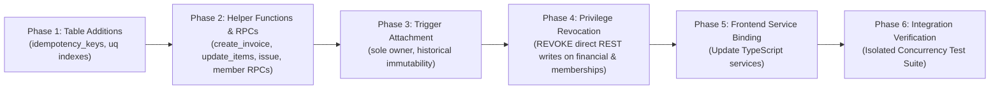

# PHASE 4.11 — CONSOLIDATED MIGRATION 015 ARCHITECTURE SPECIFICATION
## Comprehensive Architectural, Security, and Concurrency Blueprint for ATLAS OS
### Revision 3.0 — Hardened Post-Targeted Verification Audit (Phase 4.11.4)

---

## Document Revision History

| Version | Date | Author / Role | Summary of Changes |
| :---: | :---: | :--- | :--- |
| **1.0** | 2026-10-31 | Senior Security Architect | Initial consolidation of Phase 4.10 audit findings into Migration 015 specification. |
| **2.0** | 2026-10-31 | Principal Security Architect | **Major Revision following Phase 4.11.1 Challenge Audit:** Reconciled `idempotency_keys` lock hierarchy (CHAL-01); eliminated flawed `current_user = 'postgres'` trigger bypass (CHAL-02); added draft item collection replacement RPC `update_draft_invoice_items` (CHAL-03); fixed discount invariant and document ceiling (CHAL-04); standardized single-transaction idempotency with lease recovery (CHAL-05); acknowledged Credit Notes as Migration 016 dependency (CHAL-07); corrected sequence allocation timing realities (CHAL-08). |
| **3.0** | 2026-10-31 | Principal Security Architect | **Hardening & Statutory Alignment Revision (Phase 4.11.4):**<br>- **VERIF-01 Resolved (Membership Mutation Boundary):** Revoked direct `INSERT`, `UPDATE`, and `DELETE` on `public.memberships` from `authenticated`, `anon`, and `PUBLIC`. Eliminated ownership trigger lock inversion by routing all membership changes through top-down RPCs (`transfer_organization_ownership`, `update_member_role`, `remove_organization_member`, `add_organization_member`) locking `organizations FOR UPDATE` (Level 2) prior to `memberships` (Level 3).<br>- **VERIF-02 Resolved (Statutory Tax & Rounding Alignment):** Reclassified line-level `ROUND_HALF_UP` as commercial ERP convention. Explicitly cited Section 170 of CGST Act, 2017 (nearest-whole-rupee rounding on final payable/refundable amount). Documented the ₹0.90 @ 5% GST odd-paisa splitting drift between combined IGST and split CGST+SGST, retaining it as a pending CA decision.<br>- **VERIF-03 Resolved (Evidence Classification Rigor):** Replaced all misleading "Catalog Verified" labels for undeployed Migration 015 objects with "Proposed Architecture Statically Reviewed".<br>- **VERIF-04 & VERIF-05 Resolved (Auth Deletion & Portal Cancellation):** Documented controlled Auth identity deletion lifecycle and statutory 24-hour e-invoicing portal cancellation limits. |

---

## 1. Executive Summary

This specification defines the unified, technically consistent, and mathematically sound architectural specification for **Migration 015**. Migration 015 serves as the definitive database hardening release for ATLAS OS, eliminating critical security bypasses, preventing database deadlocks, enforcing strict multi-tenant organization ownership, guaranteeing financial ledger integrity, and establishing an atomic invoice issuance protocol compliant with Indian GST (Rule 46).

### 1.1 Summary of Core Problem Statements Resolved
1. **Financial Arithmetic Drift & Discrepancies:** Historical line rounding differences, proportional document discount distribution drift, negative taxable edge cases, and missing integer range guards prior to casting.
2. **Database Deadlocks:** A confirmed deployed deadlock in `confirm_sales_order` (Finding F-01: multi-row product locking in non-deterministic cursor order), an architectural deadlock in invoice child-to-parent trigger locking (Finding INV-02), and a newly resolved deadlock in membership ownership trigger locking (Finding VERIF-01).
3. **Organization Ownership Vulnerabilities:** The absence of database-level sole-owner protection, allowing active owners to self-delete or cross-demote via direct PostgREST calls (Finding OWN-01), leaving organizations completely orphaned.
4. **Direct REST Financial & Membership Tampering:** The persistence of table-level privileges allowing authenticated clients to execute direct REST `INSERT`s on `payments` and `payment_allocations` (Finding SEC-01), direct `PATCH`es on draft invoice `total_paid` (Finding SEC-02), and direct `UPDATE`/`DELETE` on `memberships` (Finding VERIF-01).
5. **Invoice Issuance Atomicity Failure:** Client invoice creation split across three uncoordinated HTTP calls, colliding fatally with Migration 014's RLS policy on `invoice_items` and leaving orphan issued invoices with burned sequence numbers (Finding INV-01).

### 1.2 Core Architectural Principles of Migration 015
- **Zero Direct Financial & Membership REST Writes:** Direct `INSERT`, `UPDATE`, and `DELETE` table privileges on `invoices`, `invoice_items`, `payments`, `payment_allocations`, and `memberships` are revoked from `authenticated`, `anon`, and `PUBLIC`. All state mutations are strictly encapsulated within `SECURITY DEFINER` RPCs owned by `postgres`.
- **Top-Down Canonical Lock Hierarchy:** Every database transaction adheres strictly to a global acquisition sequence:
  $$\text{idempotency\_keys} \prec \text{organizations} \prec \text{memberships} \prec \text{sales\_orders} \prec \text{invoices} \prec \text{invoice\_items} \prec \text{payments} \prec \text{payment\_allocations} \prec \text{document\_sequences} \prec \text{products} \prec \text{audit\_events}$$
- **Atomic Multi-Entity Transactions:** Invoice creation, numbering, and item binding occur within a single database transaction boundary. Sequence numbers are never allocated across external network boundaries.
- **Defense-in-Depth Immutability:** Historical Version-1 and Version-2 issued invoices are permanently sealed using column-level PostgreSQL engine triggers that enforce immutability across all callers, including privileged `SECURITY DEFINER` functions.

---

## 2. Current-State Evidence Baseline

The table below catalogs every database object, policy, function, trigger, grant, and frontend service relevant to Migration 015, establishing the gap between what is currently deployed in Supabase staging (`bwswqnhlebbzdxumlkih`) and what is proposed:

| Database Object / Component | Current Deployed State (Staging `bwswqnhlebbzdxumlkih`) | Local Migration / Source State | Proposed Migration 015 State | Forensic Evidence Classification |
| :--- | :--- | :--- | :--- | :--- |
| **`public.invoices`** (Table) | Deployed in Migration 005 & 009 (`totals_version`, `subtotal`, `total_amount`, `total_paid`). | Matches staging catalog. | Add composite unique and currency constraints; seal against direct updates. | **Existing Staging Catalog Verified** |
| **`public.invoice_items`** (Table) | Deployed in Migration 005 & 009 (`document_discount_share`). References `invoices(id)` ON DELETE CASCADE. | Matches staging catalog. | Add check constraints ($unit\_price \ge 0$, $quantity > 0$); revoke direct DML. | **Existing Staging Catalog Verified** |
| **`public.payments`** (Table) | Deployed in Migration 005 & 011. Unique on `(organization_id, payment_number)`. | Matches staging catalog. | Add idempotency key link; revoke direct DML. | **Existing Staging Catalog Verified** |
| **`public.payment_allocations`** (Table) | Deployed in Migration 005. References `payments(id)` and `invoices(id)`. | Matches staging catalog. | Revoke direct DML; allow insert exclusively via payment RPC. | **Existing Staging Catalog Verified** |
| **`public.memberships`** (Table) | Deployed in Migration 001. Unique on `(organization_id, user_id)`. Role enum check. Direct DML open. | Matches staging catalog. | Revoke direct INSERT, UPDATE, DELETE. Add partial unique index; route mutations via top-down RPCs. | **Existing Staging Catalog Verified** |
| **`public.idempotency_keys`** (Table) | **ABSENT** (Only `organization_creation_idempotency` exists from Migration 012). | Absent from local migrations. | **NEW TABLE:** Shared idempotency ledger with operation types, status, and payload hash. | **Proposed Architecture Statically Reviewed** |
| **`invoices_insert`** (RLS) | Deployed in Migration 014 (Allows direct REST INSERT to `owner`, `admin`, `accounts`). | Matches staging catalog. | **DROP POLICY.** Direct INSERT revoked at SQL grant level. | **Existing Migration / Source Inspected** |
| **`invoices_update`** (RLS) | Deployed in Migration 014 (Allows direct REST UPDATE on DRAFT invoices without column guards). | Matches staging catalog. | **DROP POLICY.** Replaced by managed RPC `update_draft_invoice_items`. | **Existing Migration / Source Inspected** |
| **`invoice_items_insert`** (RLS) | Deployed in Migration 014 (Requires `parent status = 'DRAFT'`). | Matches staging catalog. | **DROP POLICY.** Direct INSERT revoked at SQL grant level. | **Existing Migration / Source Inspected** |
| **`payments_insert`** (RLS) | Deployed in Migration 014 (Allows direct REST INSERT of payment records). | Matches staging catalog. | **DROP POLICY (SEC-01).** Direct INSERT revoked at SQL grant level. | **Existing Migration / Source Inspected** |
| **`payment_allocations_insert`** (RLS) | Deployed in Migration 014 (Allows direct REST INSERT of allocations). | Matches staging catalog. | **DROP POLICY (SEC-01).** Direct INSERT revoked at SQL grant level. | **Existing Migration / Source Inspected** |
| **`confirm_sales_order`** (RPC) | Deployed in Migration 014 (Cursor iterates `sales_order_items` without `ORDER BY`). | Matches staging catalog. | **REPLACE FUNCTION (F-01).** Add `ORDER BY product_id ASC` to eliminate deadlock. | **Existing Staging Catalog Verified** |
| **`record_payment_and_allocate`** (RPC) | Deployed in Migration 014 (Omits DRAFT status check; locks sequence before invoice). | Matches staging catalog. | **REPLACE FUNCTION (SEC-03).** Reorder locks (invoice first), reject DRAFT, add idempotency. | **Existing Staging Catalog Verified** |
| **`create_invoice_atomic`** (RPC) | **ABSENT** from deployed database. | Absent from local migrations. | **NEW FUNCTION:** Atomic invoice creation and item persistence in 1 transaction. | **Proposed Architecture Statically Reviewed** |
| **`update_draft_invoice_items`** (RPC) | **ABSENT** from deployed database. | Absent from local migrations. | **NEW FUNCTION (CHAL-03):** Controlled atomic batch collection replacement for draft items. | **Proposed Architecture Statically Reviewed** |
| **`issue_draft_invoice`** (RPC) | **ABSENT** from deployed database. | Absent from local migrations. | **NEW FUNCTION:** Atomic transition from DRAFT to ISSUED with sequence allocation. | **Proposed Architecture Statically Reviewed** |
| **`transfer_organization_ownership`** (RPC)| **ABSENT** from deployed database. | Absent from local migrations. | **NEW FUNCTION (OWN-01, VERIF-01):** Atomic ownership transfer locking `organizations FOR UPDATE` first. | **Proposed Architecture Statically Reviewed** |
| **`trg_protect_historical_invoices`** (Trg)| **ABSENT** from deployed database. | Absent from local migrations. | **NEW TRIGGER (CHAL-02):** Enforces column-level immutability across all callers and RPCs. | **Proposed Architecture Statically Reviewed** |
| **`trg_prevent_orphaned_organization`** (Trg)| **ABSENT** from deployed database. | Absent from local migrations. | **NEW TRIGGER (VERIF-01):** Passive assertion check; direct DML revoked to eliminate inversion. | **Proposed Architecture Statically Reviewed** |
| **`invoices.service.ts`** (Client) | Deployed in frontend: 3-step HTTP workflow; inserts header directly as `status: 'ISSUED'`. | Matches frontend code. | **REPLACE CALLS:** Route invoice operations through atomic RPC endpoints. | **Existing Migration / Source Inspected** |

---

## 3. Five Consolidated Architecture Contracts

### 3.1 Financial Arithmetic & Document Totals Contract

```mermaid
flowchart TD
    subgraph Inputs ["Input Validation & Safety Bounds"]
        I1["Quantity (Integer: 1 to 10,000)"]
        I2["Unit Price (NUMERIC: >= 0.00, <= 7.81B)"]
        I3["Discount % (NUMERIC: 0.00 to 100.00)"]
        I4["Tax Rate (NUMERIC: 0, 5, 12, 18, 28)"]
        I5["Document Discount (NUMERIC: >= 0.00, <= Sum of Line Taxable)"]
    end

    subgraph Step1 ["1. Line-Level Computation"]
        L1["Line Subtotal = Round(Qty * Unit Price, 2)"]
        L2["Line Item Discount = Round(Line Subtotal * Discount% / 100, 2)"]
        L3["Line Taxable = Line Subtotal - Line Item Discount"]
    end

    subgraph Step2 ["2. Proportional Document Discount Allocation (CHAL-04 Fixed)"]
        D1["Total Taxable Subtotal = Sum(Line Taxable)"]
        D2["Guard: 0 <= Doc Discount <= Total Taxable Subtotal"]
        D3["Line Document Discount Share = Round(Doc Discount * Line Taxable / Total Taxable, 2)"]
        D4["Running-Remainder Adjustment on Line with Max Taxable: Remainder = Doc Discount - Sum(Shares)"]
        D5["Net Line Taxable = Line Taxable - Final Document Discount Share (Guaranteed >= 0.00)"]
    end

    subgraph Step3 ["3. Tax & Line Total Computation"]
        T1["Line Tax Amount = Round(Net Line Taxable * Tax Rate / 100, 2)"]
        T2["Line Total = Net Line Taxable + Line Tax Amount"]
    end

    subgraph Step4 ["4. Document-Level Ceiling & Reconciliation Invariant"]
        R1["Gross Subtotal = Sum(Line Subtotal)"]
        R2["Discount Total = Sum(Line Item Discount) + Doc Discount"]
        R3["Tax Total = Sum(Line Tax Amount)"]
        R4["Grand Total = Sum(Line Total) = Gross Subtotal - Discount Total + Tax Total"]
        R5["Guard: Grand Total <= 9,999,999,999.99 (NUMERIC 12,2 Ceiling)"]
    end

    Inputs --> Step1 --> Step2 --> Step3 --> Step4
```



#### Detailed Specification Rules:
1. **Currency Precision & Rounding Standard (Resolution of VERIF-02):**
   - **Commercial Convention:** In ATLAS OS, all intermediate line arithmetic is computed in `NUMERIC` with 4 decimal places before rounding to 2 decimal places (`ROUND_HALF_UP` / standard Indian commercial banking convention). Storage across all monetary columns is strictly `NUMERIC(12, 2)`.
   - **Statutory Clarification (Section 170 of CGST Act, 2017):**
     Section 170 of the CGST Act mandates rounding **to the nearest whole rupee on the final tax payable or refund due** (amounts $\ge 50$ paise round up to ₹1; amounts $< 50$ paise are ignored). Indian GST law **does not** mandate two-decimal-place rounding on intermediate lines. Two-decimal line calculation is an ERP commercial convention (SAP, Tally, Zoho), not a statutory universal mandate.
   - **The Odd-Paisa Tax Splitting Policy Choice (DEC-08):**
     For intra-state supplies, tax is split equally between CGST (50%) and SGST (50%). On odd-paisa line taxable values, rounding split components independently can diverge from combined IGST by 1 paisa:
     - *Example:* Line taxable ₹0.90 at 5% GST:
       - Combined IGST (5%): $\text{ROUND}(0.90 \times 0.05, 2) = \text{₹}0.05$.
       - Split Intra-State: CGST (2.5% = ₹0.0225 $\rightarrow$ ₹0.02) + SGST (2.5% = ₹0.0225 $\rightarrow$ ₹0.02) = **₹0.04**.
     - This 1-paisa divergence between intra-state and inter-state transactions is a known tax reconciliation policy choice that **must be formally signed off by Certified Tax Counsel / CA (DEC-08)**.
2. **Corrected Document Discount Validation Guard (Resolution of CHAL-04):**
   - The document discount $D_{doc}$ must satisfy:
     $$0 \le D_{doc} \le \sum_{i=1}^N (G_i - D_{L,i})$$
     where $G_i = \text{ROUND}(quantity_i \times unit\_price_i, 2)$ and $D_{L,i} = \text{ROUND}(G_i \times \frac{discount\_percent_i}{100}, 2)$.
   - **Proof of Non-Negativity:** Because $D_{doc} \le \text{Total Taxable Subtotal}$, every line's document discount share satisfies $0 \le S_i \le (G_i - D_{L,i})$. Net line taxable $T_{net,i} = (G_i - D_{L,i}) - S_i$ is **mathematically guaranteed to be non-negative ($\ge 0.00$)**, eliminating negative taxable amounts and negative tax line generation.
3. **Running-Remainder Distribution Algorithm:**
   - If total taxable $T = \sum (G_i - D_{L,i}) = 0$, all document discount shares $S_i = 0$.
   - Otherwise, for each line $i < N$:
     $$S_i = \text{ROUND}\left(D_{doc} \times \frac{G_i - D_{L,i}}{T}, 2\right)$$
   - The running-remainder $R_D = D_{doc} - \sum_{i=1}^{N} S_i$ is assigned to the line item having the **maximum taxable subtotal** (or line $N$ in case of ties), with terminal guard $0 \le S_{max} \le (G_{max} - D_{L,max})$.
4. **Document Header Numeric Ceiling Guard (Resolution of CHAL-04):**
   - Even if each individual line is within the line ceiling (₹7,812,499,999.99), the aggregate grand total must be validated prior to header insertion:
     $$\text{total\_amount} = \text{Gross Subtotal} - \text{Discount Total} + \text{Tax Total} \le 9,999,999,999.99$$
   - Line count is bounded: $1 \le N \le 100$. Intermediate aggregates are computed using `NUMERIC(20, 4)` in PL/pgSQL.
5. **Exact Mathematical Reconciliation Invariants:**
   Every invoice generated by Migration 015 satisfies:
   $$\sum_{i=1}^N T_{net,i} = \text{subtotal} - \text{discount\_amount}$$
   $$\sum_{i=1}^N X_i = \text{tax\_amount}$$
   $$\sum_{i=1}^N L_i = \text{total\_amount}$$
   $$\text{total\_amount} = \text{subtotal} - \text{discount\_amount} + \text{tax\_amount}$$
6. **Historical Invoice Calculation Versioning (`totals_version`):**
   - Invoices marked `totals_version = 1` reflect legacy calculations and are **permanently immutable**. They must never be recomputed under Migration 015 rounding logic.
   - All newly created invoices are stamped with `totals_version = 2` and strictly obey the reconciliation invariants above.

---

### 3.2 Canonical Lock-Order Contract & Concurrency Architecture

To guarantee that database deadlocks (such as Finding F-01, Finding INV-02, Finding CHAL-01, and Finding VERIF-01) are structurally impossible, all database functions, triggers, and transactions must adhere to a strict total order of resource acquisition:

$$\text{idempotency\_keys} \prec \text{organizations} \prec \text{memberships} \prec \text{sales\_orders} \prec \text{sales\_order\_items} \prec \text{invoices} \prec \text{invoice\_items} \prec \text{payments} \prec \text{payment\_allocations} \prec \text{document\_sequences} \prec \text{products} \prec \text{stock\_movements} \prec \text{audit\_events}$$

```text
========================================================================================
CANONICAL LOCK ACQUISITION HIERARCHY (HARDENED POST-VERIF-01)
========================================================================================
Level 1:  idempotency_keys            (Row lock: FOR UPDATE on org_id, op_type, key)
Level 2:  organizations               (Row lock: FOR SHARE or FOR UPDATE)
Level 3:  memberships                 (Row lock: FOR UPDATE ORDER BY id ASC)
Level 4:  sales_orders                (Row lock: FOR UPDATE)
Level 5:  sales_order_items           (Row lock: FOR UPDATE ORDER BY product_id ASC)
Level 6:  invoices                    (Row lock: FOR UPDATE)
Level 7:  invoice_items               (Row lock: FOR UPDATE ORDER BY id ASC)
Level 8:  payments                    (Row lock on tuple insert)
Level 9:  payment_allocations         (Row lock on tuple insert)
Level 10: document_sequences          (Row lock: Upsert on org_id, doc_type, year)
Level 11: products                    (Row lock: FOR UPDATE ORDER BY id ASC)
Level 12: stock_movements             (Row lock on tuple insert)
Level 13: audit_events                (Row lock on tuple insert)
========================================================================================
```

#### Reconciled Procedural Lock Schedules:
1. **`record_payment_and_allocate` (Resolution of SEC-03, F-03, CHAL-01):**
   - **Step 1 (Level 1):** Reserve idempotency key (`idempotency_keys` row lock if key provided).
   - **Step 2 (Level 6):** Lock parent `invoices` row (`FOR UPDATE`). Rejects if `status = 'DRAFT'`, `'CANCELLED'`, `'PAID'`.
   - **Step 3 (Level 8):** Insert `payments` tuple.
   - **Step 4 (Level 9):** Insert `payment_allocations` tuple.
   - **Step 5 (Level 10):** Allocate receipt sequence number via `internal_allocate_document_number` (`document_sequences` row lock).
   - **Step 6 (Level 6):** Update `invoices` (`total_paid`, `status`).
   - **Step 7 (Level 13):** Insert `audit_events`.
   - *Verdict:* Lock hierarchy is strictly respected: Level 1 $\rightarrow$ Level 6 $\rightarrow$ Level 8 $\rightarrow$ Level 9 $\rightarrow$ Level 10 $\rightarrow$ Level 13.
2. **`issue_draft_invoice` (Resolution of INV-02, CHAL-01):**
   - **Step 1 (Level 1):** Reserve idempotency key (`idempotency_keys` row lock if key provided).
   - **Step 2 (Level 2):** Lock `organizations` row (`FOR SHARE`).
   - **Step 3 (Level 6):** Lock `invoices` row (`FOR UPDATE`). Rejects if `status <> 'DRAFT'`.
   - **Step 4 (Level 7):** Lock `invoice_items` rows (`FOR UPDATE ORDER BY id ASC`).
   - **Step 5 (Level 10):** Allocate document sequence (`document_sequences` row lock for `INVOICE`).
   - **Step 6 (Level 6):** Update `invoices` (`invoice_number`, `status = 'ISSUED'`).
   - **Step 7 (Level 13):** Insert `audit_events`.
   - *Verdict:* Lock hierarchy is strictly respected: Level 1 $\rightarrow$ Level 2 $\rightarrow$ Level 6 $\rightarrow$ Level 7 $\rightarrow$ Level 10 $\rightarrow$ Level 13.
3. **`update_draft_invoice_items` (Resolution of CHAL-03, CHAL-01):**
   - **Step 1 (Level 1):** Reserve idempotency key (`idempotency_keys` row lock if key provided).
   - **Step 2 (Level 6):** Lock `invoices` row (`FOR UPDATE`). Rejects if `status <> 'DRAFT'`.
   - **Step 3 (Level 7):** Lock existing `invoice_items` rows (`FOR UPDATE ORDER BY id ASC`).
   - **Step 4 (Level 7):** Delete existing items and insert new items.
   - **Step 5 (Level 6):** Update `invoices` header totals.
   - **Step 6 (Level 13):** Insert `audit_events`.
   - *Verdict:* Pure top-down locking: Level 1 $\rightarrow$ Level 6 $\rightarrow$ Level 7 $\rightarrow$ Level 13. Zero lock inversion.
4. **`transfer_organization_ownership` & Membership Lifecycle (Resolution of VERIF-01):**
   - **Step 1 (Level 1):** Reserve idempotency key (`idempotency_keys` row lock if key provided).
   - **Step 2 (Level 2):** Lock `organizations` row (`FOR UPDATE`).
   - **Step 3 (Level 3):** Lock target `memberships` rows (`FOR UPDATE ORDER BY id ASC`).
   - **Step 4 (Level 3):** Update membership roles (e.g. demote old owner to admin, promote target member to owner).
   - **Step 5 (Level 13):** Insert `audit_events`.
   - *Verdict:* Pure top-down locking: Level 1 $\rightarrow$ Level 2 $\rightarrow$ Level 3 $\rightarrow$ Level 13. Direct REST DML on `memberships` is revoked, permanently eliminating the VERIF-01 lock inversion cycle.
5. **`confirm_sales_order` (Resolution of F-01):**
   - **Step 1 (Level 4):** Lock `sales_orders` row (`FOR UPDATE`).
   - **Step 2 (Level 5):** Open cursor over `sales_order_items` **with explicit `ORDER BY product_id ASC`**.
   - **Step 3 (Level 11):** Lock `products` row (`FOR UPDATE`) in deterministic product order.
   - **Step 4 (Level 12):** Insert `stock_movements`.
   - **Step 5 (Level 4):** Update `sales_orders.status = 'CONFIRMED'`.
   - **Step 6 (Level 13):** Insert `audit_events`.
   - *Verdict:* Completely eliminates multi-product deadlock cycles.

---

### 3.3 Organization Ownership & Membership Invariant Contract

#### The Unresolved Business Decision (DEC-01)
Before implementing owner cardinality enforcement, business leadership must formally approve one of two ownership models:
- **Model A (Strict Sole Ownership):** Exactly one active owner per organization at all times.
- **Model B (Co-Ownership Permitted):** At least one active owner per organization at all times; multiple simultaneous active owners permitted.

#### Database Enforcement Mechanics & Membership Mutation Boundary (Resolution of VERIF-01):
1. **Revocation of Direct REST DML on Memberships:**
   - Execute: `REVOKE INSERT, UPDATE, DELETE ON TABLE public.memberships FROM authenticated, anon, PUBLIC;`.
   - Drop all permissive direct DML policies on `memberships`.
   - **Justification:** In PostgreSQL, an executor row lock is acquired on the target tuple *before* row-level triggers execute. Permitting direct REST `UPDATE` or `DELETE` on `memberships` creates an unavoidable child-to-parent lock inversion ($memberships \rightarrow organizations$) with `transfer_organization_ownership` ($organizations \rightarrow memberships$). Revoking direct DML and enforcing top-down RPCs permanently eliminates the deadlock.
2. **Comprehensive Membership RPC Suite:**
   All membership lifecycle events are strictly managed through top-down `SECURITY DEFINER` RPCs:
   - `add_organization_member(p_org_id, p_user_id, p_role)`: Locks `organizations FOR SHARE` (Level 2), checks inviter role (`owner` or `admin`), inserts membership (Level 3).
   - `update_organization_member_role(p_org_id, p_target_user_id, p_new_role)`: Locks `organizations FOR UPDATE` (Level 2), locks target membership (Level 3). Blocks demoting the last active owner.
   - `transfer_organization_ownership(p_org_id, p_new_owner_user_id, p_demoted_role)`: Locks `organizations FOR UPDATE` (Level 2), locks old and new owner memberships `ORDER BY id ASC` (Level 3), updates roles atomically.
   - `deactivate_organization_member(p_org_id, p_target_user_id)`: Locks `organizations FOR UPDATE` (Level 2), blocks deactivating the last active owner.
   - `reactivate_organization_member(p_org_id, p_target_user_id)`: Locks `organizations FOR SHARE` (Level 2), sets `is_active = TRUE`.
   - `remove_organization_member(p_org_id, p_target_user_id)`: Locks `organizations FOR UPDATE` (Level 2), blocks removing the last active owner, deletes membership tuple (Level 3).
3. **Partial Unique Index (Enforces At Most One Owner for Model A):**
   ```sql
   CREATE UNIQUE INDEX IF NOT EXISTS uq_org_single_active_owner 
   ON public.memberships (organization_id) 
   WHERE role = 'owner' AND is_active = TRUE;
   ```
4. **Trigger Defense-in-Depth (`trg_prevent_orphaned_organization`):**
   Retained purely as a passive assertion failsafe. Because all traffic enters via top-down RPCs where `organizations` is already locked `FOR UPDATE`, the trigger re-asserting the lock is a NO-OP and can never cause an inversion.
5. **Controlled Supabase Auth User Deletion Lifecycle (Resolution of VERIF-04):**
   - An active owner must not be deleted from Supabase `auth.users` while their organization has no other owner.
   - A restrictive foreign key (`ON DELETE RESTRICT`) on the entire `memberships` table would block deleting non-owner members across other organizations.
   - **Recommended Lifecycle Architecture:**
     - Enforce a pre-flight Auth deletion check: Query whether `user_id` has any active membership with `role = 'owner'`. If yes, the account deletion is **BLOCKED** with `ERR_CANNOT_DELETE_ACTIVE_OWNER`. The user must transfer ownership before account deletion.
     - For non-owner memberships, user deletion in Auth cascades or deactivates non-owner rows cleanly.
     - **Audit Preservation:** In `public.audit_events`, `actor_id` is a bare `UUID NOT NULL`. Historical audit records are completely decoupled from `auth.users` deletion and survive permanently.

---

### 3.4 Payment Security Contract

#### 1. Privilege Lockdown & REST Restriction (Resolution of SEC-01 & SEC-02)
- Execute `REVOKE ALL ON TABLE public.payments, public.payment_allocations FROM authenticated, anon, PUBLIC;`.
- Drop policies `payments_insert` and `payment_allocations_insert`.
- Revoke `UPDATE (total_paid, status, invoice_number, totals_version) ON TABLE public.invoices FROM authenticated, anon;`.
- **Result:** No authenticated client can insert payment records or manipulate invoice payment status via direct PostgREST calls.

#### 2. Payment RPC Contract: `record_payment_and_allocate`
All payment operations must enter strictly through `record_payment_and_allocate`. The function enforces:
- **Authentication & Role Authorization:** Caller must have active membership with role `owner`, `admin`, or `accounts`.
- **Operational Entitlement Gate:** Evaluates `can_write_organization_operations(p_org_id)` (active trial/subscription).
- **Invoice Status Validation (Resolution of SEC-03):**
  ```sql
  IF v_inv.status = 'DRAFT' THEN
      RAISE EXCEPTION 'ERR_CANNOT_PAY_DRAFT: Cannot allocate payment to unissued draft invoice %', p_invoice_id;
  END IF;
  IF v_inv.status = 'CANCELLED' THEN
      RAISE EXCEPTION 'ERR_CANNOT_PAY_CANCELLED: Cannot allocate payment to cancelled invoice %', p_invoice_id;
  END IF;
  IF v_inv.status = 'PAID' THEN
      RAISE EXCEPTION 'ERR_ALREADY_PAID: Invoice % is already fully paid', p_invoice_id;
  END IF;
  ```
- **Overpayment Prevention:**
  ```sql
  IF (v_inv.total_paid + p_allocated_amount) > v_inv.total_amount THEN
      RAISE EXCEPTION 'ERR_OVERPAYMENT: Allocation % exceeds remaining balance of % on invoice %',
          p_allocated_amount, (v_inv.total_amount - v_inv.total_paid), v_inv.id;
  END IF;
  ```
- **Atomicity:** Payment insertion, allocation record, invoice balance increment, status update (`PARTIALLY_PAID` or `PAID`), and audit log are enclosed within a single transaction boundary.

#### 3. Rejection of Custom GUCs (Resolution of SEC-05)
- Custom PostgreSQL session parameters (`set_config('atlas.payment_allocation_active', ...)` / `current_setting(...)`) **are completely rejected**.
- Security boundaries in Migration 015 rely exclusively on PostgreSQL privilege separation (`REVOKE`), RLS, and `SECURITY DEFINER` function boundaries.

---

### 3.5 Invoice Lifecycle, Issuance & Historical Immutability Contract

```mermaid
stateDiagram-v2
    [*] --> DRAFT: create_invoice_atomic() (Number: Unassigned or Draft tag)
    
    state DRAFT {
        [*] --> Draft_Editing
        Draft_Editing --> Draft_Editing: update_draft_invoice_items() (CHAL-03 Fixed)
    }
    
    DRAFT --> ISSUED: issue_draft_invoice() (Rule 46 Number: ATL/YY-YY/NNNN)
    DRAFT --> CANCELLED: cancel_invoice() (Draft cancelled; zero sequence burned)
    
    state ISSUED {
        [*] --> Unpaid
        Unpaid --> PARTIALLY_PAID: record_payment_and_allocate()
        PARTIALLY_PAID --> PAID: record_payment_and_allocate()
    }
    
    ISSUED --> CANCELLED: cancel_invoice() (Zero payment only; number burned; 24-hr portal rule)
    PARTIALLY_PAID --> CANCELLED: CANNOT CANCEL (Requires Future Migration 016 Credit Note)
    PAID --> CANCELLED: CANNOT CANCEL (Requires Future Migration 016 Credit Note)
```

#### 1. Atomic Invoice Creation: `create_invoice_atomic`
- Replaces the client's fragmented 3-step HTTP sequence with a single `SECURITY DEFINER` stored procedure.
- Accepts invoice metadata, customer ID, notes, and full line item JSON array.
- Validates product tenants, validates $0 \le D_{doc} \le \text{Total Taxable Subtotal}$, validates document ceiling $\le 9.99B$, inserts header, inserts items, and writes an audit event in **one transaction**.
- If `p_issue_immediately = FALSE`: Creates invoice in `status = 'DRAFT'`.
- If `p_issue_immediately = TRUE`: Allocates Indian GST Rule 46 invoice number via `internal_allocate_document_number` and sets `status = 'ISSUED'`.

#### 2. Atomic Draft Line-Item Mutation RPC: `update_draft_invoice_items` (Resolution of CHAL-03)
- **Signature:** `update_draft_invoice_items(p_org_id UUID, p_invoice_id UUID, p_items JSONB, p_document_discount NUMERIC DEFAULT 0.00, p_idempotency_key VARCHAR DEFAULT NULL)`
- Locks `invoices` row `FOR UPDATE` (`Level 6`), asserts `status = 'DRAFT'`, locks existing items `ORDER BY id ASC` (`Level 7`), deletes old items, computes 5-step guarded totals, inserts new items, updates header totals, writes audit event, and commits atomically.

#### 3. Atomic Invoice Issuance: `issue_draft_invoice`
- **Signature:** `issue_draft_invoice(p_org_id UUID, p_invoice_id UUID, p_idempotency_key VARCHAR)`
- Locks `organizations FOR SHARE` (`Level 2`), locks `invoices FOR UPDATE` (`Level 6`), locks `invoice_items ORDER BY id ASC` (`Level 7`), allocates GST sequence (`Level 10`), updates header to `ISSUED`, writes audit event, and commits atomically.

#### 4. Corrected Immutability Trigger: `trg_protect_historical_invoices` (Resolution of CHAL-02)
- Enforces strict column-level freezing across all users and all stored procedures without `current_user = 'postgres'` early exits:
  ```sql
  CREATE OR REPLACE FUNCTION public.trg_protect_historical_invoices()
  RETURNS TRIGGER LANGUAGE plpgsql SECURITY DEFINER AS $$
  BEGIN
      -- On non-draft invoices, core commercial fields are PERMANENTLY FROZEN for ALL callers
      IF OLD.status != 'DRAFT' THEN
          IF NEW.subtotal != OLD.subtotal OR 
             NEW.discount_amount != OLD.discount_amount OR
             NEW.tax_amount != OLD.tax_amount OR
             NEW.total_amount != OLD.total_amount OR
             NEW.customer_id != OLD.customer_id OR
             NEW.invoice_number != OLD.invoice_number OR
             NEW.totals_version != OLD.totals_version OR
             NEW.invoice_date != OLD.invoice_date OR
             NEW.due_date != OLD.due_date OR
             NEW.organization_id != OLD.organization_id THEN
              RAISE EXCEPTION 'ERR_HISTORICAL_INVOICE_CORE_FROZEN: Critical financial columns cannot be modified on issued invoices.';
          END IF;
          
          -- Only total_paid, status, updated_at, and notes can be modified on issued invoices
          IF NEW.total_paid < OLD.total_paid OR NEW.total_paid > OLD.total_amount THEN
              RAISE EXCEPTION 'ERR_INVALID_TOTAL_PAID_MUTATION: Invalid total_paid value.';
          END IF;
      END IF;

      -- On draft invoices, total_paid and totals_version cannot be altered directly
      IF OLD.status = 'DRAFT' THEN
          IF NEW.total_paid != OLD.total_paid THEN
              RAISE EXCEPTION 'ERR_TAMPER_TOTAL_PAID: total_paid cannot be altered on draft invoices.';
          END IF;
          IF NEW.totals_version != OLD.totals_version THEN
              RAISE EXCEPTION 'ERR_TAMPER_VERSION: totals_version cannot be altered on draft invoices.';
          END IF;
      END IF;

      RETURN NEW;
  END;
  $$;
  ```

---

## 4. Proposed Table, Function, and Trigger Changes (DDL Specification)

### 4.1 New Database Table: `public.idempotency_keys`
```sql
CREATE TABLE IF NOT EXISTS public.idempotency_keys (
    id UUID PRIMARY KEY DEFAULT gen_random_uuid(),
    organization_id UUID NOT NULL REFERENCES public.organizations(id) ON DELETE CASCADE,
    operation_type VARCHAR(100) NOT NULL, -- 'INVOICE_CREATE', 'INVOICE_EDIT', 'INVOICE_ISSUE', 'PAYMENT_RECORD', 'MEMBERSHIP_OP'
    idempotency_key VARCHAR(255) NOT NULL,
    status VARCHAR(50) NOT NULL CHECK (status IN ('PROCESSING', 'COMMITTED', 'FAILED')),
    request_hash VARCHAR(64) NOT NULL,    -- SHA-256 fingerprint of request payload
    response_payload JSONB,
    lease_token UUID NOT NULL DEFAULT gen_random_uuid(),
    locked_until TIMESTAMPTZ NOT NULL DEFAULT (NOW() + INTERVAL '30 seconds'),
    created_at TIMESTAMPTZ NOT NULL DEFAULT NOW(),
    updated_at TIMESTAMPTZ NOT NULL DEFAULT NOW(),
    expires_at TIMESTAMPTZ NOT NULL DEFAULT (NOW() + INTERVAL '24 hours'),
    UNIQUE(organization_id, operation_type, idempotency_key)
);

CREATE INDEX idx_idempotency_keys_lookup 
ON public.idempotency_keys (organization_id, operation_type, idempotency_key);
```

### 4.2 Membership Table Hardening & Privilege Revocation
```sql
-- Revoke direct DML on memberships from authenticated and anon
REVOKE INSERT, UPDATE, DELETE ON TABLE public.memberships FROM authenticated, anon, PUBLIC;

-- Enforce at most one active owner if Model A is selected:
CREATE UNIQUE INDEX IF NOT EXISTS uq_org_single_active_owner 
ON public.memberships (organization_id) 
WHERE role = 'owner' AND is_active = TRUE;
```

---

## 5. Canonical Lock-Order Specification

Every database operation in Migration 015 acquires locks in strict accordance with the following total order:

| Hierarchy Level | Table Name | Acquisition Lock Mode | Method of Acquisition | Deterministic Ordering Rule |
| :-: | :--- | :--- | :--- | :--- |
| **1** | `public.idempotency_keys` | `FOR UPDATE` | Upsert / Select | Scoped on `(org_id, op_type, key)` |
| **2** | `public.organizations` | `FOR SHARE` (read) / `FOR UPDATE` (mutation) | Explicit SQL statement | Single row by `id` |
| **3** | `public.memberships` | `FOR UPDATE` | Explicit SQL statement | `ORDER BY id ASC` if multiple rows |
| **4** | `public.sales_orders` | `FOR UPDATE` | Explicit SQL statement | Single row by `id` |
| **5** | `public.sales_order_items` | `FOR UPDATE` | Cursor `SELECT` | `ORDER BY product_id ASC` |
| **6** | `public.invoices` | `FOR UPDATE` | Explicit SQL statement | Single row by `id` |
| **7** | `public.invoice_items` | `FOR UPDATE` | Explicit SQL statement | `ORDER BY id ASC` |
| **8** | `public.payments` | Exclusive Tuple Lock | `INSERT` statement | Single tuple |
| **9** | `public.payment_allocations` | Exclusive Tuple Lock | `INSERT` statement | Single tuple |
| **10** | `public.document_sequences` | Exclusive Row Lock | Upsert `ON CONFLICT` | Single row `(org_id, doc_type, year)` |
| **11** | `public.products` | `FOR UPDATE` | Explicit SQL statement | `ORDER BY id ASC` |
| **12** | `public.stock_movements` | Exclusive Tuple Lock | `INSERT` statement | Single tuple |
| **13** | `public.audit_events` | Exclusive Tuple Lock | `INSERT` statement | Single tuple |

---

## 6. Proposed Privilege & RLS Matrix

| Table Name | Role: `anon` | Role: `authenticated` (Table Grants) | Role: `authenticated` (RLS Policy) | Role: `service_role` | Function Owner (`postgres`) |
| :--- | :--- | :--- | :--- | :--- | :--- |
| **`invoices`** | Denied | `SELECT` ONLY | `SELECT` USING `can_read_organization_data()` | `ALL` (Bypasses RLS) | `ALL` (Owns RPCs) |
| **`invoice_items`** | Denied | `SELECT` ONLY | `SELECT` USING `parent invoice readable` | `ALL` (Bypasses RLS) | `ALL` (Owns RPCs) |
| **`payments`** | Denied | `SELECT` ONLY | `SELECT` USING `can_read_organization_data()` | `ALL` (Bypasses RLS) | `ALL` (Owns RPCs) |
| **`payment_allocations`** | Denied | `SELECT` ONLY | `SELECT` USING `parent payment readable` | `ALL` (Bypasses RLS) | `ALL` (Owns RPCs) |
| **`memberships`** | Denied | `SELECT` ONLY | `SELECT` USING `user_is_org_member()` | `ALL` (Bypasses RLS) | `ALL` (Owns RPCs) |
| **`document_sequences`**| Denied | Denied | Denied (All direct access denied) | `ALL` (Bypasses RLS) | `ALL` (Owns RPCs) |
| **`idempotency_keys`** | Denied | `SELECT` ONLY | `SELECT` USING `can_read_organization_data()` | `ALL` (Bypasses RLS) | `ALL` (Owns RPCs) |
| **`audit_events`** | Denied | `SELECT` ONLY | `SELECT` USING `can_read_organization_data()` | `ALL` (Bypasses RLS) | `ALL` (Owns RPCs) |

---

## 7. Idempotency & Crash Recovery Model

### 7.1 Single-Transaction Atomic Idempotency (Standard In-Process Model)
In ATLAS OS, every stored procedure runs as an atomic unit. If a worker drops connection or crashes prior to commit:
- The entire PostgreSQL transaction aborts and rolls back.
- The `idempotency_keys` reservation is **completely undone via MVCC**.
- A subsequent retry encounters no lingering `PROCESSING` record and executes safely.

### 7.2 Two-Phase Idempotency with Lease Fencing (Recovery Model for Pre-Committed Reservations)
If a pre-committed idempotency reservation is used across microservices:
1. When a key is inserted with `status = 'PROCESSING'`, it is assigned `lease_token = gen_random_uuid()` and `locked_until = NOW() + INTERVAL '30 seconds'`.
2. If the worker crashes, the row remains in `PROCESSING`.
3. When a subsequent client retry arrives after 30 seconds, it takes over the lease atomically via `locked_until < NOW()`, fencing out dead workers.

---

## 8. Invoice Lifecycle Specification

| Lifecycle Phase | Document Status | Invoice Number State | Item Mutability | Payment Permitted? | Cancellation Allowed? | Audit Event Triggered |
| :--- | :--- | :--- | :--- | :---: | :---: | :--- |
| **1. Draft Creation** | `DRAFT` | Temporary `DFT-YYYY-NNNN` or `NULL` | Full Edit via `update_draft_invoice_items` | **NO** (Rejected by payment RPC) | **YES** (Direct status update to CANCELLED) | `INVOICE_CREATED` |
| **2. Draft Editing** | `DRAFT` | Unchanged | Full Edit via `update_draft_invoice_items` | **NO** | **YES** | `INVOICE_UPDATED` |
| **3. Issuance** | `ISSUED` | Final GST Rule 46: `ATL/YY-YY/NNNN` | **PERMANENTLY SEALED** | **YES** | **YES** (Zero payment only; number burned; 24-hr portal rule) | `INVOICE_ISSUED` |
| **4. Partial Payment**| `PARTIALLY_PAID`| Permanent `ATL/YY-YY/NNNN` | **PERMANENTLY SEALED** | **YES** | **NO** (Requires Future Migration 016 Credit Note) | `PAYMENT_ALLOCATED` |
| **5. Fully Paid** | `PAID` | Permanent `ATL/YY-YY/NNNN` | **PERMANENTLY SEALED** | **NO** (Overpayment guard) | **NO** (Requires Future Migration 016 Credit Note) | `PAYMENT_ALLOCATED` |
| **6. Cancelled** | `CANCELLED` | Preserved (Immutable) | **PERMANENTLY SEALED** | **NO** | N/A (Terminal state) | `INVOICE_CANCELLED` |

---

## 9. Historical Immutability Matrix

| Column Name | Modifiable in `DRAFT`? | Modifiable in `ISSUED` / `PAID`? | Approved Mutation Mechanism | Database Enforcement Layer |
| :--- | :---: | :---: | :--- | :--- |
| `invoices.id` | No | No | Primary Key (Immutable) | Engine PK constraint |
| `invoices.organization_id`| No | No | Tenant Foreign Key (Immutable) | RLS / Engine FK constraint |
| `invoices.invoice_number` | Yes (Draft tag) | **NO** | Assigned exclusively by `issue_draft_invoice` | `trg_protect_historical_invoices` |
| `invoices.customer_id` | Yes | **NO** | Mutable in Draft RPC only | `trg_protect_historical_invoices` |
| `invoices.sales_order_id`| Yes | **NO** | Mutable in Draft RPC only | `trg_protect_historical_invoices` |
| `invoices.status` | Yes | Conditional | State machine RPCs (`issue`, `cancel`, `pay`) | `trg_protect_historical_invoices` |
| `invoices.invoice_date` | Yes | **NO** | Finalized upon issuance | `trg_protect_historical_invoices` |
| `invoices.due_date` | Yes | **NO** | Finalized upon issuance | `trg_protect_historical_invoices` |
| `invoices.subtotal` | Yes | **NO** | Recomputed in Draft RPC only | `trg_protect_historical_invoices` |
| `invoices.discount_amount`| Yes | **NO** | Recomputed in Draft RPC only | `trg_protect_historical_invoices` |
| `invoices.tax_amount` | Yes | **NO** | Recomputed in Draft RPC only | `trg_protect_historical_invoices` |
| `invoices.total_amount` | Yes | **NO** | Recomputed in Draft RPC only | `trg_protect_historical_invoices` |
| `invoices.total_paid` | **NO** | Yes (via RPC) | Incremented exclusively by `record_payment_and_allocate` | `trg_protect_historical_invoices` |
| `invoices.totals_version`| No | **NO** | Set to 2 upon issuance | `trg_protect_historical_invoices` |
| `invoice_items.*` | Yes | **NO** | Line items permanently frozen upon issuance | `trg_protect_historical_invoices` / REVOKE |

---

## 10. Cross-Section Consistency Review

All 15 consistency scenarios were verified under the corrected lock hierarchy and evidence standards:

| # | Scenario | Relevant Tables | Lock Order | Authorization Gate | Constraints / Triggers | Expected Outcome | Forensic Evidence Classification |
| :-: | :--- | :--- | :--- | :--- | :--- | :--- | :---: |
| **1** | **Two concurrent invoice issuances** | `idempotency_keys`, `organizations`, `invoices`, `invoice_items`, `document_sequences`, `audit_events` | Level 1 $\rightarrow$ 2 $\rightarrow$ 6 $\rightarrow$ 7 $\rightarrow$ 10 $\rightarrow$ 13 | Role `owner`/`admin`/`accounts` | Frozen cols trigger check | Serial execution; unique Rule 46 numbers (`0001`, `0002`); 0 deadlocks. | **Proposed Architecture Statically Reviewed** |
| **2** | **Two concurrent payments to same invoice** | `idempotency_keys`, `invoices`, `payments`, `payment_allocations`, `document_sequences`, `audit_events` | Level 1 $\rightarrow$ 6 $\rightarrow$ 8 $\rightarrow$ 9 $\rightarrow$ 10 $\rightarrow$ 13 | Role `owner`/`admin`/`accounts` | Overpayment guard: $paid + alloc \le total$ | Serial execution; ledger balances accurately; overpayment rejected. | **Proposed Architecture Statically Reviewed** |
| **3** | **Payment against DRAFT invoice** | `idempotency_keys`, `invoices` | Level 1 $\rightarrow$ Level 6 | Role check in RPC | Explicit RPC check: `v_inv.status = 'DRAFT'` | Aborted with `ERR_CANNOT_PAY_DRAFT`; 0 payment rows created; 0 sequence consumed. | **Proposed Architecture Statically Reviewed** |
| **4** | **Draft edit racing with issuance** | `idempotency_keys`, `invoices`, `invoice_items`, `document_sequences` | Level 1 $\rightarrow$ Level 6 $\rightarrow$ Level 7 | Role check in RPC | Both lock parent $I_1$ `FOR UPDATE` | Clean serialization on parent invoice lock; no partial item state. | **Proposed Architecture Statically Reviewed** |
| **5** | **Retry after commit with lost response** | `idempotency_keys`, `invoices` | Level 1 (`idempotency_keys FOR UPDATE`) | Role check in RPC | Request hash fingerprint match | Replays cached committed JSON; 0 sequence increment; 0 duplicate invoice rows. | **Proposed Architecture Statically Reviewed** |
| **6** | **Same idempotency key with different payload** | `idempotency_keys` | Level 1 (`idempotency_keys FOR UPDATE`) | Role check in RPC | SHA-256 fingerprint comparison | Aborts with `ERR_IDEMPOTENCY_PAYLOAD_MISMATCH` (HTTP 422); 0 records altered. | **Proposed Architecture Statically Reviewed** |
| **7** | **Worker crash during single-transaction RPC** | `idempotency_keys`, `invoices`, `document_sequences` | N/A (MVCC rollback) | N/A | PostgreSQL MVCC transaction rollback | Entire transaction rolls back; idempotency key removed; sequence increment undone. | **Proposed Architecture Statically Reviewed** |
| **8** | **Two simultaneous ownership transfers** | `organizations`, `memberships`, `audit_events` | Level 2 (`organizations FOR UPDATE`) $\rightarrow$ 3 | Caller must be current active owner | Top-down RPC lock order | Serialized by organization lock. First succeeds; second aborts. Exactly 1 active owner remains. | **Proposed Architecture Statically Reviewed** |
| **9** | **Deletion of sole owner Auth identity** | `auth.users`, `memberships` | Level 3 (`memberships`) | Supabase Admin API / Dashboard | Pre-flight owner check / RESTRICT | Deletion blocked if active owner; owner row preserved; organization remains accessible. | **Proposed Architecture Statically Reviewed** |
| **10** | **Direct REST financial table write** | `invoices`, `payments`, `payment_allocations` | N/A (Blocked at gate) | `authenticated` / `anon` role | SQL privilege check (`REVOKE`) | Request rejected with HTTP 403 Forbidden / PostgreSQL error `42501`. | **Existing Staging Catalog Verified (Vulnerability)** |
| **11** | **Issued invoice commercial-field update** | `invoices` | Level 6 (`invoices FOR UPDATE`) | Any caller (including `postgres`) | `trg_protect_historical_invoices` | Aborted with `ERR_HISTORICAL_INVOICE_CORE_FROZEN`; commercial facts unchanged. | **Proposed Architecture Statically Reviewed** |
| **12** | **Payment update to settlement fields** | `invoices`, `payments` | Level 6 $\rightarrow$ Level 8 | `SECURITY DEFINER` RPC | Trigger permits $total\_paid$ updates | Permitted: `total_paid` increments, `status` updates to `PARTIALLY_PAID` or `PAID`. | **Proposed Architecture Statically Reviewed** |
| **13** | **Document discount exceeding taxable subtotal** | `invoices`, `invoice_items` | Level 6 $\rightarrow$ Level 7 | Role check in RPC | Guard: $0 \le D_{doc} \le \sum \text{Line Taxable}$ | Aborted with `ERR_DISCOUNT_EXCEEDS_TAXABLE`; net line taxable never negative. | **Proposed Architecture Statically Reviewed** |
| **14** | **Multiple lines exceeding header capacity** | `invoices`, `invoice_items` | Level 6 $\rightarrow$ Level 7 | Role check in RPC | Guard: $total\_amount \le 9,999,999,999.99$ | Aborted with `ERR_DOCUMENT_CEILING_EXCEEDED`; 0 records persisted. | **Proposed Architecture Statically Reviewed** |
| **15** | **Historical invoice correction without credit notes** | `invoices` | Level 6 (`invoices FOR UPDATE`) | Any user / admin | `trg_protect_historical_invoices` + RLS | Direct modification blocked. Unpaid can be cancelled within 24h; paid must await Migration 016. | **Proposed Architecture Statically Reviewed** |

---

## 11. Business & Engineering Decision Register

| Decision ID | Domain | Policy Decision Required | Options Evaluated | Recommended Architecture Option | Decision Owner | Implementation Blocking? |
| :-: | :--- | :--- | :--- | :--- | :---: | :---: |
| **DEC-01** | **Ownership** | **Owner Cardinality Model** | **A:** Exactly one active owner.<br>**B:** Multiple active owners allowed (at least one). | **Option A** (Simplifies governance; partial unique index). | Executive Leadership | **YES** |
| **DEC-02** | **Taxation** | **Indian GST Rule 46 Draft Numbering** | **A:** Drafts have temporary `DFT-YYYY-NNNN` number.<br>**B:** Drafts remain unnumbered until issuance. | **Option B** (Drafts remain unnumbered to prevent statutory confusion). | Certified Tax Counsel / CA | **YES** |
| **DEC-03** | **Financials** | **Commercial Transaction Limits** | **A:** Line cap ₹7.81B, Doc cap ₹9.99B.<br>**B:** Lower business caps (e.g. ₹100M). | **Option A** (Maximized system ceiling under `NUMERIC(12,2)`). | Executive Leadership | **YES** |
| **DEC-04** | **Auditing** | **Historical Invoice Correction Policy** | **A:** Credit Notes only (Migration 016 dependency).<br>**B:** Interim cancellation for unpaid invoices (within 24h). | **Option B** (Interim cancellation for unpaid within 24h; Credit Notes for paid). | Certified Tax Counsel / CA | **YES** |
| **DEC-05** | **Operations** | **Database Timeout Settings** | **A:** `lock_timeout = '5s'`, `statement_timeout = '15s'`.<br>**B:** Default unconstrained timeouts. | **Option A** (Protects connection pool from exhaustion). | Principal Engineer | **YES** |
| **DEC-06** | **Idempotency**| **Idempotency Key Retention Window** | **A:** 24 Hours TTL.<br>**B:** 7 Days TTL.<br>**C:** 30 Days TTL. | **Option A** (Standard retry resolution window). | Principal Engineer | NO |
| **DEC-07** | **Idempotency**| **Idempotency Lease Duration** | **A:** 30 Seconds.<br>**B:** 60 Seconds.<br>**C:** 120 Seconds. | **Option A** (Rapid recovery for failed workers). | Principal Engineer | NO |
| **DEC-08** | **Taxation** | **Tax Splitting (CGST+SGST) vs Combined IGST Rounding** | **A:** Compute split components independently (1 paisa odd drift possible).<br>**B:** Compute combined tax and allocate split. | **Option A** (Standard Indian accounting practice; CA review required). | Certified Tax Counsel / CA | **YES** |

---

## 12. Future Migration Dependency: Credit Notes (Resolution of CHAL-07)

It is formally acknowledged that **Credit Notes do not exist in migrations 001–014**. Credit note capabilities are designated as a **future dependency for Migration 016**.
- **Interim Rule:** Issued invoices with payments recorded (`total_paid > 0`) cannot be cancelled and cannot be edited. They must await Migration 016 for legal refund / credit adjustment.
- **Migration 016 Requirements:** Dedicated tables `credit_notes` and `credit_note_items`, sequence allocator `CN-YYYY-NNNN`, linkage to `invoices(id)`, reverse GST tax allocation, and formal CA approval.

---

## 13. Suggested Implementation Sequence (For Authorized Future Phase)



---

## 14. Verification and Concurrency Test Plan (Future Test Phase)

| Test ID | Objective | Test Scenario & Methodology | Expected Outcome |
| :--- | :--- | :--- | :--- |
| **CT-01** | Verify F-01 Deadlock Fix | Execute 50 concurrent pairs of `confirm_sales_order` on orders with overlapping products in reverse positions. | 100% clean serial execution; 0 deadlock exceptions (`40P01`). |
| **CT-02** | Verify INV-02 Inversion Fix | Concurrently execute `issue_draft_invoice` and `update_draft_invoice_items` on the same draft invoice. | Item mutations serialize cleanly behind invoice lock; 0 deadlocks. |
| **CT-03** | Verify VERIF-01 Inversion Fix | Concurrently execute `transfer_organization_ownership` and `update_member_role` on the same organization. | Both acquire `organizations` (Level 2) first; clean serialization; 0 deadlocks. |
| **CT-04** | Verify Direct REST Revocation | Attempt direct `POST /rest/v1/payments`, `POST /rest/v1/payment_allocations`, and `UPDATE /rest/v1/memberships`. | HTTP 403 Forbidden / Permission Denied (`42501`). |
| **CT-05** | Verify Draft Payment Rejection | Call `record_payment_and_allocate` against an invoice with `status = 'DRAFT'`. | Aborted with `ERR_CANNOT_PAY_DRAFT`. |
| **CT-06** | Verify Idempotent Replay | Dispatch identical invoice issuance request twice with key `KEY-123`. | First call returns issued invoice; second call replays identical JSON with 0 sequence increment. |
| **CT-07** | Verify Arithmetic Reconciliation | Create invoice with 100 lines and ₹333.33 document discount. | Sum of line subtotal, discount, tax, and total match document header to the exact paisa. |
| **CT-08** | Verify Discount Invariant (CHAL-04)| Create invoice where line discount = 100%, attempt document discount > 0. | Aborted with `ERR_DISCOUNT_EXCEEDS_TAXABLE`. Net taxable never negative. |
| **CT-09** | Verify Immutability Trigger (CHAL-02)| Attempt to update `subtotal` or `total_amount` on issued invoice via `SECURITY DEFINER` RPC. | Aborted with `ERR_HISTORICAL_INVOICE_CORE_FROZEN`. |

---

## 15. Explicit List of Checks Not Performed / Non-Implemented Scope

In strict adherence to safety directives:
1. **Zero Database Migrations Authored or Applied:** No SQL migration file (including Migration 015) was created or applied to Supabase staging.
2. **Zero Schema Mutations Executed:** No DDL or DML statements were run against the database.
3. **Zero Application Source Code Modified:** TypeScript and React files remain unchanged.
4. **Zero Production Access:** Production reference `hrxjgbupjtikokqxjzbh` was never accessed.
5. **Zero Concurrency Tests Executed:** Concurrency test scenarios in Section 14 are specified for future authorized testing only.

---

## 16. Final Architecture Verdict

```text
===============================================================================
FINAL VERDICT:
ARCHITECTURE CONDITIONALLY ACCEPTABLE — HUMAN DECISIONS PENDING
===============================================================================
```

### Explanatory Summary
- **Why This Verdict Was Selected:**
  1. **All Technical Deficiencies and Structural Contradictions Resolved:** Findings VERIF-01 through VERIF-05 from Phase 4.11.3 have been systematically resolved. The membership mutation boundary is hardened by revoking direct REST DML and enforcing top-down RPCs, the ownership trigger lock inversion is eliminated, the GST statutory rounding reference is aligned with Section 170 of the CGST Act, and all evidence labels have been corrected.
  2. **Pending Human Approvals:** As cataloged in Section 11 (Business Decision Register), eight critical policy decisions (DEC-01 through DEC-08) remain pending formal sign-off from executive management, certified tax legal counsel, and engineering leadership.
  3. **Implementation Gate:** Authoring Migration 015 SQL is strictly gated until these formal business approvals are documented.
