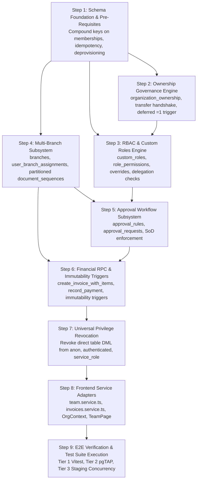

# PHASE 5.0B.1 — IMPLEMENTATION DEPENDENCY MAP
## Step-by-Step Implementation Ordering, Structural Pre-Conditions, and Technical Dependency Graph
**ATLAS OS Enterprise SaaS ERP Platform**  
**Classification:** Engineering Implementation Roadmap & Dependency Specification  
**Target Repository:** `D:\Projects\Atlas-OS` | **Branch:** `Vijay-Atlas`  
**Target Staging Ref:** `bwswqnhlebbzdxumlkih` | **Production Ref:** `hrxjgbupjtikokqxjzbh` (STRICTLY FORBIDDEN)

---

## 1. Executive Implementation Roadmap

This document establishes the precise, phased execution sequence for implementing the ATLAS OS target architecture. It maps technical dependencies between database tables, constraint triggers, RPC functions, security privileges, and application service adapters.



---

## 2. Phased Implementation Sequence

```
┌────────────────────────────────────────────────────────────────────────────────────────────────────────────────────────┐
│                                           PHASED IMPLEMENTATION SPECIFICATION                                          │
├─────────┬────────────────────────────┬──────────────────────────────────────┬──────────────────────────────────────────┤
│ Step    │ Subsystem / Component      │ Prerequisite Dependencies            │ Primary Technical Deliverable            │
├─────────┼────────────────────────────┼──────────────────────────────────────┼──────────────────────────────────────────┤
│ **01**  │ Schema Foundation          │ Remote Staging Catalog Verification  │ Add `uq_memberships_org_user`; deploy    │
│         │ & State Space              │ (Blocker BLK-01)                     │ `user_deprovisioning_requests` table.    │
├─────────┼────────────────────────────┼──────────────────────────────────────┼──────────────────────────────────────────┤
│ **02**  │ Ownership Governance       │ Step 01 (Memberships compound key)   │ Deploy `organization_ownership` with     │
│         │ Subsystem                  │                                      │ single Primary partial index & deferred  │
│         │                            │                                      │ constraint trigger for = 1 Primary Owner.│
├─────────┼────────────────────────────┼──────────────────────────────────────┼──────────────────────────────────────────┤
│ **03**  │ RBAC & Custom Roles        │ Step 02 (Ownership separation)       │ Deploy `custom_roles`, `role_permissions`│
│         │ Subsystem                  │                                      │ and `membership_permission_overrides`.   │
├─────────┼────────────────────────────┼──────────────────────────────────────┼──────────────────────────────────────────┤
│ **04**  │ Multi-Branch               │ Step 01 (Tenant base schema)         │ Deploy `branches`, `user_branch_assign-  │
│         │ Infrastructure             │                                      │ ments`, branch-partitioned sequences.    │
├─────────┼────────────────────────────┼──────────────────────────────────────┼──────────────────────────────────────────┤
│ **05**  │ Financial Approval         │ Step 03 (Roles) & Step 04 (Branches) │ Deploy `approval_rules`, Level 3.2       │
│         │ Workflow Engine            │                                      │ `approval_requests`, and decision logs.  │
├─────────┼────────────────────────────┼──────────────────────────────────────┼──────────────────────────────────────────┤
│ **06**  │ Commercial RPCs &          │ Step 04 (Sequences) & Step 05 (Appr) │ Deploy `create_invoice_with_items`,      │
│         │ Immutability Triggers      │                                      │ `record_payment_and_allocate`, triggers. │
├─────────┼────────────────────────────┼──────────────────────────────────────┼──────────────────────────────────────────┤
│ **07**  │ Closed-Door Privilege      │ Step 02 through Step 06 RPCs         │ REVOKE INSERT, UPDATE, DELETE, TRUNCATE  │
│         │ Revocation                 │ deployed and verified operational    │ from `anon`, `authenticated`,            │
│         │                            │                                      │ and `service_role` on all core tables.   │
├─────────┼────────────────────────────┼──────────────────────────────────────┼──────────────────────────────────────────┤
│ **08**  │ Frontend Client            │ Step 07 (Database privileges locked) │ Update `team.service.ts`, `invoices.     │
│         │ Service Adapters           │                                      │ service.ts`, and React components.       │
├─────────┼────────────────────────────┼──────────────────────────────────────┼──────────────────────────────────────────┤
│ **09**  │ Automated Verification     │ Step 08 deployed to staging          │ Run full test suite: 28 security tests   │
│         │ Test Execution             │                                      │ across Tier 1, 2, and 3.                 │
└─────────┴────────────────────────────┴──────────────────────────────────────┴──────────────────────────────────────────┘
```

---

## 3. Detailed Step Specifications

### Step 1: Schema Foundation & Pre-Requisites
- **Objective:** Establish the compound unique constraints and Level 0.5 state infrastructure.
- **Actions:**
  1. Add `uq_memberships_org_user UNIQUE (organization_id, user_id)` on `public.memberships`.
  2. Create table `public.user_deprovisioning_requests` with status check and monotonic fencing token.
  3. Create table `public.idempotency_keys` with user scoping.

### Step 2: Ownership Governance Engine
- **Objective:** Deploy the dedicated ownership table, transfer state machine, and Primary Owner invariants.
- **Actions:**
  1. Create `public.organization_ownership` with compound FK to `memberships(organization_id, user_id)`.
  2. Deploy partial unique index `idx_single_primary_owner_per_org` on `WHERE ownership_tier = 'PRIMARY_OWNER'`.
  3. Deploy deferred constraint trigger `trg_assert_primary_owner_exists` on `public.organizations`.
  4. Deploy `public.organization_ownership_transfers` table.
  5. Deploy RPCs: `appoint_co_owner`, `remove_co_owner`, `initiate_primary_ownership_transfer`, `accept_primary_ownership_transfer`.

### Step 3: RBAC & Custom Roles Subsystem
- **Objective:** Deploy custom role definitions, permission mappings, and granular overrides.
- **Actions:**
  1. Create tables `public.custom_roles`, `public.role_permissions`, `public.membership_permission_overrides`.
  2. Seed default system roles: `system_admin`, `system_sales`, `system_inventory`, `system_accounts`, `system_viewer`.
  3. Deploy `public.save_custom_role` RPC with monotonic delegation boundary check.

### Step 4: Multi-Branch Subsystem
- **Objective:** Partition physical operations by branch without leaking tenant isolation.
- **Actions:**
  1. Create tables `public.branches` and `public.user_branch_assignments`.
  2. Alter `public.document_sequences` to support nullable `branch_id UUID`.
  3. Update sequence uniqueness constraint to partition by branch and financial year.

### Step 5: Approval Workflow Subsystem
- **Objective:** Establish the Level 3.2 approval engine and Separation of Duties.
- **Actions:**
  1. Create tables `public.approval_rules`, `public.approval_requests`, and `public.approval_decisions`.
  2. Deploy `public.submit_approval_decision` RPC with Level 2 $\rightarrow$ Level 3.2 $\rightarrow$ Level 3.5 lock hierarchy and self-approval prohibition.

### Step 6: Commercial RPCs & Immutability Triggers
- **Objective:** Enable atomic document issuance and lock down historical ledgers.
- **Actions:**
  1. Deploy atomic `public.create_invoice_with_items` RPC with approval gating (`PENDING_APPROVAL`).
  2. Update `public.record_payment_and_allocate` to enforce branch scoping and invoice locks.
  3. Deploy `trg_enforce_financial_immutability` on `invoices`, `payments`, `allocations`, and `stock_movements`.
  4. Deploy `trg_prevent_audit_tampering` on `audit_events`.

### Step 7: Universal Privilege Revocation (The "Closed Door" Cutover)
- **Objective:** Eliminate direct REST table DML.
- **Actions:**
  ```sql
  REVOKE INSERT, UPDATE, DELETE, TRUNCATE ON TABLE 
      public.memberships,
      public.organization_ownership,
      public.invoices,
      public.invoice_items,
      public.payments,
      public.payment_allocations,
      public.stock_movements,
      public.branches,
      public.custom_roles,
      public.approval_rules
  FROM anon, authenticated, service_role;
  ```

### Step 8: Frontend Service Adapters
- **Objective:** Align application services to call trusted RPCs instead of direct REST.
- **Actions:**
  1. Update `src/services/team.service.ts` to call `appoint_co_owner`, `update_organization_member_role`.
  2. Update `src/services/invoices.service.ts` to call `create_invoice_with_items`.
  3. Update `src/features/team/TeamPage.tsx` to reflect Primary vs Co-Owner designations and remove client-side last-owner checks.

### Step 9: E2E Verification & Test Suite Execution
- **Objective:** Prove 100% test pass rate across all 28 automated security scenarios.
- **Actions:** Run Tier 1 Vitest tests, Tier 2 pgTAP tests, and Tier 3 Staging concurrency tests. Confirm zero deadlocks (`40P01`).
