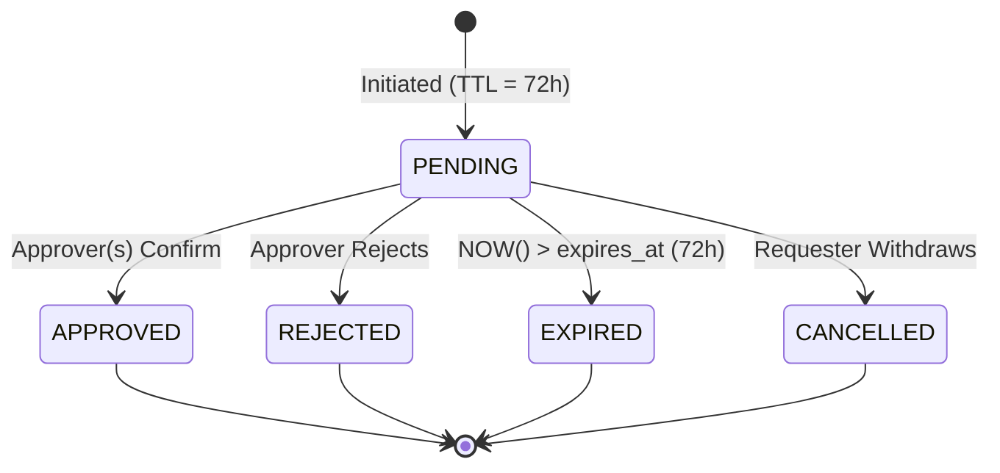
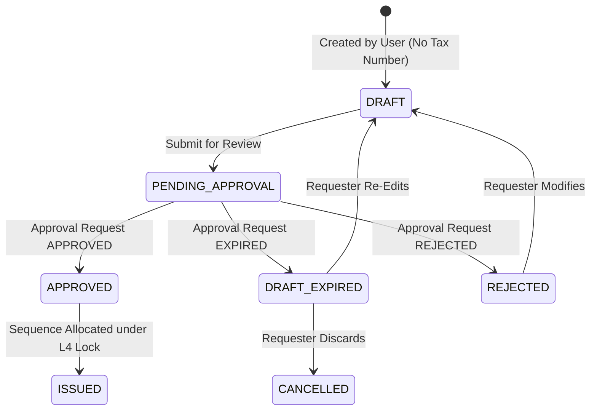

# PHASE 5.0B.2.1 — APPROVAL LIFECYCLE CONTRACT
## Authoritative Commercial Document State Machines, Expiry Transitions, and Separation of Duties Specification
**ATLAS OS Enterprise SaaS ERP Platform**  
**Classification:** Business Logic, Concurrency & Document Lifecycle Contract  
**Target Repository:** `D:\Projects\Atlas-OS` | **Branch:** `Vijay-Atlas`  
**Target Staging Ref:** `bwswqnhlebbzdxumlkih` | **Production Ref:** `hrxjgbupjtikokqxjzbh` (STRICTLY FORBIDDEN)

---

## 1. Executive Summary & Policy Scope

This contract formally defines the operational lifecycle, expiration mechanics, concurrency controls, and governance constraints for approval workflows across commercial and financial documents in ATLAS OS.

It supersedes previous ambiguous descriptions by establishing **discrete, type-specific state transitions for every business entity**, preventing any state corruption, sequence gaps, or invalid reversions to `DRAFT`.

### Core Contractual Invariants:
1. **Zero Silent Approval:** An expired approval request **MUST NEVER** execute or approve a transaction automatically.
2. **Immutability of Issued Financial Documents:** An invoice that has been finalized, issued, or allocated a sequence number **CAN NEVER REVERT TO DRAFT** or be mutated. Corrections require an official Credit Note under Section 34 of the CGST Act 2017.
3. **Strict Separation of Duties (SoD):** The initiating actor of an approval request is strictly barred from being an approver on that request.
4. **Dual-Distinct Approvers:** Tier 4 transactions (> ₹500,000) require authorization from **two distinct natural persons** (`approver_1_id != approver_2_id`).
5. **Two-Phase Ownership Transfer Handshake:** Primary Ownership cannot be unilaterally transferred; the nominated successor must explicitly accept the transfer before rights and fiduciary liabilities transition.

---

## 2. Multi-Entity State Machine Specifications (PO-02)

Different document categories behave differently when approval is requested, granted, rejected, or expired:

```
┌────────────────────────────────────────────────────────────────────────────────────────────────────────────────────────┐
│                                   DISCRETE DOCUMENT LIFECYCLE STATE MATRIX                                             │
├────────────────────┬────────────────────┬────────────────────┬────────────────────┬────────────────────────────────────┤
│ Entity Category    │ Initial State      │ In-Approval State  │ Approved State     │ Expired / Rejected State           │
├────────────────────┼────────────────────┼────────────────────┼────────────────────┼────────────────────────────────────┤
│ 1. Approval Request│ `PENDING`          │ `PENDING`          │ `APPROVED`         │ `EXPIRED` / `REJECTED`             │
├────────────────────┼────────────────────┼────────────────────┼────────────────────┼────────────────────────────────────┤
│ 2. Draft Invoice   │ `DRAFT`            │ `PENDING_APPROVAL` │ `APPROVED`         │ `DRAFT_EXPIRED` (Re-editable draft)│
│    (Pre-Issuance)  │ (No Seq Number)    │ (No Seq Number)    │ -> `ISSUED` (Seq#) │ No sequence allocated              │
├────────────────────┼────────────────────┼────────────────────┼────────────────────┼────────────────────────────────────┤
│ 3. Issued Invoice  │ `ISSUED`           │ Direct Generation  │ N/A                │ CANNOT REVERT TO DRAFT!            │
│    (Post-Issuance) │ (Tax Seq Assigned) │ Pre-Gated          │                    │ Correction via Credit Note only    │
├────────────────────┼────────────────────┼────────────────────┼────────────────────┼────────────────────────────────────┤
│ 4. Sales Order     │ `ORDER_DRAFT`      │ `PENDING_APPROVAL` │ `CONFIRMED`        │ `ORDER_EXPIRED` (Draft editable)   │
├────────────────────┼────────────────────┼────────────────────┼────────────────────┼────────────────────────────────────┤
│ 5. Stock Adjustment│ `PENDING_APPROVAL` │ `PENDING_APPROVAL` │ `POSTED`           │ `CANCELLED`                        │
│    (Write-off)     │ (No Stock Moved)   │ (No Stock Moved)   │ (Movement Ledger)  │ Zero inventory moved               │
├────────────────────┼────────────────────┼────────────────────┼────────────────────┼────────────────────────────────────┤
│ 6. Payment / Alloc │ `PENDING_APPROVAL` │ `PENDING_APPROVAL` │ `ALLOCATED`        │ `CANCELLED`                        │
│    (High-Value)    │ (No Cash Moved)    │ (No Cash Moved)    │ (Ledger Posted)    │ Zero ledger mutation               │
└────────────────────┴────────────────────┴────────────────────┴────────────────────┴────────────────────────────────────┘
```

---

### 2.1 Entity A: Approval Request (`public.approval_requests`)
The approval request entity tracks the lifecycle of the governance workflow itself:



- **Transitions:**
  - `PENDING` $\to$ `APPROVED`: Triggered when required quorum of approvers sign off (1 or 2 distinct approvers depending on tier).
  - `PENDING` $\to$ `REJECTED`: Triggered immediately if any authorized approver explicitly rejects with mandatory comment.
  - `PENDING` $\to$ `EXPIRED`: Triggered when `NOW() > expires_at` without reaching full approval quorum.
  - `PENDING` $\to$ `CANCELLED`: Triggered if the requester withdraws the request prior to approval.
- **Expiry Behavior:** Status updates to `EXPIRED`. Automated alert sent to requester. Transaction execution is strictly blocked.

---

### 2.2 Entity B: Draft Invoices (Pre-Issuance Commercial Documents)
Electrical contractors and wholesalers prepare draft invoices that exceed monetary thresholds or involve high-risk credit:



- **Critical Invariant:** While in `DRAFT`, `PENDING_APPROVAL`, or `DRAFT_EXPIRED`, **NO INVOICE NUMBER IS ALLOCATED**. The document does not consume a slot in `document_sequences`.
- **Handling Expiration:** If the approval request expires:
  - Invoice transitions to `DRAFT_EXPIRED`.
  - The document has never been posted to accounting ledgers or GSTR-1 tables.
  - Requester may modify items/prices and re-submit, or discard the draft entirely.
  - **Zero sequence gap is created.**

---

### 2.3 Entity C: Issued Invoices (Post-Issuance Financial Ledgers)
- **Absolute Rule:** In ATLAS OS, an invoice reaches `ISSUED` status **ONLY AFTER** all required approvals have completed and the sequential tax invoice number has been allocated under row-level sequence lock.
- **Reversion Prohibition:** 
  - An invoice in `ISSUED` status is guarded by Migration 015 database trigger `trg_prevent_invoice_mutation`.
  - Any SQL statement attempting `UPDATE invoices SET status = 'DRAFT' ...` or `DELETE FROM invoices ...` raises SQLSTATE `42501` / `55000` (Object in use / Immutability violation).
- **Post-Issuance Corrections:** If an issued invoice contains errors or goods are returned, the operator must issue an official **GST Credit Note** under Section 34 of the CGST Act 2017, linked to the original invoice UUID.

---

### 2.4 Entity D: Sales Orders
- **Initial State:** `ORDER_DRAFT`.
- **Submission:** If order total exceeds the branch manager tier, order transitions to `PENDING_APPROVAL`.
- **Approved State:** Order transitions to `CONFIRMED`. Inventory reservations are confirmed.
- **Expired State:** 
  - If approval expires, order transitions to `ORDER_EXPIRED`.
  - Any provisional inventory soft-holds are released.
  - Requester is notified; order can be revised and resubmitted or marked `CANCELLED`.

---

### 2.5 Entity E: Stock Adjustments & Physical Inventory Write-Offs
- **Policy Scope:** Physical inventory write-offs (e.g., damaged wire, missing switchgear) are classified as high-risk regardless of value (`PO-01`).
- **Initial State:** Adjustment proposal created in `PENDING_APPROVAL`. Zero entries are written to `public.stock_movements`.
- **Approved State:** Once approved by Senior Manager / Owner, the atomic RPC writes ledger lines to `stock_movements` with movement type `WRITE_OFF` or `ADJUSTMENT`.
- **Expired / Rejected State:**
  - Approval request transitions to `EXPIRED` or `REJECTED`.
  - Adjustment proposal transitions to `CANCELLED`.
  - **Zero inventory movement is posted.** The physical inventory balance in `get_product_stock` remains untouched.

---

### 2.6 Entity F: High-Value Payments & Credit Allocations
- **Initial State:** Proposed payment or credit refund exceeds Tier 3 threshold ($\ge$ ₹100,000). Payment request stored in `PENDING_APPROVAL`.
- **Approved State:** Atomic RPC executes `record_payment_and_allocate`, updating invoice balances and recording ledger entries under Level 3.5 lock.
- **Expired / Rejected State:** Payment proposal marked `CANCELLED`. Zero balance adjustments occur.

---

## 3. Financial Thresholds, Currencies & Rounding Rules (PO-01)

### 3.1 Currency Awareness
1. **Base Currency Evaluation:** All approval rules and thresholds are configured and evaluated in the organization's **base accounting currency** (default: `INR`).
2. **Foreign Currency Transactions:** If an organization transacts in foreign currency (e.g., USD), the commercial document's value is converted to base currency using the transaction's locked exchange rate prior to evaluating approval rules:
   $$\text{EvaluationAmount} = \text{document\_total} \times \text{exchange\_rate}$$

### 3.2 Precision and Rounding
- Threshold comparisons are executed in **integer minor units (paise)** or `NUMERIC(14, 2)`:
  - Tier 1: $\le 25,000.00$
  - Tier 2: $> 25,000.00 \land \le 100,000.00$
  - Tier 3: $> 100,000.00 \land \le 500,000.00$
  - Tier 4: $> 500,000.00$
- Floating-point arithmetic (`FLOAT`, `DOUBLE PRECISION`) is strictly barred from threshold evaluation to prevent IEEE-754 precision boundary leaks (e.g., ₹25,000.000000000001 triggering an unintended tier jump).

---

## 4. Separation of Duties (SoD) & Dual-Approver Constraints

```
┌────────────────────────────────────────────────────────────────────────────────────────────────────────────────────────┐
│                                   SEPARATION OF DUTIES & GOVERNANCE CHECKS                                             │
└────────────────────────────────────────────────────────────────────────────────────────────────────────────────────────┘

  [ Initiating Employee ] ────── Creates Document ──────► [ Approval Request Created ]
            │                                                         │
            │                                                         ▼
            │                                            ┌─────────────────────────┐
            │                                            │  CHECK 1: Self-Approval │
            │                                            │  Prohibition (SoD)      │
            │                                            └────────────┬────────────┘
            │                                                         │
            └── Attempted Approval by Initiator Rejected ◄────────────┤ Initiator == Approver?
                                                                      │ (RAISE EXCEPTION 42501)
                                                                      ▼
                                                         ┌─────────────────────────┐
                                                         │  CHECK 2: Tier Quorum   │
                                                         │  Evaluation             │
                                                         └────────────┬────────────┘
                                                                      │
                    ┌─────────────────────────────────────────────────┴─────────────────────────────────┐
                    ▼                                                                                   ▼
       [ Tier 1–3: Single Approver ]                                                       [ Tier 4: Dual Approvers ]
       • Must hold authorized role                                                         • Requires Approver 1 & Approver 2
       • Approver != Initiator                                                             • Approver 1 != Approver 2
                                                                                           • Both Approvers != Initiator
                                                                                           • Both must hold Tier 4 role
```

### 4.1 Anti-Self-Approval Enforcement
- Database trigger `trg_assert_separation_of_duties` on table `approval_decisions`:
  ```sql
  IF NEW.decided_by = (SELECT initiated_by FROM approval_requests WHERE id = NEW.request_id) THEN
      RAISE EXCEPTION 'Separation of Duties Violation: Requester cannot approve their own request'
          USING ERRCODE = '42501';
  END IF;
  ```

### 4.2 Dual-Distinct Approver Enforcement
- For Tier 4 requests, the schema requires two distinct approver signatures in `approval_decisions`:
  $$\text{approver\_1\_id} \neq \text{approver\_2\_id} \land \text{approver\_1\_id} \neq \text{initiated\_by} \land \text{approver\_2\_id} \neq \text{initiated\_by}$$
- The transaction cannot commit execution until both distinct signatures are recorded.

---

## 5. Two-Phase Primary Owner Transfer Handshake Protocol

To prevent malicious or accidental dumping of legal ownership, statutory tax liabilities, or compliance burdens onto an unsuspecting user, Primary Ownership transfer cannot be executed unilaterally:

```mermaid
sequenceDiagram
    autonumber
    actor CurrentOwner as Current Primary Owner
    participant DB as ATLAS OS System
    actor Nominee as Nominated Co-Owner / Admin

    CurrentOwner->>DB: initiate_ownership_transfer(nominee_id, reason)
    DB->>DB: Assert CurrentOwner == PRIMARY_OWNER
    DB->>DB: Assert Nominee is Active Member
    DB->>DB: Create ownership_transfers (status = 'OFFERED', ttl = 7 days)
    DB-->>CurrentOwner: Transfer Offer Created (Notification Sent)
    DB-->>Nominee: Alert: You have been offered Primary Ownership
    
    alt Nominee Accepts
        Nominee->>DB: accept_ownership_transfer(transfer_id)
        DB->>DB: Under Row Lock on organization_ownership:
        DB->>DB: Demote CurrentOwner -> CO_OWNER
        DB->>DB: Promote Nominee -> PRIMARY_OWNER
        DB->>DB: Update transfer status -> 'COMPLETED'
        DB-->>Nominee: Ownership Successfully Assumed
        DB-->>CurrentOwner: Ownership Transferred
    else Nominee Rejects or TTL Expires
        Nominee->>DB: reject_ownership_transfer(transfer_id)
        DB->>DB: Update transfer status -> 'REJECTED' / 'EXPIRED'
        DB-->>CurrentOwner: Transfer Cancelled; You Remain Primary Owner
    end
```

- **Invariant:** The current Primary Owner remains fully vested with all fiduciary rights and obligations until the nominee explicitly executes `accept_ownership_transfer`.

---

## 6. Co-Owner Recovery Quorum Formulation (PO-04)

- **Eligible Voters:** All active members holding `ownership_type = 'CO_OWNER'`, **strictly excluding the claimant**:
  $$N_{\text{eligible}} = |\{c \in \text{CoOwners}(\text{org\_id}) \mid c.\text{user\_id} \neq \text{claimant\_id} \land c.\text{is\_active} = \text{TRUE}\}|$$
- **Approval Quorum:** Strictly $> 66\%$ rounded upward:
  $$\text{RequiredApprovals} = \lfloor 0.66 \times N_{\text{eligible}} \rfloor + 1$$
- **Zero Co-Owner Guard:** If $N_{\text{eligible}} = 0$, peer voting is mathematically impossible; the request is blocked from automated voting and diverts exclusively to **Sole-Owner KYC Verification (`PO-06`)**.

---

## 7. Branch-Level Isolation for Central Customer Master (PO-07)

- **Master Record:** `public.customers` is scoped to `organization_id`. All branches share the customer identity to prevent duplicate entities and fragmented GSTIN reporting.
- **Branch Access Overlay:**
  - Branch sales operators have `SELECT` access to customer names, GSTINs, and delivery addresses to create quotations and orders.
  - Sensitive financial attributes (`credit_limit`, `payment_terms_days`, `current_aging_balance`, `internal_risk_rating`) are accessible only to Head Office roles (`admin`, `finance_manager`, `owner`).
  - Implemented via PostgreSQL column-level privileges or security-barrier views (`public.branch_accessible_customers`).

---

## 8. Summary Attestation

This contract guarantees that no document state corruption, unapproved financial actions, or illegal reversions can occur within ATLAS OS commercial workflows.
