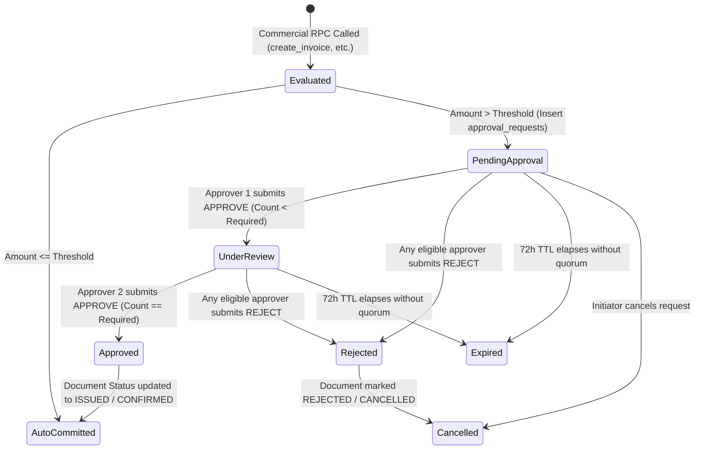

# PHASE 5.0B — WORKSTREAM D: FINANCIAL & BUSINESS APPROVAL WORKFLOW ARCHITECTURE
## Authoritative Enterprise Approval Engine: Multi-Tier Thresholds, Separation of Duties, Quorums, and Financial Ledger Integration
**ATLAS OS Enterprise SaaS ERP Platform**  
**Classification:** Restricted Engineering Architecture Blueprint — Read-Only Design  
**Target Repository:** `D:\Projects\Atlas-OS` | **Branch:** `Vijay-Atlas`  
**Target Staging Ref:** `bwswqnhlebbzdxumlkih` | **Production Ref:** `hrxjgbupjtikokqxjzbh` (STRICTLY FORBIDDEN)

---

## 1. Purpose & Scope

This document specifies the **Enterprise Financial & Business Approval Framework** for ATLAS OS. It implements **DEC-13 (Configurable Critical Action Approvals)**, designing an auditable, multi-level authorization pipeline for high-value transactions, risk-bearing commercial adjustments, and credit control.

The specification details:
1. Configurable monetary thresholds and risk tiers.
2. Strict Separation of Duties (SoD) and self-approval prevention.
3. Multi-approver quorums and linear approval chains.
4. Full integration with commercial document RPCs (`create_invoice_with_items`, `record_payment_and_allocate`, credit notes, and stock write-offs).
5. State transitions, expiration, cancellation, and immutable audit trails.

---

## 2. Existing-State Evidence & Architectural Audit

1. **`004_quotations_and_orders.sql` & `005_invoices_and_payments.sql`:**
   - Any user holding `role = 'accounts'`, `role = 'admin'`, or `role = 'owner'` can unilaterally issue an invoice for ₹10,000,000 or grant a 99% discount with zero secondary review [`VERIFIED IN LOCAL SOURCE`].
   - There is **no approval mechanism** or intermediate `PENDING_APPROVAL` status on invoices, payments, or orders [`VERIFIED IN LOCAL SOURCE`].
2. **`003_inventory_ledger.sql`:**
   - A storekeeper with `role = 'inventory'` can execute direct manual stock deductions (`movement_type = 'ADJUSTMENT'`) of any quantity with no oversight [`VERIFIED IN LOCAL SOURCE`].
3. **`005_invoices_and_payments.sql` (lines 156–240):**
   - The RPC `record_payment_and_allocate` accepts payments of any amount and commits them immediately to the ledger with no secondary authorization [`VERIFIED IN LOCAL SOURCE`].

---

## 3. Configurable Approval Architecture & Threshold Model

### 3.1 Financial Risk & Approval Tiers (DEC-13)
ATLAS OS establishes four standard governance risk tiers [`PROPOSED DESIGN`]:

| Governance Tier | Transaction Threshold (INR) | Eligible Action Types | Mandatory Approver Quorum | Separation of Duties Rule |
| :--- | :--- | :--- | :--- | :--- |
| **Tier 1: Standard (Auto)** | $\le$ ₹25,000 | Standard Invoices, Normal Payments, Dispatches | Auto-approved by operational staff | Standard role check |
| **Tier 2: Operational** | > ₹25,000 to ₹100,000 | Discounts > 10%, Credit Limit Extensions up to ₹50K | 1 Approver: Branch Admin or Accounts Lead | **SoD:** Approver cannot be Initiator |
| **Tier 3: Executive** | > ₹100,000 to ₹500,000 | Large Invoices, Credit Notes, Physical Stock Write-offs | 1 Approver: Co-Owner or Finance Director | **SoD:** Approver cannot be Initiator |
| **Tier 4: Critical / Ownership** | > ₹500,000 | Multi-lakh purchases, High-value refunds, Bad debt write-offs | 2 Approvers: Primary Owner + 1 Co-Owner | **Dual-Quorum:** Strict two-person rule |

---

## 4. Separation of Duties (SoD) & Anti-Abuse Invariants

To eliminate internal fraud, collusion, and rogue employee transactions:

### Invariant Inv-Appr-01: Absolute Self-Approval Prohibition
$$\forall \text{ approval request } R: \quad \text{Approver}(R) = \text{Initiator}(R) \implies \text{ABORT}(42501)$$
- **Enforcement:** The approval RPC `public.submit_approval_decision` compares `auth.uid()` against `approval_requests.initiator_user_id`. If they match, the transaction raises PostgreSQL error `42501 (self_approval_prohibited)`.
- **Exception:** Even the Primary Owner cannot self-approve their own transaction if the policy specifies a Tier 4 Dual-Quorum rule.

### Invariant Inv-Appr-02: Approver Authority Boundary
$$\text{Approve}(U, R) \implies \text{EffectiveAuthority}(U) \ge \text{RiskTier}(R)$$
- An administrator cannot approve an action whose value exceeds their assigned monetary limit, even if they hold the `admin` role.

---

## 5. Schema Data Model: Approval Engine

```sql
-- Architectural Schema: Configurable Approval Rules
CREATE TABLE public.approval_rules (
    id UUID PRIMARY KEY DEFAULT gen_random_uuid(),
    organization_id UUID NOT NULL REFERENCES public.organizations(id) ON DELETE CASCADE,
    action_type VARCHAR(50) NOT NULL CHECK (
        action_type IN (
            'INVOICE_DISCOUNT', 'HIGH_VALUE_INVOICE', 'REFUND', 
            'CREDIT_NOTE', 'CREDIT_LIMIT_OVERRIDE', 'STOCK_WRITEOFF'
        )
    ),
    threshold_amount NUMERIC(12, 2) NOT NULL DEFAULT 0.00,
    required_approver_role VARCHAR(50) NOT NULL, -- e.g., 'CO_OWNER', 'PRIMARY_OWNER', 'FINANCE_HEAD'
    required_approvals_count INTEGER NOT NULL DEFAULT 1,
    is_active BOOLEAN NOT NULL DEFAULT TRUE,
    created_at TIMESTAMPTZ NOT NULL DEFAULT timezone('utc'::text, now())
);

-- Active Approval Requests
CREATE TABLE public.approval_requests (
    id UUID PRIMARY KEY DEFAULT gen_random_uuid(),
    organization_id UUID NOT NULL REFERENCES public.organizations(id) ON DELETE CASCADE,
    action_type VARCHAR(50) NOT NULL,
    entity_type VARCHAR(50) NOT NULL, -- 'invoices', 'payments', 'stock_movements'
    entity_id UUID NOT NULL,
    initiator_user_id UUID NOT NULL,
    amount NUMERIC(12, 2),
    payload JSONB NOT NULL, -- Commercial snapshot of requested action
    status VARCHAR(50) NOT NULL DEFAULT 'PENDING' CHECK (
        status IN ('PENDING', 'APPROVED', 'REJECTED', 'CANCELLED', 'EXPIRED')
    ),
    required_approvals INTEGER NOT NULL DEFAULT 1,
    current_approvals INTEGER NOT NULL DEFAULT 0,
    expires_at TIMESTAMPTZ NOT NULL DEFAULT (timezone('utc'::text, now()) + INTERVAL '72 hours'),
    created_at TIMESTAMPTZ NOT NULL DEFAULT timezone('utc'::text, now()),
    updated_at TIMESTAMPTZ NOT NULL DEFAULT timezone('utc'::text, now())
);

-- Individual Approval Decisions (Audit Trail)
CREATE TABLE public.approval_decisions (
    id UUID PRIMARY KEY DEFAULT gen_random_uuid(),
    request_id UUID NOT NULL REFERENCES public.approval_requests(id) ON DELETE CASCADE,
    approver_user_id UUID NOT NULL,
    decision VARCHAR(20) NOT NULL CHECK (decision IN ('APPROVE', 'REJECT')),
    notes TEXT,
    decided_at TIMESTAMPTZ NOT NULL DEFAULT timezone('utc'::text, now()),
    CONSTRAINT uq_request_approver UNIQUE (request_id, approver_user_id)
);
```

---

## 6. Approval Workflow State Machine & Commercial Document Integration

### 6.1 State Machine Diagram


---

### 6.2 Interaction with `create_invoice_with_items` and Financial RPCs
When `create_invoice_with_items` is executed:
1. The RPC evaluates whether the document triggers an active approval rule (e.g., `discount_amount > ₹10,000` or `total_amount > ₹500,000`).
2. **If Triggered:**
   - The invoice is inserted with `status = 'PENDING_APPROVAL'`.
   - Line items are inserted and locked.
   - An entry is inserted into `approval_requests`.
   - The RPC returns the invoice marked `PENDING_APPROVAL` with the associated `approval_request_id`.
   - **Immutability Protection:** The invoice cannot be edited, paid, or printed as a valid tax invoice while in `PENDING_APPROVAL`.
3. **Upon Final Approval (`submit_approval_decision`):**
   - The approval engine acquires the invoice row lock (`FOR UPDATE`).
   - Allocates the official sequential tax invoice number from `document_sequences`.
   - Updates invoice status: `status := 'ISSUED'`.
   - Emits `INVOICE_ISSUED_UPON_APPROVAL` audit event.

---

## 7. Approval Expiration, Escalation & Delegation

1. **Time-To-Live (TTL):** Standard approval requests carry an enforceable 72-hour expiration window.
2. **Automated Expiration Cleaner:** A scheduled worker (or transactional lazy evaluation) marks requests older than `expires_at` as `EXPIRED`.
3. **Delegated Authority (Out-of-Office):**
   - An approver can designate an active delegate via `public.delegate_approval_authority(p_delegate_user_id, p_start_date, p_end_date)`.
   - The delegate must already hold an active operational role of equal or higher tier.
   - All delegated actions record both the delegator and delegate IDs in `approval_decisions`.

---

## 8. Matters Requiring CA & Legal Review

1. **GST Credit Note Mandate (Section 34 CGST Act):**
   - Under Indian GST, can a manager approve an invoice "cancellation" after the invoice has been dispatched to the customer, or must every post-issuance correction strictly be a Credit Note? [`REQUIRES CA/LEGAL REVIEW`]
2. **Bad Debt & Inventory Write-Off Approvals:**
   - Are there statutory board resolution requirements under the Companies Act for writing off damaged stock or uncollectible debts exceeding ₹500,000? [`REQUIRES CA/LEGAL REVIEW`]

---

## 9. Acceptance Criteria for Implementation (Phase 5.0B Gate)

- [ ] Four-tier risk threshold model defined with explicit monetary boundaries.
- [ ] Absolute Self-Approval Prohibition (SoD) formalized and mathematically proven.
- [ ] Schema models for `approval_rules`, `approval_requests`, and `approval_decisions` specified.
- [ ] Two-phase integration with commercial RPCs (`PENDING_APPROVAL` state) designed without ledger leaks.
- [ ] Dual-approver quorum mechanism specified for critical transactions (>₹500K).
