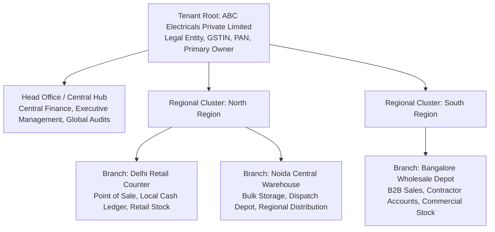

# PHASE 5.0B — WORKSTREAM C: MULTI-BRANCH GOVERNANCE DESIGN
## Authoritative Multi-Unit Architecture: Head Office Hierarchy, Regional Clusters, Inter-Branch Ledgers, and Scoped Isolation
**ATLAS OS Enterprise SaaS ERP Platform**  
**Classification:** Restricted Engineering Architecture Blueprint — Read-Only Design  
**Target Repository:** `D:\Projects\Atlas-OS` | **Branch:** `Vijay-Atlas`  
**Target Staging Ref:** `bwswqnhlebbzdxumlkih` | **Production Ref:** `hrxjgbupjtikokqxjzbh` (STRICTLY FORBIDDEN)

---

## 1. Purpose & Scope

This document specifies the **Multi-Branch Governance Architecture** for ATLAS OS. It provides an enterprise-ready foundation supporting businesses that operate across multiple physical or logical facilities (e.g., head office, retail outlets, regional distribution centers, and wholesale warehouses).

The design establishes:
1. Hierarchical branch modeling and regional cluster grouping.
2. Contextual authorization scoping (accessing one or more branches without full organization-wide privileges).
3. Centralized vs localized financial and inventory ledgers.
4. Two-phase inter-branch inventory transfer protocols.
5. Strict tenant isolation safeguards ensuring branch boundaries never compromise organization partitioning.

---

## 2. Existing-State Evidence & Architectural Audit

1. **`001_multi_tenant_base.sql` (lines 8–24):**
   - The `organizations` table represents the single physical and legal entity [`VERIFIED IN LOCAL SOURCE`].
   - There is **no branch or location concept** anywhere in migrations `001` through `014` [`VERIFIED IN LOCAL SOURCE`].
2. **`002_products_customers_suppliers.sql` & `003_inventory_ledger.sql`:**
   - Products and stock movements are partitioned solely by `organization_id` [`VERIFIED IN LOCAL SOURCE`].
   - Stock quantities returned by `get_product_stock(p_product_id, p_org_id)` aggregate across the entire organization, with no facility to determine stock at a specific warehouse or retail counter [`VERIFIED IN LOCAL SOURCE`].
3. **`005_invoices_and_payments.sql`:**
   - Invoices and payments belong directly to the organization root. Consecutive numbering sequences (`010_robust_document_numbering_sequences.sql`) are organization-wide [`VERIFIED IN LOCAL SOURCE`].

---

## 3. Multi-Branch Structural Hierarchy

To support growth from a single electrical retail shop to a multi-state distribution network, ATLAS OS models branches as sub-tenant organizational units [`PROPOSED DESIGN`]:



### 3.1 Schema Data Model: `public.branches` and `public.user_branch_assignments`
```sql
-- Architectural Schema: Multi-Branch Entity Model
CREATE TABLE public.branches (
    id UUID PRIMARY KEY DEFAULT gen_random_uuid(),
    organization_id UUID NOT NULL REFERENCES public.organizations(id) ON DELETE CASCADE,
    code VARCHAR(20) NOT NULL, -- e.g., 'HO-01', 'DEL-RET', 'BLR-DEP'
    name VARCHAR(255) NOT NULL,
    branch_type VARCHAR(50) NOT NULL CHECK (
        branch_type IN ('HEAD_OFFICE', 'RETAIL_STORE', 'WAREHOUSE', 'WHOLESALE_DEPOT')
    ),
    address JSONB NOT NULL DEFAULT '{}'::jsonb,
    is_active BOOLEAN NOT NULL DEFAULT TRUE,
    created_at TIMESTAMPTZ NOT NULL DEFAULT timezone('utc'::text, now()),
    updated_at TIMESTAMPTZ NOT NULL DEFAULT timezone('utc'::text, now()),
    CONSTRAINT uq_org_branch_code UNIQUE (organization_id, code)
);

CREATE INDEX idx_branches_org ON public.branches(organization_id);

-- User-Branch Scoping Assignment (Many-to-Many within Tenant)
CREATE TABLE public.user_branch_assignments (
    id UUID PRIMARY KEY DEFAULT gen_random_uuid(),
    organization_id UUID NOT NULL REFERENCES public.organizations(id) ON DELETE CASCADE,
    user_id UUID NOT NULL,
    branch_id UUID NOT NULL REFERENCES public.branches(id) ON DELETE CASCADE,
    is_default BOOLEAN NOT NULL DEFAULT FALSE,
    assigned_at TIMESTAMPTZ NOT NULL DEFAULT timezone('utc'::text, now()),
    assigned_by UUID,
    CONSTRAINT uq_user_branch UNIQUE (organization_id, user_id, branch_id)
);

CREATE INDEX idx_user_branch_lookup ON public.user_branch_assignments(organization_id, user_id);
```

---

## 4. Contextual Scoping & Permission Resolution

### 4.1 Access Scope Levels
ATLAS OS defines three distinct operational scoping tiers for tenant users [`PROPOSED DESIGN`]:

| Scope Tier | User Roles / Personas | Scope Definition | Concrete Data Visibility |
| :--- | :--- | :--- | :--- |
| **Tier 1: Global (Tenant-Wide)** | Primary Owner, Co-Owners, Central Finance, Executive Management | `branch_id IS NULL` in user scope (Universal Access) | Can read and operate across all branches, warehouses, and consolidated financial ledgers. |
| **Tier 2: Regional / Multi-Branch** | Regional Sales Director, Area Inventory Controller | Assigned to a specific set of branches in `user_branch_assignments` | Can inspect and operate across their assigned branches (e.g., Delhi + Noida), but blocked from South branches. |
| **Tier 3: Single-Branch** | Branch Cashier, Counter Salesman, Warehouse Storekeeper | Exactly one branch assigned in `user_branch_assignments` | Strictly confined to their local counter. Cannot see cash drawers, stock, or invoices of other branches. |

### 4.2 Multi-Branch Scoping Invariant: Primary Tenant Guard
$$\forall \text{ query } Q \text{ on table } T: \quad \text{RLS}(Q) \implies (T.\text{organization\_id} = \text{Tenant}(U)) \land (\text{IsGlobal}(U) \lor T.\text{branch\_id} \in \text{AssignedBranches}(U))$$

#### Critical Security Rule:
**Under no circumstances may a branch query ever omit the `organization_id` filter.** Branch filtering is strictly a secondary constraint applied *after* tenant boundary isolation. Even if a user attempts to forge a `branch_id` belonging to another tenant, the primary `organization_id = auth.get_user_org_id()` filter guarantees immediate rejection.

---

## 5. Branch-Level Financial & Inventory Segregation

### 5.1 Local vs Centralized Ledgers
To support real-world commercial operations in the electrical trade:

1. **Cash Drawers & Local Payments:**
   - Payments collected at a retail counter are tagged with `branch_id`.
   - Daily cash settlement and reconciliation are performed per branch.
   - Central finance can view consolidated cash positions across all branches.
2. **Branch-Specific Invoice Numbering:**
   - GST regulations in India allow branch-specific sequence prefixes (e.g., `INV/DEL/2627/0001` vs `INV/BLR/2627/0001`).
   - The `document_sequences` table is extended to support optional branch partitioning:
     `UNIQUE(organization_id, document_type, branch_id, financial_year)`.

---

## 6. Two-Phase Inter-Branch Inventory Transfers

In electrical wholesaling, transferring heavy cable drums or switchgear between a central warehouse and retail counters requires strict custody tracking [`PROPOSED DESIGN`].

### 6.1 Transfer State Machine & Inventory Conservation Invariant

```mermaid
stateDiagram-v2
    [*] --> Requested: Branch A requests stock from Branch B
    Requested --> Dispatched: Branch B approves & dispatches (SALES_DISPATCH)
    Dispatched --> InTransit: Stock deducted from Branch B; added to Transit Bucket
    InTransit --> Received: Branch A receives & verifies (GOODS_RECEIVED)
    Received --> Completed: Stock deducted from Transit Bucket; added to Branch A
    InTransit --> Disputed: Discrepancy detected (Damaged / Missing stock)
    Disputed --> Completed: Adjustment logged; reconciled
    Completed --> [*]
```


### 6.2 Mathematical Inventory Invariant
Across any inter-branch transfer of product $P$ between Source $S$ and Destination $D$:
$$\text{Stock}(P, S) + \text{Stock}(P, D) + \text{InTransit}(P, S \rightarrow D) = \text{Constant}$$
- **Step 1 (Dispatch):** Source branch executes `dispatch_stock_transfer`. Generates a negative stock movement for Source (`-Q`) and a positive movement for the virtual transit pool (`+Q`).
- **Step 2 (Receipt):** Destination branch executes `receive_stock_transfer`. Generates a negative movement for the virtual transit pool (`-Q`) and a positive movement for Destination (`+Q`).
- **Total Physical Stock:** At no point during the transfer is stock duplicated or lost from the organization's aggregate ledger.

---

## 7. Tenant Isolation Risks in Multi-Branch Architecture

### Risk 1: Foreign Key Bleed
- **Vulnerability:** An invoice in Org $A$ references a branch belonging to Org $B$.
- **Mitigation:** Database-level compound foreign keys:
  ```sql
  -- Prevents cross-tenant branch association
  ALTER TABLE public.branches ADD CONSTRAINT uq_branch_org_id UNIQUE (id, organization_id);
  ALTER TABLE public.invoices ADD CONSTRAINT fk_invoice_branch_tenant 
      FOREIGN KEY (branch_id, organization_id) 
      REFERENCES public.branches(id, organization_id);
  ```

### Risk 2: Multi-Branch Session Contamination
- **Vulnerability:** A cashier operating in Branch 1 switches browser tabs and inadvertently submits an order under Branch 2.
- **Mitigation:** The active `branch_id` must be passed explicitly in every mutating RPC payload (`p_branch_id`), where it is verified against the user's active `user_branch_assignments` record under row lock.

---

## 8. Acceptance Criteria for Implementation (Phase 5.0B Gate)

- [ ] Multi-branch data model (`branches`, `user_branch_assignments`) specified with compound tenant FKs.
- [ ] Three-tier scoping model (Global, Regional, Local) formalized.
- [ ] Strict secondary scoping invariant defined (Tenant guard always takes precedence).
- [ ] Two-phase inventory transfer protocol designed with mathematical conservation invariant.
- [ ] Compound foreign keys specified to prevent cross-tenant branch reference injection.
