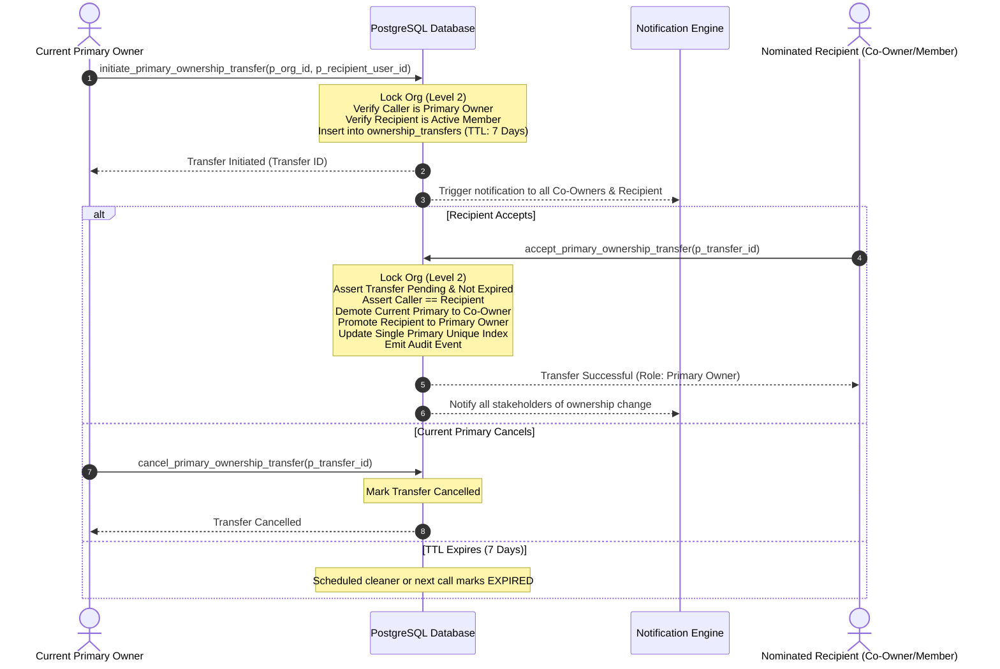

# PHASE 5.0B — WORKSTREAM A: OWNERSHIP GOVERNANCE DESIGN
## Authoritative Architecture Specification: Primary Owner Reserved Powers, Co-Ownership Model, and Governance Lifecycles
**ATLAS OS Enterprise SaaS ERP Platform**  
**Classification:** Restricted Engineering Architecture Blueprint — Read-Only Design  
**Target Repository:** `D:\Projects\Atlas-OS` | **Branch:** `Vijay-Atlas`  
**Target Staging Ref:** `bwswqnhlebbzdxumlkih` | **Production Ref:** `hrxjgbupjtikokqxjzbh` (STRICTLY FORBIDDEN)

---

## 1. Purpose & Scope

This document defines the comprehensive **Ownership Governance Architecture** for ATLAS OS. It formalizes the confirmed product owner decisions:
- **DEC-01 (Owner Cardinality):** MULTIPLE OWNERS (Exactly one designated Primary Owner, zero or more Co-Owners).
- **Ownership Authority Model:** PRIMARY OWNER HAS RESERVED POWERS (Co-owners hold shared governance authority, but lack unilateral powers over ownership transfer, owner removal, and tenant closure).
- **DEC-11 (Role Independence):** Single operational role per membership, separating ownership status from functional RBAC roles.

This specification covers the full lifecycle of organization ownership, database schema representations, server-side invariant enforcement, state machine workflows, failure recovery protocols, and concurrency safeguards.

---

## 2. Existing-State Evidence & Architectural Audit

Based on forensic inspection of the codebase and schema:

1. **`001_multi_tenant_base.sql` (lines 26–36):**
   - The table `public.memberships` couples ownership and operational permissions into a single column: `role VARCHAR(50) NOT NULL CHECK (role IN ('owner', 'admin', 'sales', 'inventory', 'accounts', 'viewer'))` [`VERIFIED IN LOCAL SOURCE`].
   - Composite uniqueness is enforced only on `(organization_id, user_id)` [`VERIFIED IN LOCAL SOURCE`].
   - There is **no database-level constraint** distinguishing a "Primary Owner" from secondary owners, nor any constraint ensuring an active organization retains at least one owner [`VERIFIED IN LOCAL SOURCE`].
2. **`007_security_and_integrity_audit_fixes.sql` (lines 770–800):**
   - RLS policies permit any user with `role = 'owner'` to issue direct REST `INSERT`, `UPDATE`, and `DELETE` on `public.memberships` [`VERIFIED IN LOCAL SOURCE`].
   - This allows any owner to unilaterally delete other owners, demote themselves, or delete the last owner, orphaning the organization [`VERIFIED IN LOCAL SOURCE`].
3. **`src/features/team/TeamPage.tsx` (lines 94–96, 124–126):**
   - Last-owner checks are executed entirely in client-side React code: `const activeOwners = memberships.filter((m) => m.role === 'owner' && m.isActive)` [`VERIFIED IN LOCAL SOURCE`].
   - This check is subject to TOCTOU race conditions and can be completely bypassed via direct Supabase REST API requests [`VERIFIED IN LOCAL SOURCE`].
4. **`012_organization_creation_rpc.sql` (lines 198–212):**
   - The `create_organization` RPC creates the tenant root and assigns `role = 'owner'` to the creator [`VERIFIED IN LOCAL SOURCE`].
   - It provides no field to record Primary Ownership designation or governance metadata [`VERIFIED IN LOCAL SOURCE`].

---

## 3. Schema Architecture: Model Evaluation & Recommendation

Workstream A requires evaluating whether the existing schema can support this model or whether a separate ownership structure is required, avoiding unnecessary table proliferation while upholding strict database invariants.

### 3.1 Model Comparison Matrix

```
┌────────────────────────────────────────────────────────────────────────────────────────────────────────┐
│                                    OWNERSHIP SCHEMA MODEL EVALUATION                                   │
├──────────────────────┬──────────────────────────────┬──────────────────────────┬───────────────────────┤
│ Evaluation Dimension │ Model 1: Enriched Membership │ Model 2: Dedicated Table │ Model 3: Tenant Root  │
│                      │ Column (`ownership_tier`)    │ (`organization_ownership`)│ Pointer + Co-Owners   │
├──────────────────────┼──────────────────────────────┼──────────────────────────┼───────────────────────┤
│ **DEC-11 Alignment** │ MODERATE: Mixes governance   │ EXCELLENT: Total decouple│ EXCELLENT: Distinct   │
│                      │ with operational membership  │ of ownership from RBAC   │ root attribute        │
├──────────────────────┼──────────────────────────────┼──────────────────────────┼───────────────────────┤
│ **Single Primary**   │ Partial unique index on      │ Partial unique index on  │ `primary_owner_id` FK │
│ **Owner Constraint** │ `memberships(org_id)`        │ `org_ownership(org_id)`  │ on `organizations`    │
├──────────────────────┼──────────────────────────────┼──────────────────────────┼───────────────────────┤
│ **Lock Contention**  │ Locks `memberships` row;     │ Dedicated lock space;    │ Locks root tenant row │
│                      │ potential RLS check conflict │ zero member lock overlap │ on any owner change   │
├──────────────────────┼──────────────────────────────┼──────────────────────────┼───────────────────────┤
│ **Deprovisioning**   │ Direct link to user identity;│ Clean cascade or state   │ Circular FK between   │
│ **Interactions**     │ requires complex row updates │ machine handling         │ auth.users and orgs   │
├──────────────────────┼──────────────────────────────┼──────────────────────────┼───────────────────────┤
│ **Migration Impact** │ LOW: Add column to existing  │ MEDIUM: Add 1 table;     │ HIGH: Alter core orgs │
│                      │ `memberships` table          │ no breaking changes      │ schema; circular deps │
└──────────────────────┴──────────────────────────────┴──────────────────────────┴───────────────────────┘
```

### 3.2 Architectural Recommendation: Dedicated `public.organization_ownership` Table (Model 2)
[`PROPOSED DESIGN`]

To strictly honor **DEC-11** (Single operational role per membership, with ownership modeled independently) and avoid circular foreign key dependencies between `organizations` and `auth.users`, ATLAS OS adopts **Model 2: Dedicated Organization Ownership Architecture**.

```sql
-- Architectural Design: Organization Ownership Governance Table
CREATE TABLE public.organization_ownership (
    id UUID PRIMARY KEY DEFAULT gen_random_uuid(),
    organization_id UUID NOT NULL REFERENCES public.organizations(id) ON DELETE RESTRICT,
    user_id UUID NOT NULL, -- Bare UUID, referential survival upon Auth deletion
    ownership_tier VARCHAR(20) NOT NULL CHECK (
        ownership_tier IN ('PRIMARY_OWNER', 'CO_OWNER')
    ),
    appointed_at TIMESTAMPTZ NOT NULL DEFAULT timezone('utc'::text, now()),
    appointed_by UUID, -- Bare UUID of delegating Primary Owner
    updated_at TIMESTAMPTZ NOT NULL DEFAULT timezone('utc'::text, now()),
    CONSTRAINT uq_org_owner UNIQUE (organization_id, user_id)
);

-- Core Invariant: Exactly one active Primary Owner per organization
CREATE UNIQUE INDEX idx_single_primary_owner_per_org 
ON public.organization_ownership(organization_id) 
WHERE ownership_tier = 'PRIMARY_OWNER';

CREATE INDEX idx_org_ownership_user ON public.organization_ownership(user_id);
```

#### Dual-Relationship Contract:
1. Every user who holds an entry in `organization_ownership` **must also hold an active record in `public.memberships`** defining their operational role (e.g., `role = 'admin'`, `role = 'executive'`, or legacy `role = 'owner'`).
2. An employee may change their operational role (e.g., from `admin` to `accounts`) without affecting their Co-Ownership equity/governance status.
3. Conversely, revoking Co-Ownership does not terminate the user's employment or operational access unless their membership is explicitly deactivated.

---

## 4. Ownership Authority & Reserved Powers Matrix

The following matrix formally specifies the division of powers enforced by PostgreSQL server-side RPCs [`PROPOSED DESIGN`]:

| Governance / Operational Action | Primary Owner | Co-Owner | Administrator (`admin`) | Operational Staff | Enforcement Mechanism |
| :--- | :---: | :---: | :---: | :---: | :--- |
| **Initiate Organization Closure / Deletion** | **AUTHORITY** | DENIED | DENIED | DENIED | RPC: `initiate_organization_closure` |
| **Initiate Primary Ownership Transfer** | **AUTHORITY** | DENIED | DENIED | DENIED | RPC: `initiate_primary_ownership_transfer` |
| **Cancel Primary Ownership Transfer** | **AUTHORITY** | DENIED | DENIED | DENIED | RPC: `cancel_primary_ownership_transfer` |
| **Appoint New Co-Owner** | **AUTHORITY** | DENIED | DENIED | DENIED | RPC: `appoint_co_owner` |
| **Remove a Co-Owner** | **AUTHORITY** | DENIED | DENIED | DENIED | RPC: `remove_co_owner` |
| **Voluntary Co-Owner Resignation** | N/A | **AUTHORITY** | N/A | N/A | RPC: `resign_co_ownership` |
| **Primary Owner Verified Recovery Approval** | N/A | **AUTHORITY** | DENIED | DENIED | RPC: `vote_owner_recovery` |
| **Edit Legal Name, GSTIN, PAN** | **AUTHORITY** | **AUTHORITY** | DENIED | DENIED | RPC: `update_organization_legal_profile` |
| **Manage Subscription & Billing Tier** | **AUTHORITY** | **AUTHORITY** | DENIED | DENIED | RPC: `manage_subscription_billing` |
| **Approve Tier 3 Financial Workflows (>₹500K)**| **AUTHORITY** | **AUTHORITY** | DENIED | DENIED | Approval Engine (`DEC-13`) |
| **Create / Modify Custom Operational Roles** | **AUTHORITY** | **AUTHORITY** | **AUTHORITY** | DENIED | RPC: `manage_custom_roles` |
| **Manage Operational Staff Memberships** | **AUTHORITY** | **AUTHORITY** | **AUTHORITY** | DENIED | RPC: `update_organization_member_role` |
| **Standard Financial Document DML** | Restricted | Restricted | Permitted | Permitted | Operational RLS & Financial RPCs |

---

## 5. Ownership Lifecycle Workflows & State Transitions

### 5.1 Diagram: Complete Ownership Lifecycle

```mermaid
stateDiagram-v2
    [*] --> Initializing: Organization Creation
    Initializing --> PrimaryAssigned: create_organization() RPC
    PrimaryAssigned --> CoOwnerInvited: Primary appoints Co-Owner
    CoOwnerInvited --> CoOwnerActive: Co-Owner accepts invitation
    CoOwnerActive --> CoOwnerRemoved: Primary removes Co-Owner
    CoOwnerActive --> CoOwnerResigned: Co-Owner resigns
    
    PrimaryAssigned --> TransferPending: Primary initiates transfer
    TransferPending --> TransferAccepted: Recipient accepts within 7 days
    TransferAccepted --> PrimaryAssigned: Old Primary becomes Co-Owner; Recipient becomes Primary
    TransferPending --> PrimaryAssigned: Primary cancels OR 7-day TTL expires
    
    PrimaryAssigned --> RecoveryPending: Primary unavailable; Recovery initiated
    RecoveryPending --> PrimaryAssigned: Co-Owners approve + time-lock expires
    RecoveryPending --> PrimaryAssigned: Primary cancels / objects
    
    PrimaryAssigned --> OrgClosed: Primary initiates closure (all accounts cleared)
    OrgClosed --> [*]
```


---

### 5.2 Primary Owner Transfer Protocol (Two-Phase Handshake)

To prevent accidental transfer, account hijacking, or transferring to an unverified recipient, Primary Ownership transfer requires an asynchronous two-phase cryptographic handshake [`PROPOSED DESIGN`].

#### Sequence Diagram: Primary Owner Transfer


#### Transfer State Table Specification:
```sql
CREATE TABLE public.organization_ownership_transfers (
    id UUID PRIMARY KEY DEFAULT gen_random_uuid(),
    organization_id UUID NOT NULL REFERENCES public.organizations(id) ON DELETE CASCADE,
    initiator_user_id UUID NOT NULL,
    recipient_user_id UUID NOT NULL,
    status VARCHAR(50) NOT NULL DEFAULT 'PENDING' CHECK (
        status IN ('PENDING', 'ACCEPTED', 'CANCELLED', 'EXPIRED', 'REJECTED')
    ),
    initiated_at TIMESTAMPTZ NOT NULL DEFAULT timezone('utc'::text, now()),
    expires_at TIMESTAMPTZ NOT NULL DEFAULT (timezone('utc'::text, now()) + INTERVAL '7 days'),
    completed_at TIMESTAMPTZ,
    notes TEXT,
    CONSTRAINT uq_pending_org_transfer UNIQUE (organization_id, status) 
        DEFERRABLE INITIALLY IMMEDIATE
);

-- Invariant: Only one pending transfer per organization at any time
CREATE UNIQUE INDEX idx_single_pending_transfer 
ON public.organization_ownership_transfers(organization_id) 
WHERE status = 'PENDING';
```

---

## 6. Security Invariants & Mathematical Proofs

The ownership subsystem enforces five non-negotiable invariants [`PROPOSED DESIGN`]:

### Invariant Inv-Own-01: Exactly One Primary Owner
$$\forall \text{ active org } O, \quad \sum_{u \in \text{Users}} \mathbf{1}_{\{\text{tier}(O, u) = \text{PRIMARY\_OWNER} \land \text{is\_active}(O, u)\}} = 1$$
- **Enforcement:** Enforced at the physical storage level via partial unique index `idx_single_primary_owner_per_org` combined with `RESTRICT` foreign key integrity on organization deletion.
- **Concurrency Proof:** Any concurrent attempt to insert or promote a second Primary Owner within organization $O$ collides on the B-tree unique index page, raising PostgreSQL error `23505 (unique_violation)`.

### Invariant Inv-Own-02: Strict Reserved Power Boundary
$$\forall \text{ action } A \in \{\text{TransferPrimary}, \text{RemoveCoOwner}, \text{CloseOrg}\}, \quad \text{Caller} \neq \text{PrimaryOwner}(O) \implies \text{ABORT}(42501)$$
- **Enforcement:** Checked in the prologue of every ownership RPC while holding an exclusive row lock on the organization (`SELECT 1 FROM organizations WHERE id = p_org_id FOR UPDATE`).
- **Concurrency Proof:** Because the organization row lock is held prior to reading caller credentials from `organization_ownership`, concurrent demotions or privilege revocations cannot race with governance execution.

### Invariant Inv-Own-03: No Self-Orphaning (Last-Owner Protection)
$$\forall \text{ deprovisioning or resignation request for user } U \text{ in org } O: \quad U = \text{PrimaryOwner}(O) \implies \text{ABORT}(23514)$$
- **Enforcement:** A Primary Owner cannot be deleted, deactivated, or deprovisioned until Primary Ownership has been successfully transferred to another active member or the organization is formally dissolved via `close_organization`.

---

## 7. Concurrency Scenarios & Deadlock Analysis

### Scenario A: Concurrent Co-Owner Removal and Transfer Initiation
- **Setup:** Primary Owner $P$ initiates transfer to Member $M_1$. Concurrently, $P$ attempts to remove Co-Owner $C_1$.
- **Trace:**
  1. Transaction 1 (`initiate_transfer`) acquires Level 2 row lock: `SELECT id FROM organizations WHERE id = O FOR UPDATE`.
  2. Transaction 2 (`remove_co_owner`) requests Level 2 row lock on $O$ and blocks.
  3. Transaction 1 inserts transfer record into `organization_ownership_transfers`, logs audit event, and commits. Lock released.
  4. Transaction 2 unblocks, acquires lock on $O$, verifies $P$ is still Primary Owner, removes $C_1$ from `organization_ownership`, and commits.
- **Verdict:** Serialized cleanly. Zero deadlock (`40P01`).

### Scenario B: Multi-Organization Ownership Modifications
- **Setup:** A corporate administrator simultaneously updates ownership records across Organizations $O_A$ and $O_B$.
- **Rule:** When multiple organizations are locked in a single transaction, locks must be acquired strictly in ascending lexicographical UUID order:
  $$\text{LOCK}(O_{\min(A, B)}) \longrightarrow \text{LOCK}(O_{\max(A, B)})$$
- **Verdict:** Acyclic wait graph guaranteed.

---

## 8. Unresolved Questions & Legal Review Items

1. **Incapacitation Policy:** If a sole Primary Owner becomes permanently incapacitated or deceased without designated Co-Owners, what legal documentation is required for probate takeover? [`REQUIRES CA/LEGAL REVIEW`]
2. **Co-Owner Equity Implications:** Does appointing a Co-Owner in the ERP carry legal partnership or GST liability implications under Indian Commercial Law? [`REQUIRES CA/LEGAL REVIEW`]
3. **Statutory Transfer Notification:** Does changing Primary Ownership require automated notification to GST / ROC filing authorities? [`REQUIRES CA/LEGAL REVIEW`]

---

## 9. Acceptance Criteria for Implementation (Phase 5.0B Gate)

- [ ] Dedicated `organization_ownership` schema specified with single Primary Owner partial unique index.
- [ ] Primary Owner reserved powers formally separated from Co-Owner and Admin operational roles.
- [ ] Two-phase transfer handshake with 7-day TTL and cancelability fully modeled.
- [ ] Level 2 organization row locking proven to serialize all concurrent ownership mutations.
- [ ] All statements rigorously classified with evidential tags.
