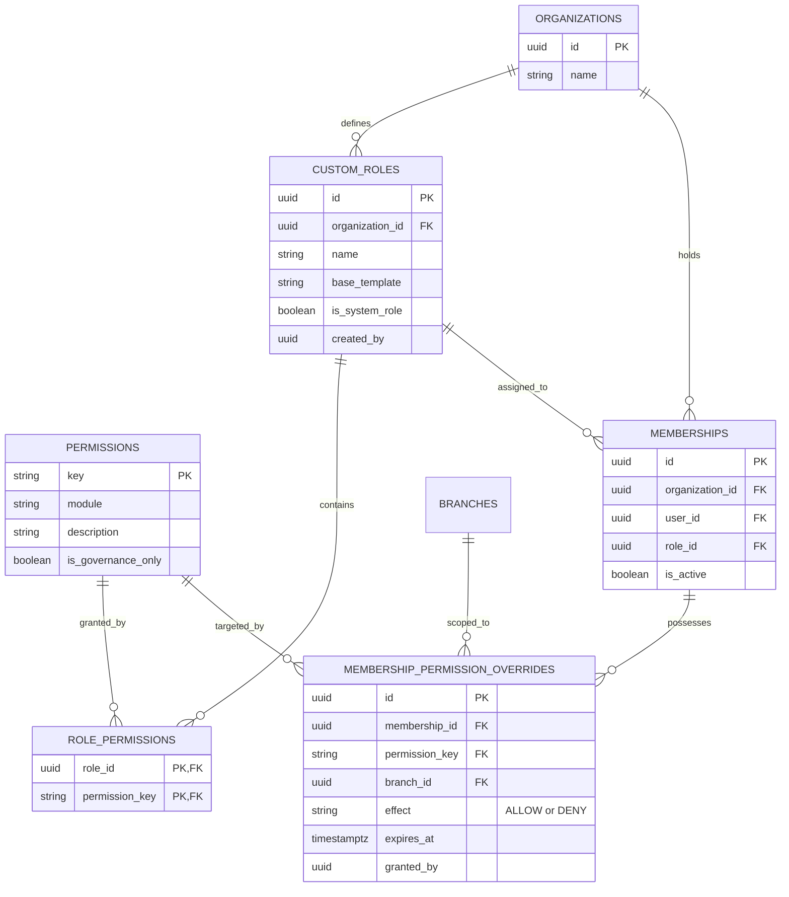
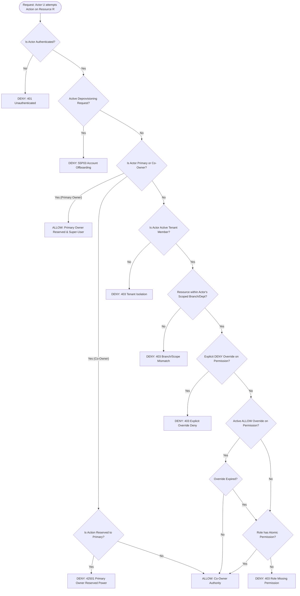

# PHASE 5.0B — WORKSTREAM B: RBAC & PERMISSION ARCHITECTURE
## Authoritative Enterprise Authorization Specification: Single-Role Memberships, Controlled Custom Roles, Scoped Grants, and Policy Evaluation
**ATLAS OS Enterprise SaaS ERP Platform**  
**Classification:** Restricted Engineering Architecture Blueprint — Read-Only Design  
**Target Repository:** `D:\Projects\Atlas-OS` | **Branch:** `Vijay-Atlas`  
**Target Staging Ref:** `bwswqnhlebbzdxumlkih` | **Production Ref:** `hrxjgbupjtikokqxjzbh` (STRICTLY FORBIDDEN)

---

## 1. Purpose & Scope

This document specifies the enterprise-grade **Role-Based & Contextual Authorization Architecture** for ATLAS OS. It translates the confirmed architectural decisions:
- **DEC-11 (Membership Role Cardinality):** SINGLE OPERATIONAL ROLE PER MEMBERSHIP. Each tenant member possesses exactly one primary operational role.
- **DEC-14 (Custom Roles):** CONTROLLED CUSTOM ROLES. Organizations can define and assign custom roles with server-enforced delegation limits, explicit deny semantics, and platform invariant protections.

This specification details the structural data model, permission resolution engine, contextual scoping (Organization, Branch, Department), temporary permission grants, authorization caching, and audit logging.

---

## 2. Existing-State Evidence & Architectural Audit

1. **`001_multi_tenant_base.sql` (lines 31–32):**
   - The operational role is a hardcoded PostgreSQL check constraint: `role VARCHAR(50) NOT NULL CHECK (role IN ('owner', 'admin', 'sales', 'inventory', 'accounts', 'viewer'))` [`VERIFIED IN LOCAL SOURCE`].
   - There is no mechanism to introduce custom roles without altering table constraints via migration [`VERIFIED IN LOCAL SOURCE`].
2. **`008_fix_authorization_vulnerabilities_and_null_roles.sql` (lines 32–45):**
   - Role evaluation relies on `user_has_org_role(p_org_id, VARIADIC p_roles)` [`VERIFIED IN LOCAL SOURCE`].
   - All authorization checks are coarse-grained (e.g., "is user in `['owner', 'admin']`?") rather than atomic permission checks (e.g., "does user have `invoices:issue`?") [`VERIFIED IN LOCAL SOURCE`].
3. **`src/lib/permissions.ts` (lines 1–75):**
   - Role-to-permission mapping exists exclusively in TypeScript frontend code: `ROLE_PERMISSIONS: Record<Role, Permission[]>` [`VERIFIED IN LOCAL SOURCE`].
   - Because these permissions are not evaluated or verified in PostgreSQL RLS or RPCs, client-side role checks provide zero server-side security [`VERIFIED IN LOCAL SOURCE`].
4. **Absence of Atomic Grants:**
   - In the current architecture, giving an inventory clerk permission to view accounts reports requires promoting them to `accounts` or `admin`, violating the principle of least privilege [`VERIFIED IN LOCAL SOURCE`].

---

## 3. The Five Core Authorization Dimensions

To eliminate conceptual conflation, ATLAS OS strictly bifurcates authorization into five orthogonal dimensions [`PROPOSED DESIGN`]:

```
┌─────────────────────────────────────────────────────────────────────────────────────────────┐
│                             THE FIVE AUTHORIZATION DIMENSIONS                               │
├───────────────────┬────────────────────────────────────────┬────────────────────────────────┤
│ Dimension         │ Definition                             │ Concrete Example               │
├───────────────────┼────────────────────────────────────────┼────────────────────────────────┤
│ **1. Ownership**  │ Legal equity and ultimate corporate     │ Primary Owner, Co-Owner        │
│                   │ governance authority.                  │ (governed by Workstream A)     │
├───────────────────┼────────────────────────────────────────┼────────────────────────────────┤
│ **2. Membership** │ Association between an authenticated   │ Member of "ABC Electricals"    │
│                   │ identity and a tenant organization.    │ (`is_active = TRUE`)           │
├───────────────────┼────────────────────────────────────────┼────────────────────────────────┤
│ **3. Operational  │ Functional job template assigning a    │ `sales_executive`, `accountant`│
│ **Role**          │ baseline bundle of atomic permissions. │ (Exactly one per membership)   │
├───────────────────┼────────────────────────────────────────┼────────────────────────────────┤
│ **4. Atomic       │ Specific capability to execute a       │ `invoices:issue`,              │
│ **Permission**    │ discrete business action.              │ `inventory:adjust_physical`    │
├───────────────────┼────────────────────────────────────────┼────────────────────────────────┤
│ **5. Approval     │ Authority to approve actions exceeding │ Up to ₹50,000 for sales        │
│ **Threshold**     │ monetary or risk thresholds.           │ discounts (Workstream D)       │
└───────────────────┴────────────────────────────────────────┴────────────────────────────────┘
```

---

## 4. Permission Architecture & Controlled Custom Roles

### 4.1 Schema Data Model: Roles, Permissions, and Scoped Overrides
To fulfill **DEC-11** (single role per membership) while allowing granular exceptions and custom roles (**DEC-14**), ATLAS OS designs a hybrid RBAC + ABAC data model [`PROPOSED DESIGN`]:



### 4.2 How an Employee Receives Additional Permissions (Zero Multiple Roles)
Under **DEC-11**, an employee has exactly one role (e.g., `role = 'inventory'`). If that employee needs to view invoices for audit reconciliation:
1. **They are NOT granted a second role** (such as `accounts` or `admin`).
2. An organization administrator grants a **Permission Override** attached directly to their membership record:
   - `permission_key = 'invoices:read'`
   - `effect = 'ALLOW'`
   - `expires_at = NOW() + INTERVAL '30 days'` (Optional temporary grant)
   - `branch_id = 'branch_mumbai'` (Optional contextual scope)
3. The evaluation engine unions the baseline role permissions with active overrides, honoring explicit `DENY` rules.

---

## 5. Controlled Custom Roles (DEC-14 Implementation)

### 5.1 System Roles vs Custom Roles
ATLAS OS provides immutable built-in system roles alongside tenant-defined custom roles:

1. **System Roles (Built-in, Read-Only Templates):**
   - `system_admin`: Full operational administration (cannot close organization or transfer primary ownership).
   - `system_sales`: Quotations, customers, sales orders, order dispatches.
   - `system_inventory`: Stock levels, products, suppliers, goods receipts.
   - `system_accounts`: Invoicing, payments, credit notes, aging reports.
   - `system_viewer`: Read-only operational inspection.
2. **Custom Roles (Tenant-Created):**
   - E.g., `senior_sales_lead` (sales role with discount override authority).
   - E.g., `branch_auditor` (cross-department read-only with stock count permissions).

### 5.2 Server-Enforced Delegation Safety Invariants
To prevent privilege escalation during custom role creation and modification (**DEC-14**):

#### Invariant Inv-RBAC-01: Monotonic Delegation Boundary
$$\forall \text{ role creation/modification by Actor } A, \quad \text{Permissions}(\text{NewRole}) \subseteq \text{EffectivePermissions}(A)$$
- **Enforcement:** The RPC `public.save_custom_role` inspects the actor's own effective permissions. If the actor attempts to include any permission they do not currently hold, the transaction aborts with PostgreSQL error `42501 (privilege_escalation_denied)`.
- **System Reserved Protection:** Certain permissions (e.g., `org:close`, `owner:transfer`, `audit:export_forensic`) are flagged `is_governance_only = TRUE`. These can **never** be added to any custom role; they are reserved exclusively for the Primary Owner and Co-Owners.

#### Invariant Inv-RBAC-02: Safe Role Deletion & Reassignment
$$\text{DeleteRole}(R) \implies \text{Count}(\text{memberships WHERE role\_id} = R) = 0$$
- If members are assigned to role $R$, role deletion is blocked. The administrator must explicitly provide a `p_replacement_role_id` to reassign all affected members atomically within the same transaction.

---

## 6. Permission Resolution & Evaluation Engine

### 6.1 Diagram: Authorization Evaluation Flow
The server-side authorization resolution follows a strict hierarchical evaluation pipeline [`PROPOSED DESIGN`]:



### 6.2 Explicit Deny Precedence
If a membership has both an operational role grant and an override:
$$\text{Effective}(U, P, \text{Scope}) = \begin{cases}
\text{DENY} & \text{if } \exists \text{ active override with effect = 'DENY'} \\
\text{ALLOW} & \text{if } \exists \text{ active override with effect = 'ALLOW'} \\
\text{ALLOW} & \text{if } P \in \text{RolePermissions}(\text{role}(U)) \\
\text{DENY} & \text{otherwise}
\end{cases}$$

---

## 7. Contextual Authorization Scopes (Branch & Department)

Permissions can be constrained by physical or logical organizational hierarchies:
1. **Organization-Wide Scope (`branch_id IS NULL`):** Permission applies universally across all branches and locations of the tenant.
2. **Branch Scope (`branch_id = <UUID>`):** Permission is strictly restricted to operations and documents tagged with that specific branch (e.g., inventory adjustments at the "Chennai Depot").
3. **Department Scope (`department = 'WAREHOUSE'`):** Permission restricted to records tagged with the functional unit.

---

## 8. Emergency Access & "Break-Glass" Protocol

To support operational continuity during critical system outages or unexpected owner unavailability [`PROPOSED DESIGN`]:
1. **Break-Glass Activation:** A designated Co-Owner or Senior Administrator can invoke `public.activate_emergency_access(p_reason, p_duration_hours)`.
2. **Duration & Scope:** Strictly bounded to a maximum of 24 hours (`p_duration_hours <= 24`).
3. **High-Alert Audit Logging:** Emits an immutable `EMERGENCY_ACCESS_ACTIVATED` event in `public.audit_events` with mandatory actor tracking and IP metadata.
4. **Automated Notification:** Immediately dispatches high-priority push notifications and emails to the Primary Owner and all Co-Owners.
5. **Automatic Expiry:** Background worker revokes emergency grants automatically upon expiration.

---

## 9. Performance & Authorization Caching

To prevent querying 4 relational tables on every database operation:
1. **Database-Level Fast Cache:** Evaluated inside PostgreSQL using a `STABLE` session function `public.get_user_effective_permissions(p_org_id UUID)`.
2. **JWT Custom Claims Synchronization:** On login or role change, a Supabase Auth hook writes a compact bitmask or array of permission keys into the JWT `app_metadata`.
3. **Cache Invalidation:** Any mutation to `custom_roles`, `role_permissions`, or `membership_permission_overrides` increments a tenant `permissions_version` integer in `organizations`, forcing client session re-evaluation on version mismatch.

---

## 10. Acceptance Criteria for Implementation (Phase 5.0B Gate)

- [ ] Clear structural separation between Ownership, Membership, Role, and Permission.
- [ ] Single operational role per membership enforced with direct permission override model.
- [ ] Controlled custom roles specified with server-enforced monotonic delegation boundaries.
- [ ] Hierarchical evaluation flow defined with explicit `DENY` precedence.
- [ ] Emergency access protocol designed with mandatory time-locks and audit triggers.
