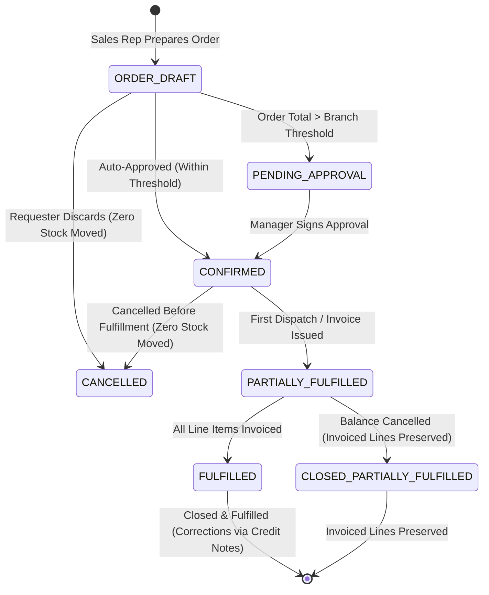

# PHASE 5.0C.2 — RECOVERY & LIFECYCLE REVIEW
## Authoritative Recovery Governance, Split-Brain Defenses, Multi-Entity State Machines, and Deprovisioning Dispute Contracts
**ATLAS OS Multi-Tenant Enterprise SaaS ERP Platform**  
**Classification:** Recovery State Machines, Document Lifecycles & Dispute Governance  
**Target Repository:** `D:\Projects\Atlas-OS` | **Branch:** `Vijay-Atlas`  
**Target Staging Ref:** `bwswqnhlebbzdxumlkih` | **Production Ref:** `hrxjgbupjtikokqxjzbh` (STRICTLY FORBIDDEN)

---

## 1. Executive Summary & Governance Objectives

This review resolves all critical lifecycle vulnerabilities identified in Phase 5.0C.1:
1. **Split-Brain Recovery Defense:** Eliminating concurrent competing recovery claims via partial unique constraints and root organization row locking.
2. **Privacy-Compliant Sole-Owner KYC:** Formally decoupling identity verification from premature PMLA retention claims, enforcing data minimization, and preferring provider assertion tokens under the DPDP Act 2023.
3. **Fulfillment State Machine Integrity:** Closing the accounting gap in Sales Order cancellations by distinguishing pre-fulfillment, partial fulfillment, and post-fulfillment lifecycles.
4. **Deprovisioning Dispute Freeze:** Extending fraud holds across both `INITIATED` and `AUTH_LOCKED` states, with strict role-based hold lifting and external Auth API retry handling.

---

## 2. Co-Owner Recovery Quorum & Split-Brain Prevention

### 2.1 Quorum Formulation & Claimant Exclusion
When a Primary Owner is incapacitated or inaccessible, eligible Co-Owners execute peer voting under `PO-04`:
- **Eligible Voters ($N_{\text{eligible}}$):** All active members holding `ownership_type = 'CO_OWNER'`, **strictly excluding the claimant**:
  $$N_{\text{eligible}} = |\{c \in \text{CoOwners}(\text{org\_id}) \mid c.\text{user\_id} \neq \text{claimant\_id} \land c.\text{is\_active} = \text{TRUE}\}|$$
- **Quorum Requirement:** Strictly $> 66\%$ rounded upward:
  $$\text{RequiredApprovals} = \lfloor 0.66 \times N_{\text{eligible}} \rfloor + 1$$
- **Zero Co-Owner Fallback:** If $N_{\text{eligible}} = 0$, peer voting is mathematically impossible; the claim diverts exclusively to **Sole-Owner KYC Verification (`PO-06`)**.

---

### 2.2 Split-Brain Defense: The Competing Claim Race Condition
If Co-Owner A and Co-Owner B initiate recovery claims concurrently without serialization, two separate voting processes can achieve independent quorums, attempting to promote two different Primary Owners.

#### The Dual-Defense Architecture:
1. **Partial Unique Index on `recovery_requests`:**
   ```sql
   CREATE UNIQUE INDEX uq_single_active_recovery_claim 
   ON public.recovery_requests(organization_id) 
   WHERE status IN ('PENDING', 'VOTING_ACTIVE', 'IN_COOLING_PERIOD');
   ```
2. **Organization-Level Root Serialization:**
   `initiate_coowner_recovery()` must execute:
   ```sql
   PERFORM id FROM public.organizations WHERE id = p_org_id FOR UPDATE;
   ```
   as its very first statement. This ensures that any competing recovery transaction waits until the first transaction commits, immediately encountering the unique constraint violation (`SQLSTATE 23505`).

---

## 3. Privacy-Compliant Sole-Owner KYC Architecture (`PO-06`)

```
┌────────────────────────────────────────────────────────────────────────────────────────────────────────────────────────┐
│                                     SOLE-OWNER IDENTITY VERIFICATION PIPELINE                                          │
└────────────────────────────────────────────────────────────────────────────────────────────────────────────────────────┘

  [ Claimant Applicant ]
            │
            ▼
  ┌──────────────────────────────────────────────────────────────────────────────────────────────────┐
  │ STEP 1: Flexible Alternative Identity Selection (Data Minimization)                              │
  │ • Mandatory Business PAN (Matches `organizations.pan`)                                           │
  │ • Choice of ONE Accredited Photo ID:                                                             │
  │     [ Option A: Masked Aadhaar (Last 4 digits visible only) via DigiLocker / UIDAI ]             │
  │     [ Option B: Passport (Identity / Validity pages only) ]                                      │
  │     [ Option C: Voter ID Card ]                                                                  │
  │     [ Option D: Driving Licence ]                                                                │
  └─────────────────────────────────┬────────────────────────────────────────────────────────────────┘
                                    │
                                    ▼
  ┌──────────────────────────────────────────────────────────────────────────────────────────────────┐
  │ STEP 2: Third-Party Accredited KYC Provider Integration (Zero Raw Document Storage Preferred)     │
  │ • Claimant redirected to certified KYC provider (e.g., DigiLocker / Setu / Cashfree)             │
  │ • Provider returns cryptographic assertion token:                                                │
  │     `{ provider_ref: "KYC-98234", status: "VERIFIED", match_score: 0.98, doc_type: "PASSPORT" }` │
  │ • Database stores ASSERTION TOKEN ONLY; raw document files never touch main database!            │
  └─────────────────────────────────┬────────────────────────────────────────────────────────────────┘
                                    │ (If fallback manual document upload is strictly necessary)
                                    ▼
  ┌──────────────────────────────────────────────────────────────────────────────────────────────────┐
  │ STEP 3: Fallback Secure Document Handling (Envelope Encryption & Access Control)                 │
  │ • Uploaded directly to private, isolated object bucket (`sec-kyc-evidence-isolated`)             │
  │ • Client-side / Envelope Encrypted using dedicated KMS Customer Managed Encryption Key (CMEK)    │
  │ • Access restricted exclusively to verified Platform Security Compliance Officers                 │
  │ • Retention duration: Reclassified as [PENDING LEGAL COUNSEL & DPDP ACT 2023 REVIEW]             │
  │ • Full audit logging in `audit_events` for every view, download, or inspection                   │
  └──────────────────────────────────────────────────────────────────────────────────────────────────┘
```

### 3.1 Retraction of Premature PMLA Claims & Clarified Legal Scope
- In Phase 5.0C.1, finding `ADV-01` argued that a 30-day purge violates PMLA 2002.
- **Clarification:** ATLAS OS is an ERP SaaS vendor, not a financial "Reporting Entity" under Section 2(1)(wa) of PMLA 2002. 
- While PMLA does not apply directly to ATLAS OS, premature deletion of identity proofs creates tort liability if corporate identity theft occurs. 
- Under the **DPDP Act 2023 (Section 8(7))**, personal data must be erased when the purpose is served, *unless retention is necessary for legal compliance or dispute defense*.
- **Authoritative Baseline:** Raw identity proofs are encrypted in CMEK storage. **Retention duration is designated as an open legal dependency (`LEG-01`) pending formal legal counsel review**, rather than fixed to an arbitrary 30-day or 5-year window.

---

## 4. Sales Order Fulfillment & Cancellation Lifecycle (`ADV-06`)

To prevent the accounting divergence identified in `ADV-06`, the Sales Order state machine is formally updated:



### 4.1 Strict State Transition Invariants:
1. **`CONFIRMED --> CANCELLED` (Permitted):** Allowed ONLY when zero goods have been dispatched and zero invoices have been generated. Releases all inventory reservations.
2. **`PARTIALLY_FULFILLED --> CANCELLED` (STRICTLY PROHIBITED):** An order with active issued invoices CANNOT be marked cancelled.
3. **`PARTIALLY_FULFILLED --> CLOSED_PARTIALLY_FULFILLED` (Permitted):** Closes the remaining unfulfilled balance. All previously issued invoices remain active and immutable under Rule 46 / Section 34 of the CGST Act.
4. **Sales Returns:** If delivered items on a partially or fully fulfilled order are returned, the transaction must execute an official **Sales Return & Credit Note RPC**, which restores inventory via return inward movements and generates credit notes against the invoices.

---

## 5. Deprovisioning Disputes & Fraud Freeze Architecture (`ADV-07`)

```mermaid
stateDiagram-v2
    [*] --> INITIATED: Deprovisioning Request Submitted (72h Notice)
    INITIATED --> AUTH_LOCKED: Notice Elapses; GoTrue Account Disabled
    AUTH_LOCKED --> MEMBERSHIPS_SEVERED: Operational Memberships Set DEACTIVATED
    MEMBERSHIPS_SEVERED --> COMPLETED: Profile Sanitized; Ledgers Preserved
    
    INITIATED --> FRAUD_HELD: Dispute Raised (is_disputed = TRUE)
    AUTH_LOCKED --> FRAUD_HELD: Dispute Raised (is_disputed = TRUE)
    
    FRAUD_HELD --> INITIATED: Compliance Officer Clears Pre-Lock Dispute
    FRAUD_HELD --> AUTH_LOCKED: Compliance Officer Clears Post-Lock Dispute
    FRAUD_HELD --> CANCELLED: Compliance Officer Confirms Fraud / Aborts
```



### 5.1 Dispute Freeze Mechanics Across All States
1. **Hold in `INITIATED` State:** Notice countdown timer freezes immediately. Auth sessions remain active.
2. **Hold in `AUTH_LOCKED` State:** User authentication remains locked (preventing unauthorized takeover actions), but the workflow **HALTS** and cannot proceed to `MEMBERSHIPS_SEVERED`.

### 5.2 Strict Role-Based Hold Authorization:
- **Who Can Place a Hold:**
  - Incumbent Primary Owner.
  - Any verified active Co-Owner.
  - Platform Security Compliance Officers.
- **Who Can Lift a Hold:**
  - **EXCLUSIVELY Platform Security Compliance Officers** backed by written forensic rationale and recorded in `public.audit_events`.
  - Organization members (including Primary Owner) **CANNOT lift a fraud hold**.

### 5.3 External Auth API Failure & Idempotent Retries:
- When calling the external Supabase GoTrue Auth API to lock or delete users:
  - If the API times out or returns HTTP 5xx, the transaction **MUST NOT corrupt database membership state**.
  - The failure is recorded in `public.deprovisioning_requests` (`status = 'RETRY_PENDING'`, `retry_count = retry_count + 1`).
  - An exponential-backoff background worker retries the API call up to 5 times before alerting human compliance operators.
- **Historical Ledger Preservation:** Financial records retain authorship via bare UUIDs (`created_by`, `actor_id`). Deleting the user in GoTrue Auth does not cascade to or erase business history.
