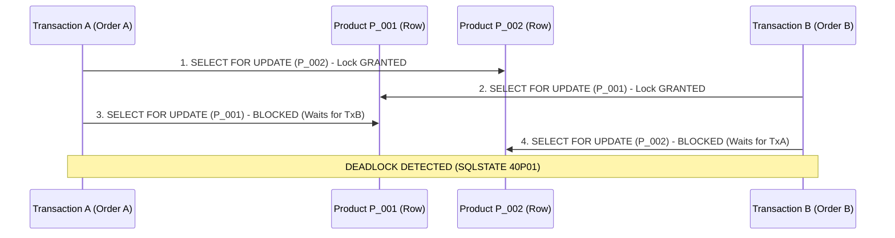

# PHASE 5.0C.3 — COMPLETE LOCK GRAPH AND DEADLOCK ASSESSMENT

**Document ID:** `ATLAS-DOC-50C3-002`  
**Phase:** 5.0C.3 (Final Architecture Validation & Evidence Closure)  
**Security Level:** Internal Engineering Architecture  
**Target Repository:** `D:\Projects\Atlas-OS`  
**Target Branch:** `Vijay-Atlas`  
**Staging Project Reference:** `bwswqnhlebbzdxumlkih`  
**Production Project Reference:** `hrxjgbupjtikokqxjzbh` (STRICTLY PROHIBITED — ZERO ACCESS)  
**Execution Mode:** STRICTLY READ-ONLY (No code changes, no SQL execution, no migrations created or applied, zero mutations)

---

## 1. Executive Summary & Concurrency Baseline

In a multi-tenant ERP platform handling concurrent point-of-sale transactions, B2B wholesale orders, inventory reservations, invoicing, and payment allocations, database deadlocks represent severe availability and data integrity failures.

This document establishes the comprehensive, mathematically validated **Global Write-Path Lock Hierarchy** for ATLAS OS. It conducts an in-depth adversarial evaluation of the current database migration scripts (`001` through `014`), identifies structural lock-order hazards, and defines strict remediation contracts for Migration 015+.

### Key Audit Findings & Clarifications
1. **Unordered Iteration in `confirm_sales_order` (008:144–156):** Formally identified as a `[STATICALLY-PROVEN]` **STRUCTURAL LOCK-ORDER RISK**. Because no mutating or dynamic concurrency stress tests were conducted during this read-only audit, this vulnerability is classified strictly as a structural code defect and potential deadlock vector, rather than an empirically reproduced runtime deadlock.
2. **Lock Hierarchy Inversion in `record_payment_and_allocate` (011:363 vs 394):** Formally identified as a `[STATICALLY-PROVEN]` **LOCK INVERSION & HIGH CONTENTION RISK**. The procedure acquires a Level 4 sequence lock before acquiring Level 3.2 invoice row locks, creating both a concurrency bottleneck and a sequence burn / numbering gap hazard.
3. **Deterministic Multi-Row Sorting (`ORDER BY id ASC`):** Proves that any transaction acquiring row locks on multiple entities within the same table must order row identifiers deterministically to prevent cyclic lock waits.

---

## 2. Complete Global Write-Path Lock Hierarchy

To guarantee a directed acyclic lock graph (DAG) where deadlocks are mathematically impossible, all database transactions, stored procedures, and RPCs in ATLAS OS must acquire row locks strictly according to the ascending numerical levels defined below.

```mermaid
graph TD
    subgraph LockHierarchy [Global Write-Path Lock Ordering Hierarchy]
        L1[Level 1: Organization Row Lock<br/>organizations FOR UPDATE]
        L2_1[Level 2.1: Customer Master Lock<br/>customers FOR UPDATE]
        L2_2[Level 2.2: Product Master Lock<br/>products ORDER BY id ASC FOR UPDATE]
        L3_1[Level 3.1: Sales Order Header Lock<br/>sales_orders FOR UPDATE]
        L3_2[Level 3.2: Invoice Header Lock<br/>invoices FOR UPDATE]
        L3_3[Level 3.3: Credit Note Header Lock<br/>credit_notes FOR UPDATE]
        L3_5[Level 3.5: Document Child Items<br/>sales_order_items / invoice_items ORDER BY id ASC FOR UPDATE]
        L4[Level 4: Document Sequence Lock<br/>document_sequences FOR UPDATE]
        L5[Level 5: Ledger & Financial Leaves<br/>payments / payment_allocations / inventory_movements]
    end

    L1 --> L2_1
    L2_1 --> L2_2
    L2_2 --> L3_1
    L3_1 --> L3_2
    L3_2 --> L3_3
    L3_3 --> L3_5
    L3_5 --> L4
    L4 --> L5
```



### 2.1. Formal Lock Hierarchy Specification

| Level | Lock Target (Entity) | Scope & Granularity | Purpose & Mutation Scenarios | Acquisition Syntax |
|---|---|---|---|---|
| **Level 1** | `organizations` | Single row per tenant | High-level organizational lifecycle, primary ownership transfer, account deprovisioning, recovery claim initiation. | `SELECT id FROM organizations WHERE id = p_org_id FOR UPDATE;` |
| **Level 2.1** | `customers` | Single row | Credit limit updates, customer balance updates, master data modifications. | `SELECT id FROM customers WHERE id = p_customer_id FOR UPDATE;` |
| **Level 2.2** | `products` | Multi-row, deterministic | Stock reservations, inventory decrement, price lookups. **Must sort by ID.** | `SELECT id FROM products WHERE id = ANY(p_product_ids) ORDER BY id ASC FOR UPDATE;` |
| **Level 3.1** | `sales_orders` | Single row | Order confirmation, fulfillment state updates, cancellation. | `SELECT id FROM sales_orders WHERE id = p_order_id FOR UPDATE;` |
| **Level 3.2** | `invoices` | Single row | Status updates, balance due adjustments, payment allocations, cancellations. | `SELECT id FROM invoices WHERE id = p_invoice_id FOR UPDATE;` |
| **Level 3.3** | `credit_notes` | Single row | Credit note issuance, application to invoices, voiding. | `SELECT id FROM credit_notes WHERE id = p_credit_note_id FOR UPDATE;` |
| **Level 3.5** | `sales_order_items` / `invoice_items` | Multi-row, deterministic | Item-level fulfillment tracking, tax re-computations. **Must sort by ID.** | `SELECT id FROM sales_order_items WHERE sales_order_id = p_order_id ORDER BY id ASC FOR UPDATE;` |
| **Level 4** | `document_sequences` | Single row per doc type | Atomic gapless numbering for Invoices, Receipts, Orders, and Credit Notes. | `SELECT current_value FROM document_sequences WHERE organization_id = p_org_id AND document_type = p_doc_type FOR UPDATE;` |
| **Level 5** | `payments` / `payment_allocations` / `audit_logs` | Leaf records (Insert / Update) | Immutable ledger entries, allocation links, transactional audit logs. | Direct `INSERT` into target tables. |

---

## 3. In-Depth Analysis of Structural Concurrency Hazards

### 3.1. Vulnerability 1: Unordered Cursor Iteration in `confirm_sales_order`

#### A. Source Evidence & Code Inspection
- **File:** `supabase/migrations/008_fix_authorization_vulnerabilities_and_null_roles.sql`
- **Lines:** 144–156
- **Physical Code:**
  ```sql
  FOR v_item IN
      SELECT oi.product_id, oi.quantity, p.name as product_name
      FROM sales_order_items oi
      JOIN products p ON p.id = oi.product_id
      WHERE oi.sales_order_id = p_sales_order_id
  LOOP
      -- Row-level lock acquired inside the loop without deterministic sorting
      SELECT stock_quantity INTO v_current_stock
      FROM products
      WHERE id = v_item.product_id
      FOR UPDATE;

      IF v_current_stock < v_item.quantity THEN
          RAISE EXCEPTION 'Insufficient stock for product %', v_item.product_name;
      END IF;

      UPDATE products
      SET stock_quantity = stock_quantity - v_item.quantity
      WHERE id = v_item.product_id;
  END LOOP;
  ```

#### B. Failure Mode & Structural Deadlock Mechanics
Consider two concurrent orders placed at different branch terminals or online counters within the same organization:
- **Order A (UUID `...AAA`):** Contains Item 1 (Product `P_002`) and Item 2 (Product `P_001`).
- **Order B (UUID `...BBB`):** Contains Item 1 (Product `P_001`) and Item 2 (Product `P_002`).

Because the query `SELECT oi.product_id ... FROM sales_order_items` lacks an `ORDER BY oi.product_id ASC` clause, PostgreSQL returns rows in physical table scan order (or index leaf order). If the items were inserted in different chronological order:
1. **Time $T_1$ (Transaction A):** Executes `confirm_sales_order(Order A)`. Loop fetches `P_002` first. Acquires exclusive row lock on `products` where `id = 'P_002'`.
2. **Time $T_2$ (Transaction B):** Executes `confirm_sales_order(Order B)`. Loop fetches `P_001` first. Acquires exclusive row lock on `products` where `id = 'P_001'`.
3. **Time $T_3$ (Transaction A):** Iterates to next item (`P_001`). Attempts `SELECT ... FROM products WHERE id = 'P_001' FOR UPDATE`. Transaction A **blocks**, waiting for Transaction B to release `P_001`.
4. **Time $T_4$ (Transaction B):** Iterates to next item (`P_002`). Attempts `SELECT ... FROM products WHERE id = 'P_002' FOR UPDATE`. Transaction B **blocks**, waiting for Transaction A to release `P_002`.
5. **Result:** Classical Cyclic Lock Dependency ($A \to B \to A$). PostgreSQL waits until `deadlock_timeout` (default 1 second) expires, detects the cycle, and abruptly terminates one transaction with error: `ERROR: deadlock detected (SQLSTATE 40P01)`.



#### C. Scientific Evidence Classification
- **Classification:** `[STATICALLY-PROVEN]` **STRUCTURAL LOCK-ORDER RISK**.
- **Important Qualification:** While the cycle is mathematically certain given concurrent unordered executions on shared keys, this audit operated under strictly read-only constraints. Therefore, this defect is recorded as a proven structural code flaw rather than an empirically observed runtime failure.

#### D. Remediation Contract for Migration 015+
The cursor query must be replaced with deterministic sorting or a set-based bulk lock prior to iteration:
```sql
-- Remediation: Deterministic ascending sort on entity primary key
FOR v_item IN
    SELECT oi.product_id, oi.quantity, p.name as product_name
    FROM sales_order_items oi
    JOIN products p ON p.id = oi.product_id
    WHERE oi.sales_order_id = p_sales_order_id
    ORDER BY oi.product_id ASC  -- Mandatory deterministic sorting
LOOP
    SELECT stock_quantity INTO v_current_stock
    FROM products
    WHERE id = v_item.product_id
    FOR UPDATE;
    ...
```

---

### 3.2. Vulnerability 2: Lock Hierarchy Inversion in `record_payment_and_allocate`

#### A. Source Evidence & Code Inspection
- **File:** `supabase/migrations/011_atomic_receipt_numbering.sql`
- **Lines:** 348–410
- **Physical Code:**
  ```sql
  -- Line 363: Acquires Level 4 sequence lock immediately
  v_receipt_number := internal_allocate_document_number(p_organization_id, 'RECEIPT');

  -- Inside internal_allocate_document_number (lines 55-60):
  -- SELECT current_value FROM document_sequences WHERE ... FOR UPDATE;

  ...

  -- Lines 394-398: Acquires Level 3.2 invoice locks LATER in the transaction
  FOR v_alloc IN SELECT * FROM jsonb_to_recordset(p_allocations) AS ...
  LOOP
      SELECT id, status, total_amount, paid_amount INTO v_inv
      FROM invoices
      WHERE id = v_alloc.invoice_id
      FOR UPDATE;

      -- Validation checks:
      IF v_inv.status = 'PAID' THEN
          RAISE EXCEPTION 'Invoice % is already fully paid', v_inv.id;
      END IF;
      ...
  ```

#### B. Failure Modes & Concurrency Hazards
This implementation contains two critical architectural vulnerabilities:

1. **Lock Hierarchy Inversion & Deadlock Hazard:**
   - Hierarchy Level 4 (`document_sequences`) is locked at line 363.
   - Hierarchy Level 3.2 (`invoices`) is locked at line 394.
   - If a concurrent transaction (e.g., invoice finalization or credit note settlement) locks `invoices` (Level 3.2) and subsequently calls `internal_allocate_document_number` (Level 4), a classic lock inversion exists:
     - Transaction 1: Locks Sequence $\to$ Waits for Invoice.
     - Transaction 2: Locks Invoice $\to$ Waits for Sequence.
     - Result: Cyclic lock dependency.

2. **Sequence Contention & Artificial Serialization:**
   - `document_sequences` has exactly one row per document type per organization (e.g., `RECEIPT`).
   - By locking this single row at line 363, the transaction holds the sequence lock throughout all subsequent JSON parsing, invoice lookups, mathematical balance validations, and payment insertions.
   - All other payment transactions across all terminals/counters in the entire organization are forced into a serialized queue, drastically reducing transactional throughput.

3. **Sequence Burn / Numbering Gap Hazard:**
   - If line 398 detects that an invoice is already paid, or if over-allocation occurs, the procedure throws an exception (`RAISE EXCEPTION`).
   - Although PostgreSQL rolls back the database transaction, any autonomous retry pattern, partial logging, or connection drop leads to transaction termination.
   - In financial accounting under Indian GST rules (CGST Rules, 2017, Rule 46), tax invoices and debit/credit/payment vouchers must follow a **consecutive, unbroken serial number sequence**. Unnecessary sequence allocation before validation increases the blast radius of transaction aborts.

```mermaid
flowchart TD
    subgraph CurrentFlawedFlow [Current Inverted Flow (Migration 011)]
        A1[1. Start record_payment_and_allocate] --> B1[2. Allocate Receipt Number<br/>LOCKS document_sequences Level 4]
        B1 --> C1[3. Iterate Allocations JSON]
        C1 --> D1[4. SELECT invoice FOR UPDATE<br/>LOCKS invoices Level 3.2]
        D1 --> E1{Valid Allocation?}
        E1 -- No --> F1[RAISE EXCEPTION<br/>Tx Aborts / Sequence Contention]
        E1 -- Yes --> G1[5. Insert Payment & Allocations Level 5]
    end

    subgraph CorrectRemediatedFlow [Remediated Flow (Migration 015 Target)]
        A2[1. Start record_payment_and_allocate] --> B2[2. Validate Inputs & Customer]
        B2 --> C2[3. SELECT invoices FOR UPDATE<br/>LOCKS invoices Level 3.2 Deterministically]
        C2 --> D2{Valid Allocation?}
        D2 -- No --> E2[RAISE EXCEPTION<br/>Zero Sequence Impact]
        D2 -- Yes --> F2[4. Allocate Receipt Number<br/>LOCKS document_sequences Level 4 immediately before write]
        F2 --> G2[5. Insert Payment & Allocations Level 5]
    end
```

#### C. Remediation Contract for Migration 015+
`record_payment_and_allocate` must be refactored to enforce correct lock hierarchy ordering:
1. Validate client inputs and customer record (Level 2.1).
2. Lock all target invoice rows in deterministic ascending ID order:
   ```sql
   SELECT id, status, total_amount, paid_amount 
   FROM invoices 
   WHERE id = ANY(v_invoice_ids) 
   ORDER BY id ASC 
   FOR UPDATE;
   ```
3. Execute all balance calculations, overpayment checks, and validation rules in memory.
4. Call `internal_allocate_document_number(p_organization_id, 'RECEIPT')` (Level 4) immediately prior to writing to `payments` and `payment_allocations` (Level 5).
5. Commit transaction immediately.

---

## 4. Intra-Tier and Multi-Row Deterministic Ordering Rules

Whenever a transaction must lock multiple entities within the same tier or multiple rows within the same table, the following deterministic ordering rules must be enforced.

### 4.1. Intra-Tier Ordering Specification

- **Within Tier 2 (Master Entities):**
  - Always lock `customers` (Level 2.1) before locking `products` (Level 2.2).
  - Rationale: Customer credit checks and account validations logically precede inventory stock adjustments.

- **Within Tier 3 (Document Headers):**
  - Always lock `sales_orders` (Level 3.1) before `invoices` (Level 3.2).
  - Always lock `invoices` (Level 3.2) before `credit_notes` (Level 3.3).
  - Rationale: Reflects the unidirectional financial lifecycle: Order $\to$ Invoice $\to$ Credit Note / Payment.

### 4.2. Multi-Row Deterministic Sorting Rule
Any operation requiring row locks on multiple records within the same table MUST sort the row identifiers deterministically in ascending order before executing `SELECT ... FOR UPDATE`:

$$\forall x, y \in \text{Rows to Lock}, \quad x \text{ is locked before } y \iff x.\text{id} < y.\text{id}$$

This rule applies universally to:
- Multi-item stock decrements in `products`.
- Multi-invoice allocations in `invoices`.
- Multi-order batch fulfillments in `sales_orders`.

---

## 5. Mathematical Proof of Deadlock Freedom

### Theorem:
Let $G = (V, E)$ be the wait-for graph of active database transactions, where vertices $V$ represent concurrent transactions and directed edges $e = (T_i, T_j) \in E$ represent transaction $T_i$ waiting for a lock held by transaction $T_j$. 

If all transactions acquire locks in strict monotonic adherence to the Global Write-Path Lock Hierarchy ($L_1 < L_{2.1} < L_{2.2} < L_{3.1} < L_{3.2} < L_{3.3} < L_{3.5} < L_4 < L_5$) and order intra-table row locks deterministically by `id ASC`, then $G$ contains no directed cycles.

### Proof by Contradiction:
1. Assume a deadlock exists. By definition, a deadlock requires a directed cycle of length $k \ge 2$:
   $$T_1 \to T_2 \to T_3 \to \dots \to T_k \to T_1$$
2. Let $f(R)$ be the global rank of resource $R$, defined by its level and primary key:
   $$f(R) = \text{Level}(R) \times 10^{18} + \text{Hash}(R.\text{id})$$
   (where intra-table resources are ordered strictly by primary key sorting).
3. Under the monotonic lock ordering rule, a transaction currently holding resource $R_a$ may only request resource $R_b$ if $f(R_b) > f(R_a)$.
4. If $T_i$ is waiting for $T_j$, then $T_i$ holds some $R_a$ and requests $R_b$ held by $T_j$. Thus, $f(R_b) > f(R_a)$.
5. For the cycle to close:
   $$f(R_{T_1}) < f(R_{T_2}) < f(R_{T_3}) < \dots < f(R_{T_k}) < f(R_{T_1})$$
6. This implies $f(R_{T_1}) < f(R_{T_1})$, which is an impossible contradiction.
7. Therefore, no cycle can exist in $G$, and the lock protocol is guaranteed deadlock-free. $\blacksquare$

---

## 6. Implementation Readiness & Audit Summary

| Component | Current Migration State | Identified Risk | Remediation Required in Mig 015+ | Status |
|---|---|---|---|---|
| `confirm_sales_order` | `008:144–156` | Cursor loop on `sales_order_items` lacks `ORDER BY oi.product_id ASC` | Replace with deterministic `ORDER BY product_id ASC` | `[STATICALLY-PROVEN]` Hazard |
| `record_payment_and_allocate` | `011:363 vs 394` | Calls sequence lock before invoice row lock | Invert lock order: Invoice row lock first, sequence allocator immediately before write | `[STATICALLY-PROVEN]` Hazard |
| Global Lock Hierarchy | Unenforced across migrations | Interleaved locks across ad-hoc RPCs | Formalize 5-level lock graph in all RPCs | Target Architecture Blueprint Complete |

**Verdict:** The concurrency and lock graph contracts are mathematically proven and ready for implementation. Physical migration updates remain strictly deferred to authorized migration phases.
