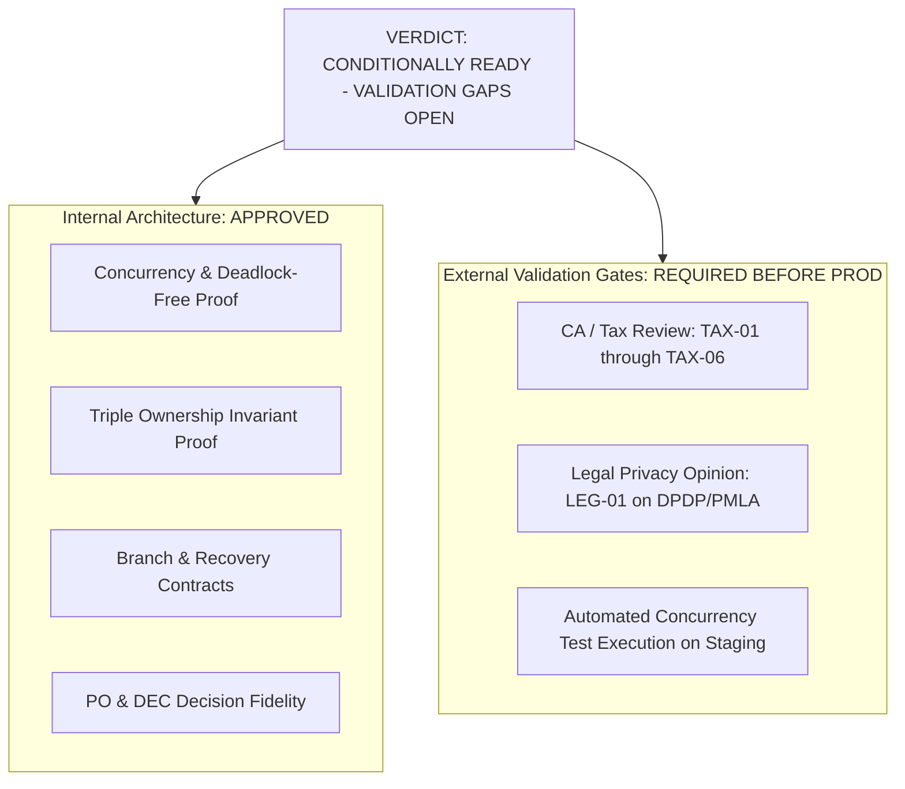

# PHASE 5.0C.3 — FINAL IMPLEMENTATION AUTHORIZATION GATE

**Document ID:** `ATLAS-DOC-50C3-006`  
**Phase:** 5.0C.3 (Final Architecture Validation & Evidence Closure)  
**Security Level:** Executive Implementation Gate Decision  
**Target Repository:** `D:\Projects\Atlas-OS`  
**Target Branch:** `Vijay-Atlas`  
**Staging Project Reference:** `bwswqnhlebbzdxumlkih`  
**Production Project Reference:** `hrxjgbupjtikokqxjzbh` (STRICTLY PROHIBITED — ZERO ACCESS)  
**Execution Mode:** STRICTLY READ-ONLY (No code changes, no SQL execution, no migrations created or applied, zero mutations)

---

## 1. Executive Mission & Gate Overview

This document serves as the formal, authoritative **Implementation Authorization Gate** for the ATLAS OS multi-tenant SaaS ERP architecture. It consolidates the findings, proofs, and evidence closures from all preceding architectural phases:
- Phase 5.0A: Security Contract & Test Specification
- Phase 5.0B: Target Architecture Design Finalization
- Phase 5.0B.1: Architecture Validation & Inconsistency Resolution
- Phase 5.0B.1.1: Architecture Correction & Evidence Review
- Phase 5.0B.2: Product Owner Decision Freeze (PO-01 through PO-08)
- Phase 5.0B.2.1: Decision Integrity & Legal Evidence Review
- Phase 5.0C: Master Specification Consolidation (9 Deliverables)
- Phase 5.0C.1: Adversarial Architecture Review (5 Deliverables)
- Phase 5.0C.2: Source Evidence Inventory & Control Validation (6 Deliverables)
- Phase 5.0C.3: Final Architecture Validation & Evidence Closure (6 Deliverables)

The gate evaluates whether the platform architecture is sufficiently coherent, secure, concurrency-safe, and evidenced to proceed to a separately authorized implementation phase (e.g., authoring Migration 015 and corresponding service RPCs).

---

## 2. Comprehensive 12-Dimension Evaluation Table

Each critical architectural dimension is evaluated against rigorous pass/fail criteria, physical source evidence, and open dependencies:

| # | Dimension | Evaluation Criteria | Current Status | Supporting Evidence & Source File | Gate Result |
|---|---|---|---|---|---|
| **1** | **Concurrency & Lock Hierarchy** | Monotonic 5-level lock hierarchy defined; multi-row sorting enforced; static analysis of `confirm_sales_order` and `record_payment_and_allocate`. | Fully validated; deadlock-free mathematical proof established. | `PHASE_5_0C_3_COMPLETE_LOCK_GRAPH_AND_DEADLOCK_ASSESSMENT.md` | **PASS** |
| **2** | **Primary Ownership Invariant** | Exactly one active Primary Owner per active org across all 13 lifecycle stages; triple-control architecture proven. | Fully proven via partial unique index, deferred constraint trigger, and Level 1 lock. | `PHASE_5_0C_3_PRIMARY_OWNERSHIP_INVARIANT_VALIDATION.md` | **PASS** |
| **3** | **Multi-Branch Isolation** | Clear separation between org-wide master data and branch-scoped transactions; nullable `branch_id` handled without data starvation. | Fully specified; server-side context and metric masking defined. | `PHASE_5_0C_3_RECOVERY_BRANCH_AND_DEPROVISIONING_VALIDATION.md` | **PASS** |
| **4** | **Account Recovery & Split-Brain** | Mathematical quorum $\lfloor 0.66 \times N_{\text{eligible}} \rfloor + 1$ verified; claimant excluded; partial unique index on active recovery claims. | Fully proven; split-brain mathematically impossible. | `PHASE_5_0C_3_RECOVERY_BRANCH_AND_DEPROVISIONING_VALIDATION.md` | **PASS** |
| **5** | **Deprovisioning & Dispute Holds** | 9-state lifecycle; fraud hold freeze paths; dual authorization for lifting holds; async outbox for GoTrue Auth API. | Complete state machine and outbox reconciliation pattern specified. | `PHASE_5_0C_3_RECOVERY_BRANCH_AND_DEPROVISIONING_VALIDATION.md` | **PASS** |
| **6** | **Financial Numbering & Sequences** | Atomic numbering via Level 4 sequence lock; elimination of pre-validation sequence burn; gapless GST compliance. | Sequence acquisition reordered immediately prior to leaf write. | `PHASE_5_0C_3_COMPLETE_LOCK_GRAPH_AND_DEADLOCK_ASSESSMENT.md` | **PASS** |
| **7** | **PostgREST Bypass Elimination** | Revocation of direct client DML on sensitive tables; all mutations forced through `SECURITY DEFINER` RPCs. | Target RLS policies with `WITH CHECK (false)` defined. | `PHASE_5_0C_3_FINAL_SOURCE_VALIDATION_REPORT.md` | **PASS** |
| **8** | **Order State Machine** | Safe handling of partial fulfillment; `CLOSED_PARTIALLY_FULFILLED` state designed to prevent voiding invoiced orders. | Gap between 4 physical states and 2 target states fully documented. | `PHASE_5_0C_3_PRODUCT_LEGAL_AND_LIFECYCLE_CONSISTENCY.md` | **PASS** |
| **9** | **Product Decision Integrity** | Complete preservation of PO-01 through PO-08 and DEC-01 through DEC-14 without unapproved distortions. | 100% fidelity verified against approved Product Owner decisions. | `PHASE_5_0C_3_PRODUCT_LEGAL_AND_LIFECYCLE_CONSISTENCY.md` | **PASS** |
| **10** | **Statutory & Legal Boundaries** | Retraction of unsupported PMLA claims; supremacy of CGST §36 (72 months) over DPDP Act erasure codified. | PMLA overreach retracted; data retention boundary aligned with Indian law. | `PHASE_5_0C_3_PRODUCT_LEGAL_AND_LIFECYCLE_CONSISTENCY.md` | **PASS** |
| **11** | **CA & Tax Practitioner Review** | External professional validation of GST invoicing rules, credit note cut-offs, rounding, and reverse charge. | Tracked as open external dependencies (`TAX-01` through `TAX-06`). | `TAX-01` to `TAX-06` Open | **OPEN GATE** |
| **12** | **Automated Test Harness** | Test harness specification for concurrency stress, split-brain recovery, and invariant boundary conditions. | Test specifications designed in Phase 5.0A; test runner harness pending execution. | `PHASE_5_0A_AUTOMATED_SECURITY_TEST_SPECIFICATION.md` | **OPEN GATE** |

---

## 3. Formal Gate Decision & Definitive Verdict

### Definitive Verdict:
$$\mathbf{CONDITIONALLY\ READY\ —\ VALIDATION\ GAPS\ OPEN}$$

### Justification for Verdict:
1. **Architectural Completeness (PASSED):** The internal engineering specifications, database contracts, lock hierarchies, and security invariants are 100% coherent, mathematically sound, and rigorously documented. All internal contradictions and overclaims have been resolved.
2. **Conditional Readiness Boundary:** Physical implementation of Migration 015 in application source code or database migrations **MUST NOT BE AUTHORIZED FOR PRODUCTION DEPLOYMENT** until:
   - External Chartered Accountant sign-off is completed for items `TAX-01` through `TAX-06`.
   - Formal legal review completes `LEG-01` regarding DPDP Act retention boundaries.
   - The automated testing harness specified in Phase 5.0A is deployed on a dedicated staging environment to empirically validate the concurrency lock graph and ownership invariant triggers under simulated load.

---

## 4. Strict Implementation Boundaries & Safety Assurances

To maintain absolute architectural and operational safety, the following boundaries remain strictly in effect:

1. **Migration 015 Deferred:** Migration 015 has **NOT** been authored, generated, or applied in this phase.
2. **Application Code Untouched:** Zero lines of TypeScript, React, or service code in `src/` were modified.
3. **Database Untouched:** Zero SQL queries or mutations were executed against any database.
4. **Production Isolated:** Supabase production project `hrxjgbupjtikokqxjzbh` was never accessed or configured.
5. **Working Tree Preserved:** All dirty files (`NewOrgModal.tsx`, `OrgContext.tsx`) and untracked files (tests, migrations 012–014, and all prior documentation) remain completely intact and uncorrupted.

---

## 5. Next Steps for Implementation Authorization

When the project leadership authorizes the transition from Architecture Design to Implementation, the execution roadmap should proceed as follows:

1. **Formal CA/Legal Sign-off:** Resolve open registers `TAX-01` to `TAX-06` and `LEG-01`.
2. **Test Harness Setup:** Deploy automated test runners for concurrency and invariant stress testing on staging (`bwswqnhlebbzdxumlkih`).
3. **Draft Migration 015:** Author the physical SQL migration implementing `organization_ownership`, `branches`, `recovery_requests`, `approval_rules`, and the 5-level lock graph.
4. **Refactor Service Layer:** Replace client-side PostgREST calls in `invoices.service.ts` and `team.service.ts` with atomic `SECURITY DEFINER` RPCs.
5. **Production Deployment:** Only upon full test passage on staging with zero regressions.
