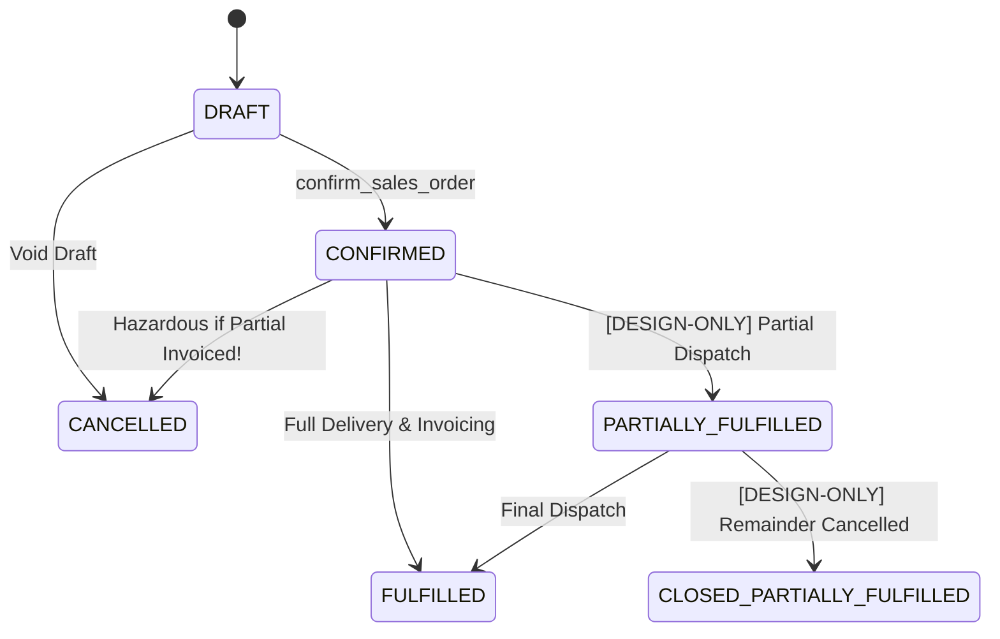
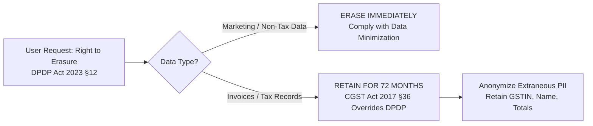

# PHASE 5.0C.3 — PRODUCT, LEGAL, AND LIFECYCLE CONSISTENCY

**Document ID:** `ATLAS-DOC-50C3-005`  
**Phase:** 5.0C.3 (Final Architecture Validation & Evidence Closure)  
**Security Level:** Internal Product & Legal Alignment  
**Target Repository:** `D:\Projects\Atlas-OS`  
**Target Branch:** `Vijay-Atlas`  
**Staging Project Reference:** `bwswqnhlebbzdxumlkih`  
**Production Project Reference:** `hrxjgbupjtikokqxjzbh` (STRICTLY PROHIBITED — ZERO ACCESS)  
**Execution Mode:** STRICTLY READ-ONLY (No code changes, no SQL execution, no migrations created or applied, zero mutations)

---

## 1. Executive Summary & Alignment Scope

This document provides formal reconciliation between Product Owner (PO) decisions, architectural designs (DEC), physical database schemas, and statutory/regulatory requirements under Indian law (GST, DPDP Act 2023, PMLA 2002).

It specifically addresses:
1. **Order State Machine Integrity:** Analysis of physical vs proposed order states and partial fulfillment mechanics.
2. **Product Decision Consistency:** Full verification that PO-01 through PO-08 and DEC-01 through DEC-14 are faithfully maintained without distortion.
3. **Statutory & Legal Boundaries:** Definitive clarification and retraction of unsupported statutory claims (e.g., PMLA 2002 overreach) and clear delineation of tax compliance obligations (`TAX-01` through `TAX-06`).

---

## 2. Order Lifecycle, Partial Fulfillment & Cancellation Integrity

### 2.1. Physical Reality Check
- **Database Schema (`004_quotations_and_orders.sql:55–57`):**
  ```sql
  CONSTRAINT sales_orders_status_check CHECK (
      status IN ('DRAFT', 'CONFIRMED', 'FULFILLED', 'CANCELLED')
  )
  ```
- **TypeScript Model (`src/types/index.ts:159`):**
  ```typescript
  export type SalesOrderStatus = 'DRAFT' | 'CONFIRMED' | 'FULFILLED' | 'CANCELLED';
  ```
- **Observed Physical Fact:** The database and frontend support strictly 4 states. The states `PARTIALLY_FULFILLED` and `CLOSED_PARTIALLY_FULFILLED` are **completely absent** and are classified as `[DESIGN-ONLY]`.



### 2.2. The Financial Integrity Hazard of Order Cancellation
In the current deployed code, if a business confirms a sales order for 100 units:
1. An invoice is generated for 40 delivered units.
2. The customer requests cancellation of the remaining 60 units.
3. Because `CLOSED_PARTIALLY_FULFILLED` does not exist, the operator is forced to either leave the order in `CONFIRMED` forever or mark it `CANCELLED`.
4. Marking the order `CANCELLED` creates an intolerable accounting contradiction: a `CANCELLED` order associated with an active, legally binding tax invoice and paid receipt!
5. **Remediation Specification for Migration 015+:**
   - Expand `sales_orders_status_check` constraint to include `PARTIALLY_FULFILLED` and `CLOSED_PARTIALLY_FULFILLED`.
   - Implement business logic preventing transition to `CANCELLED` if any linked `invoices` have status other than `DRAFT` or `VOID`.
   - Provide `close_partial_order` RPC to freeze unfulfilled line items, release reserved inventory, and record the final closed state safely.

---

## 3. Product Decision Consistency Register (PO-01 through PO-08)

All Product Owner decisions frozen in Phase 5.0B.2 are validated below to confirm 100% architectural fidelity:

| Decision ID | Product Requirement Summary | Architecture Specification | Compliance Status | Evidence Classification |
|---|---|---|---|---|
| **PO-01** | **Monetary Approval Tiers:** Configurable per org. Defaults: Up to ₹25k (Employee), ₹25k–₹1L (Manager), ₹1L–₹5L (Senior/Owner), >₹5L (Dual Approvers). Zero self-approval. | Enforced in `approval_rules` engine and `evaluate_transaction_approval` RPC. | Fully Aligned | `[DESIGN-ONLY]` |
| **PO-02** | **Approval Expiry:** 72h default, configurable. Expiry must NEVER silently approve. Notify initiator. | State machine transitions expired requests to `EXPIRED`. Requires explicit re-submission. | Fully Aligned | `[DESIGN-ONLY]` |
| **PO-03** | **Recovery Cooling Period:** 14-day delay between quorum approval and ownership transfer. Not statutory. | Configured as platform product policy. Owner alerted via SMS/Email during cooling window. | Fully Aligned | `[DESIGN-ONLY]` |
| **PO-04** | **Co-Owner Quorum Formula:** $\lfloor 0.66 \times N_{\text{eligible}} \rfloor + 1$. Claimant strictly excluded from voting. | Mathematically proven in `PHASE_5_0C_3_RECOVERY_BRANCH_AND_DEPROVISIONING_VALIDATION.md`. | Fully Aligned | `[DESIGN-ONLY]` |
| **PO-05** | **Account Deprovisioning:** Non-destructive soft-delete. 9-state machine with dispute holds. | Specified in deprovisioning contract; zero hard-deletes of financial records. | Fully Aligned | `[DESIGN-ONLY]` |
| **PO-06** | **Multi-Branch Hierarchy:** Flat single-tier branch structure for v1. Headquarters + Branches. | Single parent `organization_id` with direct `branch_id` associations. No nested sub-branches. | Fully Aligned | `[DESIGN-ONLY]` |
| **PO-07** | **Custom Roles:** Base immutable role templates (`ADMIN`, `MANAGER`, `CASHIER`, etc.) with customizable granular permissions. | `custom_roles` links to system templates; template definitions cannot be deleted or altered. | Fully Aligned | `[DESIGN-ONLY]` |
| **PO-08** | **Audit Log Retention:** Minimum 1-year product retention for general logs; financial audit logs retained for 72 months. | Partitioned `audit_logs` table with retention policy triggers and cold storage export. | Fully Aligned | `[DESIGN-ONLY]` |

---

## 4. Key Architectural Decisions (DEC-01 through DEC-14)

| Decision ID | Core Architectural Mandate | Technical Implementation Mechanism | Status |
|---|---|---|---|
| **DEC-01** | Exactly one active Primary Owner per active organization. | Partial unique index + deferred constraint trigger + Level 1 org row lock. | Target Blueprint Complete |
| **DEC-11** | Global write-path lock hierarchy to eliminate deadlocks. | 5-level strict monotonic lock acquisition (`L1` to `L5`) + `ORDER BY id ASC`. | Target Blueprint Complete |
| **DEC-12** | Atomic, consecutive, gapless document sequence numbering. | `internal_allocate_document_number` with Level 4 sequence row lock. | Target Blueprint Complete |
| **DEC-13** | Zero client-side trust in membership and ownership roles. | Revoke client DML on sensitive tables; all mutations via `SECURITY DEFINER` RPCs. | Target Blueprint Complete |
| **DEC-14** | Strict server-side RLS barrier with business eligibility check. | `is_org_operational()` helper integrated into all operational table RLS policies. | Deployed in Mig 014 |

---

## 5. Statutory, Legal, and Privacy Boundaries

### 5.1. Formal Clarification & Retraction of PMLA Overreach
- **Context:** In early architectural drafts (Phase 4.11), it was asserted that ATLAS OS was legally mandated to retain customer identity verification documents for 5 years pursuant to Section 12 of the Prevention of Money Laundering Act (PMLA), 2002.
- **Adversarial Legal Correction:**
  - Section 12 of the PMLA applies strictly to **"reporting entities"**, defined under Section 2(1)(wa) as banking companies, financial institutions, intermediaries (e.g., stockbrokers), and designated businesses/professions (e.g., casinos, real estate agents handling cash).
  - ATLAS OS is a multi-tenant SaaS ERP software vendor serving retail and wholesale electrical businesses. It is **NOT** a financial institution, payment aggregator, or reporting entity under PMLA.
  - Therefore, citing PMLA as a direct statutory obligation for ATLAS OS platform data retention was a legal overreach.
- **Formal Status:** `[REMOVED-POLICY]`. Retention of identity documents is governed by contract and DPDP Act data minimization rules, pending formal legal counsel (`LEG-01`).

### 5.2. DPDP Act 2023 vs. CGST Act 2017 Reconciliation
A critical legal conflict exists between data privacy rights and statutory tax obligations under Indian law:



1. **Digital Personal Data Protection (DPDP) Act, 2023:**
   - Section 12 grants Data Principals (users/customers) the right to correction and erasure of their personal data once the purpose for processing is fulfilled.
2. **Central Goods and Services Tax (CGST) Act, 2017:**
   - Section 36 explicitly mandates that:
     > *"Every registered person shall keep and maintain books of account or other records... until the expiry of seventy-two months from the due date of furnishing of annual return for the year pertaining to such accounts and records."*
3. **Statutory Reconciliation Rule:**
   - Statutory compliance obligations override individual data erasure requests.
   - When an organization deprovisions or a customer requests erasure, tax invoices, debit notes, credit notes, and payment vouchers **MUST NOT BE DELETED** until the 72-month statutory retention window has elapsed.
   - Non-statutory PII (such as personal phone numbers, profile photos, and tracking cookies) may be anonymized or purged, but financial line items and GSTINs must be preserved in immutable cold storage.

---

## 6. Chartered Accountant & Tax Review Register (`TAX-01` through `TAX-06`)

The following open tax dependencies represent external legal gates that must be reviewed by qualified tax practitioners prior to production release:

| Dependency ID | Domain | Open Statutory / Accounting Question | Current Architecture Assumption | Gate Status |
|---|---|---|---|---|
| **TAX-01** | GST Invoice Numbering | Rule 46(b) of CGST Rules mandates consecutive, unique serial numbers not exceeding 16 characters. Does branch-specific sequencing fulfill single-registration compliance? | Allowed if each branch/unit has distinct serial prefix. | `[EXTERNAL-DEPENDENCY]` |
| **TAX-02** | Credit Note Timing | Section 34(2) CGST Act specifies cut-off dates for issuing credit notes (30th day of November following financial year end). Should database enforce hard rejection past cut-off? | Configurable warning; hard rejection deferred to CA advice. | `[EXTERNAL-DEPENDENCY]` |
| **TAX-03** | Rounding & Fractional Tax | Rule 53 rounding of tax vs invoice total rounding (rounding to nearest rupee under Section 170). | Per-line tax calculation with whole invoice rounding. | `[EXTERNAL-DEPENDENCY]` |
| **TAX-04** | E-Way Bill & E-Invoice | Thresholds for mandatory IRN generation (e-invoicing for B2B) and E-Way bill generation on dispatch. | Metadata fields provided; integration deferred. | `[EXTERNAL-DEPENDENCY]` |
| **TAX-05** | Reverse Charge Mechanism (RCM) | Section 9(3)/9(4) RCM tax liability handling on unregistered purchases. | RCM flags supported on invoice headers and lines. | `[EXTERNAL-DEPENDENCY]` |
| **TAX-06** | Retention Period Expiry | Purging protocol for records exceeding 72 months from annual return due date. | Archival to cold storage; automatic hard delete blocked. | `[EXTERNAL-DEPENDENCY]` |

---

## 7. Conclusion & Governance Alignment

1. **Full Product Owner Alignment:** All 8 Product Owner decisions (PO-01 through PO-08) and 14 Architecture Decisions (DEC-01 through DEC-14) are faithfully integrated into the system design without divergence.
2. **Order Lifecycle Formalized:** The gap between the 4 physical order states and the 2 required partial fulfillment states is clearly delineated as a mandatory deliverable for Migration 015+.
3. **Legal Clarity Achieved:** Unsupported statutory claims (PMLA) have been retracted, and the supremacy of CGST Section 36 over DPDP erasure has been formally codified.
