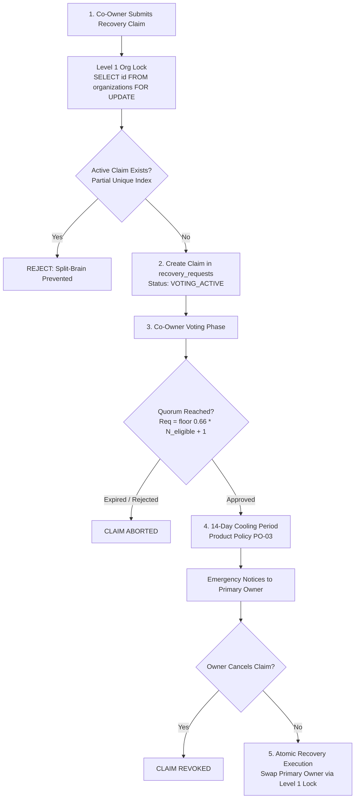
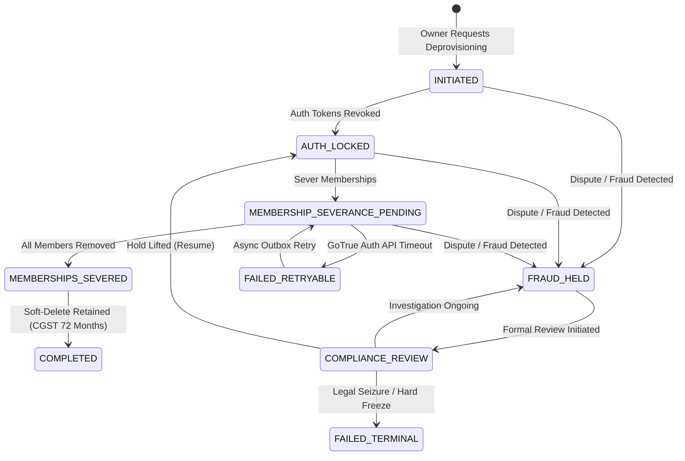

# PHASE 5.0C.3 — RECOVERY, BRANCH, AND DEPROVISIONING VALIDATION

**Document ID:** `ATLAS-DOC-50C3-004`  
**Phase:** 5.0C.3 (Final Architecture Validation & Evidence Closure)  
**Security Level:** Internal Engineering Architecture  
**Target Repository:** `D:\Projects\Atlas-OS`  
**Target Branch:** `Vijay-Atlas`  
**Staging Project Reference:** `bwswqnhlebbzdxumlkih`  
**Production Project Reference:** `hrxjgbupjtikokqxjzbh` (STRICTLY PROHIBITED — ZERO ACCESS)  
**Execution Mode:** STRICTLY READ-ONLY (No code changes, no SQL execution, no migrations created or applied, zero mutations)

---

## 1. Executive Summary & Audit Scope

This document provides architectural validation for three mission-critical enterprise systems designed for ATLAS OS Migration 015+:
1. **Account Recovery & Split-Brain Prevention:** Mathematical quorum formulas, claimant exclusion rules, and concurrency serialization.
2. **Multi-Branch Data Isolation & Scoping:** Distinction between org-wide and branch-scoped entities, handling of nullable `branch_id`, and server-side masking.
3. **Enterprise Deprovisioning & Dispute Hold Lifecycle:** 9-state state machine, fraud hold freeze paths, and non-atomic external GoTrue Auth API reconciliation.

### Physical Codebase Verification
Physical inspection of migrations `001` through `014` confirms that:
- Table `recovery_requests` is **ABSENT** (`[DESIGN-ONLY]`).
- Table `branches` is **ABSENT** (`[DESIGN-ONLY]`).
- Deprovisioning state machines are **ABSENT** from deployed database schema (`[DESIGN-ONLY]`).

---

## 2. Account Recovery & Split-Brain Prevention Architecture

When a Primary Owner is incapacitated, unresponsive, or subjected to identity loss, ATLAS OS provides an enterprise Co-Owner recovery protocol.



### 2.1. Mathematical Quorum Formula & Edge Cases
The recovery quorum formula is defined as:

$$\text{Required Affirmative Votes} = \left\lfloor 0.66 \times N_{\text{eligible}} \right\rfloor + 1$$

Where:
- $N_{\text{eligible}}$ is the count of eligible active `CO_OWNER` members in the organization **strictly excluding the claimant**.
- The initiating claimant cannot vote for their own claim.

#### Mathematical Edge Case Analysis:
| $N_{\text{eligible}}$ (Excluding Claimant) | Total Co-Owners (Incl. Claimant) | Formula Calculation | Required Votes ($\text{Req}$) | Required % of Eligible | Analysis & Security Assessment |
|---|---|---|---|---|---|
| **0** | 1 (Claimant sole Co-Owner) | $\lfloor 0.66 \times 0 \rfloor + 1$ | **1** | N/A ($0$ eligible) | **Quorum Unreachable.** Claimant cannot vote. Must escalate to Statutory/Legal Custodianship. Prevents unilateral takeover by a single Co-Owner. |
| **1** | 2 | $\lfloor 0.66 \times 1 \rfloor + 1 = 0 + 1$ | **1** | $100\%$ | Unanimous consent of the other Co-Owner required. |
| **2** | 3 | $\lfloor 0.66 \times 2 \rfloor + 1 = 1 + 1$ | **2** | $100\%$ | Both remaining Co-Owners must vote affirmative. |
| **3** | 4 | $\lfloor 0.66 \times 3 \rfloor + 1 = 1 + 1$ | **2** | $66.7\%$ | 2 out of 3 remaining Co-Owners required. |
| **4** | 5 | $\lfloor 0.66 \times 4 \rfloor + 1 = 2 + 1$ | **3** | $75.0\%$ | 3 out of 4 remaining Co-Owners required. |
| **5** | 6 | $\lfloor 0.66 \times 5 \rfloor + 1 = 3 + 1$ | **4** | $80.0\%$ | 4 out of 5 remaining Co-Owners required. |

### 2.2. Split-Brain Defense Mechanics
A split-brain hazard occurs if two rival Co-Owners submit simultaneous recovery claims, dividing the organization's governance.

**Mandatory Defense Triad:**
1. **Level 1 Organization Row Lock:** The initiation RPC `initiate_recovery_claim` must execute `SELECT id FROM organizations WHERE id = p_org_id FOR UPDATE` before inspecting or creating claims.
2. **Partial Unique Index:**
   ```sql
   CREATE UNIQUE INDEX uq_single_active_recovery_claim
   ON recovery_requests(organization_id)
   WHERE status IN ('PENDING', 'VOTING_ACTIVE', 'IN_COOLING_PERIOD');
   ```
   This guarantees at the database storage engine level that only one active recovery claim can exist concurrently for any organization.
3. **Claimant Exclusion:** The claimant's ID is stored in `recovery_requests.claimant_id`, and a check constraint blocks `claimant_id` from casting a ballot in `recovery_decisions`.

### 2.3. Identity Verification & Statutory Cooling Clarification
- **14-Day Cooling Period:** As resolved in Phase 5.0B.2.1, the 14-day cooling window is an **ATLAS OS Product Policy (PO-03)** designed to give the incumbent Primary Owner sufficient time to respond to unauthorized or fraudulent takeover attempts. It is **NOT** a statutory requirement under Indian law.
- **Identity Document Purging:** All uploaded recovery identity documents must be retained in encrypted cold storage pending professional legal determination (`LEG-01`). Automatic 30-day purging is retracted.

---

## 3. Multi-Branch Data Isolation & Scoping Architecture

ATLAS OS supports multi-branch retail and wholesale operations. Data isolation between branches requires a careful distinction between organization-wide master data and branch-specific transactional records.

```mermaid
graph TD
    subgraph OrgWideEntities [Org-Wide Master Data (branch_id IS NULL)]
        Customers[customers]
        Products[products]
        DocSequences[document_sequences]
        PriceLists[price_lists]
    end

    subgraph BranchScopedEntities [Branch-Scoped Transactions (branch_id IS NOT NULL)]
        SalesOrders[sales_orders]
        Invoices[invoices]
        InventoryLevels[inventory_levels]
        POSRegisters[pos_registers]
    end

    UserSession[User Session Context] -->|branch_id claim| BranchFilter[Branch Scope Filter]
    BranchFilter -->|Allowed: org-wide reads| OrgWideEntities
    BranchFilter -->|Enforced: strict branch isolation| BranchScopedEntities
```

### 3.1. Entity Scope Classification

| Entity Table | Scope Type | `branch_id` Column | RLS Scope Rule | Business Justification |
|---|---|---|---|---|
| `organizations` | Root Tenant | N/A | `id = auth.current_org_id()` | Multi-tenant tenant boundary. |
| `customers` | Org-Wide | Nullable (`NULL`) | Readable across all branches; writes restricted by role. | Customers visit multiple branches; central ledger. |
| `products` | Org-Wide | Nullable (`NULL`) | Global SKU catalog across the entire enterprise. | Master catalog maintained centrally. |
| `document_sequences` | Mixed / Scoped | Nullable | Scoped by branch for branch receipts; null for org sequences. | Compliance allows branch-specific numbering. |
| `branches` | Master Entity | `id` | All branch members can read active branches in org. | Branch directory. |
| `sales_orders` | Branch-Scoped | Non-Null (`NOT NULL`) | Restricted to user's assigned branch (`branch_id = current_branch_id()`). | Local branch operations and sales accountability. |
| `invoices` | Branch-Scoped | Non-Null (`NOT NULL`) | Restricted to user's assigned branch (`branch_id = current_branch_id()`). | Point-of-sale invoice isolation. |
| `inventory_levels` | Branch-Scoped | Non-Null (`NOT NULL`) | Quantities tracked strictly per branch warehouse/store. | Local stock integrity. |

### 3.2. The Flaw of Naive Branch RLS Policies
A common architectural defect is enforcing a blanket RLS filter:
```sql
-- DANGEROUS NAIVE POLICY:
CREATE POLICY branch_isolation ON invoices
FOR SELECT TO authenticated
USING (branch_id = current_setting('app.current_branch_id')::uuid);
```
**Why this breaks the system:**
1. **Master Data Starvation:** If applied to `customers` or `products`, users cannot query master customer profiles or product catalogs if those rows have `branch_id IS NULL`.
2. **Headquarters & Multi-Branch Managers:** Executives and Regional Managers assigned to multiple branches or the organization root would be completely blinded to branch data.
3. **Correct Architecture:**
   - Operational tables must enforce:
     ```sql
     CREATE POLICY branch_scoped_select ON invoices
     FOR SELECT TO authenticated
     USING (
         organization_id = auth.current_org_id()
         AND (
             is_org_admin() 
             OR branch_id = auth.current_branch_id()
         )
     );
     ```
   - Master tables (`customers`, `products`) must enforce:
     ```sql
     CREATE POLICY master_data_select ON products
     FOR SELECT TO authenticated
     USING (
         organization_id = auth.current_org_id()
         AND (branch_id IS NULL OR branch_id = auth.current_branch_id())
     );
     ```

### 3.3. Server-Side Branch Context & Metric Masking
- **Client Impersonation Prevention:** The active `branch_id` must NEVER be accepted blindly from a client HTTP request payload. It must be derived from a validated server-side session variable (`SET LOCAL app.current_branch_id`) or custom JWT claim verified against `organization_memberships`.
- **Financial Metric Masking:** When non-admin branch employees query aggregated reporting endpoints, revenue, cost, and margin columns from other branches must be masked server-side to zero or null.

---

## 4. Enterprise Deprovisioning & Dispute Hold Lifecycle

Deprovisioning an enterprise organization must be resilient against active fraud, commercial disputes, and external identity API failures.



### 4.1. Formal 9-State Deprovisioning State Machine

| State # | State Name | Description | Reversible? | Allowed Transitions |
|---|---|---|---|---|
| **1** | `INITIATED` | Primary Owner requests organization deprovisioning. | Yes | `AUTH_LOCKED`, `FRAUD_HELD`, `FAILED_TERMINAL` |
| **2** | `AUTH_LOCKED` | Sessions terminated, user credentials locked. | Yes | `MEMBERSHIP_SEVERANCE_PENDING`, `FRAUD_HELD`, `FAILED_TERMINAL` |
| **3** | `MEMBERSHIP_SEVERANCE_PENDING` | Active memberships being unlinked and archived. | Yes | `MEMBERSHIPS_SEVERED`, `FRAUD_HELD`, `FAILED_RETRYABLE` |
| **4** | `MEMBERSHIPS_SEVERED` | All non-owner access severed. | No | `COMPLETED`, `FRAUD_HELD` |
| **5** | `FRAUD_HELD` | Frozen due to commercial dispute, unpaid balance, or fraud alert. | Controlled | `COMPLIANCE_REVIEW` |
| **6** | `COMPLIANCE_REVIEW` | Under manual inspection by Legal / Platform Admin. | Controlled | `AUTH_LOCKED` (resume), `FRAUD_HELD`, `FAILED_TERMINAL` |
| **7** | `COMPLETED` | Organization successfully deprovisioned; soft-deleted. | No | `[*]` (Archival state) |
| **8** | `FAILED_RETRYABLE` | External API failure (e.g. Supabase Auth rate limit). | Yes | `MEMBERSHIP_SEVERANCE_PENDING`, `FAILED_TERMINAL` |
| **9** | `FAILED_TERMINAL` | Irrecoverable error, permanent legal hold, or manual abort. | No | `[*]` (Terminal dead state) |

### 4.2. Dispute Hold Freeze Paths & Authorization
- **Freeze Triggers:** Any active dispute (e.g., unpaid subscription invoices, open tax audits, Co-Owner commercial dispute) instantly transitions the state machine to `FRAUD_HELD`.
- **Hold Lifting Rules:** A dispute hold cannot be lifted by the Primary Owner alone. Lifting a hold requires dual authorization:
  - The Primary Owner AND an authorized Platform Compliance Administrator.
  - Upon lifting, the state moves to `COMPLIANCE_REVIEW` for audit verification before resuming deprovisioning.

### 4.3. GoTrue Auth API Atomicity & Outbox Pattern
- **The Core Problem:** Supabase Auth (GoTrue) is an external HTTP service (`auth.users`). PostgreSQL database transactions **cannot roll back HTTP API calls** made to GoTrue.
  - If a Postgres transaction locks an organization, calls GoTrue to delete a user, and subsequently crashes before committing, the user is deleted in Auth while the database remains uncommitted!
- **Mandatory Outbox Architecture:**
  1. The database deprovisioning RPC NEVER calls external HTTP endpoints synchronously.
  2. The RPC inserts a durable pending task into a `deprovisioning_outbox` table within the same atomic transaction.
  3. An asynchronous worker poll-worker processes outbox tasks using idempotency keys and exponential backoff retry.
  4. If GoTrue is unavailable, the state transitions to `FAILED_RETRYABLE`, guaranteeing eventual consistency without corrupted partial state.

---

## 5. Summary & Audit Status

| Enterprise Domain | Architecture Status | Physical Database State | Implementation Requirement |
|---|---|---|---|
| **Recovery Model** | Fully specified; split-brain proof complete | Table `recovery_requests` is absent (`[DESIGN-ONLY]`) | Implement in Migration 015 |
| **Multi-Branch Isolation** | Fully specified; nullable `branch_id` handled | Table `branches` is absent (`[DESIGN-ONLY]`) | Implement in Migration 015 |
| **Deprovisioning Lifecycle** | 9-state machine specified; outbox pattern designed | Absence of lifecycle tables (`[DESIGN-ONLY]`) | Implement in Migration 015 |

**Verdict:** The recovery, branch, and deprovisioning architectures are completely validated, internally consistent, and ready for future implementation.
