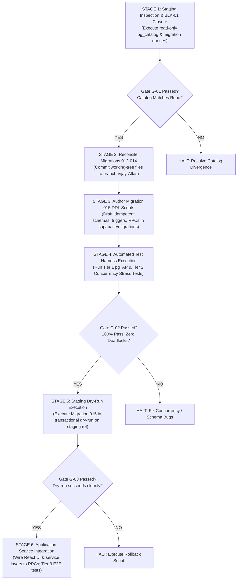

# PHASE 5.0C — IMPLEMENTATION DEPENDENCY & ROLLOUT MAP
## Phased Implementation Roadmap, Blocker BLK-01 Inspection Protocol, Rollout Gates, and Rollback Procedures
**ATLAS OS Multi-Tenant Enterprise SaaS ERP Platform**  
**Classification:** Engineering Roadmap, Rollout Gates & Staging Operations Plan  
**Target Repository:** `D:\Projects\Atlas-OS` | **Branch:** `Vijay-Atlas`  
**Target Staging Ref:** `bwswqnhlebbzdxumlkih` | **Production Ref:** `hrxjgbupjtikokqxjzbh` (STRICTLY FORBIDDEN)

---

## 1. Executive Summary & Implementation Phasing

Moving from the completed architecture specification to database implementation requires a disciplined, gated rollout. 

Attempting to apply Migration 015 without first resolving the unverified remote status of Migrations 012–014 or without running pre-deployment test suites risks catastrophic catalog divergence, corrupting the staging environment.

This document establishes the **6-Stage Implementation Roadmap**, provides the **exact read-only SQL verification script to resolve Blocker BLK-01**, and defines the **Rollback and Fallback Protocols** for future deployment.

---

## 2. 6-Stage Implementation Roadmap



---

### 2.1 Stage Breakdown & Gating Dependencies

```
┌────────────────────────────────────────────────────────────────────────────────────────────────────────────────────────┐
│                                       STAGE IMPLEMENTATION & GATING MATRIX                                             │
├───────┬─────────────────────────────┬────────────────────────────────────┬─────────────────────────────────────────────┤
│ Stage │ Stage Scope & Objectives    │ Prerequisites & Input Artifacts    │ Mandatory Exit Gate Criteria                │
├───────┼─────────────────────────────┼────────────────────────────────────┼─────────────────────────────────────────────┤
│ **S-1 │ Staging Catalog Inspection  │ User authorization to run read-only│ Blocker BLK-01 cleared; exact state of      │
│       │ & Blocker BLK-01 Closure    │ SQL query on `bwswqnhlebbzdxumlkih`│ migrations 001–014 on staging confirmed.    │
├───────┼─────────────────────────────┼────────────────────────────────────┼─────────────────────────────────────────────┤
│ **S-2 │ Working-Tree Reconciliation │ Stage 1 catalog report; untracked  │ Migrations 012, 013, 014 committed cleanly  │
│       │ (Migrations 012–014)        │ migration files in workspace.      │ to git on branch `Vijay-Atlas`.             │
├───────┼─────────────────────────────┼────────────────────────────────────┼─────────────────────────────────────────────┤
│ **S-3 │ Author Migration 015 DDL    │ Master Spec; State Machine Catalog;│ File `015_enterprise_governance_and_...sql` │
│       │ & Rollback Scripts          │ Concurrency Contract.              │ authored with 100% idempotent SQL.          │
├───────┼─────────────────────────────┼────────────────────────────────────┼─────────────────────────────────────────────┤
│ **S-4 │ 3-Tier Pre-Deployment Test  │ Migration 015 DDL; Tier 1 (pgTAP)  │ 100% pass rate in pgTAP; zero deadlocks     │
│       │ Harness Execution           │ and Tier 2 (k6 concurrency) suites.│ (`40P01` = 0) in 20-worker stress tests.    │
├───────┼─────────────────────────────┼────────────────────────────────────┼─────────────────────────────────────────────┤
│ **S-5 │ Staging Dry-Run Execution   │ Stage 4 test sign-off; staging     │ Migration 015 executes within `BEGIN...`    │
│       │ & Verification              │ database ref `bwswqnhlebbzdxumlkih`│ `ROLLBACK` dry-run, then deployed cleanly.  │
├───────┼─────────────────────────────┼────────────────────────────────────┼─────────────────────────────────────────────┤
│ **S-6 │ Application UI & Service    │ Staging Migration 015 deployed;    │ Tier 3 E2E Playwright tests pass; frontend  │
│       │ Layer Integration           │ RPC schemas verified.              │ wired to `create_invoice_with_items`, etc.  │
└───────┴─────────────────────────────┴────────────────────────────────────┴─────────────────────────────────────────────┘
```

---

## 3. Protocol for Closing Blocker BLK-01 (Staging Catalog Inspection)

To resolve Blocker BLK-01 without modifying database state or leaking secrets, the following read-only SQL script must be executed against staging project `bwswqnhlebbzdxumlkih` when authorized:

```sql
-- ============================================================================
-- ATLAS OS — READ-ONLY STAGING CATALOG INSPECTION SCRIPT (CLOSING BLK-01)
-- Project Ref: bwswqnhlebbzdxumlkih | STRICTLY READ-ONLY (NO MUTATIONS)
-- ============================================================================

-- 1. Check applied migration history
SELECT version, inserted_at 
FROM supabase_migrations.schema_migrations 
ORDER BY version ASC;

-- 2. Check existence of operational tables
SELECT table_name 
FROM information_schema.tables 
WHERE table_schema = 'public' 
  AND table_name IN (
    'organizations', 'memberships', 'products', 'customers', 
    'suppliers', 'stock_movements', 'quotations', 'invoices', 
    'payments', 'document_sequences', 'audit_events'
  )
ORDER BY table_name;

-- 3. Check for Migration 012–014 RPCs and triggers
SELECT routine_name, routine_type 
FROM information_schema.routines 
WHERE routine_schema = 'public' 
  AND routine_name IN (
    'create_organization_with_owner',
    'get_user_organizations',
    'check_business_eligibility'
  );

-- 4. Check RLS status across public tables
SELECT tablename, rowsecurity 
FROM pg_tables 
WHERE schemaname = 'public';
```

---

## 4. Migration 015 Rollback & Fallback Procedures

In the event that Migration 015 encounters unexpected errors during staging execution, the following structured rollback procedure applies:

### 4.1 Rollback Sequence Specification (`015_down.sql`):
1. **Drop Triggers:**
   ```sql
   DROP TRIGGER IF EXISTS trg_assert_primary_owner_exists ON public.organization_ownership;
   DROP TRIGGER IF EXISTS trg_prevent_financial_mutation ON public.invoices;
   DROP TRIGGER IF EXISTS trg_prevent_audit_tampering ON public.audit_events;
   ```
2. **Drop Functions:**
   ```sql
   DROP FUNCTION IF EXISTS public.fn_assert_exactly_one_primary_owner();
   DROP FUNCTION IF EXISTS public.create_invoice_with_items(JSONB);
   DROP FUNCTION IF EXISTS public.accept_ownership_transfer(UUID);
   ```
3. **Drop Constraints & Indexes:**
   ```sql
   DROP INDEX IF EXISTS public.uq_single_primary_owner;
   ALTER TABLE public.document_sequences DROP CONSTRAINT IF EXISTS uq_document_sequences_partition;
   ```
4. **Drop New Tables:**
   ```sql
   DROP TABLE IF EXISTS public.approval_decisions CASCADE;
   DROP TABLE IF EXISTS public.approval_requests CASCADE;
   DROP TABLE IF EXISTS public.approval_rules CASCADE;
   DROP TABLE IF EXISTS public.ownership_transfers CASCADE;
   DROP TABLE IF EXISTS public.organization_ownership CASCADE;
   DROP TABLE IF EXISTS public.user_branch_assignments CASCADE;
   DROP TABLE IF EXISTS public.branches CASCADE;
   DROP TABLE IF EXISTS public.custom_roles CASCADE;
   ```

### 4.2 Data Integrity Rollback Safeguard:
- If rolling back in an environment that has already accumulated operational data, **NEVER DROP TABLES CONTAINING LIVE FINANCIAL RECORDS**. 
- Rollback must be gated by a verification query confirming `SELECT count(*) FROM public.organization_ownership` is zero or matches pre-migration counts.
