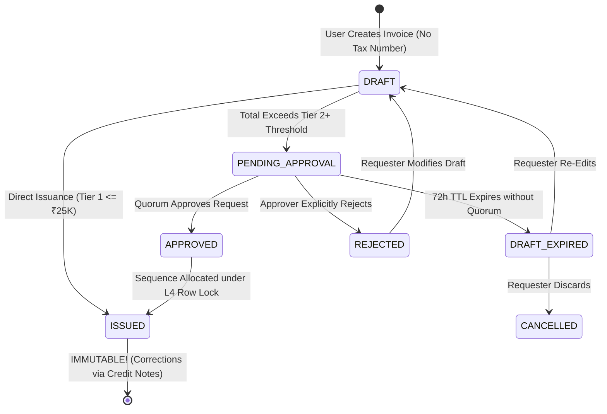
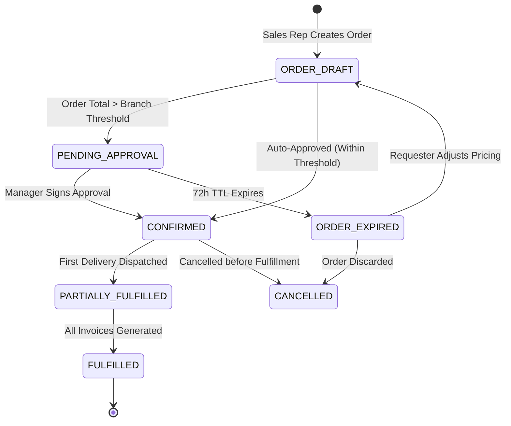
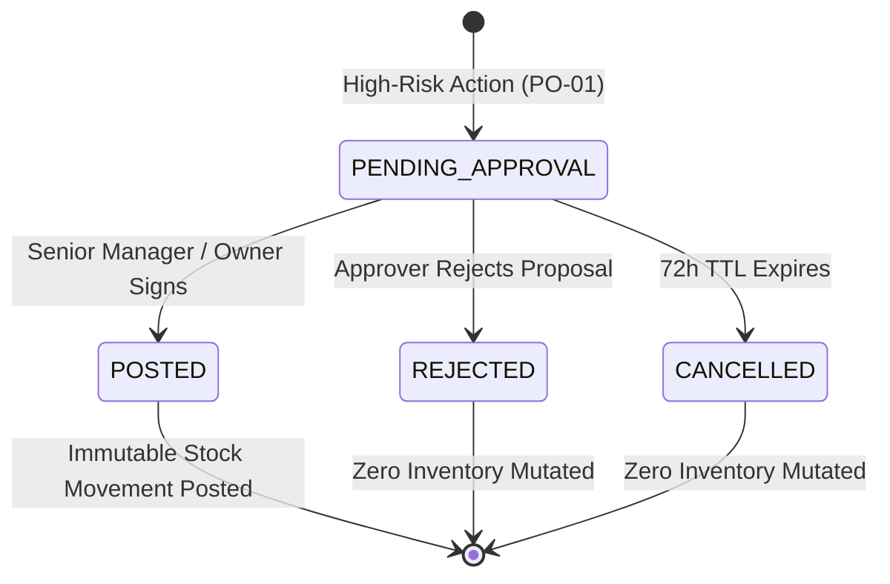
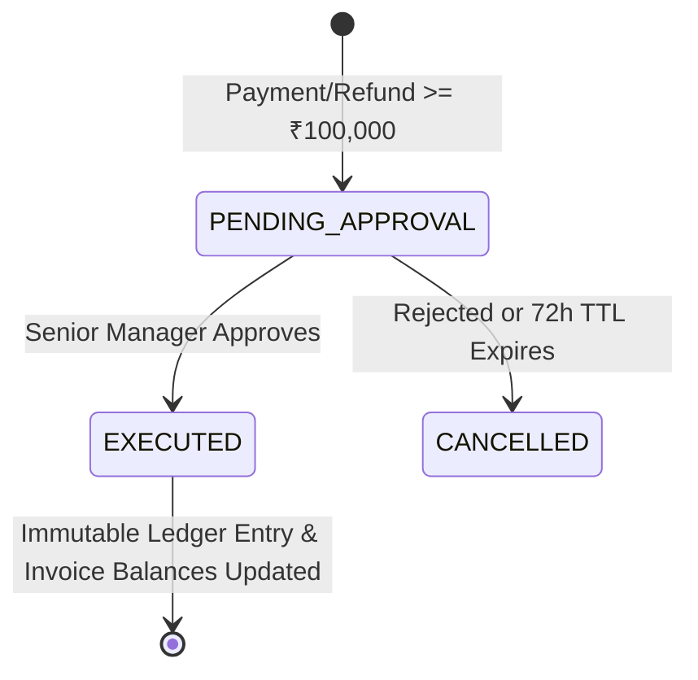
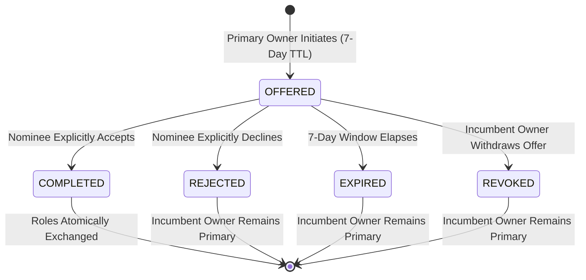

# PHASE 5.0C — STATE MACHINE & TRANSACTION CATALOG
## Authoritative Document Lifecycles, Atomic Transaction Boundaries, and Idempotency Specifications
**ATLAS OS Multi-Tenant Enterprise SaaS ERP Platform**  
**Classification:** Business Logic, Transaction & State Machine Specification  
**Target Repository:** `D:\Projects\Atlas-OS` | **Branch:** `Vijay-Atlas`  
**Target Staging Ref:** `bwswqnhlebbzdxumlkih` | **Production Ref:** `hrxjgbupjtikokqxjzbh` (STRICTLY FORBIDDEN)

---

## 1. Executive Summary & Lifecycle Invariants

This catalog formally defines the discrete lifecycle state machines, atomic database transaction boundaries, and idempotency contracts for all core operational entities in ATLAS OS.

### Universal Lifecycle Invariants:
1. **Type-Specific State Machines:** Generic state reuse is strictly prohibited. An invoice, sales order, payment, stock adjustment, and ownership transfer each follow independent, formally verified state machines.
2. **Zero Silent Approvals:** Approval request expiration (72h default TTL) transitions the request to `EXPIRED`. It **NEVER** automatically approves or posts a transaction.
3. **No Reversion of Issued Financial Documents:** Once an invoice has been assigned a sequential tax invoice number and published (`status = 'ISSUED'`), it **CAN NEVER REVERT TO DRAFT** or be modified. Corrections require an official Credit Note under Section 34 of the CGST Act 2017.
4. **All-or-Nothing Atomic Execution:** Operations modifying multiple tables (header, items, inventory, sequence, customer balance, audit trail) must commit within a single PostgreSQL database transaction.

---

## 2. Discrete Entity State Machines

### 2.1 Entity A: Sales Tax Invoices (Draft vs Issued)



- **States:**
  - `DRAFT`: Initial preparation state. `invoice_number = NULL`. Zero inventory deducted. Zero customer balance applied.
  - `PENDING_APPROVAL`: Commercial draft locked pending management sign-off. Zero sequence number consumed.
  - `DRAFT_EXPIRED`: 72-hour window elapsed. Draft unlocked for editing; zero sequence consumed.
  - `APPROVED`: Sign-off complete. Ready for sequence number allocation.
  - `ISSUED`: Official tax invoice allocated consecutive number from `document_sequences` under row lock. Inventory deducted in `stock_movements`, customer balance incremented, immutable triggers activated. **CANNOT BE MUTATED OR RETURNED TO DRAFT.**

---

### 2.2 Entity B: Sales Orders (Commercial Commitments)



- **States:**
  - `ORDER_DRAFT`: Sales order being drafted. Soft reservation on inventory.
  - `CONFIRMED`: Committed order. Hard stock reservation placed. Ready for fulfillment.
  - `ORDER_EXPIRED`: Approval expired; soft stock reservations automatically released.

---

### 2.3 Entity C: Physical Inventory Stock Adjustments & Write-Offs



- **Critical Invariant:** While in `PENDING_APPROVAL`, zero rows are written to `public.stock_movements`. Physical inventory balances reported by `get_product_stock` remain untouched. Only upon transitioning to `POSTED` are stock movement rows written.

---

### 2.4 Entity D: High-Value Customer Payments & Allocations



- **Critical Invariant:** If approval expires, the payment proposal is marked `CANCELLED`. Zero ledger lines are written to `payments`, and zero balance adjustments are made to `invoices`.

---

### 2.5 Entity E: Two-Phase Primary Owner Transfer Protocol



- **Handshake Invariant:** The incumbent Primary Owner remains fully vested with all legal, tax, and governance responsibilities until the nominee explicitly executes `accept_ownership_transfer`.

---

### 2.6 Entity F: User Deprovisioning State Machine

```mermaid
stateDiagram-v2
    [*] --> INITIATED: Deprovisioning Requested (Admin or Self)
    INITIATED --> AUTH_LOCKED: GoTrue Identity Disabled; Sessions Killed
    AUTH_LOCKED --> MEMBERSHIPS_SEVERED: Operational Roles Set DEACTIVATED
    MEMBERSHIPS_SEVERED --> COMPLETED: Profile Sanitized; Ledgers Preserved
    INITIATED --> FRAUD_HELD: Dispute Raised (is_disputed = TRUE)
    FRAUD_HELD --> INITIATED: Dispute Cleared by Compliance
    FRAUD_HELD --> CANCELLED: Deprovisioning Aborted
```



- **Deprovisioning Invariant:** Transition to `MEMBERSHIPS_SEVERED` is blocked if the user is currently the active Primary Owner of any organization. Historical transactions retain user attribution via bare UUIDs (`created_by`, `actor_id`).

---

## 3. Atomic Database Transaction Boundaries

Multi-request client operations create critical partial-failure risks (e.g., invoice row inserted, but network drop prevents line items from being inserted). ATLAS OS consolidates these operations into atomic stored procedures:

```
┌────────────────────────────────────────────────────────────────────────────────────────────────────────────────────────┐
│                                       ATOMIC TRANSACTION BOUNDARY CATALOG                                              │
├────┬─────────────────────────────┬────────────────────────────────────┬────────────────────────────────────────────────┤
│ #  │ Multi-Table Operation       │ Potential Partial-Failure Vulnerab.│ Unified Atomic Stored Procedure (RPC)          │
├────┼─────────────────────────────┼────────────────────────────────────┼────────────────────────────────────────────────┤
│ 01 │ Invoice Creation with Items │ Invoice created without line items;│ `public.create_invoice_with_items(...)`        │
│    │ & Stock Deduction           │ items inserted without stock deduction;  Single transaction creates invoice header, │
│    │                             │ sequence consumed but items fail.  │ line items, customer balance, stock deduction. │
├────┼─────────────────────────────┼────────────────────────────────────┼────────────────────────────────────────────────┤
│ 02 │ Payment Recording and       │ Payment created but unallocated;   │ `public.record_payment_and_allocate(...)`      │
│    │ Invoice Allocation          │ invoice balance updated twice on   │ Single transaction locks invoices, inserts     │
│    │                             │ client retry; overpayment error.   │ payment, updates balances, inserts allocations.│
├────┼─────────────────────────────┼────────────────────────────────────┼────────────────────────────────────────────────┤
│ 03 │ Primary Owner Transfer      │ Nominee promoted but incumbent not │ `public.accept_ownership_transfer(...)`        │
│    │ Handshake Execution         │ demoted (multi-owner corruption);  │ Single transaction acquires org lock, demotes  │
│    │                             │ incumbent demoted without nominee. │ old owner, promotes new owner, updates status. │
├────┼─────────────────────────────┼────────────────────────────────────┼────────────────────────────────────────────────┤
│ 04 │ Branch Stock Transfer       │ Stock deducted from Source Branch  │ `public.transfer_branch_stock(...)`            │
│    │ (Dispatch & Receipt)        │ but network fails before receipt   │ Atomic transaction locks both product rows,    │
│    │                             │ recorded at Destination Branch.    │ writes paired `TRANSFER_OUT` & `TRANSFER_IN`.  │
└────┴─────────────────────────────┴────────────────────────────────────┴────────────────────────────────────────────────┘
```

---

## 4. Idempotency Contract & Replay Handling

To protect against network disconnects, browser refreshes, and automated client retries during financial operations:

```
┌────────────────────────────────────────────────────────────────────────────────────────────────────────────────────────┐
│                                       IDEMPOTENCY EXECUTION STATE MACHINE                                              │
└────────────────────────────────────────────────────────────────────────────────────────────────────────────────────────┘

    Client Request: `POST /rpc/create_invoice_with_items`
    Headers: `Idempotency-Key: 7b8e-4a11-8209-fa9831`
                         │
                         ▼
    ┌────────────────────────────────────────────────────────────────────────┐
    │ Check `public.idempotency_keys` table under row lock                   │
    └────────────────────┬───────────────────────────────────────────────────┘
                         │
         ┌───────────────┴───────────────┐
         │ Does Key Exist for Org?       │
         ▼                               ▼
       [ YES ]                         [ NO ]
         │                               │
         ▼                               ▼
    ┌───────────────────────────┐   ┌────────────────────────────────────────┐
    │ Compare Request Hashes:   │   │ Insert idempotency record:             │
    │ SHA256(IncomingPayload)   │   │ status = 'PROCESSING', expires_at = +48h│
    │ vs Stored Hash            │   └───────────────────┬────────────────────┘
    └────────────┬──────────────┘                       │
                 │                                      ▼
         ┌───────┴───────┐                  ┌────────────────────────┐
         │ Hash Matches? │                  │ Execute Atomic RPC     │
         ▼               ▼                  └───────────┬────────────┘
       [ YES ]         [ NO ]                           │
         │               │                              ▼
         │               ▼                  ┌────────────────────────┐
         │       ┌───────────────┐          │ Record Response Body:  │
         │       │ Return 409    │          │ status = 'COMPLETED',  │
         │       │ Conflict: Key │          │ response_payload = ... │
         │       │ Reused with   │          └───────────┬────────────┘
         │       │ Diff Payload  │                      │
         │       └───────────────┘                      ▼
         ▼                                  ┌────────────────────────┐
    ┌───────────────────────────┐           │ Return Response to Web │
    │ Replay Cached Response:   │◄──────────┤ Client (HTTP 200/201)  │
    │ Return stored payload     │           └────────────────────────┘
    │ Zero duplicate execution! │
    └───────────────────────────┘
```

### 4.1 Idempotency Table Schema Specification
```sql
CREATE TABLE public.idempotency_keys (
    id UUID PRIMARY KEY DEFAULT gen_random_uuid(),
    organization_id UUID NOT NULL REFERENCES public.organizations(id) ON DELETE CASCADE,
    idempotency_key TEXT NOT NULL,
    endpoint_name TEXT NOT NULL,
    request_hash TEXT NOT NULL,
    status TEXT NOT NULL CHECK (status IN ('PROCESSING', 'COMPLETED', 'FAILED')),
    response_payload JSONB,
    created_at TIMESTAMPTZ NOT NULL DEFAULT NOW(),
    expires_at TIMESTAMPTZ NOT NULL DEFAULT (NOW() + INTERVAL '48 hours'),
    CONSTRAINT uq_org_idempotency_key UNIQUE (organization_id, idempotency_key)
);
```

### 4.2 Handling Partial Failures and Replays:
1. **Identical Replay:** If an identical request arrives while `status = 'COMPLETED'`, the cached `response_payload` is returned immediately without re-executing any business logic or sequence allocation.
2. **Key Tampering / Collision:** If a request arrives with a matching key but differing payload hash, the server immediately rejects the request with HTTP `409 Conflict` (SQLSTATE `23505`).
3. **In-Flight Concurrent Request:** If a request arrives while `status = 'PROCESSING'`, the second worker waits or returns HTTP `429 Too Many Requests` / `409 Concurrent Request in Progress`.
4. **48-Hour Purge TTL:** Scheduled PostgreSQL job (`pg_cron`) purges keys older than 48 hours.
