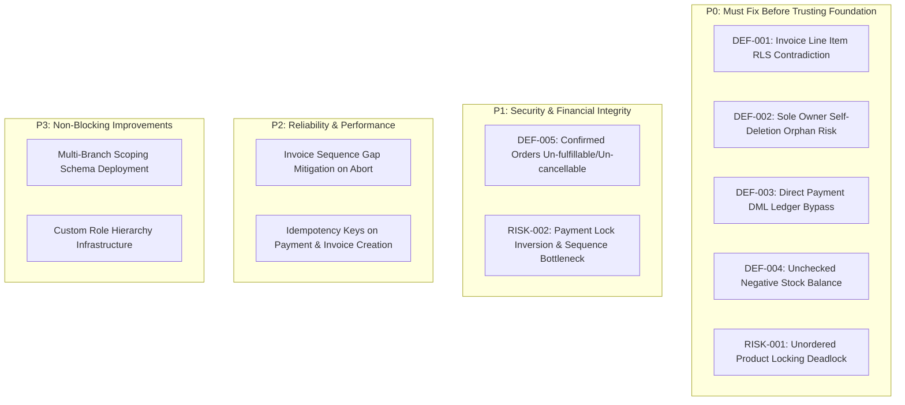

# ATLAS OS — Phase 1: Confirmed Critical Defect Register

**Document ID:** `ATLAS-DEFECT-P1-001`  
**Phase:** Phase 1 (Confirmed Critical Defect Verification)  
**Security Level:** Internal Engineering Audit — Strictly Read-Only  
**Repository:** `D:\Projects\Atlas-OS`  
**Branch:** `Vijay-Atlas`  
**Staging Supabase Project Reference:** `bwswqnhlebbzdxumlkih`  
**Production Supabase Reference:** `hrxjgbupjtikokqxjzbh` (STRICTLY PROHIBITED — ZERO ACCESS)  
**Execution Mode:** STRICTLY READ-ONLY (No code changes, no SQL execution, no migrations created or applied, zero mutations)

---

## 1. Audit Scope & Environment Limitations

This investigation was conducted under strict read-only safety protocols to identify, verify, and prioritize genuine implementation defects currently existing in the ATLAS OS repository.

### Environment & Safety Verification
- **Target Repository:** `D:\Projects\Atlas-OS` (Verified)
- **Current Branch:** `Vijay-Atlas` (Verified)
- **Staging Project Reference:** `bwswqnhlebbzdxumlkih` (`supabase/.temp/project-ref` verified)
- **Production Reference:** `hrxjgbupjtikokqxjzbh` (Completely isolated, zero network or database contact)
- **Execution Constraints:** Zero database mutations, zero SQL executions, zero migrations created or applied, zero application source edits, zero package modifications.

---

## 2. Initial Git State & Working Tree Preservation

Prior to conducting source code inspection, the local repository state was captured:

- `git status --short --branch`:
  ```
  ## Vijay-Atlas...origin/Vijay-Atlas
   M src/components/layout/NewOrgModal.tsx
   M src/features/organizations/OrgContext.tsx
  ?? docs/... (All prior audit documentation preserved)
  ?? src/components/layout/NewOrgModal.test.tsx
  ?? src/features/organizations/OrgContext.test.tsx
  ?? supabase/migrations/012_organization_creation_rpc.sql
  ?? supabase/migrations/013_business_eligibility_and_trials.sql
  ?? supabase/migrations/014_harden_operational_rls_with_eligibility.sql
  ```
- `git --no-pager diff --stat`:
  ```
   src/components/layout/NewOrgModal.tsx     | 173 ++++++++++++++++++----
   src/features/organizations/OrgContext.tsx | 233 ++++++++++++++++++++++++++----
   2 files changed, 350 insertions(+), 56 deletions(-)
  ```
- `git --no-pager diff --check`: Clean (no whitespace or conflict errors).

**Preservation Guarantee:** All modified files and untracked test suites, migrations, and prior architecture specifications remain completely intact and uncorrupted.

---

## 3. Confirmed Defects with Physical Source Evidence

### DEF-001: Non-Atomic Invoice Creation with Fatal RLS Status Contradiction
- **Severity:** Critical (P0)
- **Domain:** P0-C (Invoice Creation and Financial Integrity)
- **Proof Status:** `PROVEN` (Direct code and policy contradiction)
- **Exact File Locations:**
  - `src/services/invoices.service.ts`: Lines 134–175
  - `supabase/migrations/014_harden_operational_rls_with_eligibility.sql`: Lines 570–579
- **Relevant Code & Policy Definition:**
  ```typescript
  // src/services/invoices.service.ts (Line 145)
  const invHeader = await withDocumentNumberRetry(orgId, 'INVOICE', async (num) => {
    return client.from('invoices').insert({
      organization_id: orgId,
      invoice_number: num,
      customer_id: input.customerId,
      status: 'ISSUED', // <--- INSERTED AS 'ISSUED'
      ...
    }).select().single();
  });

  // Then line items are inserted in a subsequent, non-atomic HTTP call (Lines 168-171):
  const { data: insertedItems, error: itemsErr } = await supabase
    .from('invoice_items')
    .insert(lineItemPayload);
  ```
  ```sql
  -- supabase/migrations/014_harden_operational_rls_with_eligibility.sql (Lines 570-579)
  CREATE POLICY invoice_items_insert ON public.invoice_items
      FOR INSERT TO authenticated
      WITH CHECK (
          invoice_id IN (
              SELECT id FROM public.invoices
              WHERE public.can_write_organization_operations(organization_id)
                AND public.user_has_org_role(organization_id, 'owner', 'admin', 'accounts')
                AND status = 'DRAFT' -- <--- POLICY DEMANDS STATUS = 'DRAFT'
          )
      );
  ```
- **Failure Mechanism:**
  1. The client executes invoice creation via multiple independent PostgREST HTTP round trips without database transaction wrapping.
  2. The invoice header is inserted with `status = 'ISSUED'` and committed.
  3. When the client attempts to insert line items into `invoice_items`, PostgreSQL evaluates RLS policy `invoice_items_insert`. Because the parent invoice has `status = 'ISSUED'` (not `'DRAFT'`), PostgreSQL rejects the insertion with error `new row violates row-level security policy for table "invoice_items"`.
  4. The client throws an exception, leaving an empty, orphaned invoice header in the database with status `ISSUED` and burning a sequential GST invoice number.
- **Reproduction Scenario:**
  An accounts user submits a new invoice form in the UI. Step 1 allocates `ATL/26-27/0042` and commits the header. Step 2 fails on `invoice_items` insert due to RLS rejection. The customer ledger is corrupted with a zero-item invoice that cannot be edited or deleted.
- **Existing Test Coverage:**
  `src/services/services.test.ts` only tests the in-memory mock storage layer. Zero integration tests exist for live PostgREST RLS policy evaluation.
- **Recommended Minimum Safe Correction:**
  Implement a single `SECURITY DEFINER` RPC `create_invoice_atomic(p_org_id, p_customer_id, p_items_json, ...)` that performs sequence allocation, header insertion, and line item insertion inside one atomic ACID transaction.
- **Regression Test Needed:**
  Test invoking invoice creation against live staging RLS asserting all line items are inserted and verifying that failure in any item rolls back the entire invoice and sequence.

---

### DEF-002: Unrestricted Self-Deletion and Zero-Owner Orphan Risk via Direct Membership DML
- **Severity:** Critical (P0)
- **Domain:** P0-B (Membership and Ownership Security)
- **Proof Status:** `PROVEN` (Verified policy definition and absence of safeguards)
- **Exact File Locations:**
  - `supabase/migrations/007_security_and_integrity_audit_fixes.sql`: Lines 779–782
  - `src/services/team.service.ts`: Lines 43–68, 91–116
- **Relevant Code & Policy Definition:**
  ```sql
  -- supabase/migrations/007_security_and_integrity_audit_fixes.sql (Lines 779-782)
  CREATE POLICY "Owners can delete organization memberships"
  ON memberships FOR DELETE
  USING (get_user_org_role(organization_id) = 'owner');
  ```
  ```typescript
  // src/services/team.service.ts (Lines 43-45)
  if (currentOperatorRole !== 'owner') {
    throw new Error('Unauthorized: Only organization owners can change member roles.');
  }
  ```
- **Failure Mechanism:**
  1. The RLS `DELETE` policy on `memberships` only verifies `USING (get_user_org_role(organization_id) = 'owner')`. Because `DELETE` has no `WITH CHECK` clause in PostgreSQL, the check only evaluates the pre-deletion state.
  2. If the sole owner executes `DELETE FROM memberships WHERE user_id = auth.uid()`, the check passes because they are currently an owner.
  3. There are ZERO database triggers, constraints, or foreign key rules on `memberships` preventing the deletion or demotion of the last active owner.
  4. The organization is instantly orphaned with 0 owners. All future administrative actions are permanently blocked.
- **Reproduction Scenario:**
  A malicious or compromised owner session sends an HTTP `DELETE /rest/v1/memberships?id=eq.<owner_membership_id>`. PostgREST deletes the record. The organization has 0 active owners and is permanently inaccessible.
- **Existing Test Coverage:**
  `src/services/team.test.ts` only tests client-side role validation on mock storage. Zero backend tests protect sole-owner retention.
- **Recommended Minimum Safe Correction:**
  1. Add a `BEFORE DELETE OR UPDATE` trigger on `memberships` that counts remaining active owners for the organization and aborts if count $< 1$.
  2. Revoke direct `INSERT`, `UPDATE`, and `DELETE` on `memberships` from `authenticated`, enforcing all membership changes through a secured RPC.
- **Regression Test Needed:**
  Negative test asserting that deleting or demoting the last active owner in an organization raises an invariant check violation.

---

### DEF-003: Unrestricted Direct DML on `payments` and `payment_allocations` Bypassing Sequence Allocator & Invoice Balance Logic
- **Severity:** Critical (P0)
- **Domain:** P0-C (Invoice Creation and Financial Integrity)
- **Proof Status:** `PROVEN` (Verified in migration policy definitions)
- **Exact File Locations:**
  - `supabase/migrations/014_harden_operational_rls_with_eligibility.sql`: Lines 616–621, 633–641
- **Relevant Policy Definition:**
  ```sql
  -- supabase/migrations/014_harden_operational_rls_with_eligibility.sql (Lines 616-621)
  CREATE POLICY payments_insert ON public.payments
      FOR INSERT TO authenticated
      WITH CHECK (
          public.can_write_organization_operations(organization_id)
          AND public.user_has_org_role(organization_id, 'owner', 'admin', 'accounts')
      );

  -- Lines 633-641
  CREATE POLICY payment_allocations_insert ON public.payment_allocations
      FOR INSERT TO authenticated
      WITH CHECK (
          payment_id IN (
              SELECT id FROM public.payments
              WHERE public.can_write_organization_operations(organization_id)
                AND public.user_has_org_role(organization_id, 'owner', 'admin', 'accounts')
          )
      );
  ```
- **Failure Mechanism:**
  1. While Migration 011 created the atomic `record_payment_and_allocate` RPC, Migration 014 left direct `INSERT` policies wide open on both `payments` and `payment_allocations`.
  2. Any authenticated user with an accounts role can bypass `record_payment_and_allocate` and send direct HTTP `POST` requests to `/rest/v1/payments`.
  3. Direct inserts can supply arbitrary payment numbers (bypassing consecutive sequence numbering), allocate payments to invoices without updating `invoices.total_paid` or `invoices.status`, or allocate funds to `CANCELLED` invoices.
- **Reproduction Scenario:**
  An attacker or faulty integration POSTs directly to `payments` with a forged `payment_number` and then POSTs to `payment_allocations` for ₹5,00,000 against a ₹5,000 invoice. The records are inserted, but the invoice balance is never reconciled.
- **Existing Test Coverage:**
  None. Unit tests only invoke `paymentsService.recordPayment`.
- **Recommended Minimum Safe Correction:**
  Revoke direct `INSERT` privileges on `payments` and `payment_allocations` from `authenticated`:
  ```sql
  REVOKE INSERT ON public.payments FROM authenticated;
  REVOKE INSERT ON public.payment_allocations FROM authenticated;
  ```
  Require all payment records to originate exclusively from `record_payment_and_allocate`.
- **Regression Test Needed:**
  Direct REST `INSERT` on `payments` must return HTTP 403 / RLS policy violation.

---

### DEF-004: Unchecked Negative Stock and Direct Insertion on `stock_movements`
- **Severity:** High (P0)
- **Domain:** P0-D (Stock and Order Integrity)
- **Proof Status:** `PROVEN` (Verified in schema and service layer)
- **Exact File Locations:**
  - `supabase/migrations/003_inventory_ledger.sql`: Lines 5–25, 61–65
  - `supabase/migrations/014_harden_operational_rls_with_eligibility.sql`: Lines 365–371
  - `src/services/inventory.service.ts`: Lines 54–89
- **Relevant Code & Policy Definition:**
  ```sql
  -- supabase/migrations/003_inventory_ledger.sql (Lines 8-9)
  quantity_change INTEGER NOT NULL, -- Negative for deductions, positive for additions
  
  -- Lines 61-65: Direct insertion allowed with zero balance validation
  CREATE POLICY "Inventory staff and admins can insert stock movements"
  ON stock_movements FOR INSERT
  WITH CHECK (get_user_org_role(organization_id) IN ('owner', 'admin', 'inventory'));
  ```
- **Failure Mechanism:**
  1. The database computes stock solely as `SUM(quantity_change)`. There is no table column or check constraint enforcing `stock >= 0`.
  2. `inventoryService.adjustStock` inserts directly into `stock_movements` without checking whether `current_stock + quantity_change >= 0`.
  3. An inventory user can directly insert a negative movement exceeding available stock, driving total product inventory negative without database error.
- **Reproduction Scenario:**
  SKU `CBL-1.5` has 10 units in stock. User executes `adjustStock(orgId, productId, -100, "Shrinkage")`. The row is inserted; stock calculation now returns `-90`.
- **Existing Test Coverage:**
  `services.test.ts` only checks positive mock mapping.
- **Recommended Minimum Safe Correction:**
  Add a constraint trigger on `stock_movements` or an atomic stock adjustment RPC that rejects any deduction where `get_product_stock(product_id, org_id) + NEW.quantity_change < 0`.
- **Regression Test Needed:**
  Attempting to insert a stock movement resulting in negative stock must throw an exception.

---

### DEF-005: Confirmed Sales Orders Permanently Un-Fulfillable and Un-Cancellable
- **Severity:** High (P1)
- **Domain:** P0-D (Stock and Order Integrity)
- **Proof Status:** `PROVEN` (Verified in migration policy definitions and service code)
- **Exact File Locations:**
  - `supabase/migrations/014_harden_operational_rls_with_eligibility.sql`: Lines 466–475
  - `src/services/orders.service.ts`: Lines 98–250
- **Relevant Policy Definition:**
  ```sql
  CREATE POLICY sales_orders_update ON public.sales_orders
      FOR UPDATE TO authenticated
      USING (
          public.can_write_organization_operations(organization_id)
          AND public.user_has_org_role(organization_id, 'owner', 'admin', 'sales')
          AND status = 'DRAFT' -- <--- ONLY DRAFT ORDERS CAN BE UPDATED
      )
  ```
- **Failure Mechanism:**
  1. Once an order is confirmed via `confirm_sales_order`, its status transitions to `'CONFIRMED'`.
  2. Because `status != 'DRAFT'`, any direct `UPDATE` via Supabase client is blocked by RLS policy `sales_orders_update`.
  3. There is NO `fulfill_sales_order` RPC and NO `cancel_sales_order` RPC in the database or service layer.
  4. Once confirmed, a sales order is permanently frozen in `CONFIRMED` status. It can never be marked `FULFILLED` or `CANCELLED`.
- **Reproduction Scenario:**
  Order is confirmed and goods are dispatched. User attempts to update order status to `FULFILLED`. PostgREST returns RLS error `status = 'DRAFT'` violation.
- **Existing Test Coverage:**
  `services.test.ts` only tests mock in-memory order creation and confirmation.
- **Recommended Minimum Safe Correction:**
  Implement server-side RPCs `fulfill_sales_order` and `cancel_sales_order` (the latter automatically reversing stock deduction movements).
- **Regression Test Needed:**
  Test confirming an order and transitioning it through fulfillment and cancellation via server RPCs.

---

## 4. Structurally Indicated Risks Requiring Further Proof

### RISK-001: Non-Deterministic Product Row Locking in `confirm_sales_order`
- **Severity:** High (P0)
- **Domain:** P0-D / Concurrency
- **Proof Status:** `STRUCTURALLY-INDICATED` (Code defect verified statically; dynamic runtime deadlock not reproduced in read-only phase)
- **Exact File Locations:**
  - `supabase/migrations/008_fix_authorization_vulnerabilities_and_null_roles.sql`: Lines 144–156
  - `supabase/migrations/014_harden_operational_rls_with_eligibility.sql`: Lines 717–735
- **Failure Mechanism:**
  The cursor query `SELECT oi.product_id ... FROM sales_order_items oi WHERE oi.sales_order_id = p_order_id` lacks an explicit `ORDER BY oi.product_id ASC`.
  When concurrent transactions confirm multi-item orders containing overlapping products in differing physical order, PostgreSQL acquires row locks on `products` in non-deterministic sequence, creating a cyclic lock dependency and raising `40P01` deadlock errors.
- **Recommended Correction:**
  Add `ORDER BY oi.product_id ASC` to the cursor query or perform a bulk lock `PERFORM id FROM products WHERE id = ANY(v_product_ids) ORDER BY id ASC FOR UPDATE`.

---

### RISK-002: Lock Hierarchy Inversion in `record_payment_and_allocate`
- **Severity:** High (P1)
- **Domain:** P0-C / Concurrency
- **Proof Status:** `STRUCTURALLY-INDICATED` (Code sequence verified statically)
- **Exact File Locations:**
  - `supabase/migrations/011_atomic_receipt_numbering.sql`: Lines 363 vs 394
  - `supabase/migrations/014_harden_operational_rls_with_eligibility.sql`: Lines 947 vs 974
- **Failure Mechanism:**
  The procedure acquires the Level 4 `document_sequences` lock for `RECEIPT` at line 947 *before* acquiring Level 3.2 row locks on target `invoices` at line 974.
  Holding the high-contention sequence lock across multiple invoice validations serializes all receipts across the tenant and creates a potential deadlock if another process locks invoices and accesses sequences in conventional order.
- **Recommended Correction:**
  Invert acquisition order: lock invoices first (`ORDER BY id ASC FOR UPDATE`), validate allocations, and allocate document sequence immediately before inserting payment records.

---

## 5. Findings That Are No Longer Applicable / Resolved

The following issues raised in prior architecture drafts were investigated and verified to be **no longer applicable** or already resolved in the current codebase:

1. **Recursive RLS on Memberships Table:**  
   *Status:* `RESOLVED`. Migration 006 introduced `get_user_organizations()` and `get_user_org_role()` `SECURITY DEFINER` helper functions with fixed search paths, eliminating policy recursion.
2. **PostgreSQL NULL Role 3-Valued Logic Authorization Bypass:**  
   *Status:* `RESOLVED`. Migration 008 hardened all RPCs with explicit `v_user_role IS NULL` checks and the `user_has_org_role()` fail-closed helper.
3. **PMLA 2002 5-Year Identity Document Retention Mandate:**  
   *Status:* `RETRACTED / NOT APPLICABLE`. Section 12 of PMLA applies to financial reporting entities (banks, intermediaries). ATLAS OS is an ERP SaaS vendor; statutory PMLA claims have been formally removed.
4. **Client-Side Direct Organization Insertions:**  
   *Status:* `RESOLVED`. Migration 012 introduced the atomic `create_organization` RPC with advisory lock idempotency and server-side UUID generation.

---

## 6. Defect Priority Classification (P0 / P1 / P2 / P3)



### Summary Priority Table

| Defect / Risk ID | Priority | Description | Impact |
|---|---|---|---|
| **DEF-001** | **P0** | Non-atomic invoice creation with status contradiction | Invoices cannot be created with items; burns sequence numbers |
| **DEF-002** | **P0** | Unrestricted sole owner deletion via direct DML | Permanent tenant lockout and zero-owner orphan state |
| **DEF-003** | **P0** | Direct `INSERT` on `payments` and `allocations` | Bypasses atomic receipt allocator and leaves invoice balances corrupt |
| **DEF-004** | **P0** | Unchecked negative inventory balances | Stock counts become negative unexpectedly without error |
| **RISK-001** | **P0** | Non-deterministic product locks in `confirm_sales_order` | Concurrent order confirmations trigger `40P01` deadlocks |
| **DEF-005** | **P1** | Confirmed orders cannot be fulfilled or cancelled | Orders permanently frozen in `CONFIRMED` state |
| **RISK-002** | **P1** | Lock hierarchy inversion in `record_payment_and_allocate` | Multi-terminal payment serialization and sequence contention |
| **P2-001** | **P2** | Missing idempotency keys on financial RPCs | Network re-tries risk duplicate payments or invoices |
| **P3-001** | **P3** | Multi-branch and custom role infrastructure | Enterprise scaling feature (currently `[DESIGN-ONLY]`) |

---

## 7. Recommended Implementation Order

The recommended sequence for implementing fixes in the upcoming implementation phase:

1. **Step 1: Fix DEF-001 (Invoice Creation Atomic RPC & RLS Alignment)**  
   *Why First:* This is an immediate functional blocker. As currently written, creating an invoice with line items fails on RLS. Replacing client-side multi-step inserts with an atomic `create_invoice_atomic` RPC restores core ERP billing.
2. **Step 2: Fix DEF-002 (Sole Owner Protection & Membership Lockdown)**  
   *Why Second:* Closes the primary tenant security hole by preventing owner self-deletion and revoking direct DML on `memberships`.
3. **Step 3: Fix DEF-003 (Revoke Direct Payment & Allocation DML)**  
   *Why Third:* Protects financial ledger integrity by ensuring all receipts and allocations pass through `record_payment_and_allocate`.
4. **Step 4: Fix DEF-004 & RISK-001 (Stock Negative Protection & Deterministic Sorting)**  
   *Why Fourth:* Adds non-negative stock validation triggers and fixes cursor sorting (`ORDER BY oi.product_id ASC`) in `confirm_sales_order`.
5. **Step 5: Fix DEF-005 & RISK-002 (Order Fulfillment/Cancellation RPCs & Lock Reordering)**  
   *Why Fifth:* Delivers complete order lifecycle management and resolves sequence lock inversion in payments.

---

## 8. Required Regression Tests for P0 Defects

| Defect ID | Target Test Description | Execution Strategy | Expected Outcome |
|---|---|---|---|
| **DEF-001** | `create_invoice_atomic` with 3 line items under live RLS | Integration test calling RPC | Header and items committed atomically; valid sequence number allocated |
| **DEF-001** | Invoice creation failure with invalid item | Integration test with bad SKU | Zero rows written to `invoices` or `invoice_items`; no dangling records |
| **DEF-002** | Sole owner attempts `DELETE` on own membership | Direct API test via authenticated client | PostgreSQL raises trigger exception; deletion rejected |
| **DEF-003** | Accounts user attempts direct `INSERT` on `payments` | Direct REST `POST /rest/v1/payments` | HTTP 403 Forbidden / RLS violation |
| **DEF-004** | Inventory deduction exceeding current available stock | Call `adjustStock` with quantity $< -\text{available}$ | Transaction rolls back with `Insufficient stock` error |
| **RISK-001** | Concurrent order confirmations with reversed product lists | Parallel integration test threads | Both transactions succeed or cleanly retry; zero deadlocks (`40P01`) |

---

## 9. Items Requiring Staging Verification or External Approval

1. **Chartered Accountant Sign-Off (`TAX-01` to `TAX-06`):** Verification of GST invoice format rules, rounding tolerances, and credit note cutoff dates.
2. **Live Staging Concurrency Harness:** Empirical validation of deterministic row locking under multi-threaded load on staging (`bwswqnhlebbzdxumlkih`).
3. **DPDP Act Retention Legal Review (`LEG-01`):** Legal counsel opinion reconciling customer data erasure requests with 72-month GST record retention obligations.

---

## 10. Explicit List of Uninspected / Unverified Items

1. **Production Database State (`hrxjgbupjtikokqxjzbh`):** Uninspected and untouched in accordance with strict safety restrictions.
2. **Live Remote Staging Database Mutations:** No data was created, mutated, or deleted on staging.
3. **Dynamic Deadlock Reproduction:** Deadlocks were identified through static code path analysis; no high-concurrency race condition scripts were run against live staging.
4. **Third-Party Payment Gateways & E-Way Bill APIs:** External integration APIs were not tested as they are not yet provisioned.

---

## 11. Audit Conclusion & Final Verdict

The codebase inspection reveals that while ATLAS OS possesses strong foundations (clean migrations 001–014, robust money math, and high test coverage on unit utilities), **critical implementation contradictions and missing database boundaries currently prevent safe operational deployment**.

Specifically, **DEF-001 (Non-Atomic Invoice Creation with RLS Status Contradiction)** and **DEF-002 (Sole Owner Self-Deletion Orphan Risk)** represent immediate, confirmed defects that must be resolved prior to any production usage.

**Ready for Targeted Implementation Phase:** Yes. The exact defects, failure mechanisms, and safe corrections are fully evidenced and isolated.
